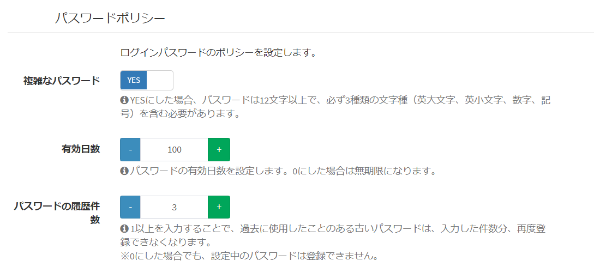

# Login settings
This page decides the rules for logging in to Exment. You can set the rules of passwords (the password policy) and two-factor authentication.  
How to reset a password by a command is also on this page.

> For the settings and explanations of SSO, see [here](/login_sso).


## Two-step certification
Exment supports two-factor authentication.  
After you enter your user information and log in, you enter the code that arrived by email or the code shown in Google Authenticator, and then you can use Exment.  
Note: two-factor authentication can be used when the login method is "Standard" or "LDAP".

- [Two-factor authentication system settings](/login_2factor_setting)
- [Login (two-factor authentication)](/login_2factor)


## Login setting management method

- The system administrator opens the following URL.  
http(s)://(Exment URL)/login_setting  
Note: you can access it after doing the "system setting change" described above.

> Note: the URLs are for the default without "/admin" (a site newly installed with v7.2.1 or later). If `ADMIN_ROUTE_PREFIX` in `.env` has a value (a site installed with an older version has "admin"), add it after the URL of the site (e.g. `http(s)://(Exment URL)/admin/oauth/token`). For details, see [Change / delete "admin" included in URL](/additional_prefix).

- From v7.1.0, you can also open it from "Admin Setting" → "Login Setting" in the left menu.
- In v7.0 and earlier, "Login Setting" is not in the menu at first. To add it to the menu, open the "Admin Setting" > "Menu" page and select the menu type "System Menu". "Login Setting" appears as a target; select it and save.

  

- Set up two-factor authentication by the steps of the following page.

    - [Two-factor authentication system settings](/login_2factor_setting)


### Password policy settings
Decide the rules about login passwords.   

  

#### Complex password
- When YES, a password must have 12 characters or more and contain three or more types of characters (half-width uppercase letters, half-width lowercase letters, half-width numbers, half-width symbols).
- The initial value is "NO".

#### Effective days
- At the first login after the set number of days has passed, the password change screen appears. Change your password and then log in again.
- When the number of days is "0", the password never expires.
- The initial value is "0".

#### Have the password changed when logging in for the first time
- When YES, the screen for changing the password appears when a user logs in for the first time.
- It applies to users newly added, and users whose password was reset, after this setting was set to YES.
- Users who were newly added and so on before it was set to YES are not covered.
- The initial value is "NO".

#### Number of password history records
- Stops recently used passwords from being used again. When the new password is the same as one of the passwords in the latest history records, it is an error.
- When the number of history records is "0", the passwords are not compared.
- The initial value is "0".

#### Password length (v7.3.0 and later)
- A password has 8 to 64 characters. The maximum length is 64 from v7.3.0 (it was 32). Long pass phrases can be used.
- The length and the usable characters can be changed in `.env`. See "Password" in the [list of settings](/config).

#### Initial values for a new site (v7.3.0 and later)
- When `.env` has `EXMENT_PASSWORD_POLICY_NEW_SITE=true`, a newly created site starts with these settings.
    - Complex password: YES
    - Have the password changed when logging in for the first time: YES
    - Number of password history records: 5
- The effective days stay "0".
- A site that already exists is not changed. You can change them later on this screen.

#### Note

- <span class="small">"Complex Password" and "Number of Password History" are used when users decide their password themselves, on the user setting screen, the password reset screen and so on. They do not apply when a system administrator decides the password.</span>


### Logins from a new place (v7.3.0 and later)
Tells the user when a login comes from an IP address that is not usual.

- **Tell the user of a login from a new IP address**
    - When YES, the user gets a notification if the IP address was not used for a login of the same user in the last 90 days.
    - The first login of a user is not told.
    - The initial value is "NO".
- **Also send a mail**
    - Shown when "Tell the user of a login from a new IP address" is YES. When YES, the notice is also sent to the mail address of the user.
    - The initial value is "NO".

> When you use Exment behind a load balancer or a reverse proxy, set `ADMIN_TRUST_PROXY_IPS` in `.env`. If not, the recorded IP address is the proxy's. See [Settings when using a reverse proxy](/additional_reverse_proxy).


### My login history (v7.3.0 and later)
Users can check their own logins. "My login history" is shown under the Login User Setting (the user menu at the top right → "Login User Setting").

- The latest 20 logins of your own account are shown.
- You can see the date and time, the result, the IP address and the browser.
- If there is a login you do not know, change your password and tell the system administrator.


### Other
- After an update from a version lower than v3.3.0 to v3.3.0 or higher, logging in with a provider whose user code contains a "dot (.)" can end in an error.  
In that case, fix it as follows.
    - In "Column Detail Setting" of the "User" table, open the edit screen of the "User Code" column.
    - In the "Available Characters" option, check "Dot" and save.


- With the first settings, even if you close the browser while logged in, you stay logged in until a certain time (120 minutes) has passed.  
From v3.6.0, you can have users logged out automatically when the browser is closed. Open the ".env" file and add the following.  
Note: see [Setting value list](/config) for how to edit the setting file.

~~~
EXMENT_SESSION_EXPIRE_ON_CLOSE=true
~~~


## Password reset command
You can reset the password of a user by a command.

- The system administrator runs the following command on the console.

~~~
php artisan exment:resetpassword --email=foobar@test.com --password=P@ssw0rd!
~~~

- This command sets the password "P@ssw0rd!" for the user whose email address is "foobar@test.com".


### Command arguments

```
exment:resetpassword {--id=} {--email=} {--user_code=} {--password=} {--random=0} {--send=0} {--reset_first_login=0}
```

#### Arguments: User specified
Note: one of the following arguments is required. When several are given, the user is looked up in the priority order id > email > user_code.

- ##### id
The login ID of the target user.

- ##### email
The email address of the target user.

- ##### user_code
The user code of the target user.


#### Arguments: Password
Note: give either "password" or "random=1". When both are given, "password" takes priority.

- ##### password  
Give the string of the new password.

- ##### random  
Give 1 to make the password at random. 0 if not given.

#### Arguments: Optional

- ##### send  
Give 1 to send the new password to the target user by email. 0 if not given.

- ##### reset_first_login  
After the password is changed, the screen for changing the password appears when the user logs in for the first time. 0 if not given.  
Note: even without this option, if "Change Password at First Login" is YES in the login settings, the screen for changing the password appears when the user logs in for the first time.

### Notices
- When "random=1" is given and "send=1" is not, the new password is shown on the console after the reset.


### Command execution example

~~~
# Example: reset for the user with id 1, giving the password
php artisan exment:resetpassword --id=1 --password=P@ssw0rd!

# Example: set a random password for the user with user code "user1" and send an email
php artisan exment:resetpassword --user_code=user1 --random=1 --send=1

# Example: set a random password for the user with email address "foobar@test.com"
php artisan exment:resetpassword --email=foobar@test.com --random=1
Executed password reset. A new password is : XXXXXXXXXX #The new password is shown on the console
~~~
