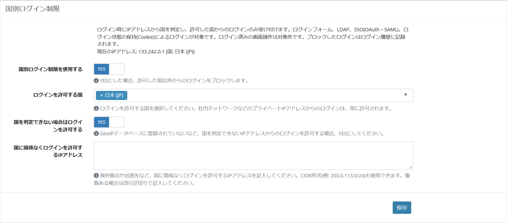
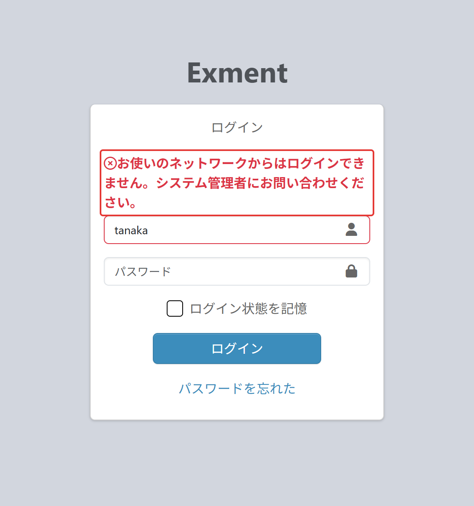
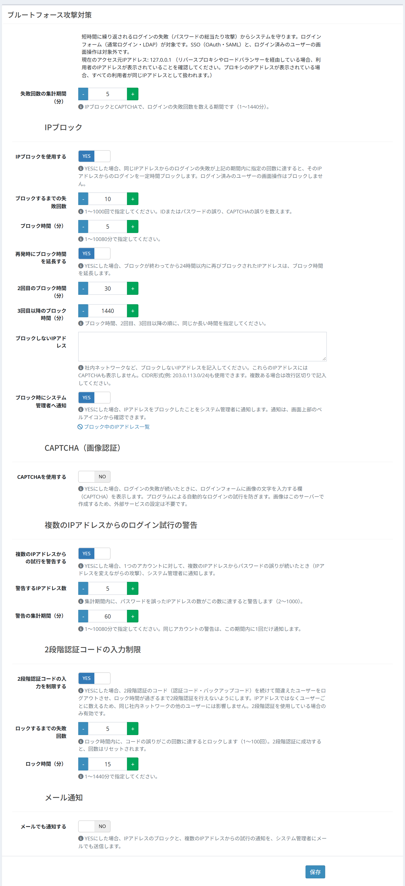
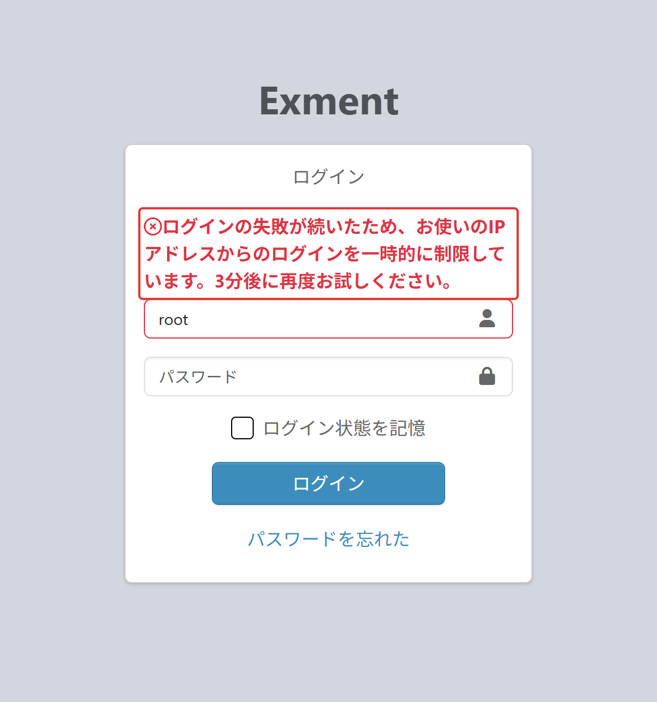
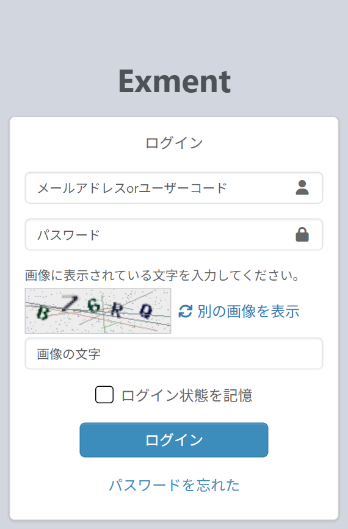
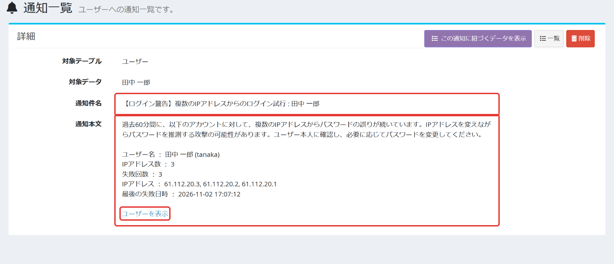

# Login settings
Make various login settings when logging in to Exment.

> Please check [here](/login_sso) for settings and explanations related to SSO.


## Two-step certification
Exment supports two-step authentication.  
After entering your user information and logging in, you will be able to access the Exment by entering the code sent by email or the Google Authenticator.  
※2-step authentication can be used when the login method is "Standard" or "LDAP".  

- [Two-step authentication system setting](/login_2factor_setting)
- [Login (2-step authentication)](/login_2factor)

## Login setting management method

- The system administrator enters the following URL.
http (s): // (Exment URL) / admin / log_setting
* You will be able to access by changing the "system settings" described above.

--Alternatively, add "Login Settings" to the menu.
Open the "Administrator Settings"> "Menu" page and select the menu type "System Menu". The target "Login Settings" will be displayed. Select it and save it.
※"Login settings" is not displayed in the menu by default.


- To manage 2-step authentication, follow the procedure on the following page to make the settings.

    - [Two-step authentication system setting](/login_2factor_setting)


### Password policy settings
Set rules related to login passwords.


#### Complex password
- If the setting is YES, you need to set a password of 12 characters or more including 3 or more character types (half-width uppercase letters, half-width lowercase letters, half-width numbers, half-width symbols).
- The initial value is "NO".

#### Effective days
- If you log in for the first time after the specified number of days, you will be directed to the password change screen.  
Please change your password and then log in again.  
- If you set the number of valid days to "0", the password will never expire.  
- The initial value is "0".  

#### Have the password changed when logging in for the first time
- If set to YES, the screen for changing the password will be displayed when the user logs in for the first time.  
- This will be valid for users who have newly registered or reset their password after setting this setting to YES.  
- The setting will not be reflected to users who newly registered before setting this setting to YES.  
- The initial value is "NO".  

#### Number of password history records
- Restrict the reuse of recently used passwords.  
If the new password is compared with the password for the latest to the number of history records and they are the same, an error will occur.  
- If the number of history records is set to "0", it will not be compared.  
- The initial value is "0".  

#### Note

- <span class = "small"> "Complex password" and "Password history" are applied when the user sets the password by himself / herself on the user setting screen or password reset screen.  
Not applicable if set by the system administrator. </span>


### Login restriction by country
When logging in, the country is judged from the IP address, and only logins from the allowed countries are accepted.  
Use it, for example, to prevent unauthorized logins from abroad.

  

- The following logins are checked.
    - Login form (default / LDAP)
    - SSO (OAuth / SAML)
    - Auto login by "Remember me" (cookie)

- Operations of users who have already logged in are not checked. Changing the setting does not log out the users who have already logged in.
- API authentication is not checked.
- The [GeoIP database](/login_history#geoip-database) is required to judge the country.
- The IP address of the current access and its country are displayed at the top of the setting.

#### Use Login Restriction by Country
- If YES, logins from countries other than the allowed countries are blocked.
- The initial value is "NO".
- Saving with NO keeps the settings of "Allowed Countries" and "IP Addresses Allowed Regardless of Country".

#### Allowed Countries
- Select the countries allowed to log in. You can search by the country name or the country code (Ex. JP). Multiple countries can be selected.
- Logins from the countries not selected (Ex. North Korea) are blocked.
- The initial values are "Japan", "United States", "Vietnam" and "Thailand".
- At least one country is required when "Use Login Restriction by Country" is YES.

#### Allow Login When Country Is Unknown
- Set YES to allow logins from IP addresses whose country cannot be judged, such as addresses not in the GeoIP database.
- The initial value is "YES".

#### IP Addresses Allowed Regardless of Country
- Enter IP addresses allowed to log in regardless of the country, such as overseas offices or business trips. Separate multiple addresses with line breaks.
- CIDR format (Ex. 203.0.113.0/24) is also available.

#### Order of judgment
Whether a login is allowed is judged in the following order.

1. If the IP address is in "IP Addresses Allowed Regardless of Country", it is allowed.
1. If the IP address is a private IP address such as the company network (10.0.0.0/8, 172.16.0.0/12, 192.168.0.0/16, 100.64.0.0/10, loopback, link-local, IPv6 unique local address), it is allowed.
1. If the country cannot be judged, it follows "Allow Login When Country Is Unknown".
1. If the country is in "Allowed Countries", it is allowed. Otherwise it is blocked.

#### When blocked
- "You cannot log in from your network. Please contact your system administrator." is displayed on the login page. The allowed countries are not displayed.
  

- On the login form, the login is blocked before the password is authenticated. So it cannot be checked from a country that is not allowed whether the password is correct.
- When an auto login by "Remember me" is blocked, the cookie of the device is deleted and the login page is displayed.
- Blocked logins are recorded in the [login history](/login_history#blocked-logins).

#### When the setting cannot be saved
The setting cannot be saved in the following cases.

- "Use Login Restriction by Country" is YES, and no country is selected in "Allowed Countries"
- "Use Login Restriction by Country" is YES, and the GeoIP database is not placed
- "IP Addresses Allowed Regardless of Country" has a line that is not an IP address nor CIDR format
- The administrator saving the setting could not log in from the current IP address any more  
* In that case, add the current country to "Allowed Countries", or the current IP address to "IP Addresses Allowed Regardless of Country".

#### Note
- <span class="small">If Exment is operated behind a reverse proxy or a load balancer, configure the [reverse proxy setting](/additional_reverse_proxy). Otherwise every access is judged as the IP address of the proxy (a private IP address), and the restriction does not work.</span>
- <span class="small">The country judged from the IP address is approximate. With VPN or mobile networks, it may be judged as a country different from the actual one.</span>


### Protection against brute-force attacks
Protects the system from repeated failed logins in a short time (attacks guessing passwords).  
You can block an IP address that keeps failing (IP block), ask for the characters in an image (CAPTCHA), warn when one account is attacked from many IP addresses, and limit wrong codes of two-step authentication.

  

- The login form (default login and LDAP) is protected.
- SSO (OAuth, SAML) logins, the pages of logged-in users, and API authentication are not affected.
- The IP address of the current access is shown at the top of the setting. When Exment runs behind a reverse proxy or a load balancer, make sure that it is the IP address of the user (see "Note" below).

#### Period to Count Failures (minutes)
- Period in which failed logins are counted, for the IP block and CAPTCHA. From 1 to 1440 minutes.
- The default is "5".

#### Use IP Block
- If YES, when failed logins from the same IP address reach "Failures to Block" in the period, logins from the IP address are blocked for a while.
- Wrong IDs or passwords, and wrong CAPTCHA are counted. Failures with an ID that does not exist are also counted.
- The default is "NO".
- A login from a blocked IP address shows "Logins from your IP address are temporarily restricted because of repeated failed logins. Please try again in N minutes." The login is blocked before the password is checked, so it cannot be known whether the password is correct while blocked.
  

- Users already logged in keep using Exment while their IP address is blocked.
- IPv6 addresses with the same first 64 bits are treated as the same IP address.

#### Failures to Block
- From 1 to 1000. The default is "10".

#### Block Time (minutes)
- From 1 to 10080 minutes. The default is "5".

#### Longer Block When Blocked Again
- If YES, an IP address blocked again within 24 hours after the last block ended is blocked longer.
- Enter "Block Time of the 2nd Block (minutes)" (default "30") and "Block Time from the 3rd Block (minutes)" (default "1440" = 24 hours). Enter the same or longer times in the order of the block time, the 2nd and the 3rd.
- The default is "YES".

#### IP Addresses Never Blocked
- Enter IP addresses never blocked, such as the office network. Separate multiple addresses with line breaks.
- CIDR format (Ex. 203.0.113.0/24) is also available.
- CAPTCHA is not shown to these IP addresses either.

#### Notify System Administrators of a Block
- If YES, system administrators are notified that an IP address was blocked. The notification is shown on the bell icon at the top of the page, and opens the detail of the blocked IP address.
- The default is "YES".

#### Blocked IP Addresses
- The link "Blocked IP Addresses" of the setting shows the IP addresses blocked now, and releases the blocks. See [Blocked IP addresses](/login_ip_block) for details.

#### Use CAPTCHA
- If YES, when logins keep failing, the login form shows a field to enter the characters in an image (CAPTCHA), to stop automated login attempts by programs.
- Shown in either case:
    - failed logins from the same IP address reach "Failures to Show CAPTCHA" in the period
    - wrong passwords of the same ID reach "Failures to Show CAPTCHA" in the period (against an attack changing IP addresses)
- The characters are not case-sensitive. If they are hard to read, click "Show another image". An image is valid for 10 minutes, and can be used only once.
- When CAPTCHA is wrong, the password is not checked. Wrong CAPTCHA is also counted for the IP block.
- The image is drawn on the Exment server: no external service is needed. The GD extension of PHP is required.
- The default is "NO". The default of "Failures to Show CAPTCHA" is "3" (1 to 1000).

  

#### Warn of Attempts from Many IP Addresses
- If YES, system administrators are notified when wrong passwords for one account come from many IP addresses. It detects a distributed attack that keeps the failures of each IP address few to avoid the IP block.
- Notified when the number of IP addresses with wrong passwords reaches "IP Addresses to Warn" in "Period of the Warning (minutes)". An account is warned only once in the period.
- The user code and the e-mail address of a user are counted as the same account. IDs that do not exist are not warned.
- The notification opens the detail of the user. Check with the user, and change the password if needed.
  

- The default is "YES". The default of "IP Addresses to Warn" is "5" (2 to 1000), and "Period of the Warning (minutes)" is "60" (1 to 10080).

#### Limit Wrong Two-step Authentication Codes
- If YES, a user who keeps entering wrong codes of two-step authentication (authentication codes or recovery codes) is logged out, and cannot pass two-step authentication until the lock time passes.
- Locked when wrong codes reach "Failures to Lock" in "Lock Time (minutes)". Counted per user, not per IP address, so other users of the same office network are not affected.
- Effective only when two-step authentication is used. For details, see [Limit of wrong codes](/login_2factor_setting#limit-of-wrong-codes).
- The default is "YES". The default of "Failures to Lock" is "5" (1 to 100), and "Lock Time (minutes)" is "15" (1 to 1440).

#### Also Notify by Mail
- If YES, the notifications of blocked IP addresses and attempts from many IP addresses are also sent to system administrators by mail.
- The default is "NO".

#### When the setting cannot be saved
The setting cannot be saved in the following cases.

- A number is out of the range, or not an integer
- "Longer Block When Blocked Again" is YES, and the 2nd block time is shorter than the block time, or the 3rd is shorter than the 2nd
- "IP Addresses Never Blocked" has a line that is not an IP address nor CIDR
- "Use CAPTCHA" is YES on a server without the GD extension of PHP

#### Note
- <span class="small">When Exment runs behind a reverse proxy or a load balancer, configure the [reverse proxy setting](/additional_reverse_proxy). Otherwise, all users are treated as the IP address of the proxy, and one block makes everyone unable to log in.</span>
- <span class="small">The records of failed logins are deleted automatically after 7 days (the schedule must be running). Failed logins are not recorded in the login history.</span>
- <span class="small">Wrong codes of two-step authentication are not counted for the IP block: they are limited per user. See [Two-factor authentication system settings](/login_2factor_setting#limit-of-wrong-codes) for details.</span>
- <span class="small">The existing limit by the combination of the ID and the IP address ("EXMENT_MAX_ATTEMPTS" etc.) still works.</span>


### Other
- If you update from less than v3.3.0 to v3.3.0 or higher and log in with a provider that includes "dot (.)" In the user code, an error may occur.  
In that case, take the following actions.  
    - Transit to the edit screen of the "User Code" column in "Custom Column Settings" of the "User" table.  
    - In the "Available characters" option, check "Dot" and save.  


- In the default operation, even if you close the browser while logged in, you will remain logged in until a certain period of time (120 minutes) elapses.  
In v3.6.0 or later, if you want to automatically log out when you close the browser while logged in, open the ".env" file and add as follows.  
※For details on how to edit the configuration file, refer to [here](/config).

~~~
EXMENT_SESSION_EXPIRE_ON_CLOSE = true
~~~


## Password reset command
Password reset can be performed by command.

- The system administrator executes the following command on the console.  

~~~
php artisan exment: resetpassword --email = foobar@test.com --password = P @ ssw0rd!
~~~

- By executing the above command, set the password "P @ ssw0rd!" To the user whose email address is "foobar@test.com".  


### Command arguments

`` ```
exment: resetpassword {--id =} {--email=} {--user_code =} {--password =} {--random = 0} {--send = 0} {--reset_first_login = 0}
`` ```

#### Arguments: User specified
※One of the following arguments is required. If more than one of the following arguments is selected, the search will be performed in the order of priority of id> email> user_code.  

- ##### id  
The login ID of the target user.

- ##### email  
The email address of the target user.

- ##### user_code  
The user code of the target user.


#### Arguments: Password
※Specify either "password" or "random = 1".  
If both are entered, the "password" argument takes precedence.  

- ##### password  
Specify the password character string to be changed.

- ##### random  
Specify 1 to randomly create the password string.  
0 if not specified.

#### Arguments: Optional

- ##### send
If you want to send the changed password by e-mail to the target user, specify 1. 0 if not specified.

- ##### reset_first_login  
After changing the password, the screen for changing the password will be displayed when the user logs in for the first time. 0 if not specified.  
※Regardless of this option specified, if "Change password at first login" is set to YES in the login settings, the screen for changing the password will be displayed when the user logs in for the first time.

### Notices
- If "random = 1" is specified in the argument and "send = 1" is not specified, the changed password will be displayed on the console after the password is reset.


### Command execution example

~~~
# Example: Reset by specifying password for user with id1
php artisan exment: resetpassword --id = 1 --password = P @ ssw0rd!

# Example: Set a random password for the user with user code "user1" and send an email
php artisan exment: resetpassword --user_code = user1 --random = 1 --send = 1

#Example: Set a random password for the user with email address "foobar@test.com"
php artisan exment: resetpassword --email = foobar@test.com --random = 1
I have reset my password. New password: XXXXXXXXXX #The changed password is output to the console
~~~