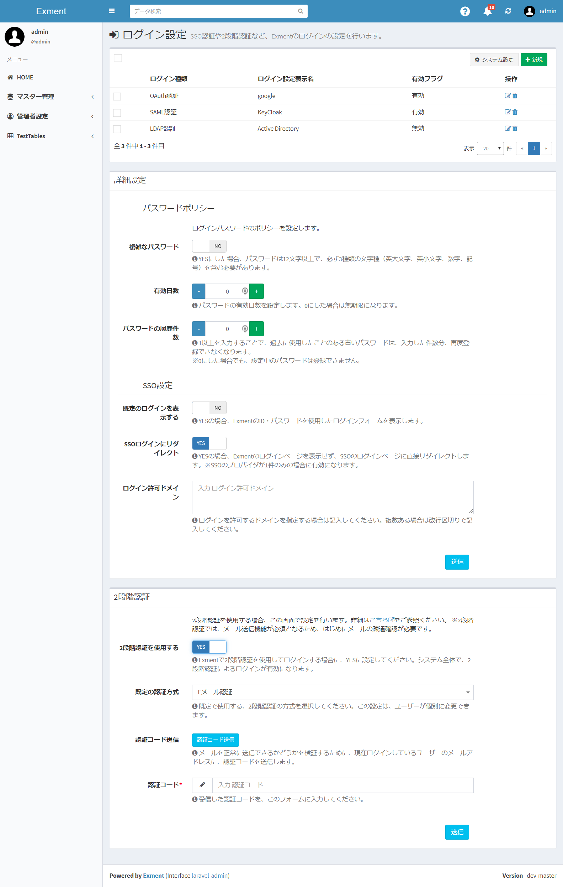

# Login settings (SSO)
Of the settings for logging in to Exment, this page is about single sign-on (SSO).  
SSO lets users log in to Exment with the account of another service (Google, Office365 and so on).

- The login methods you can use are in "Login method" below.
- How to open the setting screen is in "Login setting management method" below.

## Login method
Besides the standard login, Exment has several login methods.

| Method | What kind of login | Setting page |
|---|---|---|
| Standard | Log in with a user and password registered in Exment | - |
| OAuth | Log in on the screen of a provider registered in advance (Google and so on) | [Single sign-on (OAuth)](/login_oauth) |
| SAML | Log in on the screen of a provider registered in advance (Keycloak and so on) | [Single sign-on (SAML)](/login_saml) |
| LDAP | Enter the ID and password of LDAP (Active Directory and so on) on the login page of Exment | [Login settings (LDAP)](/login_ldap) |

### Standard
You register a user in the database of Exment, set a password, and log in with that user and password.  

### OAuth
You log in with single sign-on in the OAuth format.  
When you press the login button, you move to the login screen of the provider registered in advance and log in there.  

- [Single sign-on (OAuth)](/login_oauth)
  
Provider examples:  

- Google
- Facebook
- Office365

### SAML
You log in with single sign-on in the SAML format.  
When you press the login button, you move to the login screen of the provider registered in advance and log in there.  
  
- [Single sign-on (SAML)](/login_saml)
  
Provider examples:  

- OpenAM
- Keycloak
- ADFS

### LDAP
You log in in the LDAP format.  
On the login page of Exment, enter the user information in the ID and password fields and press the login button. Exment authenticates by LDAP and takes in the user information.  
  
- [Login settings (LDAP)](/login_ldap)
  
Provider examples:  

- Active Directory

## Login setting management method

- The system administrator opens the following URL.  
http(s)://(Exment URL)/login_setting  
Note: you can access it after doing the "system setting change" described above.

> Note: the URLs are for the default without "/admin" (a site newly installed with v7.2.1 or later). If `ADMIN_ROUTE_PREFIX` in `.env` has a value (a site installed with an older version has "admin"), add it after the URL of the site (e.g. `http(s)://(Exment URL)/admin/oauth/token`). For details, see [Change / delete "admin" included in URL](/additional_prefix).

- From v7.1.0, you can also open it from "Admin Setting" → "Login Setting" in the left menu.
- In v7.0 and earlier, add "Login Setting" to the menu.  
Open the "Admin Setting" > "Menu" page and select the menu type "System Menu". "Login Setting" appears as a target; select it and save.  
Note: in v7.0 and earlier, "Login Setting" is not shown in the menu by default.

  

- To add a new SSO provider, press the "+ New" button at the top right. For what to enter, see the page of each method.  
    - [Single sign-on (OAuth)](/login_oauth)
    - [Single sign-on (SAML)](/login_saml)
    - [Login settings (LDAP)](/login_ldap)
  

### SSO settings
The settings of SSO as a whole.  
Note: shown only when there is at least one enabled SSO.

#### Show default login
When YES, the login form that uses the ID and password of Exment, and the login button, are shown.  
Note: if you want users to log in by SAML or OAuth only, set it to NO. The default login form for entering the user ID and password is no longer shown.

#### Redirect to SSO login
When YES, a user who opens the login screen moves directly to the login page of SSO, without the login page of Exment being shown.  
Note: it works when there is only one provider in total by SAML and OAuth.

#### Login allowed domain
Enter this when you want to decide the domains that are allowed to log in. If there are several, enter them separated by line breaks.  
When a user of a domain other than the ones entered logs in, an error appears.  

### Disable SSO login settings
If, for some reason, you want to turn the SSO login settings off by force, make the following setting.

- Open the ".env" file in the folder of the project and add the following.  
Note: see [Setting value list](/config) for how to edit the setting file.

~~~
EXMENT_CUSTOM_LOGIN_DISABLED=true
~~~

With this setting, the ordinary login form with ID and password is shown on the login screen.

### About validation at SSO login
At an SSO login, the user information received from the provider (the "provider user" below) is checked (validated) by the following rules.  

- When the information of a column that is "Required" in the user table is not in the provider user, it is an error.
- When "Create User" is YES in the SSO setting and the user logs in to Exment for the first time, it is checked with the settings of the user table of Exment (the available characters setting, the string length and so on).
- When "Update User Info" is YES in the SSO setting and a user already registered in Exment logs in, it is also checked with the settings of the user table of Exment (the available characters setting, the string length and so on).

When there is an error, its cause is shown on the screen. The cause is also written to the log file.

### Other
- After an update from a version lower than v3.3.0 to v3.3.0 or higher, logging in with a provider whose user code contains a "dot (.)" can end in an error.  
In that case, fix it as follows.
    - In "Column Detail Setting" of the "User" table, open the edit screen of the "User Code" column.
    - In the "Available Characters" option, check "Dot" and save.

- With the first settings, even if you close the browser while logged in, you stay logged in until a certain time (120 minutes) has passed.  
From v3.6.0, you can have users logged out automatically when the browser is closed. Open the ".env" file and add the following.  
Note: see [Setting value list](/config) for how to edit the setting file.

~~~
EXMENT_SESSION_EXPIRE_ON_CLOSE=true
~~~
