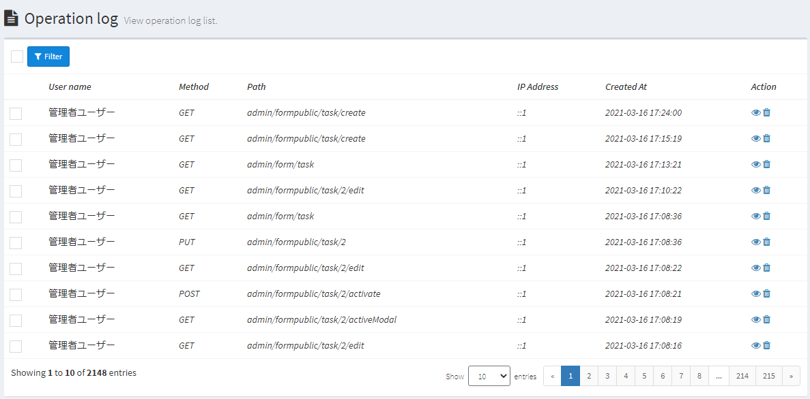

# Log
How to read the records (logs) that Exment keeps, and how to set them.  
To find out "who did what, and when", look at the operation log. To find the cause of an error, look at the log file.

## Log type
Exment has two kinds of logs.

| Kind | What it is | Where to look |
| --- | --- | --- |
| **Operation Log** | What each user did on the screens. | The Exment screen (system administrators) |
| **Log file output** | Records written mainly when an error occurs. | A file on the server |


## Operation Log
What each user did on the screens is listed on an Exment screen.  
Mainly these operations are recorded.

- Showing a page, adding, updating and deleting data, etc.
- API authentication and execution


### Confirmation Method
The operation log screen is opened by a system administrator. There are two ways to open it.

- Enter the following URL.  
http(s)://(Exment URL)/auth/logs  

> Note: the URL is for the default without "/admin" (a site newly installed with v7.2.1 or later). If `ADMIN_ROUTE_PREFIX` in `.env` has a value (an older site has "admin"), add it after the URL of the site (e.g. `http(s)://(Exment URL)/admin/auth/logs`). For details, see [Change / delete "admin" included in URL](/additional_prefix).

- Or add "Operation log" to the menu and open it from there.  
"Operation log" is not in the menu by default. To add it, open the "Admin Setting" > "Menu" page and select the menu type "System Menu". "Operation log" appears in the target; select it and save.

The operation log list screen is displayed.

  

Click a row to see the details of that operation.

  

### About Each Item

- ##### User Name  
The user who did the operation. ※It is blank for an operation done without logging in.

- ##### Method
The type of the HTTP request method.

- ##### Path
The target URI of the HTTP request.  
※The query string of a GET method (the part of the URL after "?") is not shown in this item. It is shown in "Input/Query".

- ##### IP Address
The IP address of the device that did the operation.

- ##### Input/Query
The query string or the POST values of the HTTP request.

- ##### Creation date and time
The date and time of the operation.


### Other
- In "Input/Query", the values of the following items are confidential, so they are saved replaced with the string "***" (masked).
    - password
    - password_confirmation
    - current_password
    - _token
    - verify_code
    - access_token
    - refresh_token
    - system_line_channel_token
    - system_line_channel_secret

※The items above are always masked, regardless of the settings in `config/exment.php` in "Masking Confidential Information" below.  
※"system_line_channel_token" and "system_line_channel_secret" are masked from v7.0.0.


### Masking Confidential Information
※This setting is available from Exment v7.0.0. In v6.x, only the items listed in "Other" above (except the two LINE items) are masked.

The operation log may record values entered by users, values sent by APIs, and values contained in the URL path.

So that credentials and other confidential information are not saved as they are, Exment masks the configured items and URL path values (replaces them with "***") when it writes the operation log.

The masking can be changed in the `operation_log` section of the following file.

`config/exment.php`

The following is the default `operation_log` in `config/exment.php`. (Some comments are omitted.)

```php
'operation_log' => [
    // Item names masked on every screen
    'mask_columns' => [
        // SSO (OAuth / SAML)
        'oauth_client_id',
        'oauth_client_secret',
        'saml_sp_privatekey',
        // System setting (reCAPTCHA secret key, SMTP password)
        'recaptcha_secret_key',
        'system_mail_password',
        // Meilisearch API key
        'meili_key',
        // LINE Messaging API channel information
        'system_line_channel_token',
        'system_line_channel_secret',
        // Plugin database connection password
        'custom_password',
        // Plugin (CRUD page) credentials
        'crud_auth_key',
        'crud_auth_password',
    ],

    // Item names masked only on specific screens / APIs
    'mask_columns_by_uri' => [
        // API setting screens
        'api_setting*' => ['id', 'secret', 'client_api_key'],
        // OAuth token APIs
        'oauth/*' => ['client_id', 'api_key', 'client_secret'],
        // Password reset screen
        'auth/reset*' => ['token'],
    ],

    // URI prefixes whose next path segment is masked
    'mask_path_prefixes' => [
        'api_setting' => true,
        'oauth/clients' => true,
        // Password reset token. Do not remove it or change it to true
        'auth/reset' => false,
    ],
],
```

<span class="red">※If you write `operation_log` in `config/exment.php`, it is not merged with the Exment defaults: what you write replaces the whole default.</span>  
When adding or changing mask targets, write all of the default values above and then add or change items.  
In particular, do not remove `'auth/reset' => false` from `mask_path_prefixes`. If it is removed, password reset tokens are recorded without masking.

#### mask_columns

- Specify item names that are always masked, on every screen and API.
- Use it for values that are always confidential, such as API keys and client secrets.
- If an item name listed here is also used as an ordinary business data item of a custom table, that value is masked too.

#### mask_columns_by_uri

- Specify item names that are masked only on specific screens or APIs.
- The array key is a URI pattern relative to the `admin` prefix. The wildcard `*` can be used.
- Use it for item names such as `id`, `secret`, `client_id`, `api_key` and `token`, which may be used as ordinary business data on other screens.
- Matching items are all masked, including values inside nested values.

#### mask_path_prefixes

- Use it when the URL path contains confidential information. Specify a URI prefix relative to the `admin` prefix, and the path segment right after it (the next part separated by "/") is masked.
- The array value sets how it is masked.
    - `true`: If the value is 13 characters or longer, only the first 8 characters are kept and the rest is replaced with `***`. If it is 12 characters or shorter, the whole value is replaced with `***`. Use it for record IDs and the like that need to be traced.
    - `false`: The whole value is replaced with `***`. Use it for values that must be fully hidden, such as password reset tokens.
- For example, when `auth/reset` is set to `false`, the whole password reset token in the URL is replaced with `***`.

#### Notes

- Masking is applied to operation logs that are newly created.
- <span class="red">Existing operation logs are not masked automatically when Exment is upgraded.</span> To apply the current settings to existing operation logs too, take a backup of the database and then run the following command. Masked values cannot be restored.

```
php artisan exment:patchdata patch_log_opelation
```

※"opelation" in the command name is not a typo. Enter it exactly as shown above.
- `config/exment.php` is not overwritten by an Exment upgrade (`php artisan exment:update`). Therefore, even when a new version has more default mask targets, they are not applied to an environment that already has `operation_log` written. When upgrading, compare your `operation_log` settings with the default values above and add the missing mask targets by hand.
- Use `mask_columns` for values that are always confidential. For values that are confidential only on specific screens or APIs, use `mask_columns_by_uri` or `mask_path_prefixes` (so that ordinary business data is not masked by mistake).


### Operation Log Automatic Deletion
At the bottom of the operation log screen, you can set old operation logs to be deleted automatically.

  

#### Enable Automatic
- Turns the automatic deletion of operation logs ("Auto-delete operation logs") on or off.
- When it is on, logs older than the retention period are deleted automatically.
- When it is off, logs are not deleted automatically.
- The default value is "NO".


#### Log Retention Period (Days)
- The number of days operation logs are kept.
- Logs older than this number of days are deleted automatically.
- Enter a value of 1 or more.
- This setting is shown only when "Auto-delete operation logs" is YES.
- The default value is "180".


#### Execution Day of Week
- The day(s) of the week on which the automatic deletion runs.
- If nothing is selected, it runs regardless of the day of the week.
- The placeholder is "All".


#### Execution Month
- The month(s) in which the automatic deletion runs.
- If nothing is selected, it runs regardless of the month.
- The placeholder is "All".


#### Execution Day
- The day(s) on which the automatic deletion runs.
- If nothing is selected, it runs regardless of the day.
- If both the day of the week and the day are specified, it runs at a date and time that meets both conditions.
- The placeholder is "All".


#### Execution Hour
- The hour at which the automatic deletion runs.
- If nothing is selected, it runs regardless of the hour.
- The placeholder is "All".


#### Execution Minute
- The minute at which the automatic deletion runs.
- If nothing is selected, it runs regardless of the minute.
- The placeholder is "All".


#### To disable automatic deletion
1. Set "Auto-delete operation logs" to "NO".
2. Click "Save".

After saving, the automatic deletion is off.


### Deleting old operation logs
You can also delete old operation logs with a plugin (batch).  
It physically deletes the operation logs older than a certain number of days (14 days by default). They cannot be restored.  
Install the plugin (batch) from the link below.  
[Plugin - Operation log: delete old logs](https://github.com/exment-git/plugin-sample/tree/main/batch/OperationLogDelete)


## Log file output
Records are written to a log file on the server, mainly when an error occurs.  
※With the settings in "Add Setting Value" below, things other than errors can be output too.

### Confirmation Method
1. On the server where Exment is installed, open the following folder.  
(Exment root folder)/storage/logs  

2. Check the laravel.log file.

### Add Setting Value
- By changing the [setting values](/config), the following can also be output to the log file. See [Setting values](/config) for how to set them.

- ##### Request Value Output
    - Setting Key : EXMENT_DEBUG_MODE_REQUEST
    - Default Value : false
    - Role : When set to true, the request values sent to Exment are output to the log.

- ##### SQL Log Output
    - Setting Key : EXMENT_DEBUG_MODE_SQL
    - Default Value : false
    - Role : When set to true, the SQL statements Exment executed are output to the log.

- ##### SQL Log Output - Function display
    - Setting Key : EXMENT_DEBUG_MODE_SQLFUNCTION
    - Default Value : false
    - Role : When "EXMENT_DEBUG_MODE_SQL" is true and this is also true, the list of the calling functions is output to the log together with the SQL statement.

### Other
- Besides the output to a log file, Laravel (the framework Exment uses) has functions such as these.
    - Output logs to other places such as Slack
    - Change the format of the log
    - Switch the log file every day

- Set these by following the [Laravel logging manual](https://readouble.com/laravel/12.x/ja/logging.html) (Japanese).
