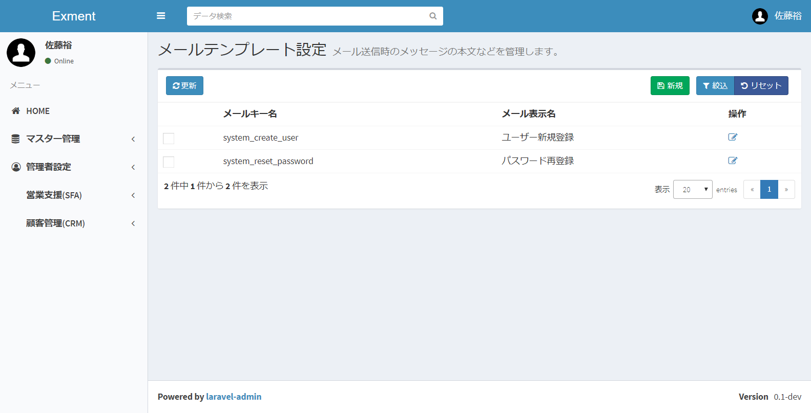
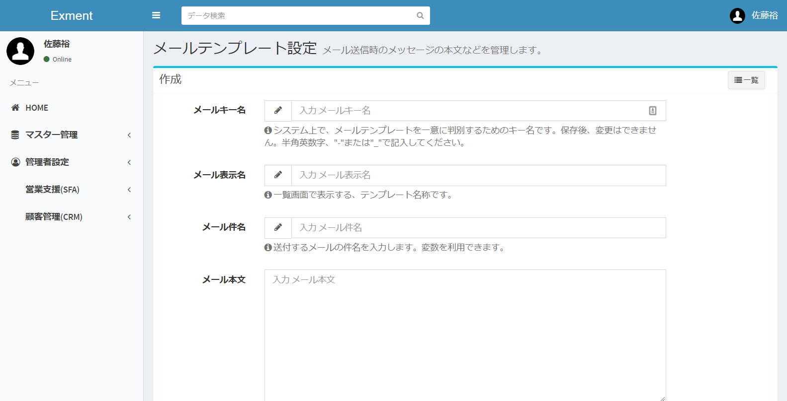
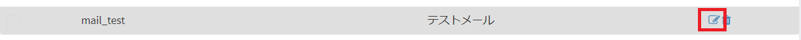

# Mail template
This page explains how to set the templates (notification templates) for the subject, body and so on of the mails and notifications Exment sends.  
The templates you make are selected and used in the [notification settings](/notify) and other places.

> From v3.6.0, the name was changed from "mail template" to "notification template".  
On a site installed with a version lower than v3.6.0, the name on some screens is still "mail template".

## Management method
### Page display
- Select the notification template menu ("Mail template") in the left menu.  
Or open the following URL.  
http(s)://(URL of Exment)/data/mail_template  
The notification template screen is displayed.  
  

> Note: the URL is for the default setting without "/admin" (a site newly installed with v7.2.1 or later). If `ADMIN_ROUTE_PREFIX` in `.env` has a value (a site installed with an older version has "admin"), add that value after the URL of the site (e.g. `http(s)://(URL of Exment)/admin/data/mail_template`). For details, see [Change / delete "admin" included in URL](/additional_prefix).

### Add new template
1. On the notification template screen, click the [New] button at the top right of the page.

2. The screen for adding a new notification template is displayed.

3. Enter the necessary items.  

### Save
After entering the settings, click [Save].

### Edit
To edit a template, click the [Edit] link in its row.  

### Delete
To delete a template, click the [Delete] link in its row.  

**Note: a template that is already set on a notification screen cannot be deleted.**

## Attached files and custom attached files
When a notification is sent by mail, the files set in the notification template can be attached and sent.  
Note: at present, this works only for mail notifications.  
  

#### Attached files
The files registered here are sent as fixed attachments with every mail notification.

#### Custom attached files
When parameters are set here, the following kinds of files registered in each data are sent with the mail notification.

■ Custom columns of the types "File" and "Image"  
Parameter: ${file:custom column name}  

■ The "File" and "Image" columns of the data selected in a custom column "Select (from the list of values in another table)"  
Parameter: ${file:select_table:custom column name of the select.file column name of the referenced table}  
Example: to attach the file of the column "contract_file" of the customer selected in the column "customer" (which refers to the customer table)  
${file:select_table:customer.contract_file}  
Note: when no data is selected, or when the column does not exist, nothing is attached.
  
■ The attached files registered on the data details screen (the place shown in the image below)  
Parameter: ${documents}  
  

## Variable rules
Variables can be used in the "mail subject", the "mail body" and the "mail sender display name".  
With variables, you can put the registered data, the system name and so on in the subject and body.

### Variable list
For the parameter variables, see the following page.  
[Parameter variables](/params)
