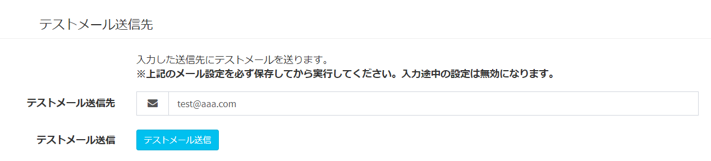

# Email sending settings
The settings for sending emails from Exment, and the steps to send a test email after the settings.  

There are two steps.

1. Set how emails are sent (usually you enter the SMTP settings on the System Setting screen)
2. Send a test email and check that it arrives

> Note: matters of the email sending feature such as "emails do not arrive" or "emails are classified as junk mail" depend largely on each server and environment, so they are outside our inquiries.  

## Overview
- Exment sometimes sends emails from the system.  
Examples:
    - Data update notifications
    - Two-factor authentication

- To send emails, settings such as SMTP are needed.

- There are two ways to set it.
    - [Set from the screen (default)](/mailsend_setting?id=setting-method-set-from-the-screen):   
    Enter the SMTP settings on the System Setting screen. Use this when you send emails by ordinary SMTP.
    
    - [Set with a config file or the env file](/mailsend_setting?id=setting-method-set-with-config-file-or-env-file):  
    Use this when you send emails by a method that is not SMTP, such as Amazon SES. You edit setting files on the server and use composer. Note: for advanced users.

### Setting method-Set from the screen
- The system administrator opens the System Setting screen.

- Enter the following settings.
  

- When you enter "Host Name" and save, Exment sends emails by SMTP, using the settings of the screen.  
It sends by SMTP even when "MAIL_MAILER" in ".env" is still "log", the initial value of Laravel (a setting that writes the mail to the log without sending it).  
Note: when "MAIL_MAILER" in ".env" is set to something other than "log" (sendmail, ses and so on), that sending method is used.  
Note: when "EXMENT_MAIL_SETTING_ENV_FORCE=true" is set in ".env", the settings of the screen are not used. See [Set with a config file or the env file](/mailsend_setting?id=setting-method-set-with-config-file-or-env-file) for details.

Note: SMTP setting example (Xserver): [here](https://www.xserver.ne.jp/manual/man_mail_setting.php)  

Note: SMTP setting example (Sakura Internet): [here](https://help.sakura.ad.jp/hc/ja/articles/206054132--%E3%83%A9%E3%82%A4%E3%83%88-%E3%82%B9%E3%82%BF%E3%83%B3%E3%83%80%E3%83%BC%E3%83%89-%E3%83%97%E3%83%AC%E3%83%9F%E3%82%A2%E3%83%A0-%E3%83%A1%E3%83%BC%E3%83%AB%E3%83%9C%E3%83%83%E3%82%AF%E3%82%B9-%E3%83%A1%E3%83%BC%E3%83%AB%E3%82%BD%E3%83%95%E3%83%88%E3%81%AE%E4%B8%80%E8%88%AC%E7%9A%84%E3%81%AA%E8%A8%AD%E5%AE%9A%E6%96%B9%E6%B3%95)  


### Setting method-Set with config file or env file
Exment usually sends emails with the values saved in "System Setting" on the screen.  
When you want to send emails by a method that is not SMTP, such as Amazon SES, you can use the standard way of Laravel (writing the settings in the ".env" file).  
To use this way, make the following settings. Note: for advanced users.


- Open the .env file and enter the following setting value.

~~~
EXMENT_MAIL_SETTING_ENV_FORCE=true
~~~

- After that, set up the mail sending driver of Laravel.

- We recommend also entering the following settings in .env.

~~~
MAIL_FROM_ADDRESS=(sender address)
MAIL_FROM_NAME=(name shown as the sender)
~~~

## Sending with OAuth 2.0 (Microsoft 365, Google)
* This feature is available in Exment v7.3.0 and later.

Microsoft 365 is retiring SMTP basic authentication (login with a user name and a password). With OAuth 2.0 (SMTP XOAUTH2), mail is sent from Microsoft 365 or Google Workspace (Gmail) without a password.

### Turning it on
1. A system administrator turns on "Mail OAuth authentication (Microsoft 365, Google)" in [Feature management](/feature).
2. In "Mail" of the system settings, enter the following. The password can stay empty.

| Item | Microsoft 365 | Google |
|---|---|---|
| Host name | smtp.office365.com | smtp.gmail.com |
| Port | 587 | 587 |
| Encryption | tls | tls |
| User name | The address of the mailbox that sends | The Gmail / Workspace address that sends |
| From | The same address as the user name | The same address as the user name |

Without a host name and port, the values above are used.

3. Open "Mail OAuth authentication" from the menu of the system setting pages, and set it up as below.

### Microsoft 365
Mail is sent with the credentials of an app (client credentials). The scope is `https://outlook.office365.com/.default` (SMTP.SendAsApp).

1. In the [Microsoft Entra admin center](https://entra.microsoft.com/), open "App registrations" > "New registration" and register an app (no redirect URI is needed). Note the "Application (client) ID" and the "Directory (tenant) ID".
2. In "Certificates & secrets", create a client secret and note its "Value" (it is not shown again; make a new one before it expires).
3. In "API permissions" > "Add a permission" > "APIs my organization uses" > "Office 365 Exchange Online" > "Application permissions", add "SMTP.SendAsApp", then press "Grant admin consent".
4. In Exchange Online PowerShell, allow the app to send as the mailbox (use the "Object ID" of the app shown in "Enterprise applications").

```powershell
Connect-ExchangeOnline
New-ServicePrincipal -AppId <Application (client) ID> -ObjectId <Object ID of the enterprise application>
Add-MailboxPermission -Identity "<mailbox that sends>" -User <Object ID of the enterprise application> -AccessRights FullAccess
# when SMTP authentication is turned off for the mailbox
Set-CASMailbox -Identity "<mailbox that sends>" -SmtpClientAuthenticationDisabled $false
```

5. In "Mail OAuth authentication" of Exment, choose "Microsoft 365 (app credentials)", enter the tenant ID, the client ID and the client secret, and save.
6. Send a [test email](#send-test-email) to check.

See also Microsoft's "[Authenticate an IMAP, POP or SMTP connection using OAuth](https://learn.microsoft.com/exchange/client-developer/legacy-protocols/how-to-authenticate-an-imap-pop-smtp-application-by-using-oauth)".

### Google
The mailbox that sends is "connected" once on the screen. Exment keeps its refresh token encrypted, and gets an access token when it sends. The scope is `https://mail.google.com/`.

1. In the [Google Cloud console](https://console.cloud.google.com/), create a project and set up the "OAuth consent screen". With Google Workspace, the user type "Internal" is the simplest.
With "External" left in "Testing", the refresh token expires in 7 days: set it to "In production".
2. In "Credentials" > "Create credentials" > "OAuth client ID", create one of the type "Web application". As the "Authorized redirect URI", enter the URI shown on the "Mail OAuth authentication" page of Exment (`https://(URL of Exment)/admin/mail_oauth_setting/google/callback`). Note the client ID and the client secret.
3. In "Mail OAuth authentication" of Exment, choose "Google (Workspace / Gmail)", enter the client ID and the client secret, and save.
4. Press "Connect with Google", log in to Google with the mailbox that sends (the user name of the system settings) and allow it. When "The mailbox is connected" is shown, it is done.
5. Send a [test email](#send-test-email) to check.

### When there is no token
- An access token is kept and used again until a minute before it expires.
- When no token can be had, the mail fails ([In case of transmission error](#in-case-of-transmission-error)), and the system administrators are told by a bell on the screen (once an hour), with the error code and description Microsoft or Google returned.
- Common causes: an expired client secret (Microsoft 365), no admin consent or mailbox permission (Microsoft 365), a revoked or expired refresh token (Google: press "Connect with Google" again).

## SPF record settings
- When the emails you send become junk mail, in many cases the "SPF record" setting of the domain is not enough. Register an SPF record in the settings of the domain.  
[Reference 1](https://sendgrid.kke.co.jp/blog/?p=3509)  
[Reference 2](https://salt.iajapan.org/wpmu/anti_spam/admin/operation/information/spf_i01/)  


## Send test email
- With the settings above, you can send a test email.  
You can send it from the screen or by a command.

### Run from screen
- The system administrator opens the System Setting screen.

- Enter the destination in the "Send TestMail" item and press [Send TestMail].

  

Note: you need to save "System Mail Settings", in the upper part of the page, first. Save once, and then send the test email.


### Execute from command
- Run the following command in the root folder of the project.

~~~
php artisan exment:notifytest --to=(mail destination)
~~~

### In case of transmission error
- An error log is written to "storage/logs/laravel.log". Please check it.
