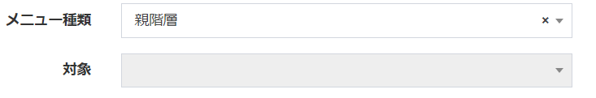

# menu
This page explains how to add, reorder, edit and delete the menu shown on the left of the screen.

| What you want to do | Where to look |
|---|---|
| Add an item to the menu | Add new menu |
| Change the order of the menu | Sort order |
| Show a parent node only to the people of chosen role groups | Role groups that see it |
| After an update, bring the menu to the standard order from v7.2.1 | Arrange in the standard order |

## Overview
After you log in, the menu is shown on the left of the screen.  
You can add items to the menu that open "pages prepared by the system", "pages of plugins", "pages of each table" and "any URL".  
Note: only the menu items of the pages the logged-in user can display are shown.


Note: from v7.1.0, "Safety Check", "Login Setting", "API Setting" and "System Performance Log", which the system administrator uses, are shown under "Admin Setting". "LINE Link" is shown in the user menu at the top right, not in the left menu ([LINE Link](/line?id=linking)). When you update from v7.0, a menu is moved only when it is at the top. Menus you moved yourself stay as they are.


### The menu from v7.2.1
From v7.2.1, the left menu is grouped by area of work (parent nodes). The order is the same as the [feature map](https://exment.net/en/feature-map/).

```
Dashboard
Groupware ▸ File sharing, Mail (Groupware)
Requests & approvals ▸ Pending tasks, Approval request (ringi), Expense claim … (bundled template "Request pack")
Projects ▸ Project Management (official plugin)
IT support ▸ IT support (official plugin)
Master ▸ Base Info, Organization, User, Information
Settings: Data & Screens ▸ Custom Table, Studio, Menu, Workflow, Mail template, Notify, Cell style presets, Template
Settings: Users & Permissions ▸ LoginUser, Role group, Login Setting, API Setting, Operation log
Settings: System ▸ System Setting, Feature Management, Plugin, Backup, Tuning, Maintenance Mode
```

- A newly installed site has this form.
- On a site updated from v7.1 or earlier, only the menus that are still where Exment put them move (when the inside of Admin Setting is still in Exment's order, when "Manage Master" is still third from the top, when File sharing is still at the top). Menus you moved yourself, names you gave and the menus of plugins stay as they are. On a site where other menus are inside Admin Setting, Admin Setting is not divided.
- The official plugins (Project Management, IT Support, Groupware) and the bundled templates put their menus under their own group (the group is made when it does not exist). Only menus at the top are moved.
- A group with no menu that can be shown inside it is not shown (the menus of features turned off in [Feature Management](/feature) are not shown).

#### Arrange in the standard order
On a site whose order did not change with the update (a site where the menus were reordered, or a site with other menus inside Admin Setting), the menu can be brought to the form above with [Arrange in the standard order] on the "Menu" screen.
- When you press it, a list of which menus move where is shown. Check it and then press [Arrange].
- Only the menus of Exment and of the official plugins move. Menus you made yourself, table menus and other menus stay in their place and in their order (those that were inside Admin Setting go to the end of "Settings: System"). No menu is deleted.
- The names "HOME", "Manage Master" and "Admin Setting" are changed to "Dashboard", "Master" and "Settings: System" only when they are still the names Exment gave.
- The menu from before arranging is kept, so you can go back with [Undo] on the same screen.
- Only system administrators can use it.


## Menu management
How to add, reorder, edit and delete menus.

### List screen display
Click "Menu" in the left menu.  
Or open the following URL.  
The menu setting screen is displayed.  
http(s)://(URL of Exment)/auth/menu  
A list of the menus currently registered in the system is displayed.


> Note: the URL is for the default setting without "/admin" (a site newly installed with v7.2.1 or later). If `ADMIN_ROUTE_PREFIX` in `.env` has a value (a site installed with an older version has "admin"), add that value after the URL of the site (e.g. `http(s)://(URL of Exment)/admin/auth/menu`). For details, see [Change / delete "admin" included in URL](/additional_prefix).

### Add new menu
On the "Menu" list screen, enter the necessary items in the "New" box on the right of the page.  


#### Parent ID
Select the item that becomes the parent of the menu to add. To add a menu at the top level, select "ROOT".


#### Menu type
Select the type of the menu to add from the following.
- <span class="heading_smaller_than_h5">System Menu</span>  
Select this to add a menu item prepared by Exment.  

- <span class="heading_smaller_than_h5">Plugin</span>  
Select this to show a plugin uploaded by a user in the menu.  

- <span class="heading_smaller_than_h5">Table Data</span>  
Select this to show the screen that lists the data of a custom table in the menu.  

- <span class="heading_smaller_than_h5">Parent Node</span>  
Select this to list child items under the menu.  

- <span class="heading_smaller_than_h5">Custom URL</span>  
Select this to add any URL to the menu.


#### Target
Select the item of the menu to add. The items shown depend on the "Menu Type".
- When the menu type is "System Menu": a list of the pages prepared by Exment is shown.


- When the menu type is "Plugin": a list of the plugins uploaded by users is shown.
- When the menu type is "Table Data": a list of the custom tables is shown.


- When the menu type is "Parent Node" or "Custom URL": it cannot be selected.



#### URI
The URI that is opened when the menu is clicked.
- When the menu type is "System Menu", "Plugin", "Table Data" or "Parent Node": it is only displayed. You do not need to enter it.  


- When the menu type is "Custom URL": enter the URI that is opened when the menu is clicked.  
Note: the URL of the page actually opened is as follows.
http(s)://(URL of Exment)/(the URI you entered)


> On a site first installed with a version lower than v3.0.2, the limit of the number of characters that can be registered in the URI was set to less than 50. To register a longer URI, follow [Bug fix: the menu URL is limited to 50 characters](/patch/menu_uri_length).


#### Menu name
Enter the name of the menu in half-width alphanumeric characters. The same name as another menu cannot be used.  
This item is not shown on the screen.
- When the menu type is "System Menu", "Plugin" or "Table Data": it is filled in automatically when "Target" is selected.  
Note: when the same menu item is already registered, the name overlaps and cannot be saved. Change the value.


- When the menu type is "Parent Node" or "Custom URL": enter any half-width alphanumeric characters that do not overlap with other values.  


#### Menu display name
Enter the name shown in the left menu.  
Note: when the menu type is "System Menu", "Plugin" or "Table Data", it is filled in automatically when "Target" is selected.

#### icon
Enter the icon shown in the left menu.  
Note: when the menu type is "System Menu", "Plugin" or "Table Data", it is filled in automatically when "Target" is selected.

#### Role groups that see it
(From v7.2.1. Only when the menu type is "Parent Node")  
This parent node, with the menus inside it, is shown only to the people of the chosen role groups. When empty, it is shown to everyone as before (the menus inside are shown by their own permissions). It is always shown to system administrators.  
For example, you can show "Requests & approvals" only to the applicants and approvers, or an "Accounting" group only to the accounting staff.  
Note: this only divides what is shown. The permissions do not change. The tables and screens inside can be opened by their own permissions.  
Note: when exported to a template, the role groups are written by name. If the site that imports it has role groups of the same name, they are linked to those.

### Save
After entering the settings, click [Submit].  
Note: after saving, reload the browser or access Exment again, and the item appears in the left menu.

### Sort order
The order of the saved menu items can be changed on the list screen.

1. Drag and drop the items to reorder them.
2. When you have finished, click [Save].
  


### Edit
To edit a menu, click the [Edit] link in its row.  


### Delete
To delete a menu, click the [Delete] link in its row.  


> On a site installed before v7.2.1, the **operation log list** is not shown in the menu items. If you need it, set it from the list. On a site newly installed with v7.2.1 or later, it is shown under "Settings: Users & Permissions".
