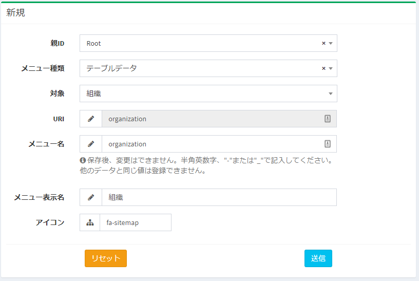
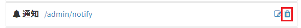

# menu
Manage the menu displayed on the left side of the page.

## Overview
After logging into the system, a menu will appear on the page.  
In this menu, you can add menu items that transition to "pages prepared by the system", "pages of plugins", "pages to each table", and "arbitrary URL".  
※ Menu items are displayed only on pages that can be displayed by the logged-in user.

※From v7.1.0, "Safety Check", "Login Setting", "API Setting" and "System Performance Log", which the system administrator uses, are shown under "Admin Setting". "LINE Link" is shown in the user menu at the top right, not in the left menu ([LINE Link](/line?id=linking)). When updating from v7.0, a menu is moved only when it is still at the top. A menu you moved yourself stays where it is.


### The menu from v7.2.1
From v7.2.1 the left menu is grouped by area of work (parent nodes), in the order of the [feature map](https://exment.net/en/feature-map/).

```
Dashboard
Groupware ▸ File sharing, Mail (Groupware)
Requests & approvals ▸ Pending tasks, approval requests, expense claims … (bundled template "Request pack")
Projects ▸ Project Management (official plugin)
IT support ▸ IT support (official plugin)
Master ▸ Base Info, Organization, User, Information
Settings: Data & Screens ▸ Custom Table, Studio, Menu, Workflow, Mail Template, Notify, Cell Style Preset, Template
Settings: Users & Permissions ▸ LoginUser, Role Group, Login Setting, API Setting, Operation Log
Settings: System ▸ System Setting, Feature Management, Plugin, Backup, Tuning, Maintenance Mode
```

- A newly installed site gets this menu.
- On a site updated from v7.1 or earlier, only the menus still where Exment put them move (the admin settings still in Exment's order, "Manage Master" still third from the top, File sharing still at the top). Menus you moved, names you gave and the menus of plugins stay. A site with other menus among the admin settings keeps one "Admin Setting".
- The official plugins (Project Management, IT Support, Groupware) and the bundled templates put their menus under their group (made when missing). Only a menu at the top moves.
- A group with nothing to show in it is not shown (the menus of features turned off in [Feature management](/feature) are not shown).

#### Arrange in the standard order
A site whose menu did not change with the update (a menu someone arranged, or other menus among the admin settings) can get the menu above with [Arrange in the standard order] on the "Menu" screen.
- It first lists which menus move where; press [Arrange] after checking.
- Only the menus of Exment and of the official plugins move. Menus you made, table menus and other menus stay where they are, in their order (those that were among the admin settings come at the end of "Settings: System"). No menu is removed.
- The titles "HOME", "Manage Master" and "Admin Setting" become "Dashboard", "Master" and "Settings: System" only while they are the ones Exment gave.
- The menu as it was is kept, and [Undo] on the same screen puts it back.
- Only system administrators can use it.

## Menu management
Describes how to manage menus.

### List screen display
Click "Menu" from the left menu.  
Or access the following URL.  
This will display the menu setting screen.  
http(s)://(Exment URL)/auth/menu  
A list of menus currently registered in the system is displayed.


> Note: the URLs are for the default without "/admin" (a site newly installed with v7.2.1 or later). If `ADMIN_ROUTE_PREFIX` in `.env` has a value (an older site has "admin"), add it after the URL of the site (e.g. `http(s)://(Exment URL)/admin/oauth/token`). For details, see [Change / delete "admin" included in URL](/additional_prefix).

### Add new menu
In the "Menu" list screen, enter the required information in the "New" box on the right side of the page.


#### Parent ID
Select the parent item of the menu to be added. To add a menu to the top layer, add "Root".


#### Menu type
Select the type of menu to add. Please choose from the following options:  
- System menu: Select when you want to add the menu items prepared by Exment.  
- Plugin: Select this if you want to display the plugin uploaded by the user in the menu.  
- Table data: Select this to display a screen that lists the data of the custom table in the menu.  
- Parent Hierarchy: Select to list child hierarchies under the menu.  
- Custom URL: Select to add any URL to the menu.  


#### Target
Select the menu item to be added. The displayed items change depending on the "Menu type".
- When the menu type is "System Menu": A list of pages prepared by Exment is displayed.


- When the menu type is "Plugin": A list of plug-ins uploaded by the user is displayed.
- When the menu type is "Table data": A list of custom tables is displayed.


- When the menu type is "Parent hierarchy" or "Custom URL": Cannot be selected.


#### URI
Enter the URI to transition to when clicked.
- When the menu type is "System Menu", "Plugin", "Table Data", "Parent Hierarchy": Display only, there is no need for the user to fill out.


- If the menu type is "Custom URL": Enter the URI that will transition when clicked.  
※ The URL of the page that actually transitions is as follows. http(s)://(Exment URL)/ (filled URI)  
http(s)://(Exment URL)/(filled URI)


#### Menu name
Enter the name of the menu in alphanumeric characters. Must be unique. It cannot be duplicated with other menus.  
Items that are not displayed on the screen.  
- When the menu type is "System menu", "Plugin", "Table data": When "Target" is selected, it is automatically filled.  
※However, if the same menu item has already been registered, the value cannot be duplicated and saved, so change the value.


- If the menu type is "Parent Hierarchy" or "Custom URL": Enter any alphanumeric characters to avoid duplication with other values.


#### Menu display name
Enter the name to be displayed on the left menu.  
※ If the menu type is "System Menu", "Plug-in", or "Table Data", it will be automatically filled when "Target" is selected.  

#### icon
Enter the icon to be displayed on the left menu.  
※ If the menu type is "System Menu", "Plug-in", or "Table Data", it will be automatically filled when "Target" is selected.  

#### Role groups that see it
(From v7.2.1. Only for the menu type "Parent node".)
Show this parent node, with the menus in it, only to the members of the chosen role groups. Empty shows it to everyone, as before (each menu inside still follows its own permission). System administrators always see it.
For example, show "Requests & approvals" only to the applicants and approvers, or an "Accounting" group only to the accounting staff.
※This only changes what is shown; permissions do not change. The tables and screens inside open according to their own permissions.
※In an exported template, the role groups are written by their name. A site that imports it gets the role groups of the same name, if it has them.

### Save
After filling in the settings, click “Submit”.  
※ After saving, if you refresh the browser or access Exment again, the items will be reflected in the left menu.

### Sort order
If you want to rearrange menu items that have already been saved, you can change them on the list screen.  
Rearrange the order by dragging and dropping items.  
When you have completed your changes, click Save.  


### Edit
If you want to edit the menu, click the "Edit" link in the corresponding line.


### Delete
To delete a menu, click the "Delete" link in the corresponding line.


> On a site installed before v7.2.1, the **operation log** is not on the menu; add it from the list if you need it. A site newly installed with v7.2.1 or later has it under "Settings: Users & Permissions".  