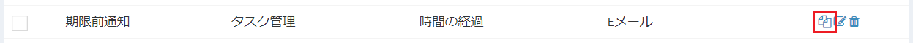
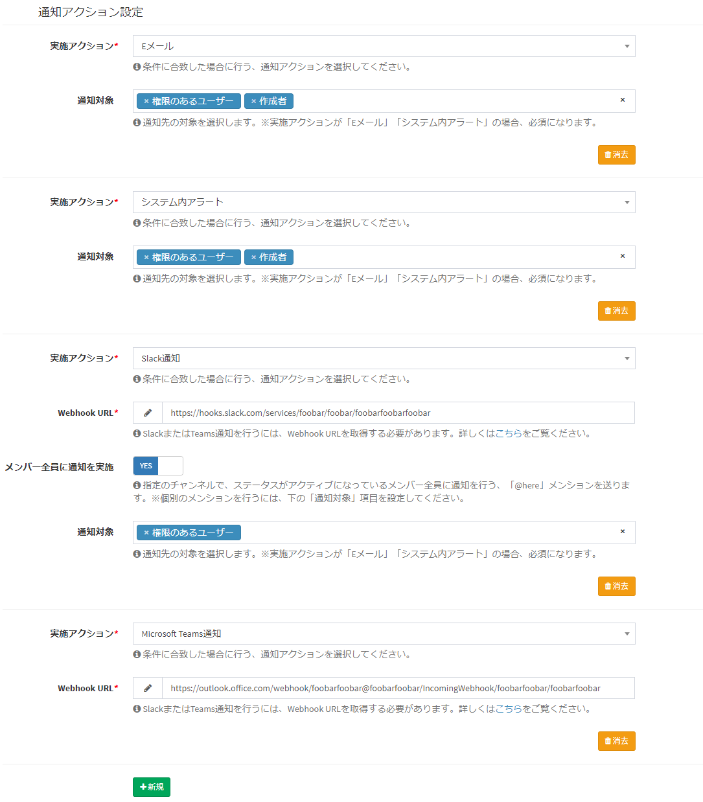

# Notification / Email sending settings
This page explains how to set "notifications", which tell users or given email addresses by mail and other means when decided conditions are met.

A notification is made by deciding the following three things.

| What to decide | Contents | Where to look |
|---|---|---|
| Notification trigger | When to notify (when data is created, when a date comes near, and so on) | Notification type |
| Notification action | By what to notify (email, in-system alert, Slack and so on) and whom to notify (the notification target) | Types of notification actions |
| Notification template | The subject and body | [Notification template](/mail) |

**Note: to send mail with this function, you need to do the [mail settings](/system_setting?id=system-mail-settings).**

## Notification type
A notification trigger is what starts a notification: "when to notify". At present there are the following types.

### Passage of time
The notification is executed on the day that is a set number of days before (or after) a date registered in the data.  
Example: when the contract renewal date is "7/31" and "notify 10 days before" is set, a mail is sent on "7/21".  
**Note: to use this function, the [task schedule](/additional_task_schedule) must be set beforehand.**

### Create / update / share / comment new data
The notification is executed at the following times. Use it when you want to know about changes of data quickly.

- When data is newly created
- When data is updated
- When a comment is made on data
- When a file is attached to data
- When data is shared
  
Note: by default, the login user who did the update and so on is not notified. To change this, set "If the notification target is a logged-in user, skip the notification" in the [config](/config).  
Note: nothing is notified at data import. This is because a large number of notifications and mails could be sent.

### Button
A button for notification is shown on the data details screen.  
Press the button to send a message to the given users and email addresses.  
Saved files can also be attached.

  
  

### Workflow execution
When a workflow is executed, the creator of the data and the next executing users can be notified.

### Public form: when data registration is completed, and on error
On a public form, when a general user has entered data and when an error has occurred, a notification can be sent to the general user or to the administrator.  
Note: for public forms, see [Public form settings](/publicform).

## Types of notification actions
A notification action is "by what to notify". At present there are the following types.  
On the notification setting screen, you also set the "notification target": whom to notify.

### Email
Sends mail to specific email addresses.

#### Notify Target (required)

- ##### Administrator
Sends mail to the system administrators.

- ##### Have the Role User
Sends mail to the users who have permission for the target data.

- ##### Create User
Sends mail to the user who created the target data.

- ##### Specified email address
Sends mail to the email addresses you enter. Several email addresses can be given.

- ##### Email column
When the data to notify has a custom column "Email", sends mail to that email address.

- ##### User column
When the data to notify has a custom column "User", sends mail to the users set in that user column.

- ##### Email column inside "Select (from the list of values in another table)"
When the custom table of the data has a custom column "Select (from the list of values in another table)" and the referenced table has an email column, sends mail to that email address.

- ##### Specified user
Sends the notification to the selected users.  
Note: only users who have permission for the table are shown as candidates. Users without permission cannot be notified.

- ##### Specified organization
Sends the notification to the selected organizations.  
Note: only organizations that have permission for the table are shown as candidates. Organizations without permission cannot be notified.

### In-system alert
When a target user logs in, a notification alert is shown on the notification icon at the top right of the page.
  

#### Notify Target (required)

- ##### Administrator
Sends the notification to the system administrators.

- ##### Have the Role User
Sends the notification to the users who have permission for the target data.

- ##### Create User
Sends the notification to the user who created the target data.

- ##### User column
When the data to notify includes a custom column "User", sends the notification to that user.

- ##### Specified user
Sends the notification to the selected users.  
Note: only users who have permission for the table are shown as candidates. Users without permission cannot be notified.

- ##### Specified organization
Sends the notification to the selected organizations.  
Note: only organizations that have permission for the table are shown as candidates. Organizations without permission cannot be notified.

### Slack
Sends the notification to Slack.  
Note: a Webhook URL is needed to notify. For how to get the URL, see [Settings for notifying a Webhook](/notify_webhook).

#### Mention settings
Mentions (a way of writing that names the other person) can be added to Slack notifications. There are the following settings for mentions.

- ##### Mention to everyone
Adds "@here", which mentions everyone, to the Slack notification.

- ##### Individual mention
Adds individual mentions to the Slack notification.  
The Slack user IDs used for the mentions must be set separately.  
For how to set the Slack ID, see [How to set the Slack ID](/notify_webhook?id=how-to-set-the-slack-id).

#### Mention target

- ##### Administrator
Sends the notification to the system administrators.

- ##### Have the Role User
Sends the notification to the users who have permission for the target data.

- ##### Create User
Sends the notification to the user who created the target data.

- ##### User column
When the data to notify has a custom column "User", sends the mention to the Slack ID set for the users in that user column.

### Microsoft Teams
Sends the notification to Microsoft Teams.  
Note: a Webhook URL is needed to notify. For how to get the URL, see [Settings for notifying a Webhook](/notify_webhook).  
Note: mentions cannot be added in Microsoft Teams.

### LINE
Sends the notification from the LINE Official Account to the LINE of the users. It can also be sent in card form (Flex Message).  
Note: the users who receive the notification must link their LINE account beforehand. For preparing the LINE Official Account and how to link accounts, see [LINE integration](/line).

#### Notify Target (required)
As with "In-system alert", select from the system administrators, the users with permission, the user who created the data, a user column, specified users, specified organizations and so on.  
Note: the notification is not sent to users who have not linked their LINE account.

## List screen display
From v4.2.0, the place of the notification setting screen changed. It is opened from the following places, depending on the type of the notification trigger.

- Passage of time; create / update / share / comment of data; button  
→ Click the notification setting button in the table detail setting dialog of the custom table.
  

- Workflow  
→ Set it in Step 3 of the workflow settings.
  

## Create New
1. Click the [New] button at the top right of the list screen.

2. The screen for creating a new notification is displayed. Enter the necessary items.  
Note: for what to enter, see "Setting item details" below.

3. Click the [Submit] button. The notification setting is created.

## Edit
- Click the [Edit] link in the row you want to edit.  
The edit screen opens, and you can change the settings.

  

## Duplication
- Click the [Copy] link in the row you want to copy.  
The screen for creating a new one opens with the setting values of that row entered.

  

## Delete
To delete a notification, click the [Delete] link in its row.

  

## Setting item details
Set the "notification name", the "notification condition setting" (when to notify) and the "notification action setting" (by what to notify).

### Notification name setting

#### Notify Name
- The name of the notification used by the system.  
It is used, for example, when "just before the notification is executed" or "after the notification is executed" is set in the trigger conditions of a plugin (trigger).
- Half-width alphanumeric characters and the symbols "-" and "_" can be used.
- It must be 30 characters or less, and a name used by another notification cannot be used.

#### Notify Display Name
- The display name of the notification.

### Notification condition setting

  

#### Enforcement trigger
Select what starts the notification ("Notify Trigger" on the screen). For details, see [Notification type](#notification-type) above.

#### Target view
Select the [filter view](/view?id=condition-view) used to narrow down the data to notify.

### Notification condition setting (elapsed time)

#### Date target column
Select the date custom column that is the base for deciding whether to notify.  
The types of custom columns that can be selected are "Date" and "Date and time".  
Note: when the selected custom table has no "Date" or "Date and time" column, no options are shown.

#### Notification date
Enter the number of days for the notification. Enter "0" to notify on the day itself.

#### Before and after notification
Select whether the notification is made "before" or "after" the registered date.  
Example: when "Notification date" is 7 and "Before and after notification" is "before", the notification is executed 7 days before the date of the specified field.

#### Notification time
The hour at which the notification is executed. Enter 0 to 23.  
Example: when "6" is entered, the notification is executed at 6:00.

### Notification condition setting (data creation / update / share / comment)

#### Notification condition setting
Set the conditions for the notification.
  

### Notification condition setting (button)

#### Button display name
Enter the name of the button shown on the screen.

### Notification condition setting (workflow)

#### Executed Status
Select the statuses for which the notification is sent. The status after the action is executed is used. Note: when empty, all are targets.

#### Execute Action
Select the actions for which the notification is sent. Note: when empty, all are targets.

### Notification action settings

Select the actions of the notification. Several can be selected.  
For details of the actions, see [Types of notification actions](#types-of-notification-actions).

  

### LINE Flex template
When the notify action is "LINE", select the template of the card sent to LINE. When none is selected, the notification is sent as text.  
For how to create a template, see [LINE integration](/line?id=line-flex-templates).

### Mail template
Select the template of the notification to send. To use a new template, create it on the notification template screen first.  
For details of notification templates, see [Notification template](/mail).
  
  
>  **When you send a notification with files attached, the attached files are encrypted if you do the setting of [Encrypting attached files at notification](/notify_encript).**

## When notification takes time
The notification process takes a very long time, whether by mail or by Webhook.  
It is a function for advanced users, but with [delayed execution of notifications](/additional_queue), the next process goes on without waiting for the notification to finish.

## Running a notification (passage of time) by command
A notification with the trigger "The Passage of Time" can be executed by hand with a command whenever you like, regardless of the "Notification time" setting.  
Run one of the following commands.

~~~
# Specify the notification ID
php artisan exment:notify 1

# Specify notify_name (Notify Name)
php artisan exment:notify --name=task_limit_date_notify
~~~

  
