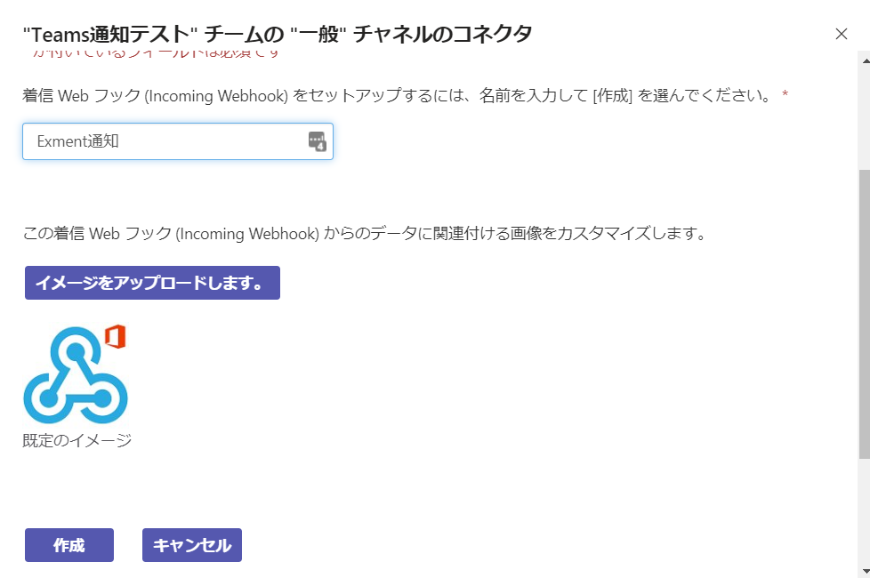

# Settings for notifying Webhook
To send notifications to Slack or Microsoft Teams, you need a "Webhook URL". A Webhook URL is a URL made only for receiving notifications.  
This page explains how to get a Webhook URL, and the setting for mentioning a particular person on Slack.

| What you want to do | Where to look |
|---|---|
| Notify Slack | [Slack acquisition procedure](/notify_webhook?id=slack-acquisition-procedure) |
| Notify Microsoft Teams | [Microsoft Teams acquisition procedure](/notify_webhook?id=microsoft-teams-acquisition-procedure) |
| Mention a user in a Slack notification | [How to set the Slack ID](/notify_webhook?id=how-to-set-the-slack-id) |
| Send JSON to any URL (v7.3.0 and later) | [JSON webhook](/notify_webhook?id=json-webhook) |

## Slack acquisition procedure
1. Open the following URL.  
https://slack.com/services/new/incoming-webhook  

2. Select the channel to notify.  
Then click "Add Incoming Webhook Integration".  
  

3. A Webhook URL is created. Copy it.  
  

4. Paste the copied Webhook URL into the notification setting of Exment.

## Microsoft Teams acquisition procedure
1. Open Teams and click "Manage team" for the team you want to notify.  
  

2. Click the "Apps" tab.  


3. Click the "Other apps" tab.  


4. Click "Incoming Webhook".  


5. Click "Install".  


6. Select the channel to notify. Then click "Settings".  


7. Enter the name to use for the notification and click "Create".  


8. A Webhook URL is created. Copy the URL and click "Done".  


9. Paste the copied Webhook URL into the notification setting of Exment.


## How to set the Slack ID
This is the setting for mentioning a particular person on Slack (a mention is a call addressed to that person).  
Make a column that holds the Slack ID of each user, and select that column in the system setting. Do this only once, at the beginning.

1. In the [custom table](/table) setting, click the "Column Detail Setting" link of the "User" table.  
 

2. In the [custom column](/column) setting of the User table, add the following custom column.
    - Column Name, Column View Name: any name
    - Column Type: "One-Line Text"

     

3. On the [System Setting](/system_setting) screen, in "Detail Setting", select the Slack ID column you just added in "Slack ID Setting Column(User)".  
 

4. On the edit screen of the user data, enter the Slack ID of each user. When that user is notified, a mention is added.  
※ For how to check a user ID on the Slack screen, see [this page](https://auto-worker.com/blog/?p=27).  
 

Now the notification setting screen can add a mention to the Slack ID entered in the user data.  
On the notification setting screen, the notification targets are shown differently, as below. (Top: without the Slack ID setting. Bottom: with the setting.)

 
 

## JSON webhook
* This feature is available in Exment v7.3.0 and later.

When "Webhook (JSON)" is chosen as the action of a notification, the data is sent as JSON to any URL. Zapier, n8n, Power Automate or a program of your own can receive it.

### Turning it on
The values of the data are sent outside the site, so it is off at first. A system administrator turns on "Webhook notifications (JSON)" in [Feature management](/feature).

### The notification setting
Choose "Webhook (JSON)" as the action of the notification and fill in the following.

| Item | Description |
|---|---|
| Webhook URL | The URL to send to (http or https). The server itself and internal addresses cannot be used (as with Slack and Teams) |
| Columns to send | The columns of the data sent. Columns not chosen are not sent. The ID, label and URL of the data are always sent |
| Signing secret | When set, the JSON is signed, so the receiver can check with the same value that Exment sent it. It is stored encrypted and cannot be shown later |

### The JSON sent
A POST with a body of `Content-Type: application/json`.

```json
{
  "event": "exment.notify",
  "id": "3f2c6a1e-6c1b-4d8e-9a57-2f1d0c9b7e11",
  "sent_at": "2026-11-26T10:15:30+09:00",
  "trigger": "create_update_data",
  "action": "updated",
  "notify": { "id": 12, "name": "Deal updated" },
  "table": { "name": "deal", "label": "Deal" },
  "record": {
    "id": 101,
    "label": "Renewal of A Inc.",
    "url": "https://exment.example.com/admin/data/deal/101",
    "created_at": "2026-11-20T09:00:00+09:00",
    "updated_at": "2026-11-26T10:15:29+09:00",
    "deleted": false,
    "values": { "status": "2", "amount": 1200000 },
    "texts": { "status": "Negotiating", "amount": "1,200,000" }
  },
  "user": { "id": 3, "name": "Taro Yamada" },
  "subject": "[Deal 101] The data was updated",
  "body": "... the body of the mail template ..."
}
```

| Item | Description |
|---|---|
| trigger | What started the notification: time, create_update_data (data created or updated), button, workflow |
| action | For data created or updated, what was done: created, updated, comment, attachmented |
| record.values | The stored values of the columns chosen (a user or the data of another table is its ID) |
| record.texts | The values of the columns chosen, as shown on the screen |
| subject, body | The subject and body of the mail template of the notification |

These headers are sent too.

| Header | Content |
|---|---|
| X-Exment-Event | `exment.notify` |
| X-Exment-Delivery | An ID that changes each time (the same as `id` of the body). When the same one arrives twice, the second can be ignored |
| X-Exment-Timestamp | When it was sent (UNIX time, seconds) |
| X-Exment-Signature | Only with a signing secret: `sha256=` and the HMAC-SHA256 (hex) of "timestamp + `.` + body" |

### Checking the signature on the receiver
Use the body exactly as the bytes received (a JSON read and written again does not match the signature). Refusing old timestamps stops the same notification from being sent again by someone else.

PHP:

```php
$secret = '(the signing secret)';
$body = file_get_contents('php://input');
$timestamp = $_SERVER['HTTP_X_EXMENT_TIMESTAMP'] ?? '';
$signature = $_SERVER['HTTP_X_EXMENT_SIGNATURE'] ?? '';

$expected = 'sha256=' . hash_hmac('sha256', $timestamp . '.' . $body, $secret);
if (!hash_equals($expected, $signature) || abs(time() - (int)$timestamp) > 300) {
    http_response_code(401);
    exit;
}
$data = json_decode($body, true);
```

Node.js (Express):

```js
const crypto = require('crypto');
app.post('/exment', express.raw({ type: 'application/json' }), (req, res) => {
  const timestamp = req.get('X-Exment-Timestamp') || '';
  const expected = 'sha256=' + crypto.createHmac('sha256', process.env.EXMENT_SECRET)
    .update(timestamp + '.' + req.body).digest('hex');
  const signature = req.get('X-Exment-Signature') || '';
  const ok = signature.length === expected.length
    && crypto.timingSafeEqual(Buffer.from(signature), Buffer.from(expected))
    && Math.abs(Date.now() / 1000 - Number(timestamp)) <= 300;
  if (!ok) return res.sendStatus(401);
  const data = JSON.parse(req.body);
  res.sendStatus(204);
});
```

### When it cannot be sent
- The receiver answers 2xx (200, 204, ...). Any other answer means it was not sent.
- On 5xx, 408, 429 or no connection, it is tried 3 times in all: 1 and 5 minutes apart with a queue worker, 1 and 2 seconds apart without one (`QUEUE_CONNECTION=sync`).
- Other 4xx and redirects (3xx) are not tried again. Redirects are not followed.
- When it is not sent at last, the user who made the notification is told by a bell on the screen, with the host name only.
- It is sent after the answer of the save (or by the queue): the save does not wait ([When notifications are sent](/additional_queue?id=when-notifications-are-sent)).
