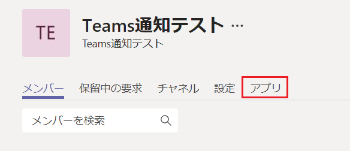
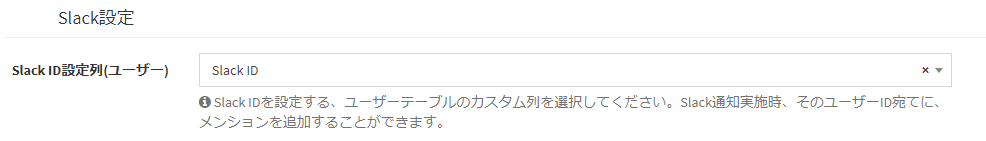

# Settings for notifying Webhook
To send notifications to Slack or Microsoft Teams, you need a "Webhook URL". A Webhook URL is a URL made only for receiving notifications.  
This page explains how to get a Webhook URL, and the setting for mentioning a particular person on Slack.

| What you want to do | Where to look |
|---|---|
| Notify Slack | [Slack acquisition procedure](/notify_webhook?id=slack-acquisition-procedure) |
| Notify Microsoft Teams | [Microsoft Teams acquisition procedure](/notify_webhook?id=microsoft-teams-acquisition-procedure) |
| Mention a user in a Slack notification | [How to set the Slack ID](/notify_webhook?id=how-to-set-the-slack-id) |

## Slack acquisition procedure
1. Open the following URL.  
https://slack.com/services/new/incoming-webhook  

2. Select the channel to notify.  
Then click "Add Incoming Webhook Integration".  
  

3. A Webhook URL is created. Copy it.  
  

4. Paste the copied Webhook URL into the notification setting of Exment.

## Microsoft Teams acquisition procedure
1. Open Teams and click "Manage team" for the team you want to notify.  
  

2. Click the "Apps" tab.  

3. Click the "Other apps" tab.  

4. Click "Incoming Webhook".  

5. Click "Install".  

6. Select the channel to notify. Then click "Settings".  

7. Enter the name to use for the notification and click "Create".  

8. A Webhook URL is created. Copy the URL and click "Done".  

9. Paste the copied Webhook URL into the notification setting of Exment.

## How to set the Slack ID
This is the setting for mentioning a particular person on Slack (a mention is a call addressed to that person).  
Make a column that holds the Slack ID of each user, and select that column in the system setting. Do this only once, at the beginning.

1. In the [custom table](/table) setting, click the "Column Detail Setting" link of the "User" table.  
 

2. In the [custom column](/column) setting of the User table, add the following custom column.
    - Column Name, Column View Name: any name
    - Column Type: "One-Line Text"

     

3. On the [System Setting](/system_setting) screen, in "Detail Setting", select the Slack ID column you just added in "Slack ID Setting Column(User)".  
 

4. On the edit screen of the user data, enter the Slack ID of each user. When that user is notified, a mention is added.  
※ For how to check a user ID on the Slack screen, see [this page](https://auto-worker.com/blog/?p=27).  
 

Now the notification setting screen can add a mention to the Slack ID entered in the user data.  
On the notification setting screen, the notification targets are shown differently, as below. (Top: without the Slack ID setting. Bottom: with the setting.)

 
 

