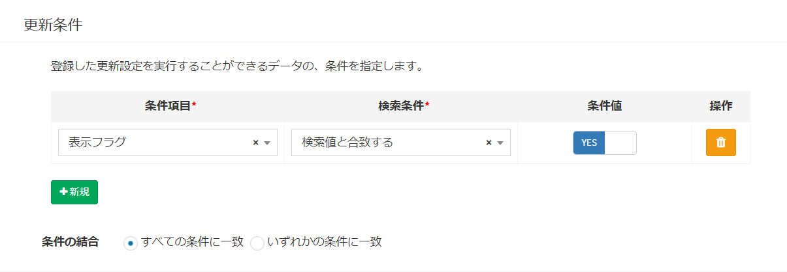

# Data update settings
A setting that rewrites the values of data in one go at a trigger you decide, such as "when a button is clicked" or "when data is newly created".  
For example, it can be used like this.  

- Show a "Done" button on the data details screen of the table "Task information"; clicking it sets the value of the custom column "Status" to done.
- When data is updated, the value of the custom column "Person in charge" is automatically set to the logged-in user.

The flow of the setting is as follows.

1. Open the data update setting screen ("Setting screen")
2. From [New], decide when (the update timing), which column, and what value, and save ("New addition", "Details of entry items")
3. The update is done at the timing you decided ("Update execution")

> This function was called "Batch data update" before v3.5.0. From v3.5.0, the function was extended.  
To update with more complex conditions or contents, make a [plugin (button)](/plugin_quickstart_button) or a [plugin (event)](/plugin_quickstart_event).

## Update timing type

- ##### When check is selected on the list screen

  

A button is added to the data list screen.  
Check the checkboxes on the list screen and click the button: the checked data is updated with the set contents.

- ##### When the button on the data details screen is pressed

  

A button is shown on the data details screen.  
Click the button to update the data with the set contents.

- ##### When creating new data
When a user newly creates data on the screen, by API, by import and so on, the data is updated with the set contents.

- ##### When updating data
When a user updates data on the screen, by API, by import and so on, the data is additionally updated with the set contents.

## Setting screen
1. In the custom table list, check one table you want to set, and click "Table Detail Setting" at the top right.  

  

- Or choose the table you want to set from the menu, and click "Table Detail Setting" at the top right in the same way.  
Note: the table must be shown in the menu beforehand.  

  

2. Then open the "Multi Update Setting" (data update setting) of that custom table.

  

3. The data update setting screen is shown.

  

## New addition
1. On the data update setting screen, click the [New] button at the top right of the page.

2. The screen for adding a new data update setting is shown. Enter the necessary items.

  

## Save
After entering the settings, click [Submit].

## Edit
To edit a data update setting, click the [Edit] link of that row.  

## Delete
To delete a data update setting, click the [Delete] link of that row.  

## Details of entry items

### basic configuration

  

- ##### Process name
The name of this data update setting.

- ##### Update timing
Choose when the data is updated.  
See "Update timing type" near the top of this page and choose.

- ##### Button label
The words shown on the button on the screen.  
Note: shown only when "Update timing" is "Pressing button on the list page" or "Pressing the button on the data details".

- ##### Button icon
The icon shown on the button on the screen.  
Note: shown only when "Update timing" is "Pressing the button on the data details".

- ##### Button HTML class
The HTML class added to the button on the screen.  
Note: shown only when "Update timing" is "Pressing the button on the data details".

- ##### Show Button for Data Locked by Workflow
Usually, the button is not shown on the data details screen for data whose workflow status is "data cannot be edited".  
With YES, the button is shown for such data too. The default is NO.  
The button is shown only to users who have permission to edit that data.  
Note: shown only when "Update timing" is "Pressing the button on the data details".

- ##### Active flag
To stop a data update setting for a while, or to save a half-made setting for now, set "Active Flg" to NO.  

### Update column setting

  

Set the columns to update and the update values.  

- ##### Target column
Select the column to update.  

- ##### Update type
When the custom column type of the target column is "Date", "Time", "Date and Time", "User" or "Organization", you can choose "Fixed Value" or "System Value".  
Otherwise, there is only "Fixed Value".

- ##### Update value
    - When the update type is "Fixed Value", enter the value you want to set.
    - When the update type is "System Value", the following choices are shown, depending on the custom column type of the target column.

| Custom column type of the target column | Choices |
|---|---|
| "Date", "Time", "Date and Time" | "Execute Datetime" |
| "User" | "Login User", "Created user" |
| "Organization" | "Berong Organizations" (the organizations the user belongs to) |

### Update conditions

  

Specify the conditions of the data on which this update setting can be run. The update can be run only when the conditions are met.  
Note: when no condition is set, the update can be run on all data.  

### Input dialog settings

  

A dialog is shown when the update is run, so that the update value of the target column can be entered by hand.  
Note: this can be selected only when "Update timing" is "Pressing button on the list page" or "Pressing the button on the data details".

## Update execution
When the setting is finished, the update is done at the timing decided in the setting item "Update timing".  

### Updates
- The values of the data are set to the values decided in the setting item "Update column setting".  
However, when the update type is "System Value", the values are as follows.  

    - When the update value is "Execute Datetime", the date and time when the update was run is set
    - When the update value is "Login User", the ID of the logged-in user who ran the update is set
    - When the update value is "Created user", the ID of the user who created the data is set
    - When the update value is "Berong Organizations", the ID of the organization the logged-in user who ran the update belongs to is set  
    Note: when the logged-in user belongs to several organizations and the column to update is not set to "Approval Multiple Select" (allow multiple selection), the first organization is saved in the data.

- When a target table column is selected in the setting item "Input dialog settings", a dialog for entering the update value is shown.  

  

    
### Update conditions
- The update cannot be run on data that does not meet the conditions set in "Update conditions".  
- When "Update timing" is "Pressing button on the list page" and you check data that does not meet the conditions and click the update button, an error is shown. In that case, the other data that did meet the conditions is not updated either.
