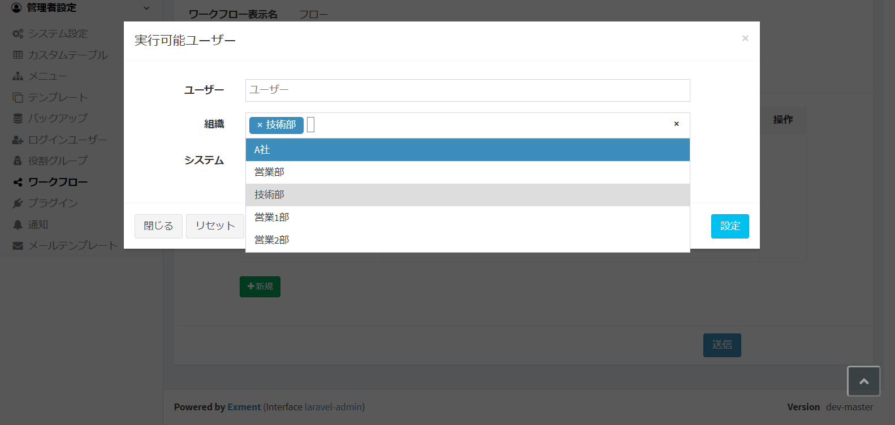
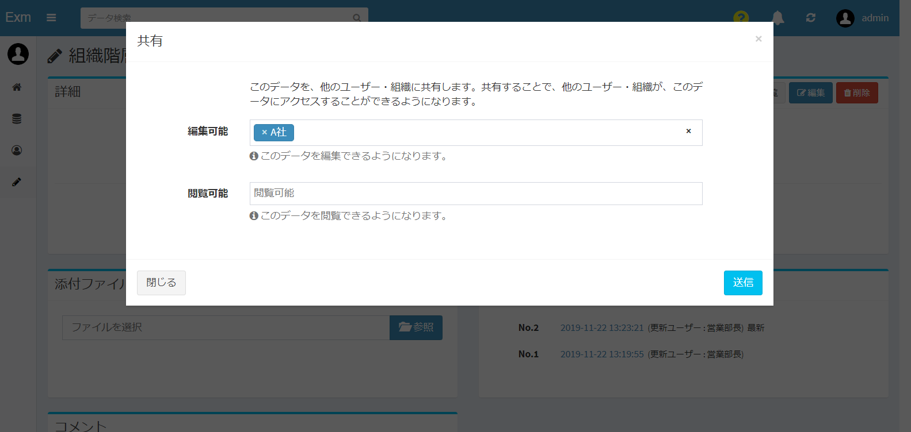
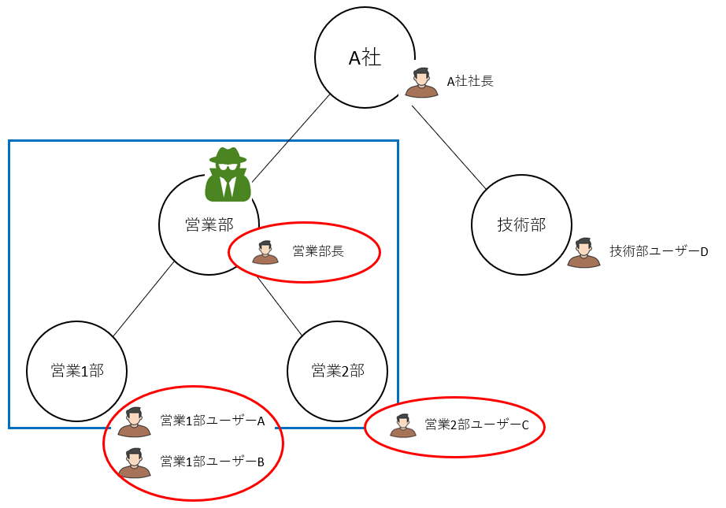

# Organization
This page explains how to register and manage "organizations", such as the departments and sections of a company, in Exment.  
When organizations are registered, you can set permissions, forms, workflows and data sharing for each organization.

> Before you set up organizations, we recommend reading [Overview of roles and permissions in Exment](/permission).

This page has the following contents.

| What you want to know | Where to look |
|---|---|
| Register, edit or delete an organization | Organization management |
| Where the registered organizations are used | Where the organization is used |
| How far parent and child organizations are included | About organization hierarchy |

## Organization management
How to register, edit and delete organizations.

### List screen display
Click "Organization" in the left menu.  
Or open the following URL.  
The organization management screen is displayed.  
http(s)://(URL of Exment)/data/organization  
A list of the organizations currently registered in the system is displayed.
  

> Note: the URL is for the default setting without "/admin" (a site newly installed with v7.2.1 or later). If `ADMIN_ROUTE_PREFIX` in `.env` has a value (a site installed with an older version has "admin"), add that value after the URL of the site (e.g. `http(s)://(URL of Exment)/admin/data/organization`). For details, see [Change / delete "admin" included in URL](/additional_prefix).
  
Note: when you set "EXMENT_SHOW_ORGANIZATION_TREE=true" in the [config](/config?id=perform-hierarchical-display-on-the-department-list-page), the hierarchy is displayed.

### Add new organization
1. On the "Organization" list screen, click the [New] button at the top right of the page.
2. The new addition screen is displayed. Enter the necessary information.  
Note: for the item "Parent organization", select the parent of that organization.

### Save
When you have finished entering, click [Submit].

### Edit
To edit an organization, click the [Edit] link in its row.

### Delete
To delete an organization, click the [Delete] link in its row.

## Where the organization is used
The registered organizations can be used in the following places.

| Place | What you can do |
|---|---|
| Role group | Decide whether the users who belong to the organization can access a page |
| Switching multiple forms | Have the users who belong to the organization use a given form |
| Workflow | The users who belong to the organization can execute workflow actions |
| Sharing custom data | The users who belong to the organization can edit and view the shared data |

#### Role group
You can set an organization in a role group.

- This setting controls whether the users who belong to the organization can access a page or not.  
In these images, the upper one is when the user can access, and the lower one is when the user cannot access.

#### Switching multiple forms
You can set an organization in the conditions for switching multiple forms.  
When the logged-in user belongs to that organization, the form is used.

#### Workflow
You can set an organization in the work user settings of a workflow.  
When the logged-in user belongs to that organization, the user can execute the workflow action.

#### Sharing custom data
You can set an organization as a share target of custom data.  
When the logged-in user belongs to that organization, the permission for the custom data is given, and the user can edit and view the data.

## About organization hierarchy
In Exment, organizations can have a parent and child hierarchy, as in the figure below.

### (For advanced users) Type of hierarchy
When organizations have a hierarchy, you choose how far "the users who belong to the organization" reaches from the following four types.  
Here, as an example, we explain based on the "**Sales Department**".

| Type | Organizations included | Example (based on the Sales Department) |
|---|---|---|
| Organization to which the user belongs | Only the target organization | Sales Manager |
| Include parent hierarchy organization | The target organization and its parent organizations | Sales Manager, President of Company A |
| Include child hierarchy organizations | The target organization and its child organizations | Sales Manager, Sales Department 1 User A, Sales Department 2 User B |
| Includes parent-child organization | The target organization and its parent and child organizations | Sales Manager, President of Company A, Sales Department 1 User A, Sales Department 2 User B |

#### Organization to which the user belongs

Only the users who belong to the target organization itself.  
In the example, only the "Sales Manager" belongs to the Sales Department.

#### Include parent hierarchy organization

The target organization and its parent organizations.  
In the example, the "Sales Manager", who belongs to the Sales Department, and the "President of Company A", who belongs to the parent "Company A", are included.

#### Include child hierarchy organizations

The target organization and its child organizations.  
In the example, the "Sales Manager", who belongs to the Sales Department, and "Sales Department 1 User A" and "Sales Department 2 User B", who belong to the children "Sales Department 1" and "Sales Department 2", are included.

#### Includes parent-child organization

The target organization and its parent and child organizations.  
In the example, the "Sales Manager", who belongs to the Sales Department, the "President of Company A", who belongs to the parent "Company A", and "Sales Department 1 User A" and "Sales Department 2 User B", who belong to the children "Sales Department 1" and "Sales Department 2", are included.

<h4 id="kaisou_syurui">(Advanced) Setting the hierarchy type</h4>

How far the hierarchy is included is set in "System Setting" > "Organization Setting".

- The hierarchy can be set only for "Role group" and "Sharing custom data".
- For "Form Display Condition Setting" and "Workflow", only the organization to which the user belongs is the target.

### Data sharing settings
With the [data sharing settings of custom data](/data_details?id=data-sharing), other organizations can also access the data.

#### Effective range when sharing custom data
- When data is shared with an organization, the users who belong to that organization can access it.
- Whether the users who belong to a parent or child organization can access it is decided by "Setting the hierarchy type > Organization Tree Setting(Data)" above.
- Organizations of another line cannot access it.

<h4 id="kyouyu_jidou">(For advanced users) Automatic sharing when saving data</h4>

When custom data is newly created, sharing settings are added to the created data automatically.

- By default, the sharing setting is added only for the "login user".
- When you change the setting, the sharing setting is also added for the organization to which the login user belongs.
- This is set in "System Setting" > "Organization Setting".

Each setting works as follows.

##### (1) Only login users
When custom data is newly created, it is shared only with the login user.  
- **Example**: when "Sales Department 1 User A" creates new data, only the user "Sales Department 1 User A" can access it.  

##### (2) Login user and organization to which they belong
When custom data is newly created, it is shared with the login user and **the organization to which the user belongs**.  
- **Example**: when "Sales Department 1 User A" creates new data, it is shared with the user "Sales Department 1 User A" and the organization "Sales Department 1".  
→ As a result, the user "Sales Department 1 User B", who belongs to the organization "Sales Department 1", can also access it.

