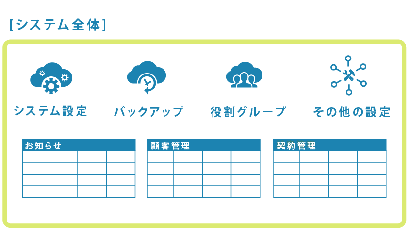
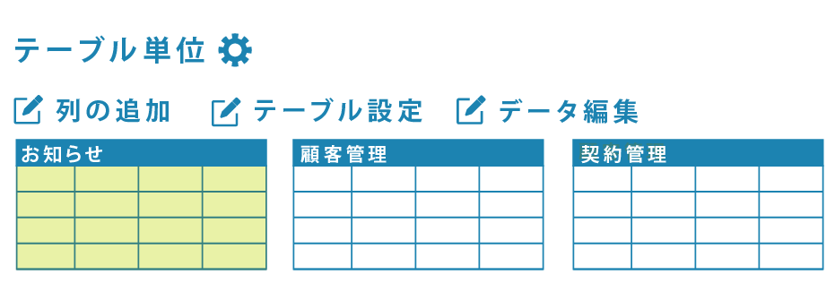
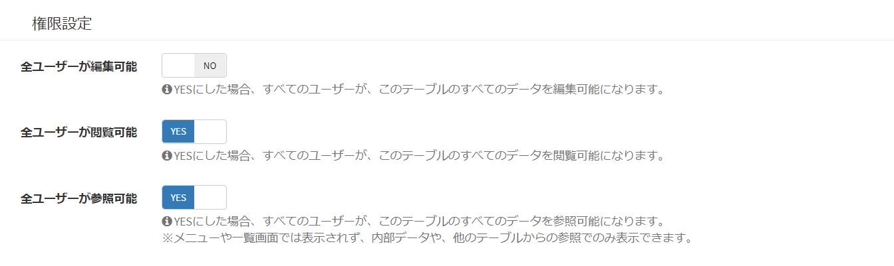
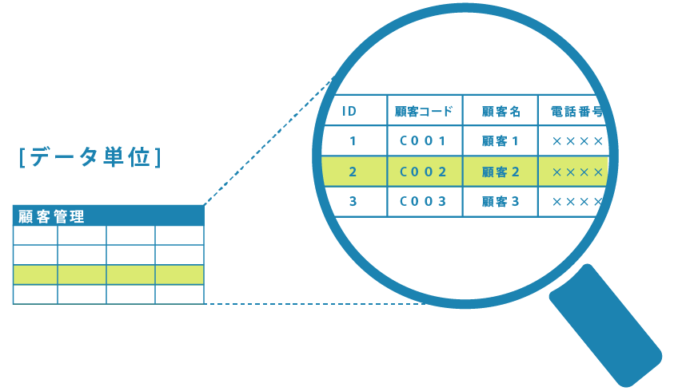

# Overview of roles and authorities
This page gives an outline of roles and permissions in Exment.  
Permissions are an important idea: they make sure that only the users you decide can operate (act on) certain data and pages.

- With the initial settings, a newly added user can use almost no functions even after logging in.  
- The system administrator needs to set suitable roles and permissions for the added user.

Permissions are managed in the following three units. See "Authority management unit" below for details.

| Unit | What can be decided (examples) | Where to set |
|---|---|---|
| (1) Whole system | Change the site name, manage login users | "System Administrator" of the [system setting](/system_setting), "System permissions" of the [role group](/role_group) |
| (2) Table unit | Change the settings of the table, edit and view the data of the table | [Table setting](/table), "Table permissions" of the [role group](/role_group) |
| (3) Data unit | Edit and view only specific data | "Share" on the [data details screen](/data_details), and so on |  

## Whether to use authority
When you do not use the permission settings, switch "Use Role Management" to No in the [system setting](/system_setting).  
When they are not used, all users can do all operations.  

## Differences with and without authority (example)
Whether a user has permission or not changes what the user can do and what the screens show.

##### ■ Only authorized menus are displayed
→ The menu of the logged-in user shows only the items the user has permission for.  

##### ■ Access error occurs
→ Trying to open a page without permission gives an access error.

##### ■ Items are not displayed in the data form options
→ When the column is "Select (From Table)", the choices are not shown without permission for the referenced table.  

## Authority management unit
There are mainly the following three units in which Exment manages permissions.

- Whole system
- Table unit
- Data unit

### Overall view

### (1) Whole system

The permission to operate the system settings of Exment.  
For example, the following operations.  

- Change the site name.
- Manage login users.
- Create, edit and view all tables.

#### How to set permissions

##### System administrator settings
"System Administrator" can be added and changed in the [system setting](/system_setting). A "System Administrator" can do all operations of the system.

##### Other system settings
A user who is not a system administrator can also operate the whole system when given a [role group](/role_group).  
For the permissions of system operations, add or change the "System permissions" in the [role group](/role_group).

### (2) Table unit

The permissions of the tables made in Exment.  
Permissions are set for each table. What each user can do changes with what is set.  
A user with no permission at all for a table cannot open any page of that table.  
  
For example, the following operations.  

- Change the settings of the table, such as adding columns.
- Edit all the data in the table.
- View all the data in the table and edit the data you are in charge of.
- View the data in the table you are in charge of.

#### How to set permissions

##### All user batch settings
Gives permissions such as edit and view to all users, regardless of role, organization and so on. All the data in the table is covered. It can be changed in the [table setting](/table).

##### Other table settings
To give different permissions to each user, use the [role group](/role_group).  
For the permissions of table operations, add or change the "Table permissions" in the [role group](/role_group).

### (3) Data unit

The permissions for each single record.  
Giving permissions per record allows fine-grained use, such as "I want to show only specific data, not all data".  
For example, the following operations.

- Edit specific data.
- View specific data.

#### How to set permissions

##### Basic operation when new data is created
When a user saves data, that user automatically gets the edit permission for the data. (The user does not need to do anything.)

##### When new data is created, add authority to the organization to which the data creator belongs
The data can be shared automatically not only with the user who created it but also with the organization that user belongs to.  

- Example: data created by a user of the sales department is automatically shared with everyone in the sales department

For how to set it, see [Organization settings](/organization).

##### Manually add permissions later (sharing)
Data already created can be shared with other users. The permission can be chosen from view and edit.  
Select "Share" on the [data details screen](/data_details).

  

##### When creating / updating data, add authority to the user / organization set in the column
In Exment, "User" and "Organization" columns can be added as custom columns.  
When data is newly created or updated on the screen or by API, the data can be shared automatically with the users and organizations entered in these "User" and "Organization" columns.  

- Example: a user entered in the "Person in charge" column of the "Task management" table automatically gets the edit permission for the data when the data is saved

For how to set it, see [Data automatic sharing settings](/table?id=data-automatic-sharing-settings).

#### Display speed of tables with a lot of data
For a user who can see data through data unit permissions (data sharing), "which data may be seen" is checked record by record every time the list screen is opened. Therefore, when **the data seen through data sharing is very large** (for example, tens of thousands of records), the display takes time, especially for **a list without a filter**.  
(A measurement on v7.1.0: in a table of 90,000 records, for a user who can see all 90,000 records through data sharing, showing the list without a filter takes about 1.3 seconds. For a user with the permission to view all data, about 0.4 seconds.)

For users who should see **all** the data of a table, give "View All Data" (or "Edit All Data") in the "Table permissions" of a [role group](/role_group), instead of data sharing. The data no longer has to be checked record by record, so the display becomes faster.

Note: with "View All Data", the user can see **all the data of that table, including data added from now on**. To show only a part of the data, keep using data sharing as before.

## Organization / user settings
An outline of the organization and user settings of Exment.  

#### Use of organization
When you do not use the organization settings, switch "Use Organization Management" to No in the [system setting](/system_setting).

#### Organizational hierarchy settings
In Exment, organizations can be managed in a hierarchy.  

When a [role group setting](/role_group) or data sharing is done for an organization, you can specify whether to include the "parent and child", the "parent" or the "child" of the organization hierarchy.  
For how to set it, see [Organization settings](/organization).

#### About the acquisition range of user / organization information of another organization
When Exment is used like an in-house portal site, it is not a big problem if other users can see "which users are using it" and "which organizations and companies are registered".

However, when users outside the company also use Exment, being able to get and view the user information of other companies can be a problem.

  
With the [settings for an external portal site](/multiuser), getting and viewing the user information of other companies can be restricted.

## Related page
- [System setting](/system_setting)
- [Role group setting](/role_group)
- [Data details screen](/data_details)
- [Organization settings](/organization)
- [Settings for an external portal site](/multiuser)
