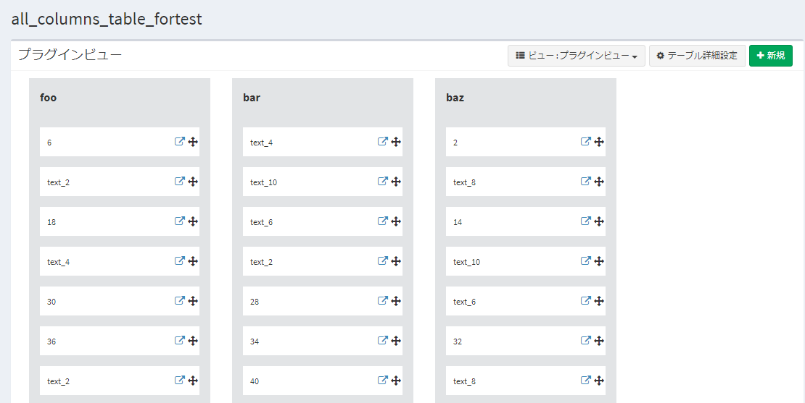
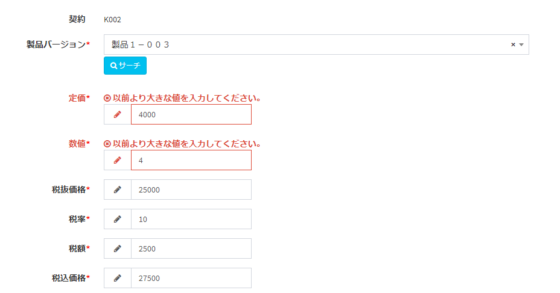
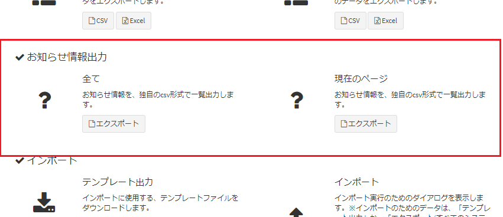

# Plugin
A plugin is a program that adds functions to Exment.
This page explains the types of plugins, and how to upload, set, delete and give permissions for them.

- To see how to install one right away, see "[Management method](/plugin?id=management-method)".
- For the official plugins made by Exceed One, see [Official plugins](/plugin_official).
- To make a plugin yourself, see [Plugin development method](/plugin_quickstart.md).

## What is a plugin
When the standard functions of Exment are not enough for your business, you can add functions by uploading a program (a zip file) from the screen. This is a "plugin".  
There are currently the following types of plugins.

- [button](#button)
- [event](#event)
- [page](#page)
- [dashboard](#dashboard)
- [view](#view)
- [CRUD page](#crud-page)
- [batch](#batch)
- [API](#api)
- [validation](#validation)
- [script](#script)
- [style](#style)
- [import](#import)
- [export](#export)
- [document output](#document-output)
- [Docurain(PDF output)](#docurain)
- [trigger ※not recommended](#trigger)

#### button
You can add a button to the Exment list screen or form screen, and run a process when it is clicked.  
※Please refer to [here](/plugin_quickstart_button) for the implementation method.  
  
A button can be placed in the following four places.
##### Menu button on the list screen
Adds a button at the top of the data list screen and raises an event when it is clicked.

##### Menu button on the data details screen
Adds a button at the top of the data details screen and raises an event when it is clicked.

##### Menu button on the new data creation screen
Adds a button at the top of the new data creation screen and raises an event when it is clicked.

##### Menu button on the data update screen
Adds a button at the top of the data update screen and raises an event when it is clicked.

#### event
It is executed when a specific operation is done on an Exment screen, and can do processing such as updating values.  
※Please refer to [here](/plugin_quickstart_event) for the implementation method.  
  
The specific operations are the following.

- ##### At the start of loading
The process starts at the beginning of the loading of the page. (It is not before all other processing.)

- ##### Immediately before saving
The process starts just before the data is saved.

- ##### After saving
The process starts after the data is saved.

- ##### After deleting
The process starts after the data is deleted.

- ##### Immediately before workflow execution
The process starts just before the workflow is executed.

- ##### After executing the workflow
The process starts after the workflow is executed.

- ##### Immediately before executing the notification
The process starts just before the notification is executed.

- ##### After executing the notification
The process starts after the notification is executed.

#### page
You can create a new screen in Exment.  
Use this when you want a page that is completely different from the standard functions.  
※Please refer to [here](/plugin_quickstart_page) for the implementation method.

#### dashboard
You can create a new screen on the Exment dashboard.  
Use this when you want to use your own page as a dashboard item.
※Please refer to [here](/plugin_quickstart_dashboard) for the implementation method.

#### View
You can create a new design or your own functions and add them to Exment's custom data list screen.  
Use this when you want functions completely different from the standard views: the list, summary and calendar views.  
※Please refer to [here](/plugin_quickstart_view) for the implementation method.

#### CRUD page
Creates a new page with almost the same screen structure as Exment's list, details, create, update and delete screens.  
You can manage external data on Exment screens without importing it into Exment. Multiple endpoints are supported too.  
※Please refer to [here](/plugin_quickstart_crud) for the implementation method.

#### batch
This can be used when you want to run periodic processing automatically.  
It can also be used when you want to run a certain process at once, such as updating statuses in bulk.  
※Please refer to [here](/plugin_quickstart_batch) for the implementation method.

#### API
You can create a new API in Exment.  
Use this when you add a function that does not exist in the [API Reference](https://exment.net/reference/ja/webapi.html).  
※Please refer to [here](/plugin_quickstart_api) for the implementation method.

#### script
You can execute your own script (javascript).  
Currently supported: when the data list screen, the data details screen, the new data creation screen or the update screen is shown.  
※Please refer to [here](/plugin_quickstart_script) for the implementation method.

#### style
You can set your own style (style sheet / css) and change the design.  
※Please refer to [here](/plugin_quickstart_style) for the implementation method.

#### validation
This can be used when you want to implement your own validation (check of the entered values) of a custom table.  
Use it to implement complicated checks, or checks of the relation between items.  
※Please refer to [here](/plugin_quickstart_validate) for the implementation method.

#### import
This can be used when you want to implement your own import of custom data.  
Use it when you import files in an original format, or implement a special conversion.  
※Please refer to [here](/plugin_quickstart_import) for the implementation method.

#### Export
This can be used when you want to implement your own export of the custom data list.  
Use it when you export a file in an original format, or implement a special conversion.  
The output can be Excel, and other formats are possible too.  
※Please refer to [here](/plugin_quickstart_export) for the implementation method.

#### document output
You can create your own documents, such as quotations and forms.  
The template is in Excel format, and the output is also in Excel format.  
※Please refer to [here](/plugin_quickstart_document) for the implementation method.
※For output in PDF format, please consider the [Docurain plugin](/plugin_quickstart_docurain).

<h4 id="docurain"><a href="#/plugin?id=docurain" data-id="Docurain(PDF output)" class="anchor">Docurain(PDF output)</a></h4>

PDF output is done with **Docurain**, a cloud form engine with which forms can be developed with only Excel and json.  
The template is in Excel format, and the output is in PDF format.  
※Please refer to [here](/plugin_quickstart_docurain) for the implementation method.

#### trigger
※Deprecated from v3.2.0.  
From now on, please implement with a "button" or an "event".

## Official plugins
Official plugins are made and supported by Exceed One. Download them from [exceedone/exment-plugins](https://github.com/exceedone/exment-plugins) on GitHub.  
For how to install them, see [Official plugins](/plugin_official).

| Plugin | What it does |
| --- | --- |
| [Project Management](/plugin_pm) | Management of projects and issues (tickets): issue tree, milestones, board, Gantt chart, wiki, comments, notifications and more |
| [Support Desk](/plugin_support_desk) | A help desk. Requests by mail, request form and phone are managed as tickets, and the progress is shared with the customer without a login |
| [Groupware](/plugin_groupware) | Web mail, and opening and editing the Office files of File sharing in the browser |

## Management method
### Page display
- Select "Plugin" from the left menu.  
Or access the following URL.  
http(s)://(Exment URL)/plugin  
The plugin screen is displayed.  

> Note: the URL is for the default without "/admin" (a site newly installed with v7.2.1 or later). If `ADMIN_ROUTE_PREFIX` in `.env` has a value (an older site has "admin"), add it after the URL of the site (e.g. `http(s)://(Exment URL)/admin/plugin`). For details, see [Change / delete "admin" included in URL](/additional_prefix).

### Plugin upload
1. Click [Choose File] and select the zip file of the plugin.
2. Click [Upload].
3. When it is completed, the plugin information is displayed in the list at the bottom of the page.

### Plugin management
Change information such as whether the plugin is active, the trigger of the plugin and the URI of the page.  
In the list, click the [Edit] link in the row of the plugin you want to change.  

The plugin management page is displayed.  

### Management items

##### Valid flag
Switches whether the plugin is used in the system ("Active Flg").  
YES makes it active. NO makes it inactive, and it is not executed in the system.  
※When a plugin is uploaded, the default is YES. However, when the plugin type is "batch", the default at upload is NO.

##### Target table
Specify the custom tables on which the plugin is executed.  
The plugin is executed when a page of a table set here is displayed.

##### Enforcement trigger
Set at which operation the plugin is executed.
The plugin is executed when the operation set here is done.

##### Button heading
Set the heading shown on the button when "Menu button on List View" or a form menu button ("Menu button on Form Create View", "Menu button on Form Edit View") is displayed.

##### Button icon
Set the icon shown on the button when "Menu button on List View" or a form menu button ("Menu button on Form Create View", "Menu button on Form Edit View") is displayed.

##### Button class
Set the class added to the HTML of the button when "Menu button on List View" or a form menu button ("Menu button on Form Create View", "Menu button on Form Edit View") is displayed.

## Remove plugin
To delete a plugin, click the [Delete] link in the row of that plugin on the list screen.  
  
※[Delete] deletes the plugin file itself.  
If you only want to stop the plugin for a while, do not delete it; set "Active Flg" to NO.

## Role permission management

With permissions, you can separate the users and organizations that can change the settings of a plugin from the users and organizations that can use the plugin.  
For example, settings like these are possible.

- Only a certain department or the managers can access the page of a plugin
- Only a certain department or the managers can output documents

### How to manage

#### Management by role groups
- Open the [Role group setting](/role_group) page.
- In the "Plugin permission settings" section, set the permissions of the plugin you want to manage.

##### Permission list
- **Manage Setting** : For a plugin that has settings, the user can change the settings of this plugin.  
※The user cannot delete or upload plugins. To allow deleting, add "Manage Plugin".
- **Access** : The user can actually use the plugin or access its pages. What is controlled depends on the type of the plugin.
    - **Button, document output** : Whether the button is shown on the screen.
    - **Page, dashboard** : Whether the page can be accessed.
    - **API** : Whether the API can be executed. (When access is not allowed, a 403 error occurs.)
    - **Import, export** : Whether the import or export of data can be executed.
    - **Others** : They cannot be controlled by role groups. They are executed for all users.

#### Management for each plugin
This is the way to let all users use the plugin, without role groups.

- Open the edit screen of the plugin.

- Set "All user can use" to YES and save.  
(The item is shown only when the plugin type is button, document output, page, dashboard, API, import or export.)

- Regardless of the role group settings, all users can use and access the plugin.

> For backward compatibility, plugins uploaded with a version lower than v3.2.0 have "All user can use" set to YES.  
In plugins uploaded with v3.2.0 or later, the default is NO.

## Other
For how to develop plugins, see [Plugin development method](/plugin_quickstart.md).
