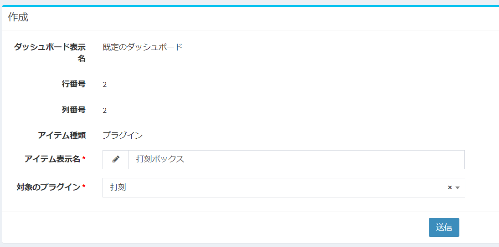

## Plugin (Dashboard)
You can create a new screen on the Exment dashboard.  
Use this when you want to use your own page as a dashboard item.  
This page explains how to make a plugin (dashboard), with buttons for clocking in and out as the example.

## Introduction
Exment plugin pages are developed using the PHP framework [Laravel](http://laravel.jp/) and the admin library [exment-admin-core](https://github.com/exceedone/exment-admin-core) (based on laravel-admin / open-admin; laravel-admin in v6.x or earlier).  
When developing a page, it is recommended that people with knowledge of Laravel develop it.  

## How to make

### sample
Here, the following page is created as a sample.
- Create a table to manage the users' clocking in and out.
- Display the buttons for clocking in, clocking out, starting a break and ending a break on the dashboard.
- By clicking the button, the time of the click is set in the data.
  
  

※  Please import [this](https://exment.net/downloads/sample/template/dakoku.zip) template in advance.  

- Sample plug-in [here](https://github.com/exment-git/plugin-sample/tree/main/dashboard/Dakoku).  

### Create config.json
- Create the following config.json file.

~~~ json

{
    "plugin_name": "Dakoku",
    "plugin_view_name" : "Time clock",
    "description": "A plugin for clocking in and out on the dashboard.",
    "uuid":  "691a24f2-2c7a-42c5-8cff-23c5277f6f22",
    "author":  "Kajitori",
    "version": "1.0.0",
    "plugin_type": "dashboard",
    "route": [
        {
            "uri": "post",
            "method": [
                "post"
            ],
            "function": "post"
        }
    ]
}

~~~

- plugin_name should be written in alphanumeric characters.
- uuid is a character string of 32 characters + hyphen, totaling 36 characters. Used to make the plugin unique.  
Please create from the following URL etc.  
https://www.famkruithof.net/uuid/uuidgen
- plugin_type should be written as dashboard.  
- route defines a list of URL endpoints to be executed, their HTTP methods, and methods in the controller.  
    - uri: uri for page display. The actual URL is "http(s)://(Exment URL)/dashboardbox/plugin/(URL set on the plugin management screen)/(ID of the dashboard item)/(specified uri)".  
    - method: HTTP method. Please fill in with get, post, put, delete.
    - function: Method in the Controller to execute
- Be sure to include a route whose uri is empty (""). This endpoint is accessed when the screen moves from the menu to the plugin page.

> Note: the URL is for the default without "/admin" (a site newly installed with v7.2.1 or later). If `ADMIN_ROUTE_PREFIX` in `.env` has a value (an older site has "admin"), add it after the URL of the site (e.g. `http(s)://(Exment URL)/admin/dashboardbox/plugin/(URL set on the plugin management screen)/(ID of the dashboard item)/(specified uri)`). For details, see [Change / delete "admin" included in URL](/additional_prefix).

### Plugin file creation

#### Create main logic
Create the following PHP file. File name should be "Plugin.php".

~~~ php
<?php

//(1)
namespace App\Plugins\Dakoku;

use Exceedone\Exment\Services\Plugin\PluginDashboardBase;
use Exceedone\Exment\Model\CustomTable;

class Plugin extends PluginDashboardBase
{
    /**
     *
     * @return Content|\Illuminate\Http\Response
     */
    public function body()
    {
        if(is_null(CustomTable::getEloquent('dakoku'))){
            return 'The time clock table is not installed.';
        }
        
        $dakoku = $this->getDakoku();
        $status = $this->getStatus($dakoku);
        $params = $this->getStatusParams($status);

        // (3)
        return view('exment_dakoku::dakoku', [
            'dakoku' => $dakoku,
            'params' => $params,
            'action' => $this->getDashboardUri('post'),
        ]);
    }

    /**
     * Submit
     *
     * @return void
     */
    public function post()
    {
        $dakoku = $this->getDakoku();
        
        $now = \Carbon\Carbon::now();

        if(!isset($dakoku)){
            $dakoku = CustomTable::getEloquent('dakoku')->getValueModel();
            $dakoku->setValue('target_date', $now->toDateString());
        }

        $status = null;
        switch(request()->get('action')){
            // Clock in
            case 'syukkin':
                $dakoku->setValue('syukkin_time', $now);
                $status = 1;
                break;
            // Start of break
            case 'kyuukei_start':
                $dakoku->setValue('kyuukei_start_time', $now);
                $status = 11;
                break;
            // End of break
            case 'kyuukei_end':
                $dakoku->setValue('kyuukei_end_time', $now);
                $status = 21;
                break;
            // Clock out
            case 'taikin':
                $dakoku->setValue('taikin_time', $now);
                $status = 99;
                break;
        }
        if(isset($status)){
            $dakoku->setValue('status', $status);
        }
        $dakoku->save();

        admin_toastr(trans('admin.save_succeeded'));
        return back();
    }

    /**
     * Get current attendance status
     *
     * @return void
     */
    protected function getDakoku(){
        $table = CustomTable::getEloquent('dakoku');
        if(!isset($table)){
            return null;
        }
        
        
        // Get the current time
        $now = \Carbon\Carbon::now();

        // If it is before the reference time, treat it as the previous day
        if($now->hour <= 4){
            $now = $now->addDay(-1);
        }

        // Get the time clock record of that day
        $query = getModelName('dakoku')::query();
        $query->where('value->target_date', $now->toDateString())
            ->where('created_user_id', \Exment::user()->base_user_id);

        $dakoku = $query->first();

        return $dakoku;
    }

    /**
     * Get status
     *
     * @param [type] $dakoku
     * @return int
     */
    protected function getStatus($dakoku){
        if(!isset($dakoku) || is_null($dakoku->getValue('syukkin_time'))){
            return 0;
        }

        return $dakoku->getValue('status');
    }

    protected function getStatusParams($status){
        switch($status){
            case 0:
                return 
                [
                    'status_text' => 'Not clocked in',
                    'buttons' => [
                        [
                        'button_text' => 'Clock in',
                        'action_name' => 'syukkin',
                        ]
                    ]
                ];
            // Clocked in
            case 1:
                return  
                [
                    'status_text' => 'At work',
                    'buttons' => [
                        [
                            'button_text' => 'Break',
                            'action_name' => 'kyuukei_start',
                        ], 
                        [
                            'button_text' => 'Clock out',
                            'action_name' => 'taikin',
                        ], 
                    ]
                ];
        
            case 11:
                return 
                [
                    'status_text' => 'On break',
                    'buttons' => [
                        [
                            'button_text' => 'End break',
                            'action_name' => 'kyuukei_end',
                        ], 
                    ]
                ];
            case 21:
                return 
                [
                    'status_text' => 'At work',
                    'buttons' => [
                        [
                            'button_text' => 'End break',
                            'action_name' => 'kyuukei_syuryo',
                        ], 
                    ]
                ]; 
                
            case 99:
                return 
                [
                    'status_text' => 'Clocked out',
                    'buttons' => [
                    ]
                ];
        }
    }
}
~~~
- (1) The namespace should be **App\Plugins\\(Pascal case of plugin name)**. [Click here for details](/plugin_quickstart?id=plugin-name-namespace)  
Also, the class name should be "Plugin" and inherit PluginDashboardBase.

- (2) The public method name in the class is the name described in function of config.json.

- (3) When using a view, add "exment_(snake case of the plugin name)::" as the prefix of the view name.

- (4) If you want to get the plugin endpoint, use the function "$this->getDashboardUri('endpoint name')".  
※ If you want to get the URL full path, use admin_url($this->getDashboardUri('endpoint name')).

#### (Optional) About views
When separating views, save the blade file under the folder "resources/views".

#### (Optional) For css, js, and other static files
- Place the css file in the folder "public/css".
- Please place the js file in the folder "public/js".
- Other files (such as image files) should be placed in the folder "public/assets".

### Compress to zip
Compress the above two files, as the minimum set, into a zip.  
The zip file name should be "(plugin_name).zip".  
- Dakoku.zip
    - config.json
    - Plugin.php
    - (Other required PHP files, image files, etc.)

### Other
- If you want to display the data details of a specific ID value, add the following description to the route of config.json.  
You can specify uri like "{id}".  

~~~ json

{
    "route": [
        {
            "uri": "show_details/{id}",
            "method": [
                "get"
            ],
            "function": "show_details"
        }
    ]
}

~~~

## Reflect on dashboard
To show the uploaded plugin on the dashboard, do the following steps.  

1. Click "New" on the dashboard.  
When a plugin of the type "Dashboard" has been uploaded, "Plugin" is shown in the choices.  
  

2. Enter the display name and the target plugin, and submit.
  

3. The selected item is displayed on the dashboard.  
  

### Sample plugin
[Time clock management](https://github.com/exment-git/plugin-sample/tree/main/dashboard/Dakoku)  
※ Please import [this template](https://exment.net/downloads/sample/template/dakoku.zip).
