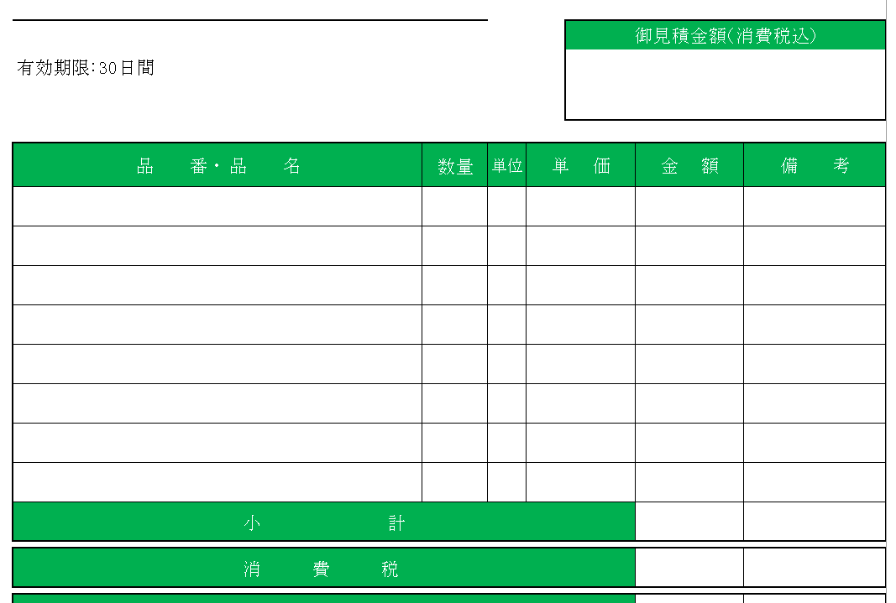

# Plugin (document output)
This plugin outputs your own documents, such as quotations and forms.
The template they are based on is made in Excel format. The output file is also in Excel format.

   

> For output in PDF format, see [Document output (Docurain)](/plugin_quickstart_docurain).

## How to make

### Create config.json
- Create the following config.json file.  

~~~ json
{
    "plugin_name": "PluginDemoDocument",
    "uuid": "1e7881d0-324f-11e9-b56e-0800200c9a66",
    "plugin_view_name": "Plugin Document",
    "description": "Test to output documents.",
    "author": "(Your Name)",
    "version": "1.0.0",
    "plugin_type": "document",
    "filename": "Estimate_${ymdhms}",
    "target_tables": "estimate",
    "label": "Estimate output",
    "icon": "fa-files-o",
    "button_class": "btn-success"
}
~~~

- Enter plugin_name in single-byte alphanumeric characters.
- uuid is a string that tells plugins apart. It is 32 characters plus hyphens, 36 characters in total. Make sure it is not the same value as another plugin's.  
You can make one at the following URL, for example.  
https://www.famkruithof.net/uuid/uuidgen
- Enter document for plugin_type.  
- file_name is the file name used for the output. You can use [parameter variables](/params).
- target_tables is the table(s) to output from. If there are several, separate them with commas.
- label is the label of the button for the document output.
- icon is the icon of the button for the document output.
- button_class is the class of the button for the document output.

Note: target_tables, label, icon and button_class can be changed later on the plugin setting screen.

### Create template Excel file
Create the template file that the document is based on.  
The template file is in Excel format (xlsx). The output file is also in Excel format (xlsx).  
Note: name the template Excel file "document.xlsx".  
Note: for the parameters written in the template file, see "Parameters" below.

#### Parameters
These are the parameters set in the Excel file of the template.
When you enter a variable of a fixed form in an Excel cell, the value registered in the system is output at the time of the document output.
##### basic rule
- Enter it in an Excel cell by the rule "**${variable name}**".  
Example: "${year}" "${month}" "${value:estimate_code}"  
  

- Several parameters can be set in the same cell.  

- Functions can be set in the Excel file. Note: some functions may not work properly. Be sure to check that they work.  

- For the parameter variables that can be set, see the following page.  
[Parameter variables](/params)

##### List output method of child table data
For some kinds of document, the data of the child table of the target data must be output as a list.
Example: "Estimate", where the estimate date and the customer information are registered, and "Estimate details", where the list of the estimated products is registered  
  
The steps to output the list of data into this table are as follows.

1. Set the following parameter in the first column of the first row of the table to output.
**"${loop:(table name of the child table):start}"**  
Example: ${loop:estimate_detail:start}  
  

2. In the second row of the table to output, set the following parameter in each column of the items you want to output.
**"${loop-item:(table name of the child table):(column name of the child table)}"**  
Example: ${loop-item:estimate_detail:product_detail_name}  
  

3. Set the following parameter in the first column of the last row of the table to output.
**"${loop:(table name of the child table):end}"**  
Example: ${loop:estimate_detail:end}  
  

##### Other restrictions
- PhpSpreadSheet 1.22.0, the latest version as of February 25, 2022, does not support the following. Please do not include them in the template.  
    - Inserted shapes
    - Charts
    - Tables made with "Format as Table"

- If the output file does not contain the images, see "Image output fails in document output using Excel as a template" in [Troubleshooting](/troubleshooting).

### Create PHP file (optional)
- For a normal document output, it is enough to prepare document.xlsx with the parameter variables set.
Create a PHP file only when you want to process the data in a special way, or to output data from outside Exment. The name is "Plugin.php".
**Note: if no special processing is needed, this Plugin.php file is not needed.**

~~~ php
<?php
namespace App\Plugins\PluginDemoDocument; // (PluginDemoDocument: plugin name)

use Exceedone\Exment\Model\Define;
use Exceedone\Exment\Model\System;
use Exceedone\Exment\Services\Plugin\PluginDocumentBase;

class Plugin extends PluginDocumentBase
{
    /**
     * The function called before the variables of the document are replaced
     *
     * @param SpreadSheet $spreadsheet
     * @return void
     */
    protected function called($spreadsheet)
    {
        // Put your own processing here to run it before the variables of the document are replaced
    }

    /**
     * The function called after the variables of the document are replaced
     *
     * @param SpreadSheet $spreadsheet
     * @return void
     */
    protected function saving($spreadsheet)
    {
        // Select the first sheet
        $sheet = $spreadsheet->getSheet(0);
        // Set the site name in cell B1
        $sheet->setCellValue('B1', System::site_name());

        // Get the Exment news
        $items = $this->getItems();

        foreach ($items as $idx => $item) {
            // Output from the 4th row
            $row = $idx + 4;
            // Output the date to cell A?
            $date = \Carbon\Carbon::parse(array_get($item, 'date'))->format(config('admin.date_format'));
            $sheet->setCellValue("A$row", $date);
            // Output the link to cell B?
            $link = array_get($item, 'link');
            $sheet->setCellValue("B$row", $link);
            // Output the title to cell C?
            $title = array_get($item, 'title.rendered');
            $sheet->setCellValue("C$row", $title);
        }
    }

    /**
     * Get the Exment news from the API
     *
     * @return array exment news items array
     */
    protected function getItems()
    {
        $client = new \GuzzleHttp\Client();
        $response = $client->request('GET', Define::EXMENT_NEWS_API_URL, [
            'http_errors' => false,
            'query' => $this->getQuery(),
            'timeout' => 3, // Response timeout
            'connect_timeout' => 3, // Connection timeout
        ]);

        $contents = $response->getBody()->getContents();
        if ($response->getStatusCode() != 200) {
            return [];
        }
        return json_decode_ex($contents, true);
    }

    /**
     * The query conditions passed to the API
     *
     * @return array query string array
     */
    protected function getQuery()
    {
        $request = request();

        // get querystring
        $query = [
            'categories' => 6,
            'per_page' => System::datalist_pager_count() ?? 5,
            'page' => $request->get('page') ?? 1,
        ];

        return $query;
    }

    /**
    * (For v3.4.3) Decides whether the button is shown on the screen. The default is true
    * 
    * @return bool true: render, false: do not render
    */
    public function enableRender(){
        // Show the button when the value of the custom column "view_flg" is "1"
        return $this->custom_value->getValue('view_flg')  == 1;
    }
}

~~~

- The namespace should be **App\Plugins\\(plugin name in Pascal case)**. [Click here for details](/plugin_quickstart?id=plugin-name-namespace)

- Your own processing goes in the following two functions. The spreadsheet is passed to these functions as an argument. You can access this spreadsheet and set values in cells.  
Note: for how to use the spreadsheet in detail, see the [PhpSpreadsheet documentation](https://phpspreadsheet.readthedocs.io/en/latest/).
    - To process before the parameter variables are replaced: implement the "called" method.
    - To process after the parameter variables are replaced: implement the "saving" method.

- The Plugin class extends the class PluginDocumentBase.  
PluginDocumentBase has properties such as the custom table that called it, $custom_table, and the table value, $custom_value.  
The values are assigned to these properties when the execute function is called.  
For details of the properties, see the [Plugin reference](/plugin_reference).  

- (For v3.4.3) To control whether the button is shown or hidden by the registered data, implement the method "enableRender".  
Return true to show the button and false to hide it. (The default is true.)

### Compress to zip
Compress the above files, as the minimum configuration, into a zip.  
The zip file name should be "(plugin_name).zip".  
- PluginDemoDocument.zip
    - config.json
    - document.xlsx
    - Plugin.php (optional)
    - (Other necessary PHP files, image files, etc.)

### Upload
Upload the plugin.  
Note: see [Plugin](/plugin) for how to upload.  

### Execute document output
When all the settings are done correctly, a button is shown on the data details screen.
  
  
When you click the button, the file is listed in "Attachment File".
 

### Sample plugin
[User information output](https://github.com/exment-git/plugin-sample/tree/main/document/document_demo_user)  
Note: the "User information output" button is shown on the user information screen.  

### Product plugin
[Invoice PDF output](https://github.com/exment-git/plugin-product/tree/main/document/PluginInvoiceDocument)  
Note: it outputs the invoice in EXCEL format with a template. It also converts the EXCEL file to PDF.
