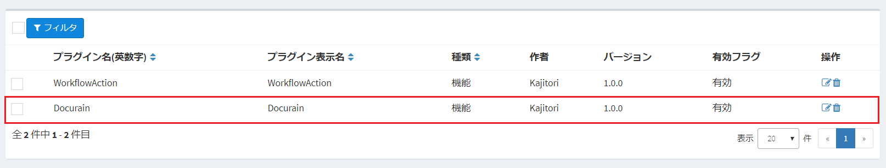
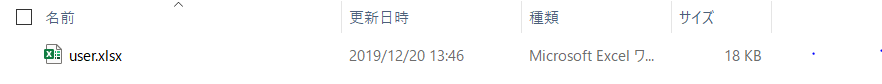

# Document output (Docurain)
How to output forms as PDF with the cloud form engine **Docurain**. With Docurain, forms can be developed with only Excel and json.

> For output in Excel format, see [Plugin (document output)](/plugin_quickstart_document).

## What is Docurain?
Docurain is a cloud form engine with which forms can be developed with only Excel and json.  
Forms of various layouts can be made from Excel file templates. Output in PDF format is also supported.
[Click here for the Docurain site](https://docurain.jp/)

> Docurain is a service developed and operated by Root42 Inc.
A license token is needed to use it. The fee is pay-as-you-go, by the number of form outputs. (A trial token can be issued.)
Kajitori Co., Ltd., the company that develops and operates Exment, is a distributor of Docurain. For trial requests, applications and inquiries, please use [this page](https://exment.net/docurain).

## Execution method
1. Download the [Docurain plugin](https://github.com/exment-git/plugin-sample/tree/main/docurain/Docurain).

2. Upload it as an Exment plugin.
For the steps, see [Plugin upload](/plugin?id=plugin-upload).

3. After the upload, click the row of the Docurain plugin and open the plugin setting screen.

  

4. Enter the following.

- target Table: the table for which Docurain is run

  

- Token: the Docurain execution token. To have a token issued, please ask through the [inquiry page](https://exment.net/inquiry)

  

- List of table names and form file names: enter the name of the table whose forms are output, the template file name, the name of the form file to output and the label of the button, separated by commas. If there are several, separate them with line breaks.
Note: Japanese cannot be used in the template file name. (It can be used in the form file name and the button label.)  
Note: when the form file name is omitted, the template file name is used.  
Note: when the label of the button is omitted, the label set in common for the plugin is used.  
Note: the form file name can contain [parameters](/params) such as a date.

  

5. Put the Excel file that the form is based on in the "documents" folder inside the unzipped folder.
To make several forms with Docurain, put several Excel files in documents.
Note: the folder path is "(project root folder)/storage/app/plugins/Docurain/documents".
Note: for how to make a form, see "Template Excel file creation" below.

  
  

6. When the settings so far are done, a button is shown on the table selected in "target Table".

  

7. Click the button, and the form is made.

  

### Template Excel file creation
Create the Excel file that the form is based on.  
Note: Japanese cannot be used in the name of the Excel file. The extension must be xlsx.  
Note: the parameters of the template file are written differently from the usual Exment parameters. The Docurain way of writing is needed.

#### Parameters
These are the parameters set in the Excel file of the template.
When you enter a variable of a fixed form in an Excel cell, it is converted to various values at the time of the form output.

##### System value
| Item | Description |
| ---- | ---- |
| %{system.site_name} | The site name of the system |
| %{system.site_name_short} | The site name of the system (short) |
| %{system.system_mail_from} | The sender of the system |
| %{system.system_url} | The home URL of the system |
| %{system.login_url} | The login URL of the system |

##### data
| Item | Description |
| ---- | ---- |
| %{id} | The ID of the target data is set. (Example: 123) |
| %{suuid} | The suuid (Short UUID, a random string of 20 characters) of the target data is set. |
| %{value_url} | The link that shows the target data is set. |
| %{value.(column name)} | The value of the column of the target data is set. (Example: when %{value.user_code} is written for user data, the user code is set) |
| %{select_table.(column name).(column name of the referenced table)} | When the column of "column name" is "Select (From Table)", "User" or "Organization", the value of the column of the referenced table is set. (Example: when the "contract information (contract)" table has a "customer (client)" column that refers to the "customer information (client)" table, setting %{select_table.client.client_code} shows the customer code (client_code) of the "customer information (client)" table) |
| %{parent.(column name of the referenced table)} | The value of the column of the parent table is set. (Example: to refer, from the "contract detail information (contract_detail)" table, to the contract code (contract_code) of its parent "contract information (contract)" table, write %{parent.contract_code} and the contract code is set) |
| $ENTITY.children.(child table name) | The information of the child table is set with a block syntax such as "#foreach". There can be more than one row of child table information, so it cannot be set like %{children.(child table name).(column name of the child table)}. An example is explained below. |

#### Setting Example
##### basic rule
- General EXCEL functions and formatting can be used.  
- Column A is a column only for writing logic. Write block syntax such as #if, #foreach and #set there.

##### * Example of template

- This is the PDF that results from outputting the template above.   

#### Download sample template
[User information](https://exment.net/downloads/product/plugin/Docurain/user.xlsx)  
[Product version information](https://exment.net/downloads/product/plugin/Docurain/product_version.xlsx)  
[Contract information](https://exment.net/downloads/product/plugin/Docurain/contract.xlsx)  
Note: to use the product version information and the contract information, the "Template for product sales companies" must be imported beforehand.

### About the error
- An error may be shown after you run the output.
In that case, check what the error says and deal with it.

- For an error whose "HTTP status code" is "413", the allowed value of the service must be changed on the Docurain cloud service side.
In that case, please ask through [this page](https://exment.net/docurain).
