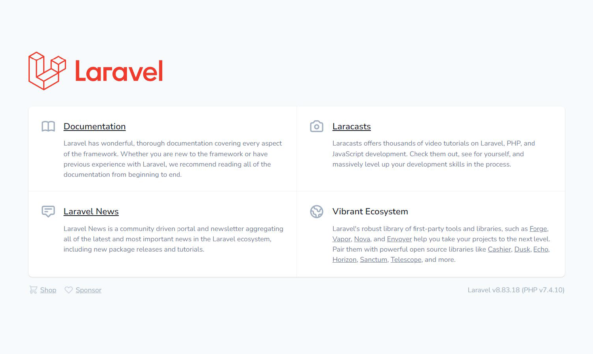
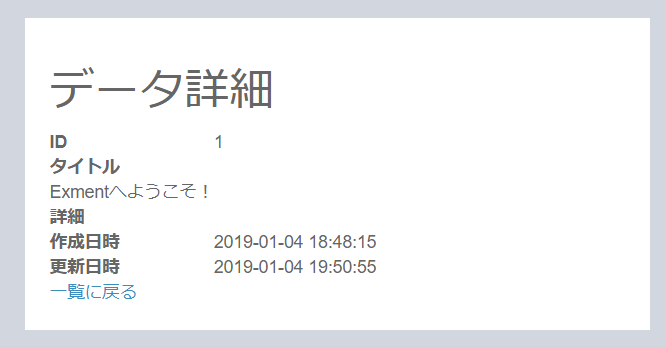
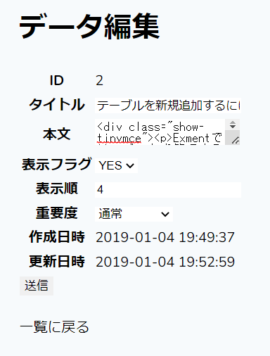
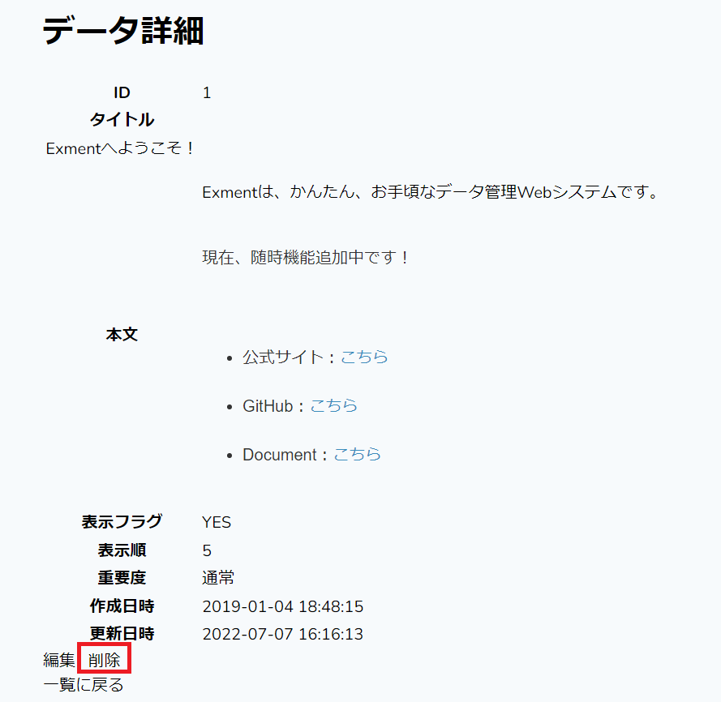

# Building a site for end users

This page is for developers.  
In Exment, by changing the endpoint (the entrance of the URL), you can build, besides the Exment site, a site for general users that the developer makes (a site for end users).

As an example, this page makes the following pages, which handle the data of the "Information" table of Exment.

- A list of the Information data
- The details of one piece of Information data
- Creating new Information data
- Editing Information data
- Deleting Information data

The order of the work is as follows.

1. Check that you can access the site
2. Make the list page (routing → controller → view)
3. Add the details, create, edit and delete pages, one after another

## Checking the access
You can access the site for end users even after Exment has been set up.

| End of the URL | Site that opens |
|---|---|
| "/admin" | The administrator site (Exment) |
| "/" | The site for end users |

- To put the site for end users at "/", set `ADMIN_ROUTE_PREFIX` in `.env` to "admin". This is because, in a new installation of v7.2.1 or later, Exment is at "/" by default. See [Change / delete "admin" included in URL](/additional_prefix) for details.

■ Endpoint "/"

■ Endpoint "/admin"

## Making the pages
A site for end users is basically made with the same structure and steps as usual system development with Laravel.  
The image below shows the structure of the root folder of Laravel. You will make php files mainly in the following folders.

| Folder | What to put there |
|---|---|
| app/Http/Controllers | Controllers |
| routes | Endpoint information |
| resources/views | Views. Written in the blade syntax |
| public | css, js, images and so on |

#### routes: routing
Write the routing of the list page in routes/web.php as follows.  
Note: For other ways to write routing, see the [Laravel description of routing](https://readouble.com/laravel/8.x/ja/routing.html) (in Japanese).

~~~
<?php

use Illuminate\Support\Facades\Route;

/*
|--------------------------------------------------------------------------
| Web Routes
|--------------------------------------------------------------------------
|
| Here is where you can register web routes for your application. These
| routes are loaded by the RouteServiceProvider within a group which
| contains the "web" middleware group. Now create something great!
|
*/

//Route::get('/', function () {
//    return view('welcome');
//});

///// List page
Route::get('/', [\App\Http\Controllers\IndexController::class, 'index']);
~~~

#### Controller
Make IndexController.php in the app/Http/Controllers folder and write it as follows.

- CustomTable: the Model for a "custom table" of Exment.
- CustomTable::getEloquent('information')->getValueModel(): the Model for the data of an Exment table. It stands for each piece of data that users entered.

Note: For other ways to write controllers, see the [Laravel description of controllers](https://readouble.com/laravel/8.x/ja/controllers.html) (in Japanese).

~~~
<?php

namespace App\Http\Controllers;

use Illuminate\Routing\Controller as BaseController;
use Illuminate\Http\Request;
use Exceedone\Exment\Model\CustomTable;

class IndexController extends BaseController
{
    //List screen
    public function index(Request $request){
        $items = CustomTable::getEloquent('information')->getValueModel()->get();
        return view('index', [
            'items' => $items,
        ]);
    }
}
~~~

#### view
Make two files for the view: the common frame (_layout.blade.php) and the content of the list (index.blade.php).

Make _layout.blade.php in resources/views and write it as follows.  
~~~
<!DOCTYPE html>
<html lang="{{ str_replace('_', '-', app()->getLocale()) }}">
    <head>
        <meta charset="utf-8">
        <meta name="viewport" content="width=device-width, initial-scale=1">

        <title>Laravel</title>

        <!-- Fonts -->
        <link href="https://fonts.googleapis.com/css2?family=Nunito:wght@400;600;700&display=swap" rel="stylesheet">

        <!-- Styles -->
        

        
    </head>
    <body class="antialiased">
        

            @if (Route::has('login'))
                

                    @auth
                        <a href="{{ url('/home') }}" class="text-sm text-gray-700 dark:text-gray-500 underline">Home</a>
                    @else
                        <a href="{{ route('login') }}" class="text-sm text-gray-700 dark:text-gray-500 underline">Log in</a>

                        @if (Route::has('register'))
                            <a href="{{ route('register') }}" class="ml-4 text-sm text-gray-700 dark:text-gray-500 underline">Register</a>
                        @endif
                    @endauth
                

            @endif

            <main>
                @yield('content')
            </main>
        

    </body>
</html>

~~~

Make index.blade.php in resources/views and write it as follows.  
Note: For other ways to write Blade, see the [Laravel description of Blade](https://readouble.com/laravel/8.x/ja/blade.html) (in Japanese).

~~~
@extends('_layout')

@section('content')
    <h1>Information list</h1>
    <table>
        <thead>
            <tr>
                <th>ID</th>
                <th>Title</th>
                <th>Created at</th>
                <th>Updated at</th>
                <th></th>
            </tr>
        </thead>

        <tbody>
        @foreach($items as $item)
            <tr>
                <td>{{$item->id}}</td>
                <td>{{$item->getValue('title', 'html')}}</td>
                <td>{{$item->created_at}}</td>
                <td>{{$item->updated_at}}</td>
                <td><a href="{{asset($item->id)}}">Details</a></td>
            </tr>
        @endforeach
        </tbody>
    </table>

    

        <a href="{{asset('/create')}}">Create new</a>
    

@endsection
~~~

#### Result
If everything so far is correct, a list of the data of the "Information" table of Exment is shown, as below.  
Note: The "Create new" and "Details" links cannot be opened yet at this point. You will make them next.

#### Making the data details screen
Make the data details screen. Add to the following three files.

routes/web.php
~~~
///// Details page
Route::get('/{id}', [\App\Http\Controllers\IndexController::class, 'show']);
~~~

app/Http/Controllers/IndexController.php (add below the index function)
~~~
  //Details screen
    public function show(Request $request, $id){
        $item = CustomTable::getEloquent('information')->getValueModel()->find($id);
        if(!$item){
            return redirect('');
        }
        return view('show', [
            'item' => $item,
        ]);
    }
~~~

resources/views/show.blade.php (new file)
~~~
@extends('_layout')

@section('content')
    <h1>Data details</h1>
    <table>
        <tbody>
            <tr>
                <th>ID</th>
                <td>{{$item->id}}</td>
            </tr>
            <tr>
                <th>Title</th>
                <td>{{$item->getValue('title', 'html')}}</td>
            </tr>
            <tr>
                <th>Body</th>
                <td>{!! $item->getValue('body', 'html') !!}</td>
            </tr>
            <tr>
                <th>Display flag</th>
                <td>{!! $item->getValue('view_flg', 'html') !!}</td>
            </tr>
            <tr>
                <th>Display order</th>
                <td>{!! $item->getValue('order', 'html') !!}</td>
            </tr>
            <tr>
                <th>Priority</th>
                <td>{!! $item->getValue('priority', 'html') !!}</td>
            </tr>
            <tr>
                <th>Created at</th>
                <td>{{$item->created_at}}</td>
            </tr>
            <tr>
                <th>Updated at</th>
                <td>{{$item->updated_at}}</td>
            </tr>
        </tbody>
    </table>

    

        <a href="{{asset('/')}}">Back to the list</a>
    

@endsection
~~~

#### Result
If it is correct, the details of the data with the given ID in the "Information" table of Exment are shown, as below.

#### The data create screen
Make the data create screen. Add to the following three files.

routes/web.php (write it above the details page)
~~~
///// Create page
Route::get('/create', [\App\Http\Controllers\IndexController::class, 'create']);
Route::post('/', [\App\Http\Controllers\IndexController::class, 'store']);
~~~

app/Http/Controllers/IndexController.php (add below the show function)
~~~
    //Create screen
    public function create(Request $request){
        return view('create');
    }

    //Save the new data
    public function store(Request $request){
        //Create the Model to save the data
        $custom_value = CustomTable::getEloquent('information')->getValueModel();

        //Set the values
        $custom_value->setValueStrictly([
            'title' => $request->get('title'),
            'body' => $request->get('body'),
            'view_flg' => $request->get('view_flg'),
            'order' => $request->get('order'),
            'priority' => $request->get('priority'),
        ]);

        //Save the data
        $custom_value->save();

        //Redirect to the data
        return redirect($custom_value->id);
    }
~~~

resources/views/create.blade.php (new file)
~~~
@extends('_layout')

@section('content')
    <h1>Create data</h1>

    <form method="post" action="{{asset('/')}}">
        @csrf
        <table>
            <tbody>
                <tr>
                    <th>Title</th>
                    <td><input type="text" name="title" value="{{old('title')}}" /></td>
                </tr>
                <tr>
                    <th>Body</th>
                    <td><textarea name="body">{{old('body')}}</textarea></td>
                </tr>
                <tr>
                    <th>Display flag</th>
                    <td>
                        <select name="view_flg">
                            <option value="0" selected>NO</option>
                            <option value="1">YES</option>
                        </select>
                    </td>
                </tr>
                <tr>
                    <th>Display order</th>
                    <td><input type="number" name="order" value="{{old('order')}}"></input></td>
                </tr>
                <tr>
                    <th>Priority</th>
                    <td>
                        <select name="priority">
                            <option value="{{old('priority')}}" selected></option>
                            <option value="1">Very low</option>
                            <option value="2">Low</option>
                            <option value="3">Normal</option>
                            <option value="4">High</option>
                            <option value="5">Very high</option>
                        </select>
                    </td>
                </tr>
            </tbody>
        </table>

        <button type="submit">Submit</button>
          
        
        

            <a href="{{asset('/')}}">Back to the list</a>
        

    </form>
@endsection
~~~

#### Result
If it is correct, a page that adds data to the "Information" table of Exment is shown, as below.

#### The data edit screen
Make the data edit screen. Add to (or rewrite) the following five files.

routes/web.php (write it above the details page)
~~~
///// Edit page
Route::get('/edit/{id}', [\App\Http\Controllers\IndexController::class, 'edit']);
Route::put('/{id}', [\App\Http\Controllers\IndexController::class, 'update']);
~~~

app/Http/Controllers/IndexController.php (add below the store function)
~~~
 // Edit screen
    public function edit(Request $request, $id){
        $item = CustomTable::getEloquent('information')->getValueModel()->find($id);
        if(!$item){
            return redirect('');
        }
        return view('edit', [
            'item' => $item,
        ]);
    }

    // Save the edit
    public function update(Request $request, $id){
        // Create the Model to save the data
        $custom_value = CustomTable::getEloquent('information')->getValueModel()->find($id);

        // Set the values
        $custom_value->setValueStrictly([
            'title' => $request->get('title'),
            'body' => $request->get('body'),
            'order' => $request->get('order'),
            'view_flg' => $request->get('view_flg'),
            'priority' => $request->get('priority'),
        ]);

        // Save the data
        $custom_value->save();

        // Redirect to the data
        return redirect($custom_value->id);
    }
~~~

resources/views/edit.blade.php (new file)
~~~
@extends('_layout')

@section('content')
    <h1>Edit data</h1>

    <form method="post" action="{{asset('/' . $item->id)}}">
        @csrf
    <table>
        <tbody>
            <tr>
                <th>ID</th>
                <td>{{$item->id}}</td>
            </tr>
            <tr>
                <th>Title</th>
                <td><input type="text" name="title" value="{{old('title', $item->getValue('title', 'html'))}}" /></td>
            </tr>
            <tr>
                <th>Body</th>
                <td>
                    <textarea name="body">{{old('body', $item->getValue('body', 'html'))}}</textarea>
                </td>
            </tr>
            <tr>
                <th>Display flag</th>
                <td>
                    <select name="view_flg">
                    <option value="{{old('view_flg', $item->getValue('view_flg', 'html'))}}" selected>{{old('view_flg', $item->getValue('view_flg', 'html'))}}</option>
                            <option value="0">NO</option>
                            <option value="1">YES</option>
                    </select>
                </td>
            </tr>
            <tr>
                <th>Display order</th>
                <td>
                    <input type="number" name="order" value="{{old('order', $item->getValue('order', 'html'))}}"></input>
                </td>
            </tr>
            <tr>
                <th>Priority</th>
                <td>
                    <select name="priority">
                            <option value="{{old('priority', $item->getValue('priority', 'html'))}}" selected>{{old('priority', $item->getValue('priority', 'html'))}}</option>
                            <option value="1">Very low</option>
                            <option value="2">Low</option>
                            <option value="3">Normal</option>
                            <option value="4">High</option>
                            <option value="5">Very high</option>
                        </select>
                </td>
            </tr>
            <tr>
                <th>Created at</th>
                <td>{{$item->created_at}}</td>
            </tr>
            <tr>
                <th>Updated at</th>
                <td>{{$item->updated_at}}</td>
            </tr>
        </tbody>
    </table>

        <button type="submit">Submit</button>
          
        @method('PUT')
    </form>

    
    

        <a href="{{asset('/')}}">Back to the list</a>
    

@endsection
~~~

resources/views/show.blade.php (add above the div tag of "Back to the list")
~~~
    

        <a href="{{asset('/edit/' . $item->id)}}">Edit</a>  
    

~~~

resources/views/index.blade.php (rewrite the content of the td tag)
~~~
<td><a href="{{asset($item->id)}}">Details</a>&nbsp;&nbsp;<a href="{{asset('edit/'.$item->id)}}">Edit</a></td>
~~~

#### Result

#### The data delete screen
Make it possible to delete data. Add to (or rewrite) the following four files.

routes/web.php
~~~
///// Delete
Route::get('/delete/{id}', [\App\Http\Controllers\IndexController::class, 'delete']);
~~~

app/Http/Controllers/IndexController.php (add below the update function)
~~~
// Run the delete
    public function delete(Request $request, $id){
        // Get the data to delete
        $custom_value = CustomTable::getEloquent('information')->getValueModel()->find($id);

        // Delete the data
        $custom_value->delete();

        // Redirect to the list
        return redirect('/');
    }
~~~

resources/views/show.blade.php (rewrite the content of the first div tag)
~~~
    

        <a href="{{asset('/edit/' . $item->id)}}">Edit</a>
        &nbsp;&nbsp;<a href="{{asset('/delete/' . $item->id)}}">Delete</a>
    

~~~

resources/views/index.blade.php (rewrite the content of the td tag)
~~~
<td><a href="{{asset($item->id)}}">Details</a>&nbsp;&nbsp;<a href="{{asset('edit/'.$item->id)}}">Edit</a>&nbsp;&nbsp;<a href="{{asset('/delete/' . $item->id)}}">Delete</a></td>
~~~

#### Result

