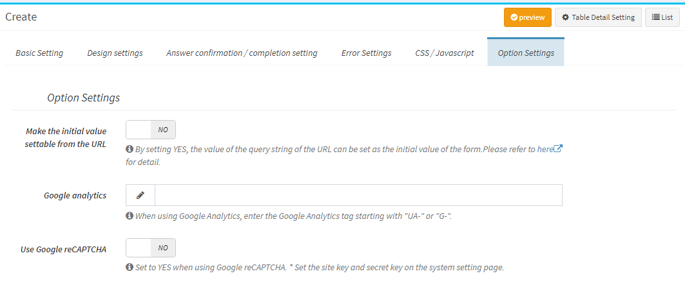
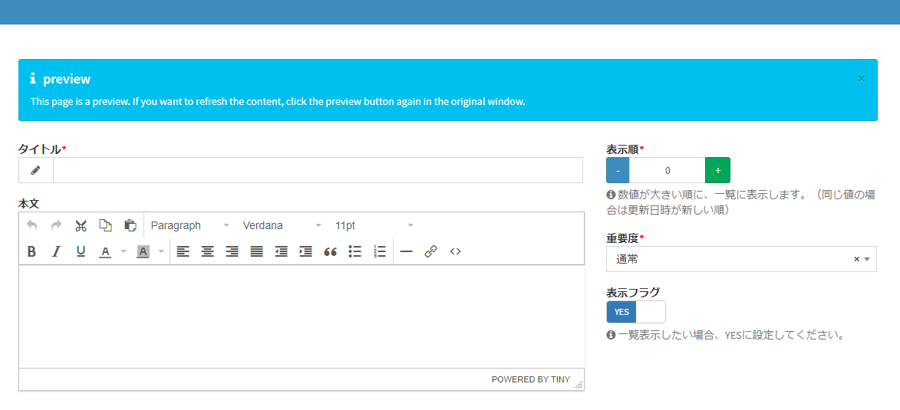
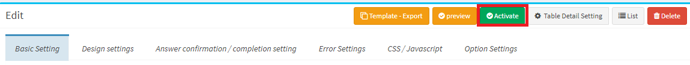
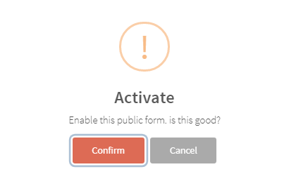
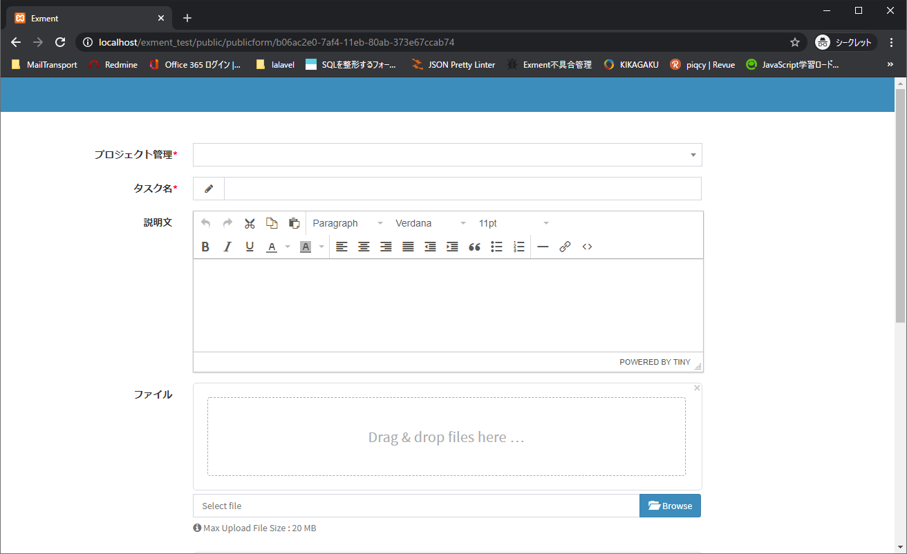

# Public form settings
This page explains how to set up a "public form", where people who are not logged in (general users) can enter data.  
You can make questionnaires, inquiry forms, application forms and so on, share the URL, and open them widely to the outside.

- The normal [data form screen](/data_form) needs users prepared beforehand, who log in with an ID and password.
- With a public form, anyone can enter data without logging in.

## About public form setting specifications

<span class="red bold">For the data entered from a public form, the user who registered the public form setting is recorded as the created user and the updated user.</span>  
The roles and permissions used on the data entry screen when options of other tables are got or searched are also those of the user who registered the public form setting.
  
For this reason, avoid having a system administrator register a public form.  
We recommend setting a new user and role group with the steps of "<a href="#/publicform?id=role_user">User or Role group to set public form</a>" below.
  
Also, the following tables cannot be the target of a public form.
- Master tables such as "User" and "Organization"
- Tables set to "Save Only One Record" in the table setting


## Setting flow
Set in the following order. For the detailed steps, see "Setup steps" below.

1. Run the command. (Only when you use Google reCAPTCHA)
2. On the System Setting screen, make public forms usable.
3. In the [custom form settings](/form), set the items, headings and so on shown on the form.
4. Register the user and role group that do the public form settings.
5. Log in as that user and do the public form settings (design, confirmation screen, Google Analytics and so on).
6. Activate the public form. A URL is issued.

## Setup steps

### 1. Command execution
Run this only when you use Google reCAPTCHA (a mechanism that prevents sending by robots) on the public form.  
In the root folder of the project, run the command that matches your Exment version.  
Note: from v7.0.0, "google/recaptcha" is used as the Google reCAPTCHA library. Exment v6.x or earlier uses "arcanedev/no-captcha".

- For Exment v7.0.0 or later

```
composer require google/recaptcha=^1.3.1
```

- For Exment v6.x or earlier

```
composer require arcanedev/no-captcha=^10.1
```

### 2. System setting page
- Go to "STEP2 Detail Setting" of the [System Setting screen](/system_setting) and set "Use public form" to YES.  
Note: the default is NO. This is so that you choose explicitly to use public forms.


- When you use Google reCAPTCHA, set the "Google reCAPTCHA" item to V2 or V3.  
When you select it, the items for the site key and the secret key are shown. Set the values copied from the [Google reCAPTCHA admin page](http://www.google.com/recaptcha/admin).  
Note: after this setting, you select on each public form setting screen whether to use Google reCAPTCHA.  
Note: when V3 is selected, the score threshold can be changed with the [config](/config?id=score-threshold-of-google-recaptcha-v3) (default 0.5).


### 3. Custom form settings
- In the [custom form settings](/form), set the items, headings and so on shown on the form. The steps are basically the same as the normal form settings.  
Note: this setting may be done by someone other than the public form setting user, such as an administrator.

<h3 id="role_user"><a href="#/publicform#role_user" data-id="role_user" class="anchor"><span>4. User or Role group to set public form</span></a></h3>
Register the user and role group that do the public form settings.  
The data sent from the public form is treated as registered and updated by this user.

- Create a new [role group](/role_group).
    - Add the "Public Form Management" permission.
	- Add the edit permission for the table for which you want to set the public form.
    - Also add the view permission for the tables accessed by that public form.

- Example: you plan to set a public form for the "Inquiry" table, and the Inquiry table refers to all data of the "Product" and "Category" tables:
    - The "Public Form Management" and "Edit Personnel Data" permissions of the "Inquiry" table
    - The "View All Data" permission of the "Product" and "Category" tables


- Add the user who manages the public form.
    - For the role group, select the role group created above.

- Log in as the user created above, open the public form setting screen, and register the public form.


### 5. Public form settings

- In the custom table list, check one table you want to set, and click "Table Detail Setting" at the top right.  

> Note: you can also open it from the data list screen or the data registration screen of the target custom table. In that case too, click "Table Detail Setting" at the top right.  

- On the table detail setting screen that is displayed, click the form setting icon.


- Toward the bottom of the form list screen, there is a "Public Form Settings" box.  
Click the "+ New" button at the top right of this box.


- The public form setting screen opens. Set the necessary items. The settings are as follows.

#### Settings - Basic setting


- ##### Target Form
Select the form to set as the public form. Select the form created in "Custom form settings" above.

- ##### Public form display name
Enter the display name shown on the list screen and so on.

- ##### Publication expiration date
To decide the period during which the form is public, enter the start date and time and the end date and time.  
Note: you can also enter only the "start date and time" or only the "end date and time". When neither is entered, the form is always valid.  
Note: outside the publication period, this public form cannot be used.


#### Settings - Design settings


Set the design elements, such as whether to use the header and footer, the logo image and texts, and the background color of the form.


#### Settings - Answer confirmation / Completion setting
The settings of the "answer confirmation screen" and the "completion screen" shown after the user finishes entering the form. Decide whether to use them, and their titles and texts.


- ##### Use answer confirmation
When YES, the screens of the user move as follows.

```
Input screen → Confirmation screen → Completion screen (data registration)
```

Note: when NO, the screens of the user move as follows.

```
Input screen → Completion screen (data registration)
```

- ##### Confirmation Title
Enter the title text of the answer confirmation screen.

- ##### Confirmation Text
Enter the text / HTML shown at the top of the confirmation screen.  
Note: [parameters](/params) can be used. Scripts cannot be executed.


- ##### Completion Title
Enter the title text of the completion screen.

- ##### Completion Text
Enter the text / HTML shown at the top of the completion screen.  
Note: [parameters](/params) can be used. Scripts cannot be executed.

- ##### Completion link URL
A link can be shown on the completion screen. To move to another screen after the entry, enter the URL of the destination.  
Note: when "Completion link text" is not entered, the entered URL is shown as the text of the link as it is.

- ##### Completion link Text
A link can be shown on the completion screen. To move to another screen after the entry, enter the text shown on the screen as the link.


#### Completion Notification (general user)
After the registration is finished, an email can be sent to the general user who entered the data.

- Because this is a notification for general users who are not logged in, the only notification method is sending email.
- The notification target is only the email address the general user wrote.
- To use this function, the custom table needs a column of the column type Email.

- ##### Notify general users of completion
When YES, the completion notification is enabled.

- ##### Notification Template
Select the notification template sent to general users. You need to create a new template beforehand in the [notification template settings](/mail).  
Note: [variables (parameters)](/params) can be used in the notification. With variables, you can add the registered data, the system name, the values the user entered and so on to the subject and body.

- ##### Notification Target
Select the custom column that holds the email address to notify.  
Example: when the input items include a "Reply email address" column, select this column as the notification target, and the notification is sent to that email address after the data entry is completed.


#### Completion notification (administrator)
After the data entry is finished, a notification can be sent to the administrator.  
Note: it says "administrator", but besides administrators you can also notify users registered in Exment, Slack and so on.

- ##### Notify administrator of completion
When YES, the completion notification is enabled.

- ##### Notification Template
Select the notification template sent to the administrator. You need to create a new template beforehand in the [notification template settings](/mail).  
Note: [variables (parameters)](/params) can be used in the notification. With variables, you can add the registered data, the system name, the values the user entered and so on to the subject and body.

- ##### Notification Target
Select the notification target.  
Note: for the items of the notification target and how to set them, see [Notification action settings](/notify?id=notification-action-settings).


#### Settings - Error Settings
Controls what happens when an error occurs.


- ##### Error Title
Enter the title text of the error screen.

- ##### Error Text
Enter the text / HTML shown at the top of the error screen.

- ##### Error link URL
A link can be shown on the error screen. To move to another screen when an error occurs, enter the URL of the destination.  
Note: when "Error link text" is not entered, the entered URL is shown as the text of the link as it is.

- ##### Error link Text
A link can be shown on the error screen. To show a link to another screen when an error occurs, enter the text shown on the screen.

#### Error Notification
When an error occurs, the administrator can be notified.  
Note: it says "administrator", but besides administrators you can also notify users registered in Exment, Slack and so on.

- ##### Notify Error
When YES, the administrator is notified when an error occurs.

- ##### Notification Template
Select the template sent to the administrator. You need to create a new template beforehand in the [notification template settings](/mail).  
Note: [variables (parameters)](/params) can be used in the notification. With variables, you can add the registered data, the system name, the values the user entered, the error contents and so on to the subject and body.

- ##### Notification Target
Select the notification target.  
Note: for the items of the notification target and how to set them, see [Notification action settings](/notify?id=notification-action-settings).


#### CSS / Javascript
You can add your own CSS and Javascript.


- ##### Custom CSS
Write the CSS you want to use directly.  
Note: the &lt;style&gt; tag is not needed. Write only the contents of the css.

- ##### Plugin (CSS)
To apply an installed plugin (CSS) to the public form too, select the name of the plugin.

- ##### Custom Javascript
Write the Javascript you want to use directly.  
Note: the &lt;script&gt; tag is not needed. Write only the contents of the Javascript.  
Note: the Javascript is added inside the following jquery.

``` javascript
<script data-exec-on-popstate>
    $(function () {
        (the added code)
    });
</script>
```

- ##### Plugin (Javascript)
To apply an installed plugin (Javascript) to the public form too, select the name of the plugin.


#### Settings - Option Setting
Other option settings.



- ##### Make the initial value settable from the URL
When YES, the values of the query string of the URL can be used as the initial values of the form. For details, see [Set the initial value from the URL](#set-the-initial-value-from-the-url).

- ##### Google Analytics
To set Google Analytics on the form, enter the Google Analytics tag that starts with "UA-" or "G-".

- ##### Use Google reCAPTCHA
To use Google reCAPTCHA, set YES.  
Note: it is effective only when the Google reCAPTCHA keys have been entered on the System Setting screen.


#### Preview
- You can show a preview of the public form with the current settings.  
Note: you can preview even when the form has not been saved.

- Click the "Preview" button at the top right of the screen. The preview screen of the public form is shown in another window.  
Note: the other window is opened by javascript. Depending on the browser settings, the pop-up is blocked. In that case, unblock it and click the button again.



#### Activate Public Form
- To open the form to general users, you need to "activate" it. Save once, open the edit screen again, and click the "Activate" button at the top right of the page.






- When the form to publish refers to other tables, general users can read the data of those tables.  
A confirmation message like the following is shown. Check carefully that there is no problem with the tables accessed.


- "Access to other tables" mainly means the following.
    - When the public form has items of the column types "Select (from the list of values in another table)", "User" and so on, the data is shown and searched as option candidates.
    - When the public form is of a 1:n child table, the data of the parent table is shown and searched as options.


#### After Activation, Display URL etc.
- When the public form is activated, the following items are added to the basic setting.

- ##### Public Form URL
The URL of the public form is shown. Copy this URL and share it with general users by email, on your own site and so on.  
Note: click the item to copy the URL.

- ##### Execution User
The user who registered the public form. All registration and reference of data from this public form are done with the permissions of this user.  
Note: even when another user updates the public form setting, the execution user does not change. To change it, log in as another user and create a new public form setting.


### 6. Use Public Form
- When you open the URL copied above, the public form is shown.  


- When the public form setting is not "activated", when it is outside the valid period, or when the URL is wrong, the following error is shown.


### 7. Use Template
With a template, you can create a new public form that takes over the setting values of a public form already made.
>The following items must be set by hand.<br />- Header Logo<br />- Google analytics<br />- Use Google reCAPTCHA

#### Export
Click [Template: Export] on the public form setting screen. The open public form is exported as a template.


#### Created from template
Click [+ Created from template] in the public form settings of the custom form setting screen.


##### Target Form
Select the form that is the target when the public form is created from the template.

##### Public Form Display Name
Enter the display name of the public form to create.

##### Upload
Select the template used to create the public form.


## Other Detailed Settings

### Set the initial value from the URL
- When the setting "Make the initial value settable from the URL" is YES, the initial values of items can be written in the URL of the public form.  
When you know values that fit the person you share the URL with, such as the company name or the category, putting them in the URL beforehand reduces the effort of entry.

#### Grant method
Set a query string like the following.

```
http://(URL up to the public form)?value.(custom column name)=(initial value)

To set several columns, join the second and later values with &.
http://(URL up to the public form)?value.(custom column name)=(initial value)&value.(custom column name)=(initial value)


# Examples
http://localhost/publicform/c4f31330-7a75-11eb-a8b0-279816836d79?value.title=Hello

http://localhost/publicform/c4f31330-7a75-11eb-a8b0-279816836d79?value.client_name=ABC Inc.&value.category=Initial setup
```

- Example: suppose there is a form like the following


- When the following query string is added to the URL of this form, the initial values are set when the form is opened.

```
http://localhost/publicform/ab3d55e4-1afc-d1de-ac1b-bc64c51d4d7d?value.title=About an inquiry&value.body=This is the body.
```


#### When you want the initial values of the custom columns "Select (from another table)", "User" and "Organization" to be settable only by suuid (a random string of 20 characters)
The initial values of the custom columns "Select (from another table)", "User" and "Organization" (below, simply "Select (from another table)") are usually given by ID (a sequential integer).  
However, because IDs are sequential, the person the form is opened to can rewrite the parameter of the URL and easily guess other values.  
When you want the initial values of these columns given by suuid (a random string of 20 characters) instead of ID, set as follows.

- In the [list of Exment config values](/config), do the setting "Allow only suuid, not ID, for 'Set the initial value from the URL' of public forms".

``` .env
EXMENT_PUBLICFORM_URLPARAM_SUUID=true
```

- With this setting, only suuid is allowed for the initial values of "Select (from another table)" columns.

- You can check the suuid in the following ways.
    - Select "System ID(20-length)" in "Select view columns" of a view
    - Export the data

### Change "publicform" included in URL
- The steps to change the string "publicform" included in the URL of public forms.  
Note: this string is the same for all public forms. It cannot be changed for each form.

#### Change procedure

- The change is done by [changing the config](/config).

- Open the ".env" file in the root directory of Exment.

- Add the following value.

~~~
### To change "publicform" to another name
EXMENT_PUBLICFORM_ROUTE_PREFIX=afiewqbfwehghwb
# http://localhost/afiewqbfwehghwb/(UUID) becomes the URL of the public form
~~~

Note: this manual is written throughout on the assumption of "publicform".


### Specifications specific to public forms
Other specifications specific to public forms.

- The "Search" button shown for the custom columns "Select (from the list of values in another table)", "User", "Organization" and so on is not shown on a public form.

- The notification with the trigger "new data creation", which can be registered in "Notification Setting" of the table detail setting, is not sent from a public form.  
This is because the public form settings have separate notifications "for general users" and "for administrators", and the notification should not be sent twice.
