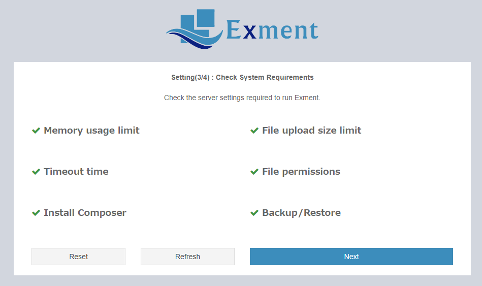

# Installation procedure (easy installation)
These are the steps to install Exment by putting the zip file in place and following the guidance on the screen.  

There are three steps.

1. Prepare a server
2. Download the zip file and extract it on the server
3. Open Exment in the browser and install it by following the guidance on the screen

> Note: for the manual installation, or to install a certain version, see [Manual installation](/quickstart_manual).

## Important points
- If you get an error during the installation, see [Troubleshooting](/troubleshooting).
- Note: we do not accept individual inquiries about the installation steps or about building a server. If you need individual help, please use the paid support.  

## Server construction
If you have not prepared a web server and a database server yet, prepare them first.  
See [Server settings](/server) for the steps.

## Exment app settings
When the server is ready, put the Exment application in place.

### zip Download / Extract

- Download the zip file from the following link.  
<a id="link" href="https://exment.net/downloads/en/exment.zip" target="_blank">[Exment zip file (latest)]</a>  
The latest version is now **v7.2.4** (released 2026/11/24, PHP 8.2 or higher). The zip of each version, with its release date, SHA-256 and supported PHP, is on the [download page](https://exment.net/en/download/) (you can also check there that a downloaded file is not broken).            
  
- If you really have to use PHP 7.4, download from the following link. This version is outside support, inquiries, GitHub issues and so on. It may also be removed without notice.  
<a href="https://exment.net/downloads/en/exment_v4_4_2.zip" target="_blank">[Exment zip file (the last version that runs on PHP 7.4: v4.4.2)]</a>

- Extract the zip file to a place where PHP runs.  
Example 1 (XAMPP Windows): C:\xampp\local\exment  
Example 2 (XAMPP Mac): /Applications/XAMPP/local/exment  
Example 3 (XServer): $HOME/domain.com.foobar/exment/  
  
- Do not put the zip file as it is right under the public folder of the server (for example on Linux: /var/www/html). The setting files, which contain the database settings, the email password and so on, become visible from outside, and this leads to a serious information leak.  

## Installation of initial data
Install Exment by following the guidance on the screen.  
Note: when you press "Reset" on a setting screen, the installation starts again from the language and time zone settings.

### Open the installation screen
First, open the Exment page in the browser.  
Example: http(s)://(your site URL)  

### Language and time zone settings
Decide the language and the time zone.  
Change them from the initial values if needed.  
  

### Database Settings
Enter the database settings.  
Enter the following to fit your environment.   
Note: if you do not know a value, it is written in the steps of each environment in [Server settings](/server); please check again.
~~~
Database type
Database host name
Database port number
Database name for Exment
Database user name for Exment
Database password for Exment
~~~  

  
  

### Check System Requirements
This screen checks the server settings needed to run Exment.  
It looks at the setting values of the web server and so on, and shows a warning or an error when there is a setting we do not recommend or a setting with a problem.  
Note: if there is an error, you cannot go on to the next screen.  
Note: for a detailed explanation of this screen, see [Check system requirements](/server?id=check-system-requirements).

  

### Execute Install
Press "Execute Install".  
  

> **Optional: password hashing cost**  
> Passwords are hashed with bcrypt, and the default of the cost (rounds) is 12. To change it, add `BCRYPT_ROUNDS` to ".env". See [Manual installation](/quickstart_manual) for an example.

### Setting completed
When the installation is finished, go on to the [Initial setting](/first_setting).  

## Other additional settings
With the work so far, you can start using Exment. However, some features need additional settings.  
Check the following page.  
- [Additional settings](/quickstart_more)

[←Back to the installation overview](/quickstart)
