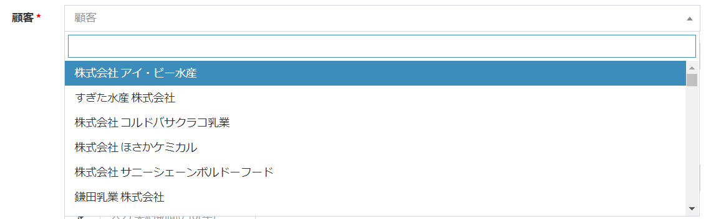
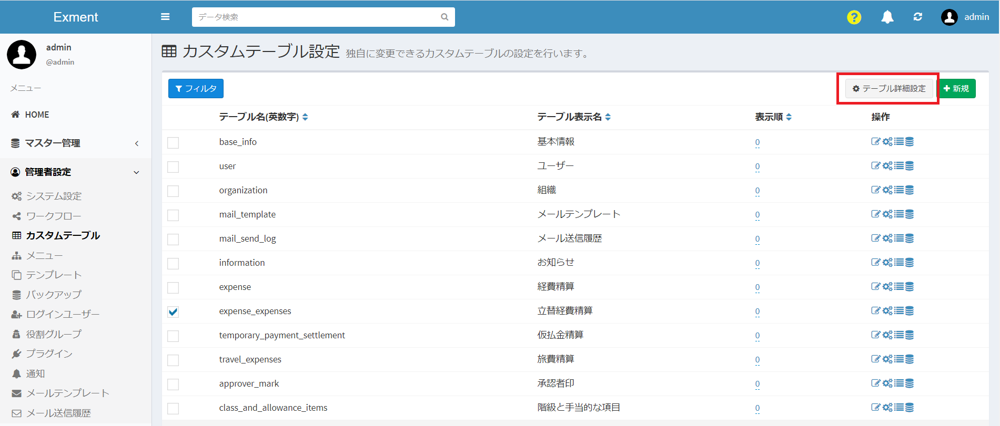

# Relation settings
The data of one table and another can have a connection (a relation).  
Examples:
- A quotation and its quotation details  
- The organizations of a company and the users who belong to them  

This page explains how to set the connections between tables.

- First, decide "by which method to connect" ("Concept of relation in Exment" below).
- If you only want to know the operations on the screen, see "How to operate relation settings" below.

## Concept of relation in Exment
The way of thinking about connecting tables in Exment is a little complicated.  
You need to know two things: "1. Relationship types" and "2. Setting method".  
Please read the following before setting on the screen.

### 1. Relationship types
Connections between data usually have the following two types.  
#### One to Many
Many data of a child table are connected, as details, to one data of a parent table   

- Example: a quotation and its quotation details  
The "Quotation" table holds the "quotation date", the "customer information" and the "subject". The "Quotation details" hold the product names, quantities and amounts of that quotation, as many details  

- Example: a contract and the main person in charge of the contract  
One user can be the main person in charge of many contracts, so users and contracts have a one-to-many relation  

#### Many to Many
Several data of a child table are connected to the data of several tables (parent tables)  

- Example: an organization and the users who belong to it  
A user can belong to several organizations (holding two posts and so on), so it is a many-to-many relation  
  

First, think about which of the types above the data you want to connect is.  

### 2. “(1) Related table settings” and “(2) Custom column choices (select from a list of values ​​in other tables)”
There are two methods of connecting data in Exment: "(1) Related table" and "(2) Select (From Table)".  

##### (1) Related table setting
This is the method explained on this page.
Register it from the "Custom Table" page by pressing the [Relation Setting] button.    

##### (2) Custom column choices (select from a list of values ​​in another table)
This is the method set on the [custom column](/column) screen.  
One of the column types of a custom column is "Select (From Table)". You make a column of this type.  

With this setting, values can be chosen from another table on the [data form screen](/data_form).  
Example (the customers are test data):

>The text shown in the list as an option can be changed in the [Heading display column setting](/table?id=heading-display-column-setting).

### Determining the relation setting method
Whether to use (1) or (2) is an easy point to get lost on.
Decide by the following criteria.

| Relation type | When | Method to use |
|---|---|---|
| One to Many | The parent and the child are always a set. When the parent is deleted, deleting the child too is correct (example: a quotation and its quotation details) | (1) Relation setting |
| One to Many | They are not always a set. Even when the referenced data is deleted, deleting the data that refers to it would be a problem (example: a quotation and its main person in charge) | (2) Select (From Table) of a custom column |
| Many to Many | Basically this one | (1) Relation setting |

#### 1. When the relation type is "one-to-many"
Decide by the following two criteria.
1. **Are the parent data and the child data always a set, closely tied?**  
For example, with the "Quotation" table and the "Quotation details" table, the data of the quotation details always has the data of a quotation, and they are a set.  
In such a case, connect them by "(1) Relation setting".  
On the other hand, the "Quotation" table and the "main person in charge" of the quotation are connected as a data reference, but they are not always a set.  
In such a case, connect them by "(2) Select (From Table) of a custom column".  

2. **When the parent data is deleted, is deleting the child data always correct?**  
For example, with the "Quotation" table and the "Quotation details" table, when the parent "Quotation" data is deleted, deleting all the child "Quotation details" data too is the correct behavior.  
In such a case, connect them by "(1) Relation setting".  

On the other hand, with the "Quotation" table and the "main person in charge" of the quotation, deleting all the "Quotation" data of which that person is the main person in charge, just because the data of the "main person in charge" was deleted, would be a problem.  
In such a case, connect them by "(2) Select (From Table) of a custom column".  

#### 2. When the relation type is "many to many"
Basically, connect them by "(1) Relation setting".  
It can also be handled by "Approval Multiple Select" in "(2) Select (From Table) of a custom column", but there are issues such as being weak at data search.  

   
With this, it is decided by which method to connect the tables.  
Below are the steps for "(1) Related table setting".  

## How to operate relation settings

### Page display
- In the custom table list, check only one table you want to set, and press "Table Detail Setting" at the top right.  

- Or, after selecting the table you want to set from the menu, press "Table Detail Setting" at the top right in the same way.  
Note: the setting that shows the table in the menu is needed beforehand.  

- On the Table Detail Setting screen that appears, press the icon of the relation setting.

- Now the list of the relation settings of that custom table appears.  

### Add new
- On the "Relation Setting" screen, press the [New] button at the top right of the page.

- Select the child table to connect and the type of the relation, and press "Submit".
  

### Edit
When you want to edit a relation, click the [Edit] link of its row.  
  

### Delete
When you want to delete a relation, click the [Delete] link of its row.  

