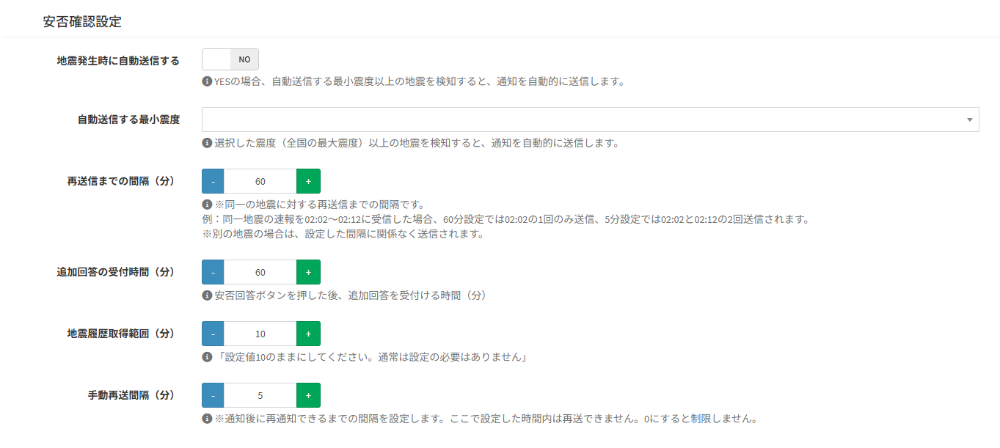
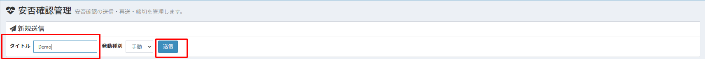
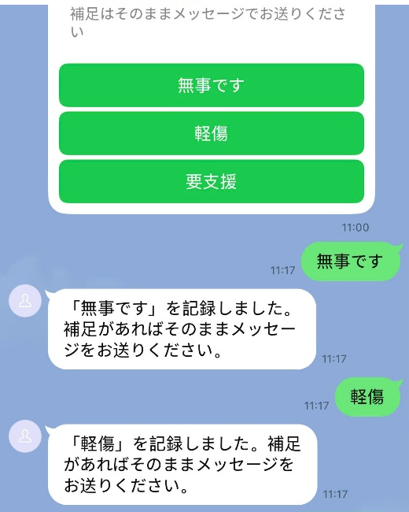
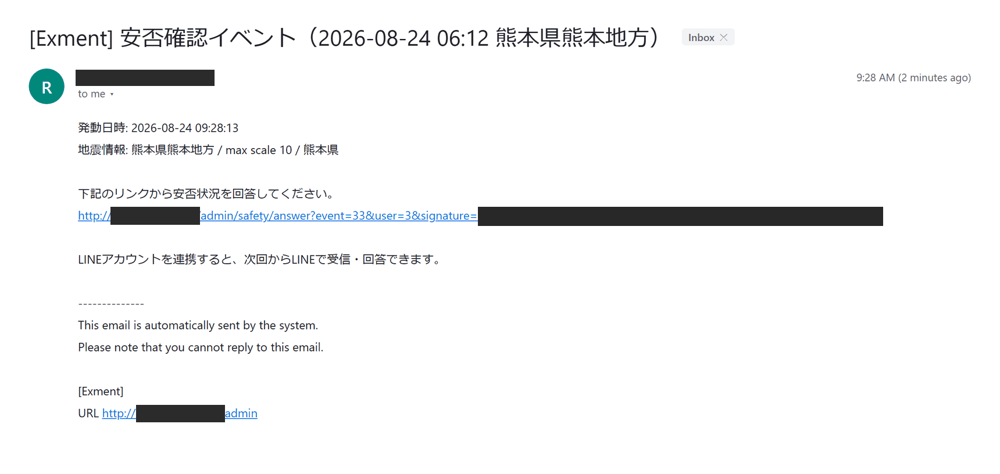
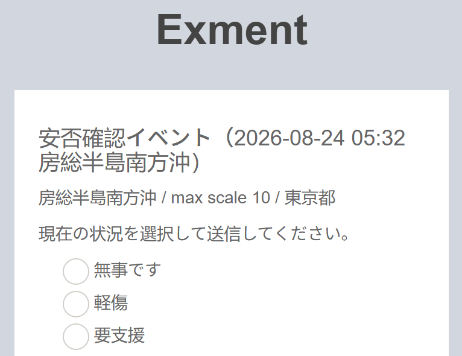
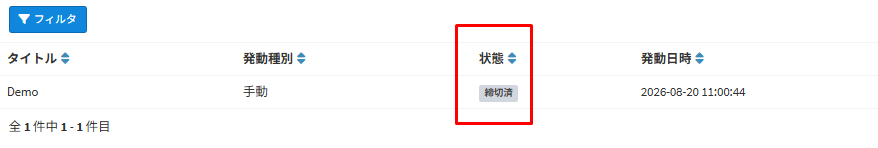

# Safety check
This function checks the safety of employees by LINE and email in an emergency, such as an earthquake or a typhoon.  
An administrator can send a safety check from the screen, and a safety check can also be sent automatically when an earthquake at or above the set seismic intensity occurs.  
The answers can be checked on the safety check screen and in the safety check answer table.  
※ The safety check is available from v7.0.0.

## How the safety check works
- Each time a safety check is sent, one data record is created in "Safety Check Events".
- At the same time, one data record of "Safety Check Answers" is created for every user, with the answer status "not_answered".
- The safety check is sent to each user as follows. Users who receive both LINE and email can answer from either of them.

| Method | Sent to | How to answer |
| --- | --- | --- |
| LINE | Users who have [linked their LINE account](/line?id=linking-a-line-account) | The "Safe", "Minor Injury" and "Need Help" buttons on the card |
| Email | Users who have an email address (including users who have linked their LINE account) | The answer page opened from the link in the email (no login required) |

※ Nothing is sent to users who have neither linked their LINE account nor registered an email address.

### Trigger types
A safety check has the following trigger types.

| Trigger type | Description |
| --- | --- |
| Manual | An administrator sends it from the safety check screen. It can be used in any emergency, such as an earthquake, a typhoon or a fire. |
| Drill | Sent in the same way as "Manual". "[Drill]" is added to the beginning of the title of the messages. |
| JMA Auto | Sent automatically when an earthquake at or above the set seismic intensity occurs. |

※ The labels on the LINE card, the replies and the answer page follow the language setting of Exment. The screenshots on this page show the Japanese labels.

## Preparation
- **To send by LINE** : Set up [LINE integration](/line) (the LINE Official Account, "LINE Setting" in the system settings, and the webhook), and ask each user to link their LINE account.
- **To send by email** : Set up [mail sending](/mailsend_setting). Also check [Mail settings](/safety_check?id=mail-settings).
- **To send automatically when an earthquake occurs** : You need to set up the [task schedule](/additional_task_schedule). The Exment server must also be able to access the API that provides earthquake information (https://api.p2pquake.net).

※ Only users with the system administrator permission can use the safety check screen.

## Installation
The tables and the menu used by the safety check are created automatically when Exment is installed or updated.  
For an existing environment, run "php artisan exment:update" by following the [update](/update) procedure.

The following items are created.

| Type | Name | Description |
| --- | --- | --- |
| Table | Safety Check Events | One data record is created each time a safety check is sent. |
| Table | Safety Check Answers | One data record is created for each safety check and each user. |
| Menu | Safety Check | The screen to send, resend and close safety checks. |
| Mail template | Safety check mail | The template of the safety check email. |
| LINE Flex template | Safety Check | Its Flex key is "safety_check". The content of the safety check card on LINE is fixed, so editing this template does not change the card. Do not select it in the notification settings, and do not edit or delete it. |

※ The names of the tables and the menu are created in the language set at installation.  
※ If they are not created, run "php artisan exment:patchdata line_safety_check".

## Safety check settings
Click "Admin Setting" > "System Setting" in the left menu, and switch to [Detail Setting] with the button at the top right.  
Set the following items in "Safety Check Settings" (below "LINE Setting") and click [Save].

| Item | Description |
| --- | --- |
| Auto-send on Earthquake | If YES, a safety check is sent automatically when an earthquake at or above "Minimum Seismic Intensity to Auto-send" occurs. If NO, safety checks can only be sent from the safety check screen. Initial value: NO |
| Minimum Seismic Intensity to Auto-send | Select the seismic intensity for automatic sending from Shindo 4, 5 Lower, 5 Upper, 6 Lower, 6 Upper and 7. It is compared with the maximum intensity in the whole country of the earthquake information. It cannot be narrowed down by region. Initial value: Shindo 5 Lower |
| Resend Interval (minutes) | How long (minutes) a safety check is not sent again for the same earthquake. Several pieces of information (preliminary, detailed, corrected, and so on) are announced for one earthquake. Information about the same earthquake that arrives within this time after sending does not trigger another safety check. For a different earthquake, a safety check is sent regardless of this time. Initial value: 60 |
| Additional Response Window (minutes) | How long (minutes) messages sent after pressing an answer button on LINE are recorded as "additional responses". The window is extended each time an additional response is sent. Initial value: 60 |
| Earthquake History Range (minutes) | No safety check is sent automatically for earthquake information issued more than this number of minutes ago. This prevents mass sending for past earthquakes right after the function is enabled or after the task schedule has stopped. Normally, leave it at "10". Initial value: 10 |
| Manual Resend Interval (minutes) | How long (minutes) after [Resend] is executed until it can be executed again. 0 means no limit. Initial value: 5 |

※ For the numeric items other than "Manual Resend Interval (minutes)", if 0 or an empty value is saved, the initial value is used.

## Mail settings

### Answer link
A safety check email contains a link that opens the answer page (answer link). Note the following.

- The answer link is created from the Exment URL. When a safety check is sent automatically for an earthquake, "APP_URL" in the ".env" file is used. Set "APP_URL" to a URL that employees can access from outside the company. When you send from the screen, also open Exment at a URL that employees can access.
- The answer link has a signature that uses "APP_KEY" in the ".env" file. If "APP_KEY" is changed after the email is sent, the links already sent become invalid. In that case, send new links with [Resend].

### Mail template
The subject and body of the email can be changed in "Safety check mail" of the [mail templates](/mail). The initial values are as follows.

~~~
Subject:
[${system:site_name}] ${safety_title}

Body:
${safety_body}

Please answer your safety status from the link below.
${answer_url}

Link your LINE account to receive and answer via LINE next time.
~~~

| Variable | Description |
| --- | --- |
| ${safety_title} | The title of the safety check. For a drill, "[Drill]" is added to the beginning. |
| ${safety_body} | The date and time the safety check was triggered, and the earthquake information (for "JMA Auto"). |
| ${answer_url} | The answer link. |

※ If "${answer_url}" is removed from the body, users cannot answer from the email. Be sure to keep it.

## Sending a safety check

### Opening the screen
Click "Safety Check" in the left menu. You can also open it from the following URL.

~~~
http(s)://(Exment URL)/admin/safety_check
~~~

### Sending manually or as a drill
- Enter the title of the safety check in "Title" of "Send New" (example: Typhoon No. 15 safety check).
- Select "Manual" or "Drill" in "Trigger Type".
- Click [Send]. "Safety check sent." is shown, and an "Open" safety check is added to the list.

※ A drill is also sent to all users, and its LINE messages are also counted toward the message limit.  
※ If "A send is already in progress. Please wait a moment and refresh the page." is shown, the previous safety check is still being sent. Wait a moment and refresh the page. Do not click [Send] repeatedly.  
※ When there are many users, sending may take time. If you use a queue (set "QUEUE_CONNECTION" in the ".env" file and run a queue worker; see the [Laravel documentation](https://laravel.com/docs/12.x/queues)), the sending is executed in the queue. With a queue, messages that failed are sent again automatically (up to 3 attempts, including the first one). LINE messages are sent again only when LINE is busy (HTTP 429) or returns a server error (HTTP 5xx).

### Sending automatically when an earthquake occurs
When "Auto-send on Earthquake" in "Safety Check Settings" is YES, Exment gets the earthquake information of the Japan Meteorological Agency from the P2P earthquake information API every minute.  
When there is earthquake information that meets all of the following conditions, a safety check with the trigger type "JMA Auto" is sent automatically.

- The maximum seismic intensity in the whole country is at or above "Minimum Seismic Intensity to Auto-send"
- "Earthquake History Range (minutes)" has not passed since the earthquake information was issued
- No safety check has been sent for the same earthquake within "Resend Interval (minutes)"

The title of an automatically sent safety check is "Safety Check Events（(occurrence date and time) (hypocenter)）".  
When it is sent with information issued before the hypocenter is determined (seismic intensity bulletin), the hypocenter is shown as "Hypocenter pending". When information that arrives later determines the hypocenter, the title is updated (the safety check is not sent again).

※ Automatic sending requires the [task schedule](/additional_task_schedule). The task schedule runs the command "exment:safetywatch" every minute.

## Answering
This section describes how users answer. Use it to guide your employees.

### Answering on LINE
Users who have linked their LINE account receive a card with the "Safe", "Minor Injury" and "Need Help" buttons.

- Press one of the buttons. A reply that confirms the recorded answer arrives, such as: Recorded "Safe". If you have additional details, please send them as a message.
- To change the answer, press another button. The last button pressed is recorded.
- To add details, send a message after pressing a button. The reply "Additional response added." arrives, and the message is recorded as an "additional response".

※ Send an additional response within "Additional Response Window (minutes)" (60 minutes by default) after pressing a button or sending the previous additional response. If the window has passed, press a button again and then send the message.

### Answering by email
Users who have an email address receive an email that contains the answer link.

- Click the link in the email. The answer page opens without logging in.
- Select the current status ("Safe", "Minor Injury" or "Need Help"), enter "Additional response (optional)" if needed, and click [Submit].

- When "Your answer has been recorded" is shown, the answer is complete.
- When you open the same link again, the current answer is shown. You can change the answer until the safety check is closed.

※ The answer link has no expiration date. Users cannot answer after the safety check is closed.  
※ Anyone who has the link can answer as that user. Do not forward the safety check email to others.  
※ Even if the [IP filter settings](/additional_ip_filter) are used, the answer page can be opened from outside the company.

The following messages may be shown on the answer page.

| Message | Description |
| --- | --- |
| This safety check has been closed. | The safety check has been closed, so it cannot be answered. |
| This link is invalid. Please contact your administrator. | The link is not correct. It is shown when a part of the link is missing, or when "APP_KEY" was changed after the email was sent. |

## Checking the answers

### Safety check screen
The list on the safety check screen shows the status of each safety check.

| Column | Description |
| --- | --- |
| Title | The title of the safety check. |
| Trigger Type | "Manual", "Drill" or "JMA Auto". |
| Status | "Open" or "Closed". |
| Triggered At | The date and time the safety check was sent. |
| Sent Count | The number of users to whom LINE or email (at least one of them) was sent at the first sending. [Resend] does not change it. |
| Target Count | The number of users targeted by the safety check. |
| Answered Count | The number of users who have answered. |
| Action | The [Resend] and [Close] buttons. They are not shown for closed safety checks. |

### Safety Check Answers table
The answer of each user can be checked in the "Safety Check Answers" table.  
The table is not shown in the left menu. Open the following URL.

~~~
http(s)://(Exment URL)/admin/data/safety_check_answer
~~~

| Column | Description |
| --- | --- |
| Event | The safety check that the answer belongs to. |
| User | The user who answers. |
| Answer Status | "not_answered", "safe", "minor_injury" or "need_help". |
| Additional Response | The additional responses. Each one is added with the date and time it was sent (month/day hour:minute). |
| Answered At | The date and time of the last answer. |
| Answer Channel | The method used to answer: "line" or "mail". |
| LINE Not Linked | YES if the user had not linked their LINE account when the safety check was sent. |

※ Even if "LINE Not Linked" is YES, the user may have answered by email. To find the users who received neither LINE nor email, check the users whose "LINE Not Linked" is YES and who have no email address.

#### Examples of views
Creating [custom views](/view) for the Safety Check Answers table makes the answers easier to check.

- **List of users who have not answered** : Create a view (normal view) and add the condition "Answer Status" is "not_answered" to the data display conditions. Add a condition on "Event" to narrow down to a specific safety check.
- **Number of users by answer status** : Create a summary view that groups by "Answer Status" and shows the count.

## Resending and closing
On the list of the safety check screen, you can execute [Resend] and [Close] for each safety check.

### Resend
Click [Resend], and click [Confirm] in the confirmation dialog.  
LINE and email are sent again **only to the users who have not answered yet**. Nothing is sent to the users who have already answered.  
Users added after the first sending also receive it, and "Target Count" is updated.

※ [Resend] cannot be executed again until "Manual Resend Interval (minutes)" (5 minutes by default) has passed since the previous [Resend]. A message such as "Please wait at least 5 minutes between re-sends." is shown.  
※ "Sent Count" keeps the value of the first sending. Check the latest answers with "Answered Count" or the Safety Check Answers table.

### Close
Click [Close], and click [Confirm] in the confirmation dialog.  
The status becomes "Closed", and the safety check can no longer be answered from either LINE or email. The recorded answers are kept.

※ A closed safety check cannot be reopened. To check the safety again, send a new safety check.  
※ After a safety check is closed, pressing a LINE button or opening the email link shows "This safety check has been closed.".

## Troubleshooting
| Symptom | Main causes | What to do |
| --- | --- | --- |
| "The safety check tables are missing or incomplete." is shown on the safety check screen | The update, or the creation of the safety check tables, has not been completed | Run "php artisan migrate". If the message still appears, run "php artisan exment:patchdata line_safety_check". |
| No safety check is sent automatically when an earthquake occurs | - "Auto-send on Earthquake" is NO - The task schedule is not running - The maximum seismic intensity in the whole country is below "Minimum Seismic Intensity to Auto-send" - The earthquake information is older than "Earthquake History Range (minutes)" | Check the settings and the [task schedule](/additional_task_schedule). Check the logs that contain "safety check" in "storage/logs/laravel.log". |
| The email does not arrive | - The mail sending settings are not correct - The user has no email address | Check that email can be sent with the test mail of the system settings. Check the logs that contain "safety check mail" in "storage/logs/laravel.log". |
| Opening the email link shows "This link is invalid." | - "APP_KEY" was changed after the email was sent - A part of the link is missing | Send new links with [Resend]. |
| The email link cannot be opened | The answer link uses a URL that cannot be accessed from outside the company (localhost, an internal IP address, and so on) | Check [Answer link](/safety_check?id=answer-link), and send new links with [Resend]. |
| Sending a message on LINE replies "Invalid command." | - No answer button has been pressed - "Additional Response Window (minutes)" has passed - The safety check has been closed | Press an answer button, and then send the message. Additional responses can also be entered on the answer page opened from the email. |
