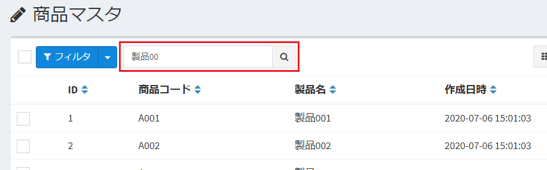
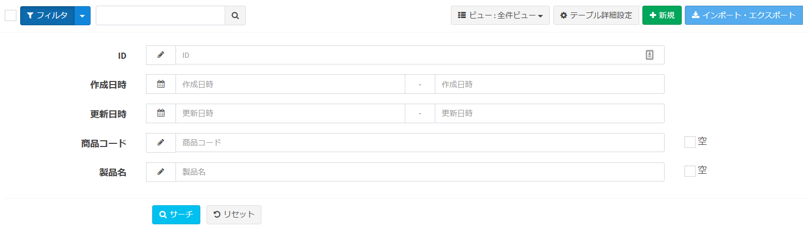
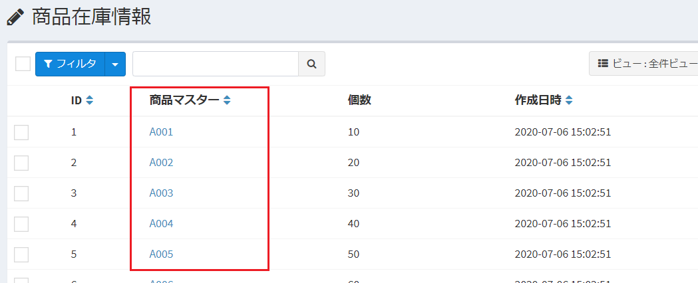

# Search
This page explains how to find data in Exment. There are two main ways to search.

| Way to search | Range searched |
|---|---|
| The search bar at the top of the page | All tables that are set as search targets |
| The search on the data list screen (search bar, filter) | The table now open |

- **At first, the search is a forward match** (it finds data that begins with the characters entered). For how to change to a partial match, see "(Supplement) Switch data search to partial match" below.

## Search with the search bar (free word search)
At the top of each page is a search bar.  
  
Enter a word in this search bar to search the data registered in Exment.  
There are two kinds of search: "word search" and "related data search".  

### Word search
This is the ordinary search. Data that contains the entered word (forward match) is shown in the results.  
  

Enter a word in the search bar and click the search button to search.  
First the list of the tables to be searched is shown, and then the matching data is looked for.

**What is searched**

- Tables: the tables where "Search Enabled" is YES in the custom table setting.  

- Custom columns: the columns where "Index Enabled" (search index) is YES and "Freeword Search Target" is also YES in the custom column setting.  
Note: a table with no custom column whose "Index Enabled" is YES is not shown in the search results.  

> From v3.4.0, "Freeword Search Target" being YES is required as a condition for being searched.  
Before that, all columns with "Index Enabled" set to YES were searched. However, when 10 to 20 search indexes are set, performance may drop, so the targets of the free word search can now be narrowed down.

- Only the tables the user has permission to view are searched.  

- **The default search setting is a forward match.** This is for the speed of the search.  
To change to a partial match, see "(Supplement) Switch data search to partial match" below.

**Search results**

The data of the search results has the icons [View], [Edit] and [Search Relation Data].  
    
Click the [Search Relation Data] icon to do the "related data search" below.  

### Related data search
The related data search is a function that finds the data linked to a certain record.  
For example, when there is a "Customer" table, you may want to see the list of "Contract" data linked to that customer.  
  
In that case, with this "related data search", you can see the contract data linked to the customer as a list.  

The related data search is done in the following cases.  
- When you enter a word in the search bar and select a candidate that appears  
  
>The words listed as candidates can be changed in the [Heading display column setting](/table?id=heading-display-column-setting).

- When you do a word search and select the [Search Relation Data] icon shown in the results  
  
  
The related data search lists the data linked under the following conditions.  
- Data in which the record selected in the search is chosen in a "select" custom column (however, "Index Enabled" must be YES in the custom column setting)  
- Data in which the record selected in the search is registered as the parent, as 1:n or n:n in the relation setting  
  
The related data search lists the selected record itself and the related data of the conditions above.  
In the example below, the data of the selected customer "ABC Corporation" and the contracts related to that customer are listed.  
  

## Search on the data list screen
You can also search on the data list screen.
There are two ways: the search with the search bar, and the filter search with columns specified.

  

### Search with the search bar (free word search)
Enter a word in this search bar to search the data in the table shown.  

  

Enter a word in the search bar and click the search button to search.  

  

- The free word search is a function separate from the custom view now selected.  
The range searched is all the data of that table. All free word search columns are searched.  
Therefore, the results are shown in the shape of the all data view, not of the custom view now selected.

- The custom columns searched are the columns where "Index Enabled" is YES and "Freeword Search Target" is also YES in the custom column setting.  

> From v3.4.0, "Freeword Search Target" being YES is required as a condition for being searched.  
Before that, all columns with "Index Enabled" set to YES were searched. However, when 10 to 20 search indexes are set, performance may drop, so the targets of the free word search can now be narrowed down.

- **The default search setting is a forward match.** This is for the speed of the search.  
To change to a partial match, see "(Supplement) Switch data search to partial match" below.

### Filter search with columns specified
Click the "Filter" button to show the box for searching in detail with columns specified.

  

  

- The following are shown as the items of the search columns.
    1. ID, created date, updated date
    2. For a table with a workflow setting, the "workflow status" and the narrowing to "data I am in charge of"
    3. When a relation setting with that table as the child exists, a choice for narrowing down by the parent data
    4. The custom columns of that table where "Index Enabled" of the custom column setting is YES

Note: of these, 1 and 2 can be hidden on the detail setting screen of the system setting.

  

## Supplement

### (Supplement) Switch data search to partial match
The word search of data is a forward match by default.  
This is to make the search fast. With a partial match, the search is not fast enough.  
  
However, it can be switched to a partial match.  
In the menu "Admin Setting > System Setting (Detail Setting)", change "Data search method" to the partial match.  
  
  

The search is now a partial match.  
Note: this setting can make the search slow. Please understand.

### (Supplement) Using the full-text search engine (Meilisearch)
In an environment with a large number of records, searching by partial match can make the search slow.  
In that case, the full-text search engine "Meilisearch" makes the search fast.  
See [Full-text search engine (Meilisearch)](/additional_meilisearch) for details.

### Free word search by custom column type
Basically, the free word search finds only the values held in the database.  
However, for some custom columns, the system rewrites the search value the user entered before searching.  
That behavior is written below.

> Currently, an AND search over several columns by entering half-width spaces, as in a Google search, is not supported.

#### Select (value and text)
You can search by the value set in the setting "value", or by the value set in the setting "text".

  

  

#### Select (From Table)
You can search by the words set in the "heading column".  

Example:  
- There is a "Product master".  

  

- In that "Product master", "Product code" is set in the "heading column setting" of the "table setting (Extended Settings)".  

  

- A column "Product master" that refers to that "Product master" is added to the table "Product stock information".  

  

- With these settings, entering the product code "A001" in the free word search lists the "Product stock information" that refers to the product master "A001".

  

#### YES/NO
You can search by 0/1, or by the strings NO/YES.  
(Because the search is then done with strings found anywhere, such as "0", "1", "NO" and "YES", making it a target of the "free word search" is not much recommended.)

#### Select 2-value
You can search by the value of a choice, or by its label.  

  
  

