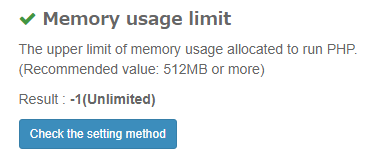

# Server settings
This page puts together the settings of the web server and the database that you prepare before installing Exment.  
Follow the steps that fit your environment.

On this page you do the following four things.

1. Prepare a web server ("Web server" below)
2. Install composer ("Introduced composer" below)
3. Prepare a database ("Database" below)
4. Install the Exment application ("Installing the application" below)

The required versions of PHP and the database are in "Operating environment" below.

- <span class="red bold">Note: we do not accept individual inquiries about the installation steps or about building a server. If you need individual help, please use the paid support.</span>  
- We do not have manuals for environments that are not in the list below. Thank you for your understanding.

## Web server
Prepare a web server by one of the following steps.  
Note: when you build an environment with PHP, Apache and MySQL from scratch for development, we recommend XAMPP.  

- [XAMPP construction (development / verification environment) Windows](/install_xampp)  
→ When you first want to try Exment on your own computer (Windows version)

- [XAMPP construction (development / verification environment) Mac](/install_xampp_mac)  
→ When you first want to try Exment on your own computer (Mac version)

- [Rental server construction](/install_rental)  
→ When you want to publish Exment and use it easily from other members and from smartphones

- [Build on Linux](/install_centos_stream)  
→ The steps to install Exment on Linux (CentOS Stream)  
 Note: if you built it on CentOS 8, see [here](/install_linux)

- [Build on IIS](/install_iis)  
→ The steps to install Exment on IIS

- [Build on AWS - single server](/install_aws_single)  
→ The steps to install Exment on AWS with a single server

- [Build on AWS - redundant](/install_aws)  
→ The steps to install Exment on AWS in a redundant configuration

- [Build with Docker](/install_docker)  
→ The steps to run Exment with Docker


### File permission settings

Of the Exment project folders, the following folders and files need write permission for the user that runs the web server (apache, www-data, etc.).  

| Type | File / folder name | Features that need it |
| ---- | ---- | ---- |
| Folder | storage | All features |
| Folder | bootstrap/cache | All features |
| File | .env | Easy installation, restore |
| Folder | config | Easy installation, restore |
| Folder | app | Easy installation |
| Folder | public | Easy installation |
| Folder | resources | Easy installation |

- The permissions for the easy installation are needed only at the time of the installation. If you want stricter permissions, remove the write permission of the folders after the easy installation.

#### Automatic generation of initial folders
- The folder structure needed at first can also be made automatically with the following command.  
    - --user=(User name. If not given, an input prompt appears after you run the command)
    - --group=(Group name. If not given, an input prompt appears after you run the command)
    - --easy=(1 when you install Exment with the easy installation. The default is 0)
    - --easy_clear=(1 when you want to return the folder permissions to the proper ones after the easy installation. The default is 0)

```
php artisan exment:setup-dir {--user=} {--group=} {--easy=0} {--easy_clear=0}

# For the manual installation
php artisan exment:setup-dir
# For the easy installation
php artisan exment:setup-dir --easy=1
# To return the folder permissions to the original ones after the easy installation is finished
php artisan exment:setup-dir --easy_clear=1
```


## Introduced composer
To use Exment, composer must be installed on the web server. composer is used to install the packages that Exment needs and to update Exment.  
See the following pages for how to install it.  
- [Official site](https://getcomposer.org/download/)
- [Windows version commentary site](https://weblabo.oscasierra.net/php-composer-windows-install/)
- [Linux version commentary site](https://weblabo.oscasierra.net/php-composer-centos-install/)
- [Mac version commentary site](https://weblabo.oscasierra.net/php-composer-macos-homebrew-install/)


## Database
The database of Exment must be one of the following.

- MySQL 8.0 or higher
- MariaDB 10.11 or higher
- SQL Server 13.0.0 or higher (the automatic backup and restore are not supported at present)

### Database environment construction
- If you have not prepared a database server yet, prepare it first.  
See the following pages for the steps.  
Note: not needed if you already have one.  

    - [MySQL](/install_mysql)
    - [SQL Server](/install_sqlserver)

### Create database

- Create a database for Exment in the database you use.  


## Installing the application
When the environment is ready, install the Exment application by one of the following two ways.

1. **Easy installation**  
→ You install by following the guidance shown on the web screen. See [Easy installation](/quickstart_easy) for the steps.

1. **Manual installation**  
→ You install by hand, with commands. See [Manual installation](/quickstart_manual) for the steps.


## Operating environment
### server
- PHP 8.2 or higher (`^8.2.0`. Exment 7.0.0 needs PHP 8.2 or higher, to match the requirements of Laravel 12, which it uses)
- Laravel 12.X (from Exment 7.0.0, the Laravel version changed to 12.X)
- Note: Exment v6.x uses PHP 8.2 and Laravel 10.X.
- Database: one of the following
    - MySQL 8.0 or higher
    - MariaDB 10.11 or higher
    - SQL Server 13.0.0 or higher
- The gd extension of PHP (with FreeType; `imagettftext` must be usable): used for the PDF of 2D barcode labels. Without it, making the label PDF ends in an error. See [2D Barcode settings](/2d_barcode) for how to check and install it.

### Operation check browser
- Google Chrome
- Microsoft Edge


### Recommended settings

- Maximum PHP memory: 512MB
- Maximum file upload size: 10MB
- Timeout: 180 seconds


## Check system requirements

You can check on the screen or by a command whether the server meets the requirements of Exment and whether the setting values are enough.  

  


### Confirmation method
You can check in one of the following ways.

- The installation screen of the [easy installation](/quickstart_easy)
- After the installation, the [System Setting screen](/system_setting)
- A command ("Execute from command" below)

### Confirmation item details

#### Memory usage limit
The upper limit of the memory that can be used to run PHP.    
See [Changing PHP settings](/additional_php_ini) for how to change it.

#### Maximum number of POST at one time
The upper limit of the number of POST parameters that PHP can receive at one time. Some screens send many items when saving, so we recommend changing this limit.  
See [Changing PHP settings](/additional_php_ini) for how to change it.

#### File upload size limit
The upper limit of the size of a file that can be uploaded. The size you need depends on the files you want to manage.  
See [Changing PHP settings](/additional_php_ini) for how to change it.

#### Timeout time
The number of seconds to wait for a process before it times out. If it is short, processes that take time, such as backup and import, can go over this time.  
See [Changing PHP settings](/additional_php_ini) for how to change it.

#### File permissions
Checks whether the file permissions needed to run Exment are there.  
See [File permission settings](/server?id=file-permission-settings) above for details.


#### Composer installation
Checks whether Composer, which is used to update Exment, is installed on the web server.  
Note: a warning can appear although composer is installed. The reasons are, for example, that the path of composer is not set for the user that runs the web server, or that the permissions are not enough.  
If composer is installed correctly and the user who actually updates can run it, ignore this warning.  
Note: to set the path of composer, try "To pass the composer path" in [Troubleshooting](/troubleshooting).


#### Backup / Restore
Checks whether the server is set up for backup and restore.  
Note: if you get an error, see "Backup and restore fail" in [Troubleshooting](/troubleshooting).  
Note: if you use SQL Server, this is always a warning. You need to back up and restore by hand. See [Backup and restore of SQL Server](/backup_sqlserver) for the steps.


### Result display
#### Normal
A green check appears.

  

Press the row to see the details.

  

#### Warning
A yellow warning mark appears. It is an item we recommend setting, or an item with a point to take care of when you use it.

  

#### Error
A red cross mark appears. You need to change the settings.

  


### Execute from command

You can also check the system requirements with the following command.

```
php artisan exment:checkrequire
```

[←Back to the installation overview](/quickstart)
