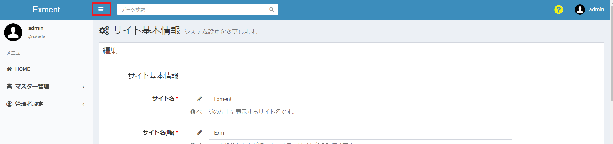
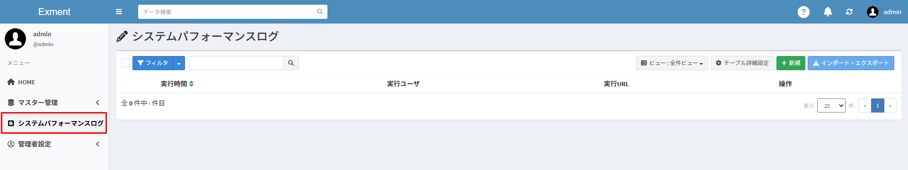

# System setting
This is the screen for the settings of the whole Exment system, such as the name, the logo and the design of the site, and how permissions are used.  
This page explains the items of the screen from top to bottom. For email, LINE, the IP filter and so on, there are links to their own pages.  

## Setting screen
Press "System Setting" in the menu.  
The System Setting screen appears.  
The system settings are divided into [Basic Setting] and [Detail Setting].  
Press the button at the top right and choose in the dialog that appears to switch between them.

  
  

## Site basic information
Decide the basic information of the site, such as the name, the logo and the shape of the menu.

- The menu layout (the shape of the menu) of Exment has two types: "Default" and "Small Icon".  
See the images below for the difference.  
- The menu layout shown at first is decided in [Site menu layout](/system_setting?id=site-menu-layout). You can also switch it each time by pressing the place in the red frame in the image.

Default
  

Small Icon
  

#### Site name ※Required
- The site name shown at the top left of the page when the menu layout is "Default".  
- The initial value is "Exment".  

#### Site name (omitted) ※Required
- The site name shown at the top left when the menu layout is "Small Icon".
- The initial value is "Exm".  

#### Site logo
- The logo of the site shown at the top left of the page when the menu layout is "Default".  
- Click the [Browse] button and select the image you want to use.  
- Recommended size: 200px * 40px  

Note: when the site logo is set and the menu layout is "Default", the site logo is shown at the top left instead of the site name.

#### Site logo (small)
- The logo of the site shown at the top left of the page when the menu layout is "Small Icon".  
- Click the [Browse] button and select the image you want to use.  
- Recommended size: 40px * 40px  

Note: when the site logo (small) is set and the menu layout is "Small Icon", the site logo (small) is shown at the top left instead of the site name.

#### Site favicon (ico)
- As in the image below, the icon image used when someone is looking at the site or bookmarks it.  
- Click the [Browse] button and select the image you want to use.  
- Recommended size: 16px * 16px  

  

#### Site skin
- The theme color of the site. Choose the colors of the header and the sidebar from the following combinations.  
- Header (blue at first): Blue, Yellow, Green, Purple, Red, White
- Sidebar (white at first): Black, White

Note: when the [Screen design](/system_setting?id=screen-design) is "Modern", the header and the sidebar stay white and gray, and the selected color becomes the "accent color" (important buttons, links, the selected menu, the frame of the field being edited and so on). With a color other than blue, a thin line of that color is shown at the top edge of the header. A "-light" color has the same accent color as the one without "-light".  
Note: from v7.1.0, the change shows right after saving. In v7.0 and earlier, it shows when you reload the web page after saving.

#### Site menu layout
- Choose the layout of the site menu from "Default" and "Small Icon".  
See the images above for an example of each.
- The initial value is "Default".  

Note: the change shows when you reload the web page after saving.

#### Screen design
- Select the design of the login screen and the admin screens: "Modern" or "Classic".
    - Modern: the new design, based on white and gray.
    - Classic: the same design as v7.0 and earlier.
- The initial value is "Modern".

Note: available from v7.1.0.  
Note: after updating to v7.1.0, the screen design changes to "Modern". To go back to the previous design, select "Classic" in this item and save.  
Note: with "Modern", the header and the sidebar are based on white and gray, and the color selected in the [Site skin](/system_setting?id=site-skin) becomes the accent color. If an image is set as the site logo, a background of the accent color is added behind the logo.  
Note: in the data list of "Modern", the action column (show, edit, delete) is shown right after the checkbox (on the left).  
Note: if the design is fixed by the server setting ("EXMENT_UI_DESIGN" in the .env file), that value takes priority. In that case this item cannot be changed, and "(set by the server)" is shown. See [Setting value list](/config?id=screen-design) for details.  
Note: the change shows right after saving. If the screen looks broken, press Ctrl+F5 (super reload) in the browser.

#### Use API 
- Set it to "YES" to use the API.
- The initial value is "NO".

#### Communicate outside the server
- When YES, Exment can run the processes that communicate with outside servers (receiving data only), such as the notice of the latest version of Exment.
- The initial value is "YES".  

#### Use privilege management
- When YES, you can set [permissions for the whole system and for each custom table](/role_group).  
- When YES, you can give permissions to chosen users.
- The initial value is "YES".  

#### Use organizational management
- When YES, in [Use privilege management](/system_setting?id=use-privilege-management) you can give permissions to chosen organizations.  
- The initial value is "YES".  

#### Enable System Performance Log
- When YES, slow screen operations are saved in the "System Performance Log".
- What is saved: the URL of the screen (the values of searches and so on are hidden as "***"), the user, the processing time and the SQL. The SQL is saved with "?", without the values.
- The initial value is "NO".

When YES, the following three items are shown (from v7.1.0).

| Item | Content | Initial value |
| --- | --- | --- |
| Performance log: seconds of a slow screen | Saves a log when a screen takes this number of seconds or more. With 0, nothing is saved by this condition. | 3 |
| Performance log: seconds of a slow SQL | Saves a log when one SQL takes this number of seconds or more. With 0, nothing is saved by this condition. | 1 |
| Performance log: maximum logs in an hour | The maximum number of logs saved in an hour. Logs over the limit are not saved. With 0, there is no limit. | 100 |

Note: when "seconds of a slow screen" and "seconds of a slow SQL" are both 0, every operation is saved (the same behavior as v7.0 and earlier). Use it only for an investigation. A site that had the log ON since v7.0 or earlier stays in this "save everything" state after the update.  
Note: to see the log, open "Admin Setting" → "System Performance Log" in the left menu.  
Note: from v7.0.3, saving with YES makes the log table and the menu (inside "Admin Setting") automatically. No template needs to be installed.  
Note: in v7.0.2 and earlier, install the template ([Template zip file](https://exment.net/template/system_logs.zip)) and run `php artisan exment:update`.

#### System Administrator
- You can set the users who are system administrators.
- The initial value is the user who made the initial settings when Exment was installed.

#### Number of data list displayed
- The number of data shown at first on the data list page.  
  Select one of "10", "20", "30", "50" and "100".
- The initial value is "20".  

#### Number of search / dashboard displays
- The number of data shown at first when you do a [keyword search](/search?id=word-search) and in the [data list of the dashboard](/dashboard?id=list-of-data).  
Select one of "5", "10" and "20".  
- The initial value is "5".  

#### Date and time display format
- You can choose the display format of dates from three types: "Default（Y-m-d H:i:s）", "Custom（Y/m/d H:i:s）" and "Local（Y年m月d日 H時i分s秒）". The initial value is "Default（Y-m-d H:i:s）".

#### Data search method
- Choose the search method of the saved data from "Forward" (the beginning is the same) and "All" (contained anywhere).
- The initial value is "Forward".

#### Hide filter in data list
- The checked items no longer appear in the filter of the data list screen.

#### System values display position
- Decide where the system values are shown on the data edit screen and the data detail screen.  
- You can select from "Displayed at the top", "Displayed at the bottom" and "Hide". The initial value is "Displayed at the top".  

#### Data Submit Redirect
- The [data entry](/data_form?id=data-submit-redirect) screen has checkboxes for choosing which screen to move to after the data is saved. Here you can have one of those checkboxes checked from the start.

#### Header User Information
- You can decide what is shown in the user information of the header. If left blank, nothing is shown.
- You can choose from the custom columns of the user table and the created date.

#### Languages the users can choose
- The languages the users can choose in the menu at the top right, on the login screen and in the login user settings (v7.2.4 or later). When empty, all the installed languages can be chosen. The language of the site can always be chosen.
- See [Language and time zone of each user](/user_locale) for details.

#### Use the browser's language when a user has not chosen one
- When YES, a user who has not chosen a language sees the screens in the language of the browser (among the languages the users can choose). When NO, in the language of the site (v7.2.4 or later).
- The initial value is "YES". To keep everyone in the language of the site, set it to NO.

## Organization settings
Decide how far organizations are included in the settings of permissions and sharing.

#### Organizational hierarchy setting (role group)
- When an organization is set in "User/organization setting" of a role group, decide how far the parent and child organizations of that organization are included.
- The initial value is "Include parent/child hierarchies of your organization".

#### Organizational hierarchy setting (data)
- When an organization is set in the sharing setting of a custom data, decide how far the parent and child organizations of that organization are included.
- The initial value is "Only your organization" (only the users of the organization the data is shared with).

#### Custom data sharing settings
- When a user creates new data, decide whether it is shared automatically with that user only, or also with the organizations the user belongs to.
- The initial value is "Only login user".

## System mail settings
The settings for sending emails from the system.  
When you set it on the screen, enter the SMTP setting values.  
See [Email sending settings](/mailsend_setting) for details.

## LINE Setting
In "LINE Setting" of [Detail Setting], set the information of the LINE Official Account used by the [LINE integration](/line) (channel access token, channel secret and basic ID).  
See [the system settings of the LINE integration](/line?id=system-settings) for details.

## Safety Check Settings
In "Safety Check Settings" of [Detail Setting], set the automatic sending at an earthquake and the other settings of the [safety check](/safety_check).  
See [Safety check settings](/safety_check?id=safety-check-settings) for details.

## IP filter settings
Set the IP addresses that are allowed to communicate, as a fixed IP (example: 12.3.5.6) or in the range format (example: 123.4.5.0/24).  
If not set, all IP addresses are allowed.
See [IP filter](/additional_ip_filter) for details.

## Password policy

> Moved to [Login settings](/login_setting).

## SSO settings

> Moved to [Login settings (SSO)](/login_sso).
