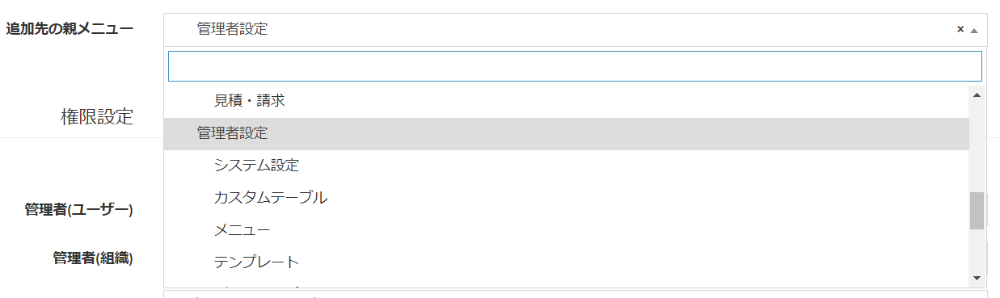
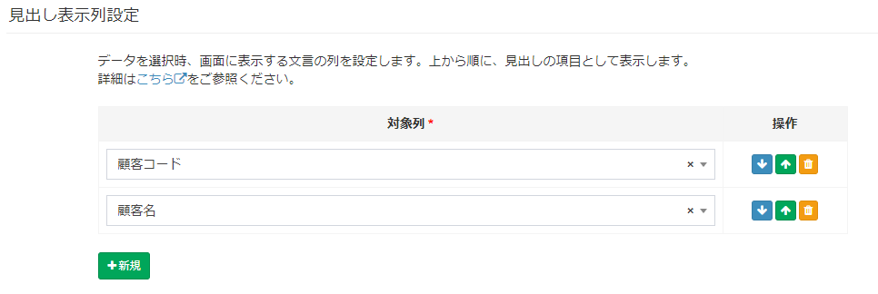

# Custom table settings
In Exment, data is kept and managed in "custom tables". You make a table for each thing you want to manage, such as customers, quotations and tasks.  
This page explains how to make, change and delete a table, and the settings of each table (the features that can be used with its data, permissions and so on).

- When you make a table for the first time: read "Create New" → "Details of setting items" → "Save" below, in this order.
- Settings that use several columns, such as the duplicate check and the text shown in search suggestions: see "Extended settings" below.

## List
Press "Custom Table" in the menu.  
The list of the custom tables that exist now appears.  

Note: "Basic information", "User", "Organization", "Notification template", "Email sending history", "Notice"  
These tables are there from the time Exment is installed.  
Tables imported by a template also appear in this list.  

## Create New

- Press the [New] button at the top right of the list screen.
  
  
- The table creation screen appears. Enter the necessary items. The items are explained in "Details of setting items" below.

## Details of setting items

#### Table name (alphanumeric) ※ required
- The name of the table. (Examples: user, information, estimate)  
- The alphanumeric name decided here is used in the URL when the table is opened and so on. (Example: http(s)://(Exment URL)/data/user)  
- You can use half-width alphanumeric characters and the symbols "-" and "_".
- A table name used by another table cannot be used.  
- The table name must be 30 characters or less and must begin with a letter.  
- It can be decided only when the table is newly made. It cannot be changed after saving.  

> Note: the URLs are for the default without "/admin" (a site newly installed with v7.2.1 or later). If `ADMIN_ROUTE_PREFIX` in `.env` has a value (a site installed with an older version has "admin"), add it after the URL of the site (e.g. `http(s)://(Exment URL)/admin/oauth/token`). For details, see [Change / delete "admin" included in URL](/additional_prefix).

####  Table display name ※ required
- The name shown on the screen. Japanese can also be used. (Examples: User, Notice, Quotation)  

  

#### Description
- A description of the table.

- The description you enter is shown to the right of the table display name on the data screen, as in the image below.  

#### Display order
- The display order on the list screen of the custom table settings.  
- Enter a half-width number, or set the number with the [-] [+] buttons on the left and right.

#### Color
- Decide the color of the table. This color is used in search suggestions and so on.

- Press the current color, and the screen for choosing a color appears.

#### Icon
- Decide the icon of the table. This icon is shown in the menu and in search results.  

- Press the current icon, and the screen for choosing an icon appears.

#### Searchable
- Decide whether this table is a target of the search when you [search](/search) from the search bar. The default is YES.  
Set it to NO when you do not want it in the search results, for example for a table you want to keep hidden.

#### Use ID for labels
- In the search suggestions shown in the search bar, the ID of the data can be put at the head of the label. See [Heading display column setting](/table?id=heading-display-column-setting) for details. The default is NO.  

#### Only one can be registered
- Set it to YES for a table where only one data can be saved, not many. The default is NO.  

#### Use attachments
- Set it to YES to let users upload [attachments](/data_details?id=attachment) to the data of the table. The default is YES.  

#### Use comments
- Set it to YES to let users write [comments](/data_details?id=comment) on the data of the table. The default is YES.  

#### Use data change history
- Set it to YES when you want to keep, as revisions (history), who updated the data and with what content. The default is YES.  

#### Change history version number
- When "Use Data Revision" is YES, enter as an integer how many change histories are kept (the number of versions).  
If you enter "200", the first change history is deleted at the 201st update. The default is 100.  

#### Optimize list display
- When YES, the data list screen is shown first, and its rows are loaded automatically after that. For a table with many data or many columns, it shortens the time until the list screen appears. The default is NO.
- It is a setting that draws the rows later. It does not reduce the queries to the database.
- The setting applies when you open the data list again.

Note: available from v7.1.0.

#### Editable by all users

> For an overview of table permissions, please see the [Overview of Roles / Permissions in Exment](/permission) page first.

- When YES, all users can edit all the data of this table. You no longer need to give permissions to each user. The default is NO.  

#### Visible to all users

> For an overview of table permissions, please see the [Overview of Roles / Permissions in Exment](/permission) page first.

- When YES, all users can view all the data of this table. You no longer need to give permissions to each user. The default is NO.  

Note: when Exment is installed, only the "Notice" table has "All Users Can View" set to YES at first. This is so that all users can view the notices.  
On the other hand, only administrators can edit the notices.

#### Available to all users

> For an overview of table permissions, please see the [Overview of Roles / Permissions in Exment](/permission) page first.

- When YES, all users can refer to all the data of this table. You no longer need to give permissions to each user. The default is NO.  

Note: when only "All Users Can Access" is YES, the table cannot be shown in the menu or on the list screen, but it can be referred to from other tables.  

Example: the "Consumption tax" table does not need to show its list screen to general users, but they need to choose "Consumption tax" as an option. For such a table, set "All Users Can Access" to YES.  

#### Viewable with permissions of parent data

> For an overview of table permissions, please see the [Overview of Roles / Permissions in Exment](/permission) page first.

- When YES, the data can be viewed with the permissions of the parent data (1:N). However, the user must have a permission on this table itself, such as viewing as a person in charge. The default is NO.  

Note: this option is shown only for the child table of a 1:N relation.  

Note: even with the edit permission of the parent data, the child data cannot be edited. It can only be viewed.  

#### Need Edit permission for parend data

> For an overview of table permissions, please see the [Overview of Roles / Permissions in Exment](/permission) page first.

- When YES, the edit permission of the parent data (1:N) is needed to edit the data of this table. The default is YES.  

Note: this option is shown only for the child table of a 1:N relation.  

#### Add to menu
- When YES, the table is added to the menu together with saving the table. The default is NO.  

Note: this item appears only when the table is newly made. To change the menu settings after it is added to the menu, do it on the [Menu](/menu) screen.  

#### Parent menu to add to
- This item appears when "Add Menu" is YES. Select the name of the menu that becomes the parent of the menu to add.  

Example: when you newly make a "Manual" table and select "Admin Setting" as the parent menu, the menu of the "Manual" table is made at the bottom inside "Admin Setting", as in the images.

#### Add to notification
- When YES, a notification setting is added together with saving the table. It is a setting that sends an in-system notification to the users with permission when data is created, updated or shared and when a comment is written.  

Note: this item appears only when the table is newly made. To change the notification settings after it is added, do it on the [Notification](/notify) screen.  

## Save
- Press the [Submit] button. The settings are saved, and the table is made with them.

- When you newly made a table, the screen changes to the [custom column list screen](/column) after saving.  
Go on to register custom columns.

## Edit
- In the custom table list, press the [Edit] button of the table you want to change.  
The screen changes to the edit screen, where you can change the settings.  

## Delete
- When you want to delete a table, first open the edit screen by the same steps as "Edit" above.

- Next, press the [Delete] button at the top right of the edit screen.  

  

- A confirmation screen like the image below appears. Enter delete me in the text area and press the [Confirm] button, and the table is deleted.  
**Note: however, tables of the following kinds cannot be deleted. - Tables installed by the system - Tables set as the child of a relation**

## Extended settings
Here you make the settings that use several columns of a table (the duplicate check, comparing columns, the heading, automatic sharing of data and so on).

- In the custom table list, press the [Extended Settings] button of the table you want to set.  

- The screen changes to the setting screen.

  

### Composite unique key setting
When several columns together are made a unique key (a combination that may not be duplicated), saving the same combination of values twice is prevented when new data is added.  

- Select two or three columns whose combination you want to keep from being duplicated.
- When new data is added, it is an error if, for all the selected columns, the values to be saved are the same as values already saved.  

Example: when "Next scheduled date" and "Name" are the unique key as in the image below, the same name cannot be saved several times for the same next scheduled date.  

Note: when you want to prevent duplicates in one column only, set Unique of that column to YES in the [custom column settings](/column).

Note: with a 1:N relation (see [Relation settings in Exment](/relation)), when you set a composite unique key on the child table, the parent table can also be selected as one of the unique keys.  
This way, duplicates are checked only inside the same parent data.

### Compare two columns
Two columns are compared when data is created and updated. The data can be saved only when the values of the columns meet the condition you set. When they do not, an error message is shown.  
You can use it in cases like the following.  

- It can be saved only when the "start date" is on or before the "end date".
- It can be saved only when the value of "X" is greater than or equal to the value of "Y".
- It can be saved only when the "person in charge" and the "checker" are different.

    

#### Handling when not entered
When one or both of the items are not entered, the result depends on the selected condition.  
Here, "true" means it can be saved and "false" means it is an error.

- **Match at A and B**: true when both values are not entered. false when only one of them is not entered.
- **Not Match at A and B**: true when only one of the values is not entered. false when both are not entered.
- **Others**: always true. This is because dates and numbers usually cannot be compared when a value is empty.  
If you do not want them left empty, make them required in the custom column settings or the custom form settings.

#### Handling by column type
- The size comparisons (A is greater than B, A is less than B, A is greater than or equal to B, A is less than or equal to B) can be done only with the following column types.
    - Integer
    - Decimal
    - Currency
    - Date
    - Time
    - Date and Time

- When you try a size comparison with other column types, it is always true.

- When the column types are not the same, sizes cannot be compared (for example "Integer" and "Date and Time"). Strictly, this should be an error when this setting is saved.  
However, at present this check is not done at saving. Select two columns whose types fit.

#### Other
- When you want a comparison of the values of three or more columns, a comparison with special conditions, a comparison with the values of another table and so on, make a [validation plugin](/plugin_quickstart_validate).

### Heading display column setting
This setting decides from which columns' values the text (heading) shown in the suggestions of the search bar and in lists of options is made.  
  
For example, suppose there is a table called "Customer information" like the one below.  
The customer information table has columns such as "Customer code", "Customer name", "Phone number" and "Email address".  
    

When you enter a search word in the search bar, search suggestions appear.  
Suppose you want the suggestions shown like this.  
"(Customer code) (Customer name)"  
    
  
In that case, on the extended settings screen of the custom table, register the columns you want in the heading as follows.  
  
  
With this, when you enter text in the search bar at the top of the page, the suggestions appear as follows.  
The text of a suggestion follows the order of the columns registered from the top on the extended settings screen.  
  
  
When you also want to show the "Email address", add the "Email address" column.  
  
  
  
The custom table settings also have the item "Use ID as Label".
  
When this is YES, the text "#(id)" is added at the head of the label.  
  

#### Other
- When this heading display column setting is not registered, the value of the first column of the custom column settings is shown.
- When the value of the first column of the custom column settings is empty, the ID is shown.
- The ID can be added only at the head of the label. It cannot be added in other places.  

### Data automatic sharing settings

> For data sharing settings, first check the [Overview of Roles / Permissions in Exment](/permission) page.

When data is saved, it can be shared automatically with the organizations and users in the values of its columns.  
You can use it in cases like the following.  

- When data of "Contract information" is newly created, the edit permission is added automatically to the user assigned in the column "Main person in charge".  
- When data of "Contract information" is updated, the view permission is added automatically to the organization assigned in the column "Related organization".  
- When data of "Task management" is newly created, the edit permission is added automatically to the user assigned in the column "Person in charge".  

Note: the custom table needs, beforehand, a column whose column type is "User" or "Organization".

#### Example  
When the "Customer management" table has column settings like these,

make the setting 'At "Created", add the "Edit" permission to the user assigned in the column "Person in charge"'.

After that, when data whose person in charge is the user "user1" is newly created,

this data is shared with the user "user1" with the edit permission.

#### Setting method

- ##### Trigger
The timing at which the data is shared.  
You can select "Created" or "Updated".  

- ##### Target column
The user or organization the data is shared with.

- ##### Target authority
Select whether to share with the edit permission or the view permission.

#### Share sync settings
With the first settings, when the trigger is "Updated", changing the user or organization of the target column does not remove the sharing with the user or organization that was there before; the data stays shared with them.  

By changing the setting, the users and organizations other than "the users and organizations in the column" and "the user who updated" can be removed from the sharing when the data is updated.

To do so, set "Sync automatic data Sharing settings When Updating" in the option settings to YES.

### Non-executable setting from the screen

Set this when you do not want creating, editing and deleting data, or import and export, to be done from the screen.  
When it is set, those buttons no longer appear on the screen.  

- The "Cannot changed from display" item is shown.

  

- Setting example: when "Export" is hidden

  

  

### System values display position

Decide where the system values are shown on the data edit screen and the data detail screen.  
You can select from "Adjust to system settings", "Displayed at the top", "Displayed at the bottom" and "Hide". (The initial value is "Adjust to system settings")  
Note: the display position for the whole system can be changed in the system settings.  

  

### Screen transition when row is clicked

Decide which screen opens when a row is pressed on the data list screen.  
You can select from "Match Default", "Data Edit", "Data Detail" and "No transition". (The initial value is "Match Default")  
Note: the default for the whole system is "Data Detail", but it can be changed by setting values in .env (`EXMENT_GRIDROW_SELECT_EDIT`, `EXMENT_GRIDROW_SELECT_DISABLED`. [Setting values](/config?id=list-grid)).  

  

### Heading format settings
> This setting appears only if you have enabled [expert mode](/additional_expert).

With parameter variables, you can decide the value shown as the heading in a free form.  

- Enable expert mode and open the extended settings screen.

- The "Headline format string" input item is shown.  

  

- To show values saved in the data in the heading, use [parameter variables](/params).  
Example: to show "User name&lt;admin@admin.admin&gt;" for user information  
${value:user_name}&lt;${value:email}&gt;  
  

- By entering it this way, you can decide the items shown in the heading.  
  

#### Other
- When this heading display format setting is set, the "Heading display column setting" is not used.
