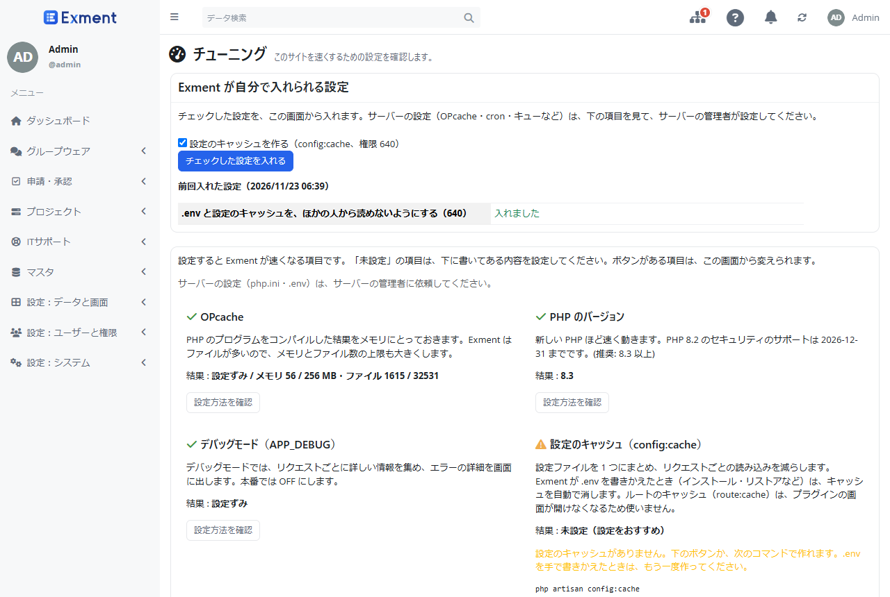
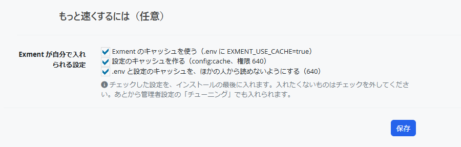

# Tuning
Check the settings that make this site faster. "Settings: System" > "Tuning" (the URL is `/tuning`) lists the settings that make Exment faster, with their state now.

Note: this screen is available in Exment v7.2.1 or later.  
Note: only system administrators can see this screen.

## Reading the page
- Each item shows "Already set" or "Not set (recommended)". For the items marked "Not set", set what is shown below them.
- The items with a button can be changed from this page.
- The data items (7.3.0) show what was counted at night. Before the first count, or when it cannot be checked, they show the "could not check" mark (?).
- Ask the server administrator to change the server settings (php.ini, .env).
- The same items are shown in "To make it faster (optional)" on the installer and in "== Tuning (optional) ==" of `php artisan exment:checkrequire`. They only say "Already set" or "Not set", and never stop the install.

## Settings Exment can set itself (recommended settings)
The settings Exment can change safely can be checked and set from this page. Only the ones this server needs are shown.

| Setting | What it does |
|---|---|
| Exment cache | `EXMENT_USE_CACHE=true` in `.env` |
| Screen files | `exment:publish` when JS / CSS files are missing |
| Where the cache is kept | Redis, only when PHP can reach Redis |
| Where sessions are kept | Redis as well (this page only; not offered at the setup) |
| Remove the route cache | Removes a route cache (it keeps plugin pages from opening) |
| Make the config cache | `config:cache` (permission 640), after the settings that write `.env` |
| Permissions of the secret files | `.env` and the config cache 640 (only when the PHP user owns them) |

- Pressing "Make the checked settings" lists them for a confirmation first. What was done goes to the operation log, and the last result (set / already set / failed, with the reason) is shown below.
- **At the setup too**: the initialize page after the install shows the same settings, checked. Unchecked ones are not applied.

  

- php.ini, PHP-FPM, OPcache, cron and the queue are not changed; see the items below and ask the server administrator.
- With `EXMENT_TUNING_SERVER_ACTIONS=false` in `.env`, neither this box nor the settings at the setup are offered.

## Items
### OPcache
Keeps compiled PHP in memory. Exment has many files, so the memory and the number of files must be large enough (at least 128 MB and 20,000 files for "Already set").

Set php.ini as below and restart PHP (PHP-FPM, the web server).

~~~ini
opcache.enable=1
opcache.memory_consumption=256
opcache.interned_strings_buffer=16
opcache.max_accelerated_files=20000
opcache.revalidate_freq=60
~~~

### PHP version
Newer PHP runs faster. PHP 8.2 gets security fixes only until 2026-12-31. Upgrading to PHP 8.3 or later is recommended.

### Debug mode (APP_DEBUG)
In debug mode every request collects details and errors are shown on the screen. Turn it off in production.

~~~
# .env
APP_DEBUG=false
~~~

### Config cache (config:cache)
Puts the config files into one file, read once per request. Make it with the buttons "Make the config cache" / "Remove the config cache" on the page, or with this command.

~~~
php artisan config:cache
~~~

- After changing `.env` by hand, make it again (the change does not take effect until then).
- When Exment writes `.env` (install, restore), it removes the cache itself.
- `bootstrap/cache/config.php` holds the secrets of `.env` (the database password, `APP_KEY`). When the sites of one server run as different OS users (multi-tenant), make it 640 after making it (or run with umask 027), so that the other sites cannot read it.
- The route cache (`route:cache`) is not used: the routes of plugins are made from the database, so the pages of plugins would not open.

### Optimized class loading (composer)
With a list of the classes made by composer, PHP finds the file of a class faster.

~~~
composer install --optimize-autoloader --no-dev
~~~

### Exment cache (EXMENT_USE_CACHE)
Keeps the definitions (tables, columns, settings) in the cache instead of reading them from the database on every request.

~~~
# .env
EXMENT_USE_CACHE=true
~~~

### Where the cache and sessions are kept
Redis and the like are faster than files, and needed when several web servers serve the site. If Redis is available, set .env as below (optional).

~~~
# .env (Redis)
CACHE_STORE=redis
SESSION_DRIVER=redis
~~~

### Queue (mails and other background work)
With the `sync` queue, mails are sent inside the request and the screen waits until they are sent. Set .env as below and keep a queue worker running (supervisor, systemd and so on).

~~~
# .env
QUEUE_CONNECTION=database
# keep a worker running
php artisan queue:work --tries=3
~~~

### Dashboard aggregation cache (EXMENT_DASHBOARD_CACHE_SECONDS)
A chart of a summary view aggregates its table every time the dashboard is opened. This keeps the result for each viewer for the given seconds, without aggregating again. The default is `0` (off).

~~~
# .env (seconds)
EXMENT_DASHBOARD_CACHE_SECONDS=60
~~~

- Saving or deleting data aggregates again.
- A change of a share or a membership shows once the time has passed.

### Logs for investigation
The system performance log and the debug modes of `.env` (`EXMENT_DEBUG_MODE_REQUEST`, `EXMENT_DEBUG_MODE_SQL`, `EXMENT_DEBUG_MODE_SQLFUNCTION`, `EXMENT_DEBUG_MODE_SQLFUNCTION1`, `EXMENT_DEBUG_MODE_SCHEDULE`) write a log on every request. Turn them off after the investigation. The system performance log can be stopped with the button "Turn off the system performance log".

### Search index
In a table with more than 10,000 rows, a "search index" on the columns often used to filter and sort makes lists, searches and summaries faster. In the [column](/column) settings, add "Search index" to the columns often used.

### Scheduled tasks (schedule:run, cron)
Notifications, schedules and batches run in `schedule:run`, started every minute by cron. It starts PHP and Exment every minute, so heavy tasks take CPU from the pages. The page shows when it last ran and the longest time in a minute, and warns when cron does not run or a task is heavy.

### PHP-FPM processes
With `pm = ondemand` and a short `pm.process_idle_timeout`, the first request after a quiet time waits for a process to start. Set `pm.max_children` for the memory of the server.

### Route cache (route:cache)
Exment adds the routes of plugin pages from the database on every request. With a route cache, plugin pages installed later do not open. **Having none is correct.**

### Permissions of the secret files (.env, config cache)
`.env` and the config cache (`bootstrap/cache/config.php`) hold passwords and APP_KEY. Make them unreadable by the other users of the server, e.g. 640 (also fixable in "Settings Exment can set itself" above).

### Screen files (JS, CSS)
Checks that the JS and CSS the login page and others load are all there, and that browsers may keep them (Cache-Control, Expires). Their URLs carry the version (`?v=`), so a long cache is safe.

### Slow query log (DB)
With the slow query log of MySQL / MariaDB on, slow queries are recorded, to find what is slow.

### Indexes of the search index (DB)
A column with "search index" has its own column and index in the data table. Without the index (after a failed restore or change), every filter and sort reads all rows. Checks that the indexes are there.

## Data items (7.3.0)
From Exment 7.3.0, the page shows problems on the data side too, besides the server settings.

- The data is **counted every night at 4:30** and the counts are kept (`php artisan exment:tuning-data`). Opening the page does not count anything. You can also count it with "Run now" on the scheduled jobs page.
- The result shows when it was counted. Before the first count, it shows "Not counted yet".
- **It only shows.** Exment never changes the data or the settings by itself. A search index is added only when an administrator presses the button.

| Item | What it shows | When it recommends | How to fix |
| ---- | ---- | ---- | ---- |
| Amount of data (tables) | The 5 tables with the most rows; on MySQL / MariaDB also the sizes of the data and the indexes | A table grew 2× and by 50,000 rows since the count before | Check that no import or automatic job runs again and again |
| Revisions | Tables with more than 1,000,000 revisions | There is such a table | Lower "Data Revision Versioning Count" in the [table](/table) settings (when a row is saved, its oldest revisions go first) |
| Deleted data | Tables with 10,000+ deleted rows (in the trash) that are 20%+ of the table | "Days to keep deleted data" is not set | Set the days in the table settings: old deleted data is then deleted for good every night (kept in an archive) |
| Attachments | The number and total size of the attachments (of the newest 5,000), and the files linked to no data | There are files left after their data was deleted for good | No page shows them; they only use the disk |
| Database settings (MySQL, MariaDB) | `innodb_buffer_pool_size` and the size of the data and indexes | `innodb_buffer_pool_size` is smaller than the data and indexes | Write the value shown in the MySQL settings file and restart (up to 50-70% of the memory of the server). Another database, or a setting that cannot be read: "Could not check" |
| Columns without a search index | In tables with 10,000+ rows, the columns that views filter, sort or group by, and the reference columns (select, user, organization), without a search index | There are such columns | Choose the columns and press "Add a search index to the chosen columns (in the background)", or add it in the [column](/column) settings |
| Heavy views | Views of tables with 10,000+ rows that filter, sort or group by a column without a search index, or that summarize a child table | There are such views | Add a search index to the columns they use, or review the conditions of the [view](/view) |

### Adding a search index from the page
- Choose columns in "Columns without a search index" and press the button: the index is added **in the background**. On large tables it takes time.
- With a queue worker it runs on the worker; without one, after the page has answered. While it runs, the column shows as "being added".
- A column of a table that already has the most search indexes allowed (20 by default) cannot be chosen.
- The press is kept in the operation log, and the change in the application log.

### Size of the logs (7.3.0)
When the logs in the database are big and no log database is set yet, the page also suggests keeping them in a database of their own, with `EXMENT_LOG_DB_CONNECTION` and `php artisan exment:log-db --copy`.

## Other settings for speed
### Charts of list views (EXMENT_CHART_LIST_MAX_ROWS)
A chart of a list view draws one point per row. By default (`0`) it reads all the rows. When a large table needs too much memory or time, set a limit in `.env` (for example 1000). Over the limit, it says to use a chart of a summary view. Make charts of large tables with summary views.

~~~
# .env (to set a limit)
EXMENT_CHART_LIST_MAX_ROWS=1000
~~~

## Hiding the buttons (EXMENT_TUNING_SERVER_ACTIONS)
When several sites share the code on one server (as a multi-tenant server), this line in `.env` hides the buttons that change the whole server (make or remove the config cache). The page then says "On this server it cannot be changed from the screen (the server administrator sets it)."

~~~
# .env
EXMENT_TUNING_SERVER_ACTIONS=false
~~~

## Hiding the page
- Tuning is one of the features of [Feature Management](/feature), on from the start. The system administrators of the site can turn it off there.
- To hide it from the server side (as a SaaS), write `EXMENT_FEATURES_LOCKED=tuning` in `.env` (separate it with commas from other features). The page answers 404 and is not in the menu.

## Related
- [Security check](/security_check)
- [Feature Management](/feature)
- [System setting](/system_setting)
- [Server setting](/server)
- [Redundancy (for advanced users)](/redundant)
