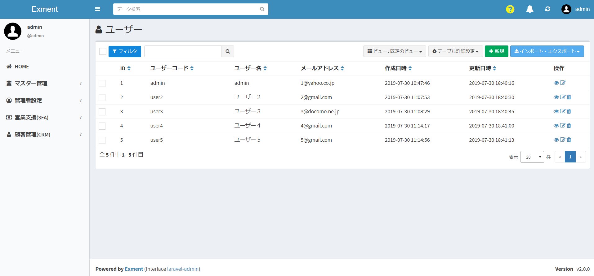
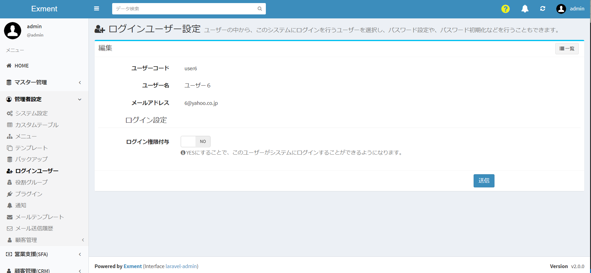
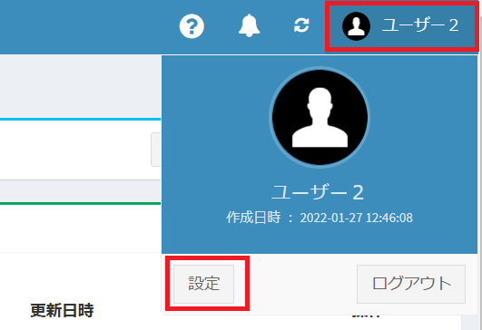

# User / Login user
This page explains the screens that manage users and login users.

| What you want to do | Where to look |
|---|---|
| Add, edit and delete users | "User management" |
| Let a user log in, decide the password | "Login user management" |
| Set the login for many users at once | "Bulk import of login user information" |
| Let users see and change their own information | "Viewing and editing personal information by the login user" |

## Name definition
### User
A person, such as an employee, who belongs to your company or organization.  
People who do not use this system can also be added as users.  
The user code and the e-mail address are required.  
A user can be registered linked to the data of other tables. However, just being a user does not let the person log in to the system.

### Login user
Among the users, a person who can log in to Exment.  
A password is attached to the user information, so the person can log in from the login screen of Exment and register and refer to data and so on.  

#### User and login user setting procedure

The flow until a person can log in to Exment is as in the figure above.  
(1) On the user management screen, register the user code, user name and e-mail address of the user.  
(2) On the login user management screen, set the password of the user registered in (1).  
The registered user can now log in to Exment.  

> When the password is entered wrongly a set number of times at login, that user cannot log in for a while.  

## User management
How to manage the information of all users.  

### List screen display
Click "User" in the left menu.  
Or open the following URL.  
The user list screen is shown.
http(s)://(Exment URL)/data/user  
The list of the users now registered in the system is shown.

> Note: the URL is for the default setting without "/admin" (a site newly installed with v7.2.1 or later). If `ADMIN_ROUTE_PREFIX` in `.env` has a value (a site installed with an earlier version has "admin"), add that value after the URL of the site (e.g. `http(s)://(Exment URL)/admin/data/user`). For details, see [Change / delete "admin" included in URL](/additional_prefix).

### Add new user
- On the "User" list screen, click the [New] button at the top right of the page.

- The screen for adding a new user is shown. Enter the necessary items.

#### Affiliation organization setting
When there is an organization the user should belong to, select it from the "Candidate data list" and move it to the "Selected data list".  
Note: this item is not shown when no organization has been made.

#### Role group settings
When there is a role group to give the user, select it from the "Candidate data list" and move it to the "Selected data list".

#### Login settings
When "Login Authorization Granted" is YES, the user can be made as a login user.  
For how to set it, see [Login user management](#login-user-management) below.

### Save
After entering the settings, click [Submit].

### Edit
To edit a user, click the [Edit] link of that row.  

### Delete
To delete a user, click the [Delete] link of that row.  

## Login user management
Manage the login users, for the users made on the screen above.  
You can add a password, reissue a password, remove the login permission, and so on.  

### Screen display
Click "Login user" in the left menu.  
Or open the following URL.  
The login user setting screen is shown.
http(s)://(Exment URL)/loginuser  
The users now registered in the system and their login information are shown.  

### Add login information
Click the [Edit] link of the row of the user to add login information to.  

- The screen for editing the login information is shown.  
  
To add the login permission, set "Login Authorization Granted" to YES.  
When it is YES, the item "Auto-Create Password" is shown.

#### Automatically generate password
When YES, the password is made automatically when the login permission is added.  
After it is made, an e-mail with the password is sent automatically to the e-mail address of that user.  
**Note: the [mail setting](/system_setting?id=system-mail-settings) is needed to use this function.**  
  
When NO, a text box for entering the password and the item "Send User Info" are shown.

#### Password input
Shown when "Auto-Create Password" is NO.  
Enter the password of the login user.  

#### Email user information
Shown when "Auto-Create Password" is NO.  
When this item is YES, an e-mail with the password is sent to the e-mail address of that user.  
**Note: the [mail setting](/system_setting?id=system-mail-settings) is needed to use this function.**

#### Change Password at First Login
When YES, a screen for changing the password is shown when the user logs in for the first time.  
It applies to newly registered users and to users whose password was reset.

### Delete login authority
Removes the login permission.  
On the list screen, click the [Edit] link of a user whose "Login User Setting" column is "YES".  
  

Change "Login Authorization Granted" to NO.  
  
Then click [Submit].  

### Bulk import of login user information
Login user information can be imported at once.  
The login can be set for many users together, without setting it one by one from the user screen.

The flow is as follows.

1. Register the users ("Registering user information")  
2. Export the login user information ("Exporting login user information")  
3. Edit the exported file ("Making the import file")  
4. Import ("Import")

#### Registering user information
First, add the users you want to give login information to on the [User management](#user-management) screen.

#### Exporting login user information
- Click "Login user" in the left menu.  
Or open the following URL.  
The login user setting screen is shown.
http(s)://(Exment URL)/loginuser  
The users now registered in the system and their login information are shown.  

- Click the "Import/Export" button at the top right of the screen.  
Then click "Export".

  

- The registered user information and the login user information of those users are output.

  

#### Contents of each column
- id  
The id of the user. Do not change this value for the later import.  

- User name, user code, e-mail address  
The user information.  
Note: even if these values are changed for the later import, they are not reflected in the user information. Change the user information on the "User" screen.

- Login Authorization Granted  
Whether that user has the standard login information of Exment. When 1, the user has login information.

- Auto-Create Password, Password, Send User Info  
On export, the values are empty. They are used on import.

#### Making the import file
Edit the file exported above to make the import file.  
Enter each column as follows.

- Login Authorization Granted  
    - To give that user the standard login permission of Exment, set 1.  
    - When the user already has the login permission and should keep it, leave 1.  
    - To remove the login permission from a user who already has it, set 0.

- Auto-Create Password  
To make the password of that user automatically, enter 1.  
Setting it for a user who already has the login permission resets the password.

- Password  
To decide the password of the user yourself, enter the password string.  
Setting it for a user who already has the login permission resets the password.

- Send User Info  
To send the password by e-mail when login information is newly given or the password is changed, enter 1.

#### Import
- On the login user setting screen, click the "Import/Export" button at the top right of the screen.  
Then click "Import".

  

- Upload the import file you made.

- The login information is given.

## Viewing and editing personal information by the login user
Information such as "user code", "user name", "e-mail address", "avatar" and "password" is registered for a user.

- "Avatar" and "password" can be shown and changed by the login user from the start.  
- "User code", "user name", "e-mail address" and "other newly made columns" can be viewed and edited by the login user when the following setting is made.  

#### Custom column setting: Viewing / Editing personal information

In the custom column setting of the user table, "Viewing / Editing personal information" can be set.  
There are three choices: "None", "View Only" and "Editable".  
What the login user can do with each is as follows.

##### None
The login user cannot show the registered information.  

##### View Only
The login user can show the registered information but cannot edit it.  

##### Editable
The login user can both show and edit the registered information.
> When an option such as "can be entered only once" is set, that option has priority.

#### Viewing and editing on the login user screen

Click the login user name at the top right of the Exment screen, and click [Setting].  

The information the login user can show is displayed.  
The columns that can be entered can be edited and saved by the user.    

Note: in the example of the image, "user code" is View Only, and "user name" and "e-mail address" are Editable.
