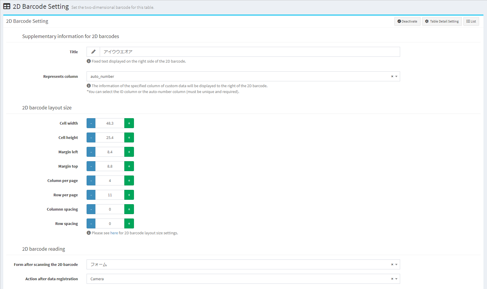
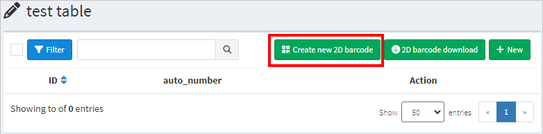
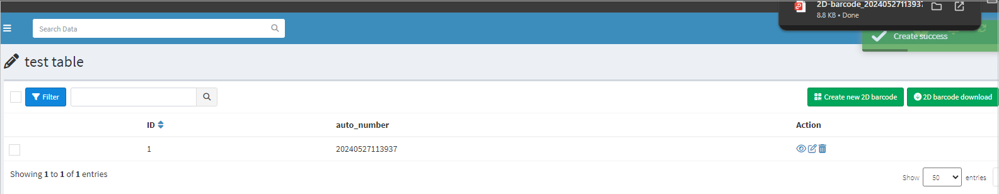

# Cài đặt mã vạch 2D
Trang này giải thích màn hình quyết định, cho từng bảng, hình thức của nhãn mã vạch 2D và hoạt động khi quét mã.

Các bước cho đến khi dùng được như sau.

1. Mở màn hình cài đặt mã vạch 2D
2. Thiết lập rồi lưu
3. Bấm nút "Kích hoạt"
4. Tạo PDF mã vạch 2D từ danh sách dữ liệu

## Tổng quan chức năng mã vạch 2D
Về tổng quan chức năng mã vạch 2D, vui lòng xem [bài viết trên trang chính thức](https://exment.net/release_v6-1-0/).

### Extension PHP cần có (PDF của nhãn)
Để tạo PDF nhãn mã vạch 2D, extension gd của PHP phải được cài kèm FreeType (dùng được `imagettftext`). Nếu chưa có, sẽ xảy ra lỗi khi tạo PDF của nhãn.

- Nếu dùng docker-exment: hãy cập nhật docker-exment (từ PR #23 ngày 2026-11-23 trở đi) và tạo lại image php (`docker compose build php` rồi `docker compose up -d`).
- Với máy chủ khác: hãy cài gd kèm FreeType (thông thường có sẵn trong gói php-gd của bản phân phối). Có thể kiểm tra dùng được hay không bằng lệnh sau. Nếu hiện `bool(true)` là dùng được.

```
php -r 'var_dump(function_exists("imagettftext"));'
```

## Hiển thị trang
- Trên danh sách bảng tùy chỉnh, đánh dấu chọn bảng cần thiết lập, rồi nhấp vào "Cài đặt chi tiết bảng" ở phía trên bên phải.  


> ※ Cũng có thể chuyển trực tiếp từ màn hình danh sách dữ liệu hoặc màn hình đăng ký dữ liệu của bảng tùy chỉnh đó. Khi đó cũng nhấp vào "Cài đặt chi tiết bảng" ở phía trên bên phải.  


- Trên màn hình cài đặt chi tiết bảng, nhấp vào biểu tượng cài đặt mã vạch 2D thì màn hình cài đặt mã vạch 2D hiển thị.  


## Các mục thiết lập của mã vạch 2D


### Thông tin bổ sung cho mã vạch 2D
Thiết lập thông tin hiển thị ở bên phải mã vạch 2D.

- #### Tiêu đề
Nhập văn bản cố định hiển thị ở bên phải mã vạch 2D.

- #### Cột hiển thị
Chọn cột của dữ liệu tùy chỉnh hiển thị ở bên phải mã vạch 2D.   
Có thể chọn cột ID hoặc cột đánh số tự động (phải là duy nhất và bắt buộc).

### Kích thước bố cục mã vạch 2D
Thiết lập kích thước bố cục của mã vạch 2D. 
Vui lòng xem bảng dưới đây.

| Case | Cell width | Cell height | Margin right | Margin top | Column per page | Row per page | Column spacing | Row spacing |
| ---- | ---- | ---- | ---- | ---- | ---- | ---- | ---- | ---- |
| 2x5 | 84 | 52 | 17 | 10.5 | 2 | 5 | 8 | 4 |
| 2x6 | 83.8 | 42.3 | 19.3 | 21.5 | 2 | 6 | 3.8 | 0 |
| 2x7 | 83 | 32 | 20 | 24 | 2 | 7 | 4 | 4 |
| 3x6 | 63.5 | 46.5 | 7.2 | 9 | 3 | 6 | 2.55 | 0 |
| 3x7 | 63.5 | 38 | 7.2 | 15.5 | 3 | 7 | 2.55 | 0 |
| 3x8 | 56 | 30 | 17 | 14.5 | 3 | 8 | 4 | 4 |
| 3x9 | 62 | 31 | 9 | 9 | 3 | 9 | 3 | 0 |
| 3x10 | 53.3 | 25.4 | 19 | 21.5 | 3 | 10 | 3.8 | 0 |
| 3x12 | 60 | 20 | 12 | 12 | 3 | 12 | 3 | 3 |
| 4x11 | 48.3 | 25.4 | 8.4 | 8.8 | 4 | 11 | 0 | 0 |


### Quét mã vạch 2D
Thiết lập hoạt động khi quét mã vạch 2D. 

- #### Biểu mẫu sau khi quét mã vạch 2D
Chọn biểu mẫu đăng ký sẽ mở sau khi quét mã vạch 2D.  
Có thể chọn từ các biểu mẫu tùy chỉnh đã đăng ký cho bảng đó. 

- #### Hành động sau khi đăng ký dữ liệu  
Chọn màn hình hiển thị sau khi đăng ký dữ liệu.  
Có thể chọn màn hình TOP, màn hình danh sách, màn hình chi tiết, màn hình chỉnh sửa hoặc màn hình khởi động camera.

Sau khi thiết lập, nhấp vào nút "Lưu".  

### Kích hoạt cài đặt mã vạch 2D  
- Để dùng được chức năng mã vạch 2D ở bảng đó, cần "Kích hoạt". Hãy lưu một lần, rồi nhấp vào nút "Kích hoạt" ở phía trên bên phải của trang.


## Tạo mới mã vạch 2D
- Khi kích hoạt chức năng mã vạch 2D, nút "Tạo mới mã vạch 2D" hiển thị trên danh sách dữ liệu của bảng đó.  
Phần "mã vạch 2D" trong tên của nút có thể đổi bằng "EXMENT_TEXT_QR_BUTTON_JA/EN" trong tệp .env.  



- Khi nhấp vào "Tạo mới mã vạch 2D", màn hình tạo mới mã vạch 2D hiển thị.

- Khi nhập số lượng mã vạch 2D rồi lưu, dữ liệu được tạo đúng số lượng đó và PDF mã vạch 2D cũng được xuất ra.


## Tải xuống mã vạch 2D
- Khi kích hoạt chức năng mã vạch 2D, nút "Tải xuống mã vạch 2D" hiển thị trên danh sách dữ liệu của bảng đó.  
Phần "mã vạch 2D" trong tên của nút có thể đổi bằng "EXMENT_TEXT_QR_BUTTON_JA/EN" trong tệp .env.


- Khi chọn dữ liệu rồi nhấp vào "Tải xuống mã vạch 2D", mã vạch 2D của các dữ liệu đã chọn được xuất ra dưới dạng PDF.


## Khởi động màn hình camera từ Exment
- Từ dashboard của Exment, có thể khởi động màn hình camera để quét mã vạch 2D.

- Về cách thêm mục "Mã vạch 2D/JAN" vào dashboard, vui lòng xem [Dashboard](/vi/dashboard).
