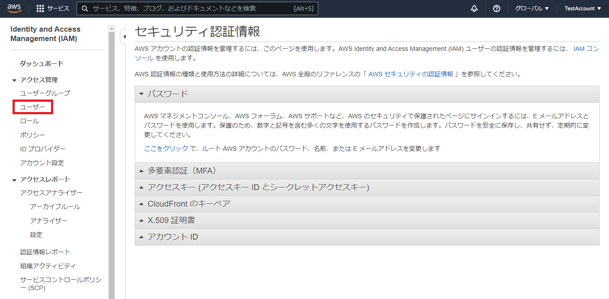
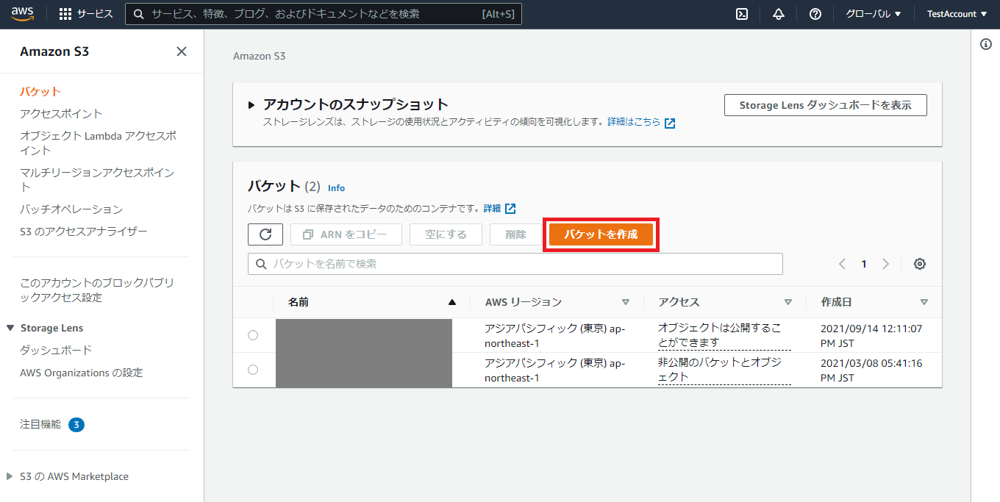
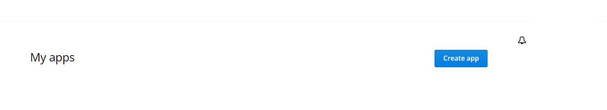

# (Dành cho người dùng nâng cao) Thay đổi nơi lưu tệp
Đây là thiết lập để lưu các tệp như tệp đính kèm và bản sao lưu ở nơi khác ngoài web server (FTP, Amazon S3, v.v.).  
Với thiết lập chuẩn, tệp đính kèm được lưu trên web server. Bạn thay đổi nơi lưu trong các trường hợp như sau.

- Lưu tệp sao lưu vào FTP
- Lưu tệp vào AWS S3 để dự phòng (redundancy)

Việc thiết lập được thực hiện theo thứ tự sau.

1. Quyết định "loại tệp" muốn đổi nơi lưu và "nơi tải lên (driver)" muốn dùng.
2. Ở "Thiết lập chung", chỉ định driver cho từng loại tệp.
3. Ở "Thiết lập theo từng driver", thiết lập thông tin của nơi kết nối.

## Các loại tệp
Hiện nay Exment có các loại tệp sau. Nơi lưu được quyết định theo từng loại.  
※Tên khóa được dùng trong các thiết lập phía sau.

| Loại tệp | Nội dung | Tên khóa |
| ---- | ---- | ---- |
| **Tệp đính kèm** | Tệp đính kèm của dữ liệu, được lưu từ màn hình | exment |
| **Sao lưu** | Tệp sao lưu dữ liệu Exment, được chạy từ màn hình sao lưu | backup |
| **Plugin** | Tệp plugin đã tải lên làm chức năng mở rộng của Exment | plugin |
| **Mẫu** | Tệp thiết lập của bảng tùy chỉnh, cột tùy chỉnh, v.v. của Exment | template |


## Các loại nơi tải lên (driver)
Hiện nay Exment hỗ trợ các nơi tải lên (driver) sau.  
※Tên khóa được dùng trong các thiết lập phía sau.

| Nơi tải lên (driver) | Nơi lưu | Tên khóa |
| ---- | ---- | ---- |
| **Local (mặc định)** | Web server | local |
| **FTP** | FTP | ftp |
| **SFTP** | SFTP | sftp |
| **Amazon S3** | Amazon S3 | s3 |
| **Azure Blob** | Azure Blob | azure |

> Từ v3.6.2, Exment hỗ trợ driver riêng. Chi tiết vui lòng xem "Thêm driver riêng" ở cuối trang này.

## Cách thiết lập

### Thiết lập chung
- Mở ".env" và chỉ định driver cho từng loại tệp muốn thay đổi.

~~~
EXMENT_DRIVER_EXMENT=(tên khóa của driver muốn dùng cho tệp đính kèm)
EXMENT_DRIVER_BACKUP=(tên khóa của driver muốn dùng cho sao lưu)
EXMENT_DRIVER_TEMPLATE=(tên khóa của driver muốn dùng cho mẫu)
EXMENT_DRIVER_PLUGIN=(tên khóa của driver muốn dùng cho plugin)

// Ví dụ 1: chỉ muốn đổi nơi sao lưu sang FTP
EXMENT_DRIVER_BACKUP=ftp

// Ví dụ 2: muốn đổi tất cả nơi tải lên sang Amazon S3
EXMENT_DRIVER_EXMENT=s3
EXMENT_DRIVER_BACKUP=s3
EXMENT_DRIVER_TEMPLATE=s3
EXMENT_DRIVER_PLUGIN=s3
~~~

### Khi phiên bản cài đặt lần đầu thấp hơn v3.0.8
Nếu phiên bản Exment bạn cài đặt lần đầu thấp hơn v3.0.8, cần sửa như sau.  
(Nếu không biết phiên bản cài đặt lần đầu, hãy kiểm tra cho chắc)

- Mở "config/exment.php" trong thư mục gốc của dự án.

- Tìm đoạn như sau.

~~~ php
    /*
    |--------------------------------------------------------------------------
    | driver
    |--------------------------------------------------------------------------
    |
    | file upload driver
    |
    */
    'driver' => [
        'default' => env('EXMENT_DRIVER_DEFAULT', 'local'),
    ],
~~~

- Sửa đoạn này thành như sau.

~~~ php
    /*
    |--------------------------------------------------------------------------
    | driver
    |--------------------------------------------------------------------------
    |
    | file upload driver
    |
    */
    'driver' => [
        'exment' => env('EXMENT_DRIVER_EXMENT', 'local'), //sửa
        'backup' => env('EXMENT_DRIVER_BACKUP', 'local'), //thêm
        'plugin' => env('EXMENT_DRIVER_PLUGIN', 'local'), //thêm
        'template' => env('EXMENT_DRIVER_TEMPLATE', 'local'), //thêm
    ],
~~~

### (1 Khuyến nghị) Thiết lập theo từng driver - thiết lập config và .env
Đây là cách viết tối thiểu vào config, còn giá trị thiết lập thì viết vào .env.  
Giá trị thiết lập dùng lại được giữa các loại tệp, nên thiết lập tương đối đơn giản.

#### FTP

- Chạy lệnh sau.

~~~
composer require league/flysystem-ftp ~3.0
~~~

- Mở "config/filesystems.php" và kiểm tra giá trị thiết lập của "disks.ftp".  
Nếu chưa có, hãy thêm thiết lập sau.

~~~php
    'disks' => [
        // Thêm từ đây
        'ftp' => [
            'driver'   => 'ftp',
            'host'     => env('FTP_HOST'),
            'username' => env('FTP_USERNAME'),
            'password' => env('FTP_PASSWORD'),
    
            // Tùy chọn của thiết lập FTP
            'port'     => env('FTP_PORT', 21),
            'ssl'      => env('FTP_SSL', false),
            'timeout'  => env('FTP_TIMEOUT', 30),
        ],
    ],
~~~

- Mở ".env" và thêm nội dung sau.  

~~~
FTP_HOST=(tên máy chủ FTP)
FTP_USERNAME=(tên người dùng FTP)
FTP_PASSWORD=(mật khẩu FTP)
~~~

- Thêm các thiết lập sau cho từng loại tệp muốn dùng FTP.

~~~
FTP_ROOT_EXMENT=(đường dẫn gốc của FTP dùng cho tệp đính kèm)
FTP_ROOT_BACKUP=(đường dẫn gốc của FTP dùng cho sao lưu)
FTP_ROOT_TEMPLATE=(đường dẫn gốc của FTP dùng cho mẫu)
FTP_ROOT_PLUGIN=(đường dẫn gốc của FTP dùng cho plugin)

// Ví dụ 1: chỉ định đường dẫn gốc của FTP cho sao lưu
FTP_ROOT_BACKUP=/var/foo/exment/ftp/backup

// Ví dụ 2: chỉ định tất cả đường dẫn gốc của FTP
FTP_ROOT_EXMENT=/var/foo/exment/ftp/admin
FTP_ROOT_BACKUP=/var/foo/exment/ftp/backup
FTP_ROOT_TEMPLATE=/var/foo/exment/ftp/template
FTP_ROOT_PLUGIN=/var/foo/exment/ftp/plugin
~~~


#### SFTP

- Chạy lệnh sau.

~~~
composer require league/flysystem-sftp-v3 ~3.0
~~~

- Mở "config/filesystems.php" và kiểm tra giá trị thiết lập của "disks.sftp".  
Nếu chưa có, hãy thêm thiết lập sau.

~~~php
    'disks' => [

        // Thêm từ đây
        'sftp' => [
            'driver'   => 'sftp',
            'host'     => env('SFTP_HOST'),
            'username' => env('SFTP_USERNAME'),
            'password' => env('SFTP_PASSWORD'),

            // Thiết lập xác thực dựa trên SSH key (chỉ ghi khi cần)
            // 'privateKey' => env('SFTP_PRIVATE_KEY'),
            // 'password' => env('SFTP_PASSWORD'),

            // Tùy chọn của thiết lập FTP
            'port' => env('SFTP_PORT', 22),
            'timeout' => env('SFTP_TIMEOUT', 30),
        ],
    ],
~~~

- Mở ".env" và thêm nội dung sau.  

~~~
SFTP_HOST=(tên máy chủ SFTP)
SFTP_USERNAME=(tên người dùng SFTP)
SFTP_PASSWORD=(mật khẩu SFTP)
~~~

- Thêm các thiết lập sau cho từng loại tệp muốn dùng SFTP.

~~~
SFTP_ROOT_EXMENT=(đường dẫn gốc của SFTP dùng cho tệp đính kèm)
SFTP_ROOT_BACKUP=(đường dẫn gốc của SFTP dùng cho sao lưu)
SFTP_ROOT_TEMPLATE=(đường dẫn gốc của SFTP dùng cho mẫu)
SFTP_ROOT_PLUGIN=(đường dẫn gốc của SFTP dùng cho plugin)

// Ví dụ 1: chỉ định đường dẫn gốc của SFTP cho sao lưu
SFTP_ROOT_BACKUP=/var/foo/exment/sftp/backup

// Ví dụ 2: chỉ định tất cả đường dẫn gốc của SFTP
SFTP_ROOT_EXMENT=/var/foo/exment/sftp/admin
SFTP_ROOT_BACKUP=/var/foo/exment/sftp/backup
SFTP_ROOT_TEMPLATE=/var/foo/exment/sftp/template
SFTP_ROOT_PLUGIN=/var/foo/exment/sftp/plugin
~~~


#### Amazon S3
- Trước tiên, hãy [tạo bucket AWS S3 và tạo IAM](#tạo-iam-cho-s3).  
※Khi dùng cho nhiều loại tệp, hãy tạo bucket riêng cho từng loại tệp

- Chạy lệnh sau.

~~~
composer require league/flysystem-aws-s3-v3 ~3.0
~~~

- Mở "config/filesystems.php" và kiểm tra giá trị thiết lập của "disks.s3".  
Nếu chưa có, hãy thêm thiết lập sau.

~~~php
    'disks' => [

        // Thêm từ đây
        's3' => [
            'driver' => 's3',
            'key' => env('AWS_ACCESS_KEY_ID'),
            'secret' => env('AWS_SECRET_ACCESS_KEY'),
            'region' => env('AWS_DEFAULT_REGION'),

            // Phần dưới chỉ ghi khi đổi endpoint, ví dụ do dùng PrivateLink
            'endpoint' => env('AWS_ENDPOINT'),
        ],
    ],
~~~

- Thêm nội dung sau vào ".env".  

~~~
AWS_ACCESS_KEY_ID=(access key của AWS S3)
AWS_SECRET_ACCESS_KEY=(secret access key của AWS S3)
AWS_DEFAULT_REGION=(region của AWS S3)
#Phần dưới chỉ ghi khi đổi endpoint, ví dụ do dùng PrivateLink
AWS_ENDPOINT=(endpoint của AWS S3)
~~~

> **Khi kết nối bằng IAM role mà không dùng access key**
> Chỉ khi đã thiết lập cả "AWS_ACCESS_KEY_ID" và "AWS_SECRET_ACCESS_KEY" thì Exment mới kết nối bằng access key đó.
> Nếu một trong hai chưa được thiết lập, thông tin xác thực được lấy theo cách mặc định của AWS SDK (biến môi trường, tệp thông tin xác thực dùng chung, IAM role của ECS task hoặc EC2 instance, v.v.).
> Khi đã gán IAM role cho EC2 hoặc ECS, bạn có thể kết nối đến S3 mà không lưu access key bằng cách không ghi 2 giá trị này. Vẫn cần "AWS_DEFAULT_REGION" và thiết lập bucket.

- Thêm các thiết lập sau cho từng loại tệp muốn dùng Amazon S3.

~~~
AWS_BUCKET_EXMENT=(bucket AWS S3 dùng cho tệp đính kèm)
AWS_BUCKET_BACKUP=(bucket AWS S3 dùng cho sao lưu)
AWS_BUCKET_TEMPLATE=(bucket AWS S3 dùng cho mẫu)
AWS_BUCKET_PLUGIN=(bucket AWS S3 dùng cho plugin)

// Ví dụ 1: chỉ định bucket AWS S3 cho sao lưu
AWS_BUCKET_BACKUP=exment_backup

// Ví dụ 2: chỉ định tất cả bucket AWS S3
AWS_BUCKET_EXMENT=exment_default
AWS_BUCKET_BACKUP=exment_backup
AWS_BUCKET_TEMPLATE=exment_template
AWS_BUCKET_PLUGIN=exment_plugin
~~~

- Khi nơi lưu tệp đính kèm là Amazon S3, lúc tải tệp đính kèm, người dùng được chuyển hướng đến URL tạm thời (URL có chữ ký) của Amazon S3. Trình duyệt tải tệp trực tiếp từ Amazon S3 mà không qua Exment.  
Vì vậy, trình duyệt của người dùng cần kết nối được đến Amazon S3 (endpoint của Amazon S3).  
※Thời hạn hiệu lực (phút) của URL tạm thời thay đổi được bằng "EXMENT_FILE_DOWNLOAD_TEMPORARY_URL_MINUTES" trong ".env" (giá trị mặc định là 15). Chi tiết vui lòng xem [tại đây](/vi/config?id=thời-hạn-của-url-tạm-thời-khi-tải-tệp).


#### Azure Blob
- Tạo Blob của Azure.  
※Khi dùng cho nhiều loại tệp, hãy tạo container riêng cho từng loại tệp

- Chạy lệnh sau.

~~~
composer require league/flysystem-azure-blob-storage ~3.0
~~~

- Mở "config/filesystems.php" và kiểm tra giá trị thiết lập của "disks.azure".  
Nếu chưa có, hãy thêm thiết lập sau.

~~~php
    'disks' => [
        // Thêm từ đây
        'azure' => [
            'driver' => 'azure',
            'account' => env('AZURE_STORAGE_ACCOUNT'),
            'key' => env('AZURE_STORAGE_KEY'),
        ],
    ],
~~~

- Thêm nội dung sau vào ".env".  

~~~
AZURE_STORAGE_ACCOUNT=(tài khoản Azure Blob)
AZURE_STORAGE_KEY=(access key của Azure Blob)
~~~

- Thêm các thiết lập sau cho từng loại tệp muốn dùng Azure Blob.

~~~
AZURE_STORAGE_CONTAINER_EXMENT=(container Azure Blob dùng cho tệp đính kèm)
AZURE_STORAGE_CONTAINER_BACKUP=(container Azure Blob dùng cho sao lưu)
AZURE_STORAGE_CONTAINER_TEMPLATE=(container Azure Blob dùng cho mẫu)
AZURE_STORAGE_CONTAINER_PLUGIN=(container Azure Blob dùng cho plugin)

// Ví dụ 1: chỉ định container Azure Blob cho sao lưu
AZURE_STORAGE_CONTAINER_BACKUP=exment_backup

// Ví dụ 2: chỉ định tất cả container Azure Blob
AZURE_STORAGE_CONTAINER_EXMENT=exment_default
AZURE_STORAGE_CONTAINER_BACKUP=exment_backup
AZURE_STORAGE_CONTAINER_TEMPLATE=exment_template
AZURE_STORAGE_CONTAINER_PLUGIN=exment_plugin
~~~


### (2 Không khuyến nghị) Thiết lập theo từng driver - chỉ định riêng trong config
Đây là cách thiết lập chi tiết thông tin của từng driver trong config cho từng loại tệp.

#### Ví dụ: FTP
- Mở "config/filesystems.php" và thêm các giá trị sau.  

~~~php
    'disks' => [
        // Khi loại tệp là sao lưu, thêm từ đây
        'backup' => [ // Nhập tên khóa của loại tệp
            'driver'   => 'ftp',
            'host'     => env('FTP_HOST'),
            'username' => env('FTP_USERNAME'),
            'password' => env('FTP_PASSWORD'),
            'root' => env('FTP_ROOT'),
    
            // Tùy chọn của thiết lập FTP
            'port'     => env('FTP_PORT', 21),
            'ssl'      => env('FTP_SSL', false),
            'timeout'  => env('FTP_TIMEOUT', 30),
        ],

        // Khi đổi driver của loại tệp khác, ghi thiết lập tương tự ở đây
    ],
~~~

- Mở ".env" và thêm các giá trị thiết lập được ghi trong hàm "env" ở trên.

- Khi đổi driver của loại tệp khác, hãy thêm thiết lập vào tệp ".env".


### Lưu ý
- Tùy máy chủ mà có thể không lưu được tệp.  
Đặc biệt với máy chủ thuê, **FTP, v.v. có thể bị giới hạn bởi thiết lập của nhà cung cấp**. Mong bạn thông cảm.


## (Dành cho người dùng nâng cao và nhà phát triển) Thêm driver riêng
Exment mặc định hỗ trợ các driver như FTP và Amazon S3.  
Phần này giải thích cách dùng driver riêng, không được hỗ trợ mặc định.  

### Tiền đề
- ※Với Exment, cần tách thư mục gốc cho từng "loại tệp (tệp đính kèm, sao lưu, plugin, mẫu)" đã nêu ở trên.  

- Nếu hệ thống tệp bạn dùng không có chức năng tách thư mục gốc, cần xử lý như đổi nơi tải lên, hoặc tạo ứng dụng riêng cho từng loại tệp.

### Điều kiện sử dụng
Exment dùng chức năng [hệ thống tệp của Laravel](https://readouble.com/laravel/12.x/ja/filesystem.html) để quản lý driver riêng.  
Vì vậy, chỉ những dịch vụ có sẵn hệ thống tệp của Laravel mới dùng được cho việc quản lý tệp của Exment. (Hoặc bạn cần tự chuẩn bị driver.)

### Cách phát triển
Ở đây, lấy ví dụ cách đặt nơi tải tệp lên là Dropbox.  
※Về thiết lập phía Dropbox, vui lòng xem [Tham khảo: cách lấy access token của Dropbox](#tham-khảo-cách-lấy-access-token-của-dropbox).  

#### Lấy các package cần thiết
Thêm package cần để quản lý Dropbox bằng Laravel.

```
composer require spatie/flysystem-dropbox=^2.0.5
```

#### Tạo và thêm vào tệp
Thêm mới hoặc thêm nội dung vào các tệp sau.

- ##### Adapter
Tạo mới thư mục "app/Exment/Driver" và tạo tệp "ExmentAdapterDropbox.php".

``` php
<?php

namespace App\Exment\Driver;

use Spatie\FlysystemDropbox\DropboxAdapter;

use Exceedone\Exment\Model\File;
use Exceedone\Exment\Enums\Driver;
use Exceedone\Exment\Storage\Adapter\ExmentAdapterInterface2;
use Exceedone\Exment\Storage\Adapter\AdapterTrait;

// (1) Kế thừa DropboxAdapter. ※DropboxAdapter kế thừa \League\Flysystem\Adapter\AbstractAdapter
// (2) Triển khai ExmentAdapterInterface hoặc ExmentAdapterInterface2
class ExmentAdapterDropbox extends DropboxAdapter implements ExmentAdapterInterface2
{
    //(3) use AdapterTrait
    use AdapterTrait;
    
    /**
     * (4) Lấy URL của tệp. Về cơ bản, hãy dùng nguyên xử lý dưới đây
     */
    public function getUrl(string $path): string
    {
        return File::getUrl($path);
    }
    
    /**
     * (5) Phương thức được gọi khi tạo instance của adapter
     */
    public static function getAdapter($app, $config, $driverKey)
    {
        $mergeConfig = static::getConfig($config);

        $client = new \Spatie\Dropbox\Client(array_get($mergeConfig, 'token'));

        // Let's teach Flysystem to interact with Dropdox,
        // thanks to an adapter made by Spatie as usual.
        $driver = new self($client);
        return $driver;
    }


    /**
     * (6) Merge tệp thiết lập
     * @param string $mergeFrom chuỗi 'exment', 'backup', 'plugin', 'template'
     */
    public static function getMergeConfigKeys(string $mergeFrom, array $options = []) : array{
        return [
            'token' => config('filesystems.disks.dropbox.access_token_' . $mergeFrom),
        ];
    }

    /**
     * (7) Lấy thông tin thiết lập
     * *Mục cần có từ Exment5.0.0*
     *
     * @param array $config
     * @return array
     */
    public static function getConfig($config) : array
    {
        $mergeFrom = array_get($config, 'mergeFrom');
        $mergeConfig = static::mergeFileConfig('filesystems.disks.dropbox', "filesystems.disks.$mergeFrom", $mergeFrom); // Chỉ đổi phần "dropbox" thành tên adapter của bạn
        return $mergeConfig;
    }
}

```

```
(1) Ở tệp adapter, hãy kế thừa \League\Flysystem\Adapter\AbstractAdapter.  
Với Dropbox, \Spatie\FlysystemDropbox\DropboxAdapter đã kế thừa class trên, nên hãy kế thừa class đó.　　

(2) Hãy triển khai \Exceedone\Exment\Storage\Adapter\ExmentAdapterInterface2 hoặc \Exceedone\Exment\Storage\Adapter\ExmentAdapterInterface.  
※ExmentAdapterInterface và ExmentAdapterInterface2 chỉ khác nhau ở chỗ tham số và giá trị trả về của hàm getUrl có khai báo kiểu rõ ràng hay không.  

(3) Hãy use AdapterTrait.  

(4) Về cơ bản, hãy dùng nguyên xử lý đã ghi.  

(5) Phương thức được gọi khi tạo instance của adapter. Về cơ bản, hãy triển khai theo cách tạo instance của dịch vụ tệp của bạn.    

(6) Thiết lập các cặp khóa và giá trị thiết lập cần merge vào thông tin thiết lập, dưới dạng mảng kết hợp.  

(7) Trả về thông tin thiết lập đã merge. Về cơ bản, hãy chỉ đổi phần "dropbox" thành tên adapter của bạn rồi sao chép nguyên.
  ※Đây là mục cần có từ Exment5.0.0.

※Với Exment, cần tách thư mục gốc cho từng "loại tệp (tệp đính kèm, sao lưu, plugin, mẫu)" đã nêu ở trên.  
Với Dropbox, không có chức năng tách thư mục gốc trong cùng một app.  
Vì vậy, cần tạo app DropBox riêng cho từng loại tệp.  
Xử lý merge này dùng để phân chia các access token, được tạo riêng cho từng loại tệp, làm giá trị thiết lập.
```

    
- ##### Hook
Thêm nội dung sau vào "bootstrap.php" trong thư mục "app/Exment".

``` php
<?php
// Chạy phương thức \Exceedone\Exment\Enums\Driver::extend
// Tham số thứ nhất: tên khóa của adapter
// Tham số thứ hai: đường dẫn của Adapter đã triển khai
\Exceedone\Exment\Enums\Driver::extend('dropbox', \App\Exment\Driver\ExmentAdapterDropbox::class);

```

    
- ##### Giá trị thiết lập
Thêm nội dung sau vào "filesystems.php" trong thư mục "config".  
Vì cần tách app Dropbox cho từng loại tệp, hãy thiết lập token cho từng loại tệp.

``` php
    'dropbox' => [
        'driver' => 'dropbox',
        'access_token_exment' => env('DROPBOX_ACCESS_TOKEN_EXMENT'),
        'access_token_backup' => env('DROPBOX_ACCESS_TOKEN_BACKUP'),
        'access_token_plugin' => env('DROPBOX_ACCESS_TOKEN_PLUGIN'),
        'access_token_template' => env('DROPBOX_ACCESS_TOKEN_TEMPLATE'),
    ],
```

    
- ##### Tệp .env
Thêm nội dung sau vào ".env" ở thư mục gốc.  
※Cách lấy access token, vui lòng xem "Tham khảo: cách lấy access token của Dropbox" bên dưới.

```
# Phần dưới, chỉ thêm những dòng cần thiết
EXMENT_DRIVER_EXMENT=dropbox
EXMENT_DRIVER_BACKUP=dropbox
EXMENT_DRIVER_TEMPLATE=dropbox
EXMENT_DRIVER_PLUGIN=dropbox

# Phần dưới, chỉ thêm những dòng cần thiết. Ghi access token
DROPBOX_ACCESS_TOKEN_EXMENT=XXXXXX
DROPBOX_ACCESS_TOKEN_BACKUP=YYYYYY
DROPBOX_ACCESS_TOKEN_TEMPLATE=ZZZZZZ
DROPBOX_ACCESS_TOKEN_PLUGIN=VVVVVV

```

Như vậy là đã triển khai xong.


## Tham khảo: cách tạo AWS S3
Phần này giải thích ngắn gọn cách tạo Amazon Simple Storage Service (Amazon S3).  
※Cần tạo tài khoản AWS và đăng nhập trước.

#### Tạo IAM cho S3
- Ở góc trên bên phải của màn hình console, bấm vào tài khoản của bạn để mở menu con. Hãy chọn "セキュリティ認証情報" (Security credentials).
  

- Chọn "ユーザー" (Users) ở menu bên trái.
  

- Bấm nút "ユーザーを追加" (Add users).
  

- Nhập tên tùy ý vào "ユーザー名" (User name).
Ở "AWS認証情報タイプを選択" (Select AWS credential type), đánh dấu "アクセスキー-プログラムによるアクセス" (Access key - Programmatic access) rồi bấm nút "次のステップ：アクセス権限" (Next: Permissions).
  

- Ở "アクセス許可の設定" (Set permissions), bấm "既存のポリシーを直接アタッチ" (Attach existing policies directly).
  

- Nhập "S3" vào "ポリシーのフィルタ" (Filter policies) rồi tìm kiếm. Trong danh sách hiển thị, đánh dấu "AmazonS3FullAccess" rồi bấm nút "次のステップ：タグ" (Next: Tags).
  

- Bấm nút "次のステップ：確認" (Next: Review).
  

- Màn hình xác nhận được hiển thị. Kiểm tra nội dung đã chọn rồi bấm nút "ユーザーの作成" (Create user).
  

- Khi tạo người dùng thành công, "アクセスキーID" (Access key ID) và "シークレットアクセスキー" (Secret access key) được hiển thị.
Hai giá trị này sẽ dùng về sau, nên nhất định hãy ghi lại.
  

#### Tạo bucket

- Sau khi tạo người dùng, hãy tạo bucket.  
Bấm vào dịch vụ ở góc trên bên trái của màn hình console, rồi chọn "ストレージ" (Storage) → "S3".
  

- Bấm nút "バケットを作成" (Create bucket).
  

- Nhập tên tùy ý vào "バケット名" (Bucket name). Ở "AWSリージョン" (AWS Region), chọn "アジアパシフィック（東京）" (Asia Pacific (Tokyo)).  
※Các tùy chọn khác hãy thiết lập khi cần.
  

- Bấm nút "バケットを作成" (Create bucket).
  

- Kiểm tra xem bucket đã tạo đã được thêm vào danh sách chưa.
  


## Tham khảo: cách lấy access token của Dropbox
- Truy cập [App Console](https://www.dropbox.com/developers/apps) của Dropbox.

- Bấm "Create App".
  

- Đặt "2. Choose the type of access you need" là "App folder", nhập tên tùy ý vào "3. Name your app", rồi bấm "Create app".
  

- App được tạo mới. Sau đó, thay đổi quyền Permissions. Bấm vào tab Permissions.
  

- Đánh dấu thêm các mục sau. Khi thiết lập xong, hãy bấm Submit.
    - files.metadata.write
    - files.content.write
    - files.content.read
  

- Ở menu "Generated access token" của "OAuth 2" trong tab Settings, bấm nút "Generate".
  

- Access token được tạo mới. Hãy ghi giá trị này vào tệp thiết lập.
  


[←Quay lại danh sách thiết lập bổ sung](/vi/quickstart_more)
