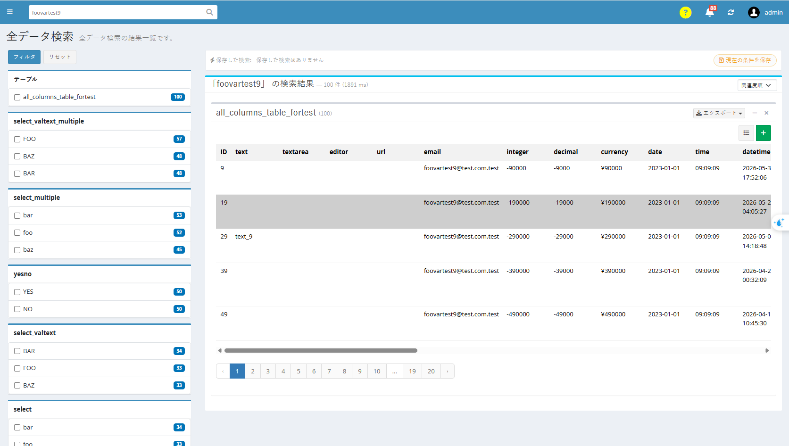

# (Dành cho người dùng nâng cao) Sử dụng công cụ tìm kiếm toàn văn (Meilisearch)
Đây là thiết lập dùng công cụ tìm kiếm toàn văn "[Meilisearch](https://www.meilisearch.com/)" để tìm kiếm trong Exment nhanh hơn.  
Thông thường Exment tìm kiếm trong cơ sở dữ liệu. Khi dùng Meilisearch, có thể tìm kiếm nhanh ngay cả trong môi trường có rất nhiều dữ liệu.  
※Chức năng này dùng được từ Exment v7.0.0 trở lên.

Có 2 cách cài.

| Cách cài | Phù hợp khi |
|---|---|
| [Cách cài đơn giản](#cách-cài-đơn-giản) | Exment v7.2.2 trở lên. Muốn cài chỉ bằng một lần chạy script |
| [Khi cài bằng tay](#khi-cài-bằng-tay) | Muốn thiết lập mà không dùng script. Muốn kiểm tra nội dung thiết lập |

Có thể dùng các chức năng sau.

- Tăng tốc tìm kiếm theo từ khóa tự do
- Thu hẹp kết quả tìm kiếm (bộ lọc, facet)
- Hiển thị nổi bật từ khóa tìm kiếm
- Sắp xếp kết quả tìm kiếm (theo độ liên quan, mới nhất trước, cũ nhất trước)
- Lưu và chia sẻ điều kiện tìm kiếm
- Xuất kết quả tìm kiếm (CSV, XLSX)
- Thiết lập từ đồng nghĩa (synonym) và từ dừng (stop word)

  

> Cơ chế tìm kiếm thông thường của Exment vui lòng xem [Tìm kiếm](/vi/search).


## Điều kiện hoạt động
Để dùng Meilisearch, cần đáp ứng các điều kiện sau.

|Mục|Nội dung|
|---|---|
|Máy chủ Meilisearch|v1.10 trở lên|
|Thư viện PHP|Cần cài "meilisearch/meilisearch-php" (v1.10 trở lên). Tệp zip của cách cài đặt đơn giản đã có sẵn thư viện này. **Thư viện này không phải là thư viện bắt buộc của Exment.** Nếu chưa được cài, các lệnh liên quan đến Meilisearch sẽ báo lỗi và đồng bộ theo thời gian thực cũng bị tắt.<br />Ngoài ra, thư viện này cần một HTTP client tương thích với "guzzlehttp/guzzle".|
|Queue|Cần đặt "QUEUE_CONNECTION" là database (hoặc redis) và đã chạy migration.<br />Đồng bộ theo thời gian thực được chạy bằng queue, nên nếu vẫn để giá trị ban đầu là sync thì xử lý của màn hình sẽ bị chặn. Chi tiết vui lòng xem [Thực hiện trễ xử lý thông báo](/vi/additional_queue).|
|Bảng tùy chỉnh|Chỉ những bảng có "Cho phép tìm kiếm" là YES trong thiết lập bảng tùy chỉnh và có cột tùy chỉnh mà "Đối tượng tìm kiếm tự do" là YES mới là đối tượng tạo chỉ mục.|


## Lưu ý
- <span class="red">※Đừng công khai Meilisearch ra Internet.</span> Hãy thiết lập để chỉ kết nối được từ cùng máy chủ với Exment hoặc từ mạng nội bộ. Hãy quản lý master key thật chặt chẽ để người khác không biết.
- **Meilisearch và queue worker cần luôn luôn chạy**. Ở bước 1 và bước 3, cả hai đều được đăng ký thành dịch vụ tự khởi động lại. Khi bị dừng thì sẽ như sau.

|Thứ bị dừng|Điều xảy ra|
|---|---|
|Meilisearch|Màn hình tìm kiếm chuyển sang tìm kiếm thông thường dùng cơ sở dữ liệu (nếu đang áp dụng điều kiện thu hẹp thì kết quả tìm kiếm không hiển thị, và thứ tự sắp xếp không được áp dụng).|
|Queue worker|Nội dung đã cập nhật không được phản ánh vào chỉ mục.|

- Chỉ mục (index, dữ liệu dùng để tìm kiếm) của Meilisearch được giữ riêng, tách khỏi cơ sở dữ liệu của Exment. Vì vậy giữa hai bên có thể phát sinh khác biệt. Ở bước 4, sẽ thiết lập tự động sửa mỗi ngày 1 lần.
- <span class="red">※Khi "EXMENT_SEARCH_DOCUMENT" là true, màn hình tìm kiếm không dùng Meilisearch.</span> Vì tên tệp của tệp đính kèm không được đưa vào chỉ mục, nên dù "MEILISEARCH_GLOBAL_SEARCH" là true, màn hình tìm kiếm vẫn tìm bằng cơ sở dữ liệu. Phần gợi ý khi nhập của cột tùy chỉnh "Lựa chọn (từ bảng khác)" không bị ảnh hưởng.
- Giải thích chi tiết về bản thân Meilisearch vui lòng xem [tài liệu chính thức của Meilisearch](https://www.meilisearch.com/docs).


## Cách cài đơn giản
Từ Exment v7.2.2 trở lên, chỉ cần chạy script 1 lần là làm được gộp các bước 1–4 của phần [Khi cài bằng tay](#khi-cài-bằng-tay) ở dưới. Script có thể chạy bao nhiêu lần cũng không sao (master key và thiết lập đã có sẽ được dùng nguyên như cũ).

Hãy xem phần phù hợp với môi trường của bạn.

|Môi trường|Phần cần xem|
|---|---|
|Máy chủ Linux (kể cả EC2 của AWS, v.v.)|"Với Linux" ở dưới|
|Máy chủ Windows|"Với Windows" ở dưới|
|docker-exment|"Với Docker" ở dưới|
|Meilisearch đã chạy sẵn (ví dụ đã chuẩn bị trên máy chủ khác)|[Khi chỉ thiết lập Exment](#khi-chỉ-thiết-lập-exment)|
|AWS, Azure, máy chủ thuê|"Với AWS và máy chủ thuê" ở dưới|

### Với Linux
Trên máy chủ dùng systemd (Ubuntu, Debian, RHEL, Amazon Linux, v.v.; kể cả EC2 của AWS), hãy chuyển đến thư mục của Exment và chạy các lệnh sau.

```
cd /var/www/exment
sudo sh vendor/exceedone/exment/resources/meilisearch/install-meilisearch.sh
```

Script làm các việc sau.

1. Cài Meilisearch ("/usr/local/bin/meilisearch"), tạo người dùng để chạy, tạo "/etc/meilisearch.conf" có ghi master key mới (chỉ root đọc được), đăng ký dịch vụ "meilisearch" (chỉ lắng nghe ở 127.0.0.1:7700)
1. Thiết lập Exment ("php artisan exment:meili-setup". Nội dung vui lòng xem [Khi chỉ thiết lập Exment](#khi-chỉ-thiết-lập-exment))
1. Đăng ký dịch vụ queue worker "exment-meili-worker"
1. Thêm scheduler (php artisan schedule:run) vào crontab của người dùng máy chủ Web

Hãy chỉ định các tùy chọn sau khi cần.

|Tùy chọn|Nội dung|
|---|---|
|--exment-dir=thư mục|Thư mục của Exment. Giá trị mặc định là thư mục hiện tại.|
|--user=người dùng|Người dùng mà máy chủ Web dùng để chạy PHP (www-data, apache, nginx, v.v.). Giá trị mặc định là chủ sở hữu của thư mục "storage".|
|--php=đường dẫn|Đường dẫn của lệnh php. Hãy chỉ định php cùng phiên bản với máy chủ Web (ví dụ: --php=/usr/bin/php8.3). Giá trị mặc định là php có trong PATH.|
|--version=phiên bản|Phiên bản của Meilisearch. Giá trị mặc định là "v1.10.3".|
|--index=tên|Tên chỉ mục. Giá trị mặc định là "exment_global".|
|--no-cron|Không thêm scheduler vào crontab. Chỉ định khi đã chạy scheduler bằng cách khác.|

### Với Windows
Mở PowerShell bằng "Run as administrator", rồi chạy các lệnh sau trong thư mục của Exment.
※Hãy đổi "C:\php\php.exe" thành đường dẫn của php đang dùng với IIS.

```
cd C:\inetpub\exment
powershell -ExecutionPolicy Bypass -File vendor\exceedone\exment\resources\meilisearch\install-meilisearch.ps1 -Php C:\php\php.exe
```

Script làm các việc sau.

1. Cài Meilisearch ("C:\meilisearch"), tạo master key mới ("C:\meilisearch\master-key.txt"; chỉ Administrators và SYSTEM đọc được), đăng ký dịch vụ "Meilisearch" bằng NSSM, loại nơi lưu chỉ mục khỏi phạm vi quét của Windows Defender
1. Thiết lập Exment ("php artisan exment:meili-setup")
1. Đăng ký dịch vụ queue worker "ExmentMeiliWorker"
1. Đăng ký task "ExmentScheduler" (chạy php artisan schedule:run mỗi 1 phút) vào Task Scheduler

> Với NSSM, hãy chỉ định đường dẫn bằng "-Nssm", hoặc đặt vào PATH hay "C:\nssm\nssm.exe". Nếu không có ở cả hai nơi mà có winget thì sẽ được tự động cài.
> Các tùy chọn khác: "-ExmentDir" (thư mục của Exment), "-Version" (phiên bản của Meilisearch), "-InstallDir" (thư mục của Meilisearch), "-Index" (tên chỉ mục), "-NoScheduler" (không đăng ký task), "-NoDefenderExclusion" (không đổi thiết lập của Windows Defender)

### Với Docker
Nếu bạn dùng [docker-exment](https://github.com/exceedone/docker-exment), chỉ cần thêm "docker-compose.meilisearch.yml" là các container Meilisearch, queue worker và scheduler sẽ khởi động.

- Ghi master key từ 16 ký tự trở lên vào ".env" trong thư mục docker-exment (ví dụ: giá trị tạo bằng "openssl rand -hex 16").

```
EXMENT_DOCKER_MEILISEARCH_MASTER_KEY=(master key)
```

- Chạy các lệnh sau để khởi động container rồi thiết lập Exment.

```
docker compose -f docker-compose.yml -f docker-compose.mysql.yml -f docker-compose.meilisearch.yml up -d
docker compose -f docker-compose.yml -f docker-compose.mysql.yml -f docker-compose.meilisearch.yml exec -u www-data php php artisan exment:meili-setup
```

### Khi chỉ thiết lập Exment
Khi Meilisearch đã chạy sẵn (ví dụ đã chuẩn bị trên máy chủ khác), hãy chạy lệnh sau trong thư mục của Exment. Lệnh này làm gộp phần "[2. Thiết lập Exment](#_2-thiết-lập-exment)" của cách cài bằng tay.

```
php artisan exment:meili-setup --host=http://127.0.0.1:7700 --key-file=/etc/meilisearch.conf
```

Lệnh này chạy theo thứ tự sau. Nếu giữa chừng có lỗi, lệnh sẽ hiện nội dung lỗi rồi dừng. Sau khi sửa, hãy chạy lại.

1. Kiểm tra rằng kết nối được với Meilisearch, master key đúng, và phiên bản là v1.10 trở lên
1. Thiết lập ".env": nếu "QUEUE_CONNECTION" là sync thì đổi thành database, và thêm "MEILISEARCH_REINDEX_QUEUE=meili-reindex"
1. Tạo các bảng của queue (jobs, failed_jobs) nếu chưa có, và chạy "php artisan migrate"
1. Lưu thiết lập hệ thống: host, master key, tên chỉ mục, đồng bộ theo thời gian thực (YES), sửa chữa chỉ mục định kỳ (YES), thời điểm sửa chữa
1. Tạo chỉ mục. Khi xong, đặt tìm kiếm toàn cục thành YES
1. Kiểm tra trạng thái kết nối ("php artisan exment:meili-health --failed") và ra chỉ thị khởi động lại các queue worker đang chạy ("php artisan queue:restart")

|Tùy chọn|Nội dung|
|---|---|
|--host=URL|Địa chỉ kết nối của Meilisearch. Giá trị mặc định là giá trị thiết lập hiện tại ("http://127.0.0.1:7700").|
|--key-file=tệp|Tệp có ghi master key. Chỉ định tệp có dòng "MEILI_MASTER_KEY=" (như "/etc/meilisearch.conf"), hoặc tệp chỉ ghi key.|
|--key=key|Master key. Key ghi trên dòng lệnh có thể bị người dùng khác nhìn thấy, vì vậy nên dùng "--key-file" hoặc biến môi trường "MEILI_MASTER_KEY".|
|--index=tên|Tên chỉ mục. Giá trị mặc định là giá trị thiết lập hiện tại ("exment_global").|
|--repair-at=HH:MM|Giờ sửa chữa chỉ mục định kỳ. Giá trị mặc định là giá trị thiết lập hiện tại ("03:00").|
|--skip-env|Không thay đổi ".env". Hãy tự ghi nội dung được hiển thị.|
|--skip-index|Chỉ lưu thiết lập, không tạo chỉ mục. Tìm kiếm toàn cục vẫn là NO.|

> Master key được tìm theo thứ tự: "--key-file", biến môi trường "MEILI_MASTER_KEY", "--key", giá trị đã lưu trong thiết lập hệ thống. Nếu không có ở đâu thì lệnh sẽ yêu cầu nhập.
> Lệnh này không đăng ký queue worker và scheduler. Hãy làm phần "[3. Đăng ký queue worker](#_3-Đăng-ký-queue-worker)" và "[4. Thiết lập scheduler](#_4-thiết-lập-scheduler)" của cách cài bằng tay.

### Với AWS và máy chủ thuê
- **AWS (EC2), máy ảo của Azure, v.v.**: giống như máy chủ Linux và Windows, có thể dùng script ở trên. Đừng công khai cổng 7700 ra bên ngoài bằng security group, v.v.
- **Máy chủ thuê (Xserver, v.v.)**: vì không chạy được chương trình thường trực, nên không thể chạy Meilisearch bên trong máy chủ thuê. Hãy đặt Meilisearch trên một máy chủ khác có thể chạy thường trực (EC2 của AWS, v.v.) và thiết lập để chỉ kết nối được từ máy chủ của Exment. Sau đó, hãy chạy "php artisan exment:meili-setup --host=(địa chỉ kết nối của Meilisearch)" trong thư mục của Exment. Vì queue worker không chạy thường trực được, hãy chạy bằng cron mỗi 1 phút. Chi tiết vui lòng xem [Thực hiện trễ xử lý thông báo](/vi/additional_queue).


## Khi cài bằng tay
Đây là các bước khi thiết lập mà không dùng script, hoặc khi muốn kiểm tra nội dung thiết lập. Thiết lập theo thứ tự sau.

1. Cài đặt máy chủ Meilisearch
1. Thiết lập Exment
1. Đăng ký queue worker
1. Thiết lập scheduler


## 1. Cài đặt máy chủ Meilisearch

### Với Linux
Đây là các bước cho Ubuntu và các môi trường dùng systemd.  
※Hãy đổi đường dẫn và tên người dùng cho phù hợp với môi trường của bạn.

- Chạy các lệnh sau để đặt tệp nhị phân của Meilisearch.  
Meilisearch chạy bằng 1 tệp, nên không cần cài thư viện khác.

```
curl -L -o /tmp/meilisearch \
  https://github.com/meilisearch/meilisearch/releases/download/v1.10.3/meilisearch-linux-amd64

chmod +x /tmp/meilisearch && sudo mv /tmp/meilisearch /usr/local/bin/meilisearch
```

- Chạy lệnh sau và kiểm tra rằng phiên bản được hiển thị.

```
meilisearch --version
```

- Chạy các lệnh sau để tạo người dùng chạy Meilisearch và thư mục lưu dữ liệu.

```
sudo useradd -r -s /usr/sbin/nologin meilisearch
sudo mkdir -p /var/lib/meilisearch
sudo chown meilisearch:meilisearch /var/lib/meilisearch
```

- Chạy các lệnh sau để tạo tệp thiết lập của Meilisearch.  
Master key được tự động tạo bằng một chuỗi ngẫu nhiên.

```
sudo tee /etc/meilisearch.conf > /dev/null << EOF
MEILI_DB_PATH=/var/lib/meilisearch/data.ms
MEILI_HTTP_ADDR=127.0.0.1:7700
MEILI_ENV=production
MEILI_MASTER_KEY=$(openssl rand -hex 16)
MEILI_NO_ANALYTICS=true
EOF

sudo chmod 600 /etc/meilisearch.conf
```

> Khi "MEILI_ENV=production", master key cần từ 16 byte trở lên.  
"openssl rand -hex 16" tạo ra chuỗi 32 ký tự nên đáp ứng điều kiện này.

- Chạy lệnh sau để xem master key đã được tạo.  
**Key này sẽ được nhập vào "Cài đặt hệ thống" của Exment ở bước sau, vì vậy nhất định hãy ghi lại.**

```
sudo grep MASTER_KEY /etc/meilisearch.conf
```

- Chạy lệnh sau để đăng ký Meilisearch thành dịch vụ.

```
sudo tee /etc/systemd/system/meilisearch.service > /dev/null << 'EOF'
[Unit]
Description=Meilisearch search engine
After=network.target

[Service]
Type=simple
User=meilisearch
Group=meilisearch
EnvironmentFile=/etc/meilisearch.conf
WorkingDirectory=/var/lib/meilisearch
ExecStart=/usr/local/bin/meilisearch
Restart=always
RestartSec=3
NoNewPrivileges=true
ProtectSystem=full
ProtectHome=true
ReadWritePaths=/var/lib/meilisearch

[Install]
WantedBy=multi-user.target
EOF
```

> Dòng "WorkingDirectory=/var/lib/meilisearch" là bắt buộc.  
Meilisearch tạo thư mục tạm trong thư mục hiện tại, nên nếu không có dòng này thì xảy ra "Permission denied" và dịch vụ lặp lại việc khởi động rồi dừng.

- Chạy các lệnh sau để bật tự khởi động dịch vụ rồi khởi động Meilisearch.

```
sudo systemctl daemon-reload
sudo systemctl enable --now meilisearch
```

- Chạy lệnh sau và kiểm tra rằng "{"status":"available"}" được hiển thị.

```
curl -s http://127.0.0.1:7700/health
```

### Với Windows
Đây là các bước cho môi trường dùng NSSM (Non-Sucking Service Manager) và Task Scheduler.  
Hãy mở PowerShell bằng "Run as administrator" và chạy các lệnh sau.  
※Hãy đổi đường dẫn cho phù hợp với môi trường của bạn.

- Chạy các lệnh sau để tạo thư mục và tải tệp nhị phân của Meilisearch.

```
New-Item -ItemType Directory -Force C:\meilisearch
Invoke-WebRequest -Uri "https://github.com/meilisearch/meilisearch/releases/download/v1.10.3/meilisearch-windows-amd64.exe" `
  -OutFile C:\meilisearch\meilisearch.exe
```

- Chạy lệnh sau và kiểm tra rằng phiên bản được hiển thị.

```
C:\meilisearch\meilisearch.exe --version
```

- Chạy các lệnh sau để tạo master key 32 ký tự.  
**Key này sẽ được nhập vào "Cài đặt hệ thống" của Exment ở bước sau, vì vậy nhất định hãy ghi lại.**

```
$key = -join (1..32 | ForEach-Object { '0123456789abcdef'[(Get-Random -Maximum 16)] })
$key
```

> "Get-Random -Count 32" không lấy trùng cùng một giá trị, nên với ký tự hệ 16 chỉ có 16 loại thì chỉ tạo được key 16 ký tự. Đừng dùng cách này.

- Tải NSSM từ [trang chính thức của NSSM](https://nssm.cc/download) và đặt "nssm.exe" vào thư mục "C:\nssm\".  
※Cũng có thể cài bằng lệnh "winget install nssm".

- Chạy các lệnh sau để đăng ký Meilisearch thành dịch vụ Windows.

```
C:\nssm\nssm.exe install Meilisearch C:\meilisearch\meilisearch.exe
C:\nssm\nssm.exe set Meilisearch AppParameters "--db-path C:\meilisearch\data.ms --http-addr 127.0.0.1:7700 --env production --master-key $key --no-analytics"
C:\nssm\nssm.exe set Meilisearch AppDirectory C:\meilisearch
C:\nssm\nssm.exe set Meilisearch AppExit Default Restart
C:\nssm\nssm.exe set Meilisearch Start SERVICE_AUTO_START
C:\nssm\nssm.exe start Meilisearch
```

> "$key" là master key đã tạo ở bước ngay trước.  
Nếu đã mở lại PowerShell thì nội dung của biến đã mất, vì vậy hãy ghi trực tiếp chuỗi key đã tạo.

- Chạy lệnh sau và kiểm tra rằng "status : available" được hiển thị.

```
Invoke-RestMethod http://127.0.0.1:7700/health
```

- Chạy lệnh sau để loại thư mục lưu chỉ mục khỏi phạm vi quét của Windows Defender.  
※Nếu nằm trong phạm vi quét, việc tạo và cập nhật chỉ mục có thể bị chậm.

```
Add-MpPreference -ExclusionPath "C:\meilisearch\data.ms"
```


## 2. Thiết lập Exment
Khi máy chủ Meilisearch đã sẵn sàng, hãy thiết lập phía Exment.  
※Bước này cũng có thể làm gộp bằng "php artisan exment:meili-setup". Chi tiết vui lòng xem [Khi chỉ thiết lập Exment](#khi-chỉ-thiết-lập-exment).  
Các bước dưới đây giống nhau cho Linux và Windows.

### Cài đặt thư viện
- Chạy lệnh sau trong thư mục của Exment.

```
composer require meilisearch/meilisearch-php
```

### Thiết lập .env
- Mở tệp ".env" trong thư mục của Exment và ghi các thiết lập sau.  
Thông tin kết nối đến máy chủ Meilisearch và các thiết lập chính không đặt ở ".env" mà được đặt từ màn hình thiết lập hệ thống ở bước sau.

```
#Queue driver. Nếu vẫn để giá trị ban đầu là sync (xử lý đồng bộ) thì xử lý của màn hình sẽ bị chặn
QUEUE_CONNECTION=database

#Chạy xử lý tạo lại chỉ mục theo từng bảng (xử lý nặng) bằng queue khác với xử lý đồng bộ từng dữ liệu tùy chỉnh
MEILISEARCH_REINDEX_QUEUE=meili-reindex
```

- Về các giá trị thiết lập khác ngoài các giá trị trên, vui lòng xem phần "Tìm kiếm" của [danh sách giá trị thiết lập](/vi/config). Chỉ ghi khi muốn đổi khác giá trị mặc định.

> Tệp thiết lập của Meilisearch được đọc từ bên trong package của Exment. Vì vậy không cần chạy "php artisan vendor:publish".

### Tạo bảng
- Chạy các lệnh sau để tạo bảng giữ thông tin của queue và các bảng dùng cho Meilisearch.

```
php artisan queue:table
php artisan queue:failed-table
php artisan migrate
```

> Bảng "jobs" và "failed_jobs" có thể đã được tạo bởi migration có sẵn khi tạo dự án Laravel. Hãy xem thư mục "database/migrations" và chạy như sau.
> - Khi có tệp chứa "create_jobs_table" (dự án tạo bằng Laravel 11 trở lên): cả hai bảng được tạo bởi migration mặc định, nên không chạy "queue:table" và "queue:failed-table", chỉ chạy "php artisan migrate".
> - Khi chỉ có tệp chứa "create_failed_jobs_table": chạy "queue:table" và "php artisan migrate".
> - Khi không có tệp nào: chạy cả 3 lệnh ở trên.
>
> Khi hiện "Migration already exists." thì migration đó đã có sẵn, vì vậy hãy bỏ qua lỗi và chuyển sang lệnh tiếp theo.

- Chạy lệnh sau để xóa cache của nội dung thiết lập.  
※Nếu đang dùng cache của thiết lập, hãy chạy lại "php artisan config:cache".

```
php artisan config:clear
```

### Cài đặt hệ thống
- Đăng nhập Exment bằng quản trị viên hệ thống, mở menu "Cài đặt quản trị > Cài đặt hệ thống" và chuyển sang "Cài đặt chi tiết".
- Ở "Cài đặt Meilisearch (tìm kiếm toàn văn)", thiết lập các mục sau rồi lưu.  
  

|Mục|Giá trị cần đặt|
|---|---|
|Máy chủ Meilisearch|Địa chỉ kết nối của máy chủ Meilisearch. Nếu Exment và Meilisearch ở cùng máy chủ thì để nguyên "http://127.0.0.1:7700".|
|Khóa API chính|Master key đã tạo khi cài đặt máy chủ Meilisearch.|
|Tên chỉ mục|Để nguyên "exment_global". Nếu nhiều Exment dùng chung một máy chủ Meilisearch, hãy đặt tên khác nhau cho từng Exment.|
|Bật tìm kiếm toàn cục bằng Meilisearch|Đặt là YES. Đây là thiết lập phía tìm kiếm, nên cũng có thể đổi thành YES sau khi tạo chỉ mục xong.|
|Đồng bộ chỉ mục theo thời gian thực|Đặt là YES. Đây là thiết lập phía cập nhật, nên cần queue worker đăng ký ở bước 3.|
|Kích thước lô (khi lập chỉ mục)|Để nguyên "1000".|
|Sửa chữa chỉ mục định kỳ|Đặt là YES. Cần scheduler thiết lập ở bước 4.|
|Thời điểm sửa chữa (HH:MM)|Đặt giờ có tải thấp, như "03:00".|
|Cột dùng cho bộ lọc tìm kiếm|Để nguyên "Tự động + Tùy chỉnh".|

> Giá trị lưu ở màn hình này được giữ trong cơ sở dữ liệu và được ưu tiên hơn giá trị thiết lập trong ".env". Khóa API chính được mã hóa khi lưu.  
> Các mục này cũng có thể được thiết lập bằng ".env" thay cho màn hình. Chi tiết vui lòng xem [Thiết lập các mục của màn hình bằng .env](#thiết-lập-các-mục-của-màn-hình-bằng-env).

> Một chỉ mục chỉ dùng được cho một Exment. Exment dùng chỉ mục đầu tiên sẽ được ghi là chủ sở hữu trong chỉ mục có tên "(tên chỉ mục)__owner". (Giá trị được ghi là giá trị nhận dạng tạo từ "APP_KEY" trong ".env")  
> Nếu nhiều Exment dùng chung một máy chủ Meilisearch, hãy đặt "Tên chỉ mục" khác nhau cho từng Exment. Không thể dùng chỉ mục mà Exment khác đã được ghi là chủ sở hữu. Chi tiết vui lòng xem [Khi không hoạt động tốt](#khi-không-hoạt-động-tốt).

### Tạo chỉ mục
- Chạy lệnh sau để tạo chỉ mục từ nội dung của cơ sở dữ liệu.  
※Tùy theo số lượng dữ liệu, xử lý có thể tốn thời gian.

```
php artisan exment:meili-index
```

- Chạy lệnh sau để kiểm tra trạng thái kết nối với Meilisearch và số document đã đăng ký.

```
php artisan exment:meili-health
```


## 3. Đăng ký queue worker
Để phản ánh nội dung cập nhật của dữ liệu tùy chỉnh vào chỉ mục, hãy đăng ký queue worker thành dịch vụ.  

Queue worker cần xử lý 2 queue sau.

- default : queue xử lý nhẹ, làm việc đồng bộ từng dữ liệu tùy chỉnh, phản ánh thiết lập, v.v. (giá trị mặc định của "MEILISEARCH_SYNC_QUEUE")
- meili-reindex : queue xử lý nặng, tạo lại chỉ mục theo từng bảng. (giá trị đã đặt cho "MEILISEARCH_REINDEX_QUEUE" ở phần "Thiết lập .env")

※Nếu không đặt "MEILISEARCH_REINDEX_QUEUE", xử lý theo từng bảng cũng được chạy trong cùng queue với "MEILISEARCH_SYNC_QUEUE" (giá trị mặc định: default). Khi đó, việc đồng bộ từng dữ liệu tùy chỉnh phải chờ đến khi xử lý nặng kết thúc.  
※Nếu đã đổi thiết lập "MEILISEARCH_SYNC_QUEUE" hoặc "MEILISEARCH_REINDEX_QUEUE", hãy đổi cả nội dung của "--queue=" cho khớp.

### Với Linux
- Chạy lệnh sau.  
※"/var/www/exment" là thư mục cài đặt Exment, "/usr/bin/php" là đường dẫn của lệnh php. Hãy đổi cho phù hợp với môi trường của bạn.

```
sudo tee /etc/systemd/system/exment-meili-worker.service > /dev/null << 'EOF'
[Unit]
Description=Exment queue worker (Meilisearch sync)
After=network.target mysql.service

[Service]
User=www-data
Group=www-data
WorkingDirectory=/var/www/exment
ExecStart=/usr/bin/php artisan queue:work --queue=default,meili-reindex --max-time=3600 --tries=3
Restart=always
RestartSec=3

[Install]
WantedBy=multi-user.target
EOF
```

- Chạy các lệnh sau để bật tự khởi động dịch vụ rồi khởi động queue worker.

```
sudo systemctl daemon-reload
sudo systemctl enable --now exment-meili-worker
```

- Chạy lệnh sau và kiểm tra rằng dịch vụ đang chạy.

```
systemctl status exment-meili-worker --no-pager
```

### Với Windows
- Chạy các lệnh sau.  
※"C:\inetpub\exment" là thư mục cài đặt Exment, "C:\php\php.exe" là đường dẫn của lệnh php. Hãy đổi cho phù hợp với môi trường của bạn.

```
C:\nssm\nssm.exe install ExmentMeiliWorker C:\php\php.exe
C:\nssm\nssm.exe set ExmentMeiliWorker AppParameters "artisan queue:work --queue=default,meili-reindex --max-time=3600 --tries=3"
C:\nssm\nssm.exe set ExmentMeiliWorker AppDirectory C:\inetpub\exment
C:\nssm\nssm.exe set ExmentMeiliWorker AppExit Default Restart
C:\nssm\nssm.exe set ExmentMeiliWorker Start SERVICE_AUTO_START
C:\nssm\nssm.exe start ExmentMeiliWorker
```


## 4. Thiết lập scheduler
Khi "MEILISEARCH_REPAIR_ENABLED" là true, việc tự động sửa chỉ mục được chạy vào giờ đã đặt ở "MEILISEARCH_REPAIR_AT".  
Để chạy xử lý này, cần thiết lập scheduler. **Nếu không thiết lập, việc tự động sửa không được chạy.**  
※Nếu đã thiết lập [task schedule](/vi/additional_task_schedule) rồi thì không cần bước này.

### Với Linux
- Chạy lệnh sau.

```
sudo crontab -u www-data -l 2>/dev/null | { cat; echo "* * * * * cd /var/www/exment && php artisan schedule:run >> /dev/null 2>&1"; } | sudo crontab -u www-data -
```

### Với Windows
- Chạy lệnh sau.

```
schtasks /create /tn "ExmentScheduler" /sc minute /mo 1 /ru SYSTEM /f /tr "C:\php\php.exe C:\inetpub\exment\artisan schedule:run"
```

> "/f" là tùy chọn ghi đè mà không hiện thông báo xác nhận khi task cùng tên đã được đăng ký.


## Thiết lập các mục của màn hình bằng .env
Các mục của "Cài đặt Meilisearch (tìm kiếm toàn văn)" cũng có thể được thiết lập bằng ".env" thay cho màn hình thiết lập hệ thống, ví dụ khi phân phối thiết lập tự động. Các khóa thiết lập như sau.

|Mục|Khóa thiết lập trong ".env"|
|---|---|
|Máy chủ Meilisearch|MEILISEARCH_HOST|
|Khóa API chính|MEILISEARCH_KEY|
|Tên chỉ mục|MEILISEARCH_INDEX|
|Bật tìm kiếm toàn cục bằng Meilisearch|MEILISEARCH_GLOBAL_SEARCH|
|Đồng bộ chỉ mục theo thời gian thực|MEILISEARCH_REALTIME_SYNC|
|Kích thước lô (khi lập chỉ mục)|MEILISEARCH_BATCH_SIZE|
|Sửa chữa chỉ mục định kỳ|MEILISEARCH_REPAIR_ENABLED|
|Thời điểm sửa chữa (HH:MM)|MEILISEARCH_REPAIR_AT|
|Cột dùng cho bộ lọc tìm kiếm|MEILISEARCH_FILTER_MODE ("Tự động + Tùy chỉnh" là override, "Chỉ tùy chỉnh" là manual)|

<span class="red">※Mỗi lần lưu, màn hình "Cài đặt chi tiết" của cài đặt hệ thống ghi tất cả các mục trên vào cơ sở dữ liệu, kể cả những mục không thay đổi. Từ đó trở đi, với các mục này, giá trị đã lưu ở màn hình được ưu tiên và giá trị trong ".env" bị bỏ qua.</span>  
Khi quản lý các mục này bằng ".env", hãy lưu ý các điểm sau.

- "Bật tìm kiếm toàn cục bằng Meilisearch", "Đồng bộ chỉ mục theo thời gian thực", "Sửa chữa chỉ mục định kỳ" và "Cột dùng cho bộ lọc tìm kiếm" không thể lưu ở trạng thái trống. Chỉ cần lưu màn hình một lần, 4 mục này sẽ luôn dùng giá trị của màn hình, vì vậy hãy thay đổi ở màn hình.
- Với "Máy chủ Meilisearch", "Khóa API chính", "Tên chỉ mục", "Kích thước lô (khi lập chỉ mục)" và "Thời điểm sửa chữa (HH:MM)", nếu để trống ở màn hình rồi lưu thì giá trị của ".env" sẽ lại được dùng.
- Khi đã đổi ".env" mà không được phản ánh, hãy kiểm tra xem có giá trị nào được lưu ở màn hình không.
- Các giá trị thiết lập khác ngoài các mục trên chỉ có thể đặt bằng ".env".


## Về độ chính xác khi tìm kiếm tiếng Nhật
Trước khi tìm kiếm, Meilisearch thực hiện xử lý tách câu thành các từ (tách từ).  
Khi xử lý dữ liệu tiếng Nhật, thiết lập "MEILISEARCH_LOCALES" được dùng để làm đúng xử lý này.

- Giá trị mặc định là "jpn". Nếu chỉ xử lý tiếng Nhật thì không cần ghi.
- Giá trị là các mã ngôn ngữ ISO-639-3, phân cách bằng dấu phẩy. (Ví dụ: "jpn", "jpn,eng")
- Nếu để trống như "MEILISEARCH_LOCALES=", thiết lập này bị xóa khỏi chỉ mục và Meilisearch tự động nhận diện ngôn ngữ.
- Để dùng thiết lập này, cần Meilisearch v1.10 trở lên.
- Khi đã đổi thiết lập, hãy chạy "php artisan exment:meili-settings". Meilisearch tự động tách từ lại, nên không cần tạo lại chỉ mục.

"MEILISEARCH_LOCALES" và thiết lập từ điển (từ đồng nghĩa, từ dừng) xử lý ở các giai đoạn khác nhau. Hãy dùng kết hợp cả hai.

|Thiết lập|Giai đoạn|Nội dung xử lý|
|---|---|---|
|MEILISEARCH_LOCALES|Trước|Tách câu thành các từ.|
|Từ đồng nghĩa, từ dừng|Sau|Mở rộng từ đồng nghĩa hoặc loại bỏ, đối với các từ đã được tách.|


## Màn hình quản lý
Các màn hình liên quan đến Meilisearch như sau.  
※Giá trị đặt ở đầu URL (như "admin") khác nhau tùy theo thiết lập "ADMIN_ROUTE_PREFIX". Chi tiết vui lòng xem [Thay đổi hoặc xóa "admin" trong URL](/vi/additional_prefix).

|Màn hình|URL|Nội dung|
|---|---|---|
|Cài đặt hệ thống|/system|Thiết lập địa chỉ kết nối, master key và các cờ ở "Cài đặt Meilisearch (tìm kiếm toàn văn)" trong "Cài đặt chi tiết".|
|Cài đặt bộ lọc tìm kiếm|/meili-filter|Thiết lập các điều kiện thu hẹp hiển thị ở sidebar của màn hình kết quả tìm kiếm.|
|Cài đặt từ điển tìm kiếm|/meili-dictionary|Thiết lập từ đồng nghĩa (synonym) và từ dừng (stop word).|

※"Cài đặt bộ lọc tìm kiếm" và "Cài đặt từ điển tìm kiếm" ban đầu không hiển thị trong menu. Hãy truy cập trực tiếp bằng URL ở trên, hoặc thêm làm menu hệ thống ở [thiết lập menu](/vi/menu). Hai mục này chỉ hiển thị trong các lựa chọn của thiết lập menu khi "MEILISEARCH_GLOBAL_SEARCH" là true.

- Ở "Cài đặt bộ lọc tìm kiếm", chọn bảng và cột, rồi thiết lập loại bộ lọc (khớp chính xác, khoảng), thêm/loại trừ, bí danh, v.v.  
  

- Ở "Cài đặt từ điển tìm kiếm", đăng ký loại (Từ đồng nghĩa, Từ dừng) và từ.  
  


## Kiểm tra hoạt động
- Đăng nhập Exment, nhập một từ vào thanh tìm kiếm ở phía trên trang và tìm kiếm.
- Kiểm tra rằng kết quả tìm kiếm được hiển thị.
- Sau khi tạo mới hoặc cập nhật dữ liệu tùy chỉnh, hãy tìm kiếm lại và kiểm tra rằng nội dung đã cập nhật được phản ánh vào kết quả tìm kiếm.  
※Nếu không được phản ánh, hãy kiểm tra xem queue worker có đang chạy không.

- Cũng có thể tìm kiếm từ dòng lệnh. Lệnh này không thu hẹp theo quyền của người dùng như trên màn hình mà truy vấn trực tiếp Meilisearch và hiển thị thời gian phản hồi, nên có thể phân biệt vấn đề nằm ở bản thân Meilisearch hay ở phía màn hình.

```
php artisan exment:meili-search "từ khóa" --limit=5 --highlight --facets
```

※Khi chỉ muốn tìm trong một bảng cụ thể, hãy chỉ định "--table=(tên bảng)".


## Chức năng của màn hình tìm kiếm
Khi "MEILISEARCH_GLOBAL_SEARCH" là true, có thể dùng các chức năng sau ở màn hình kết quả tìm kiếm.

- Thu hẹp : ở sidebar, thu hẹp kết quả tìm kiếm theo bảng, giá trị của cột, khoảng ngày hoặc số, v.v. Các cột được dùng có thể đổi ở màn hình "Cài đặt bộ lọc tìm kiếm".
- Sắp xếp : sắp xếp theo "Độ liên quan", "Mới nhất trước", "Cũ nhất trước".
- Lưu điều kiện tìm kiếm : từ "Lưu điều kiện hiện tại", lưu điều kiện thu hẹp (tùy ý, cả từ khóa tìm kiếm); từ lần sau có thể gọi lại từ "Tìm kiếm đã lưu".  
    - Phạm vi chia sẻ được chọn từ "Chỉ mình tôi", "Nhóm vai trò", "Tổ chức", "Tất cả người dùng". Chỉ quản trị viên hệ thống mới chia sẻ được cho "Tất cả người dùng".
    - Số lượng một người dùng lưu được là đến "MEILISEARCH_SAVED_SEARCH_LIMIT" (giá trị mặc định 50).

      

- Xuất : xuất kết quả tìm kiếm ra CSV hoặc XLSX theo từng bảng. Nếu số lượng cần xuất từ giới hạn trở lên (giá trị nhỏ hơn trong hai giá trị: "MEILISEARCH_PERMISSION_SCAN_CAP" (giá trị mặc định 1000) và thiết lập "maxTotalHits" của chỉ mục) thì sẽ báo lỗi, vì vậy hãy thu hẹp điều kiện tìm kiếm.  
※Số lượng được xét theo số lượng của tất cả kết quả tìm kiếm (hit), trước khi thu hẹp theo quyền xem. Vì vậy, dù dữ liệu xem được ít hơn giới hạn, vẫn có thể báo lỗi.


## Tạo lại và sửa chỉ mục
Đây là các bước sửa chỉ mục, ví dụ khi phát sinh khác biệt giữa cơ sở dữ liệu và chỉ mục, hoặc khi đã nhập hay xóa một lượng lớn dữ liệu.

### Sửa khác biệt
Lệnh "exment:meili-reconcile" làm 2 xử lý sau.

1. Với các bảng là đối tượng của chỉ mục, thêm các document còn thiếu và xóa các document không cần (dữ liệu đã bị xóa khỏi cơ sở dữ liệu).
1. Xóa khỏi chỉ mục toàn bộ document của các bảng không còn là đối tượng của chỉ mục (đã đổi "Cho phép tìm kiếm" thành NO, không còn cột là đối tượng tìm kiếm tự do, bản thân bảng đã bị xóa, v.v.).  
※Khi chạy có chỉ định "--table", xử lý này không được thực hiện.

<span class="red">※Lệnh này xóa document khỏi chỉ mục.</span>  
Khi muốn kiểm tra trước nội dung sẽ bị xóa, hãy chạy với "--dry-run".

- Chạy lệnh sau để kiểm tra khác biệt giữa cơ sở dữ liệu và chỉ mục. Khi chỉ định "--dry-run", lệnh chỉ kiểm tra, không sửa.

```
php artisan exment:meili-reconcile --dry-run
```

- Chạy lệnh sau để sửa khác biệt.

```
php artisan exment:meili-reconcile
```

- Khi chỉ sửa một bảng cụ thể, hãy chỉ định "--table".

```
php artisan exment:meili-reconcile --table=(tên bảng)
```

### Tạo lại chỉ mục
- Khi tạo lại toàn bộ chỉ mục, hãy chạy lệnh sau.  
Khi chỉ định "--fresh", tất cả document được tạo lại, nên thông báo xác nhận sẽ hiện ra khi chạy.  
※Trong lúc tạo lại, vẫn có thể tìm kiếm bằng chỉ mục hiện có. Khi tạo xong, hệ thống chuyển sang chỉ mục mới.

```
php artisan exment:meili-index --fresh
```

> Khi chạy mà không hiện thông báo xác nhận, ví dụ trong xử lý batch, hãy chỉ định thêm "--force".  
> Ở môi trường không hiện được thông báo xác nhận (cron, v.v.), nếu không chỉ định "--force" thì lệnh sẽ báo lỗi.
>
> ```
> php artisan exment:meili-index --fresh --force
> ```

- Dữ liệu tùy chỉnh được cập nhật trong lúc tạo lại không có trong chỉ mục mới. Sau khi xong, hãy chạy lệnh sau để sửa khác biệt.

```
php artisan exment:meili-reconcile
```

### Chỉ phản ánh thiết lập
- Khi lưu từ đồng nghĩa hoặc từ dừng ở màn hình "Cài đặt từ điển tìm kiếm", thiết lập được tự động phản ánh vào chỉ mục thông qua queue. Không cần chạy lệnh.  
※Khi queue worker đang dừng thì không được phản ánh. Khi đó, hãy chạy lệnh dưới đây.
- Khi đã đổi "MEILISEARCH_LOCALES", "MEILISEARCH_PERMISSION_SCAN_CAP" hoặc "MEILISEARCH_MAX_FACET_VALUES" trong ".env", hãy chạy lệnh dưới đây. Có thể phản ánh thiết lập mà không cần tạo lại chỉ mục.  
※Khi chỉ định "--show", lệnh hiển thị nội dung thiết lập hiện tại.

```
php artisan exment:meili-settings
php artisan exment:meili-settings --show
```


## Khi cập nhật hệ thống và khi đổi thiết lập
Queue worker là process chạy trong thời gian dài, nên nếu không khởi động lại thì thay đổi của mã nguồn và thiết lập không được phản ánh.  
Khi đã cập nhật Exment, hoặc khi đã đổi thiết lập của Meilisearch (các giá trị thiết lập bắt đầu bằng "MEILISEARCH_" trong ".env", hoặc "Cài đặt Meilisearch (tìm kiếm toàn văn)" trong "Cài đặt hệ thống (cài đặt chi tiết)"), hãy chạy lệnh sau để khởi động lại queue worker.

- Với Linux

```
sudo systemctl restart exment-meili-worker
```

- Với Windows

```
C:\nssm\nssm.exe restart ExmentMeiliWorker
```


## Khi không hoạt động tốt
|Hiện tượng|Nguyên nhân có thể|
|---|---|
|Sửa ".env" mà không được phản ánh|Giá trị đã lưu ở "Cài đặt quản trị > Cài đặt hệ thống (cài đặt chi tiết)" đang được ưu tiên. Hãy kiểm tra thiết lập trên màn hình.|
|Queue worker không khởi động|Các bảng dùng cho queue (jobs, failed_jobs) chưa được tạo. Hãy xem phần "Tạo bảng" của "2. Thiết lập Exment" và tạo bảng.|
|Cập nhật dữ liệu mà kết quả tìm kiếm không đổi|"MEILISEARCH_REALTIME_SYNC" là false, hoặc queue worker đang dừng. Hãy kiểm tra trạng thái dịch vụ, và kiểm tra các job thất bại bằng "php artisan exment:meili-health --failed".|
|Đổi thiết lập cột mà kết quả tìm kiếm không đổi|Xử lý tạo lại chỉ mục chưa hoàn tất. Hãy kiểm tra xem log có ghi "gave up after 3 attempts" không, rồi chạy "php artisan exment:meili-index".|
|Log ghi "reindex ... skipped: the queue connection is 'sync'"|Vì "QUEUE_CONNECTION" là sync nên xử lý bị hủy. Hãy chạy "php artisan exment:meili-index", hoặc đổi queue thành database hay redis rồi chạy queue worker.|
|Khi xuất, hiện "Có quá nhiều kết quả để xuất (giới hạn N)"|Số kết quả tìm kiếm từ giới hạn trở lên (giá trị nhỏ hơn trong hai giá trị: "MEILISEARCH_PERMISSION_SCAN_CAP" (giá trị mặc định 1000) và thiết lập "maxTotalHits" của chỉ mục). Số lượng được xét theo số hit trước khi thu hẹp theo quyền xem. Hệ thống báo lỗi chứ không tự giảm số lượng, vì vậy hãy thu hẹp điều kiện tìm kiếm, hoặc tăng giá trị thiết lập rồi chạy "php artisan exment:meili-settings".|
|Khi tìm kiếm tiếng Nhật, có lúc kết quả tìm kiếm không hiển thị (ví dụ khi kanji và katakana đứng liền nhau)|Thiết lập tách từ chưa được áp dụng. Hãy kiểm tra nội dung thiết lập bằng "php artisan exment:meili-settings --show", xem "MEILISEARCH_LOCALES" có bị trống không và Meilisearch có phải v1.10 trở lên không.|
|Sau khi nhập hoặc xóa hàng loạt, dữ liệu có khác biệt, hoặc bảng đã đổi "Cho phép tìm kiếm" thành NO vẫn hiện trong kết quả tìm kiếm|Document trong chỉ mục bị thiếu hoặc còn sót. Hãy chạy "php artisan exment:meili-reconcile" mà không chỉ định "--table".|
|Tự động sửa không được chạy|Chưa thiết lập scheduler, hoặc "MEILISEARCH_REPAIR_ENABLED" là false.|
|Dịch vụ Meilisearch lặp lại việc khởi động rồi dừng (Linux)|Tệp thiết lập của dịch vụ không có dòng "WorkingDirectory=/var/lib/meilisearch".|
|Kết quả chạy lệnh hoặc log ghi "Meilisearch index '(tên chỉ mục)' belongs to another Exment installation"|Chỉ mục đang được thiết lập đang được một Exment khác dùng với tư cách chủ sở hữu. Xảy ra khi một Exment khác dùng cùng tên chỉ mục trên cùng máy chủ Meilisearch, hoặc khi đã đổi "APP_KEY" trong ".env". Ở trạng thái này, các lệnh "exment:meili-index" và "exment:meili-reconcile" báo lỗi, và nội dung cập nhật dữ liệu cũng không được phản ánh vào chỉ mục. Ngoài ra, việc tìm kiếm được thực hiện bằng cơ sở dữ liệu.<br />Hãy đổi "Tên chỉ mục" trong "Cài đặt hệ thống (cài đặt chi tiết)" thành tên không trùng với Exment khác rồi lưu, sau đó chạy "php artisan exment:meili-index" và khởi động lại queue worker. Nếu nguyên nhân là do đã đổi "APP_KEY" thì đưa "APP_KEY" về giá trị cũ cũng giải quyết được.|

- Với Linux, có thể xem nội dung lỗi của Meilisearch bằng lệnh sau.

```
sudo journalctl -u meilisearch -n 50 --no-pager
```

- Có thể xem số job đồng bộ thất bại bằng lệnh sau.

```
php artisan exment:meili-health --failed
```


[←Quay lại danh sách thiết lập bổ sung](/vi/quickstart_more)
