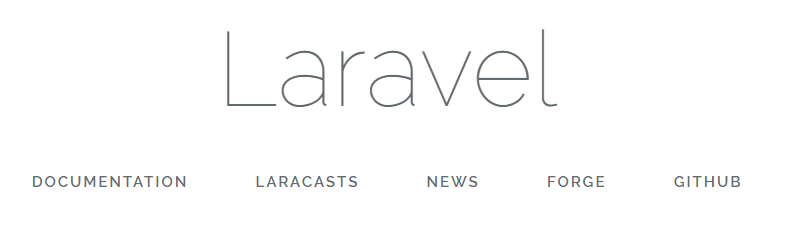

# Thay đổi hoặc xóa "admin" trong URL
Giá trị đặt ở đầu URL của màn hình Exment (như "/admin") được quyết định bằng `ADMIN_ROUTE_PREFIX` trong `.env`.

- **Site cài mới từ v7.2.1 trở đi**: mặc định không thêm gì. Ví dụ: http://localhost
- **Site đã cài bằng phiên bản trước**: có "admin" (`ADMIN_ROUTE_PREFIX=admin`, hoặc không có thiết lập và vẫn theo mặc định cũ). Ví dụ: http://localhost/admin . Dù cập nhật cũng không thay đổi.

Các URL trong tài liệu này được viết theo thiết lập mặc định là không thêm gì. Với site có "admin" hoặc giá trị khác, hãy thêm giá trị đó vào sau URL của site khi đọc (ví dụ: `(URL của Exment)/auth/login` → `(URL của Exment)/admin/auth/login`).

Khi cài mới, bạn có thể quyết định ở mục "**Tiền tố URL**" trên màn hình cuối của phần cài đặt ban đầu (để trống thì không thêm; nhập "admin" thì giống phiên bản trước). Khi muốn đổi sau này, hãy sửa `.env` theo các bước sau.

### Các bước thay đổi

- Mở tệp ".env" trong thư mục gốc của Exment.
- Ghi một trong các giá trị sau.

~~~
### 1. Không thêm gì (mặc định từ v7.2.1 trở đi)
ADMIN_ROUTE_PREFIX=
# http://localhost sẽ là URL của Exment

### 2. Thêm "admin" (giống site của phiên bản trước)
ADMIN_ROUTE_PREFIX=admin
# http://localhost/admin sẽ là URL của Exment

### 3. Đổi thành tên khác
ADMIN_ROUTE_PREFIX=admin184628
# http://localhost/admin184628 sẽ là URL của Exment
~~~

- Khi chuyển site đang có "admin" sang thiết lập không thêm gì, nếu mở URL cũ (`/admin/...`) thì sẽ được chuyển đến cùng trang đó (`/...`) (chỉ với GET; từ v7.2.1 trở đi). Bookmark và liên kết ghi trong email cũng mở được.
- Khi thêm "admin", ở URL không có "admin" ([http://localhost](http://localhost)) sẽ hiện một trang khác với Exment (trang mặc định của framework đang dùng). Bạn cũng có thể tạo ở đây một site dành cho người dùng thông thường, không cần đăng nhập ([site dành cho người dùng](/vi/public_site)).

### URL khi đã thay đổi hoặc xóa
Khi thay đổi hoặc xóa "admin", không chỉ URL của màn hình mà **mọi URL của Exment, kể cả API và callback đăng nhập**, đều thay đổi.  
Hãy đổi cả các URL đã đăng ký ở hệ thống khác (xác thực và thực hiện API, URL callback của SSO, URL Webhook của LINE, URL của plugin, v.v.). Việc chuyển từ `/admin/...` cũ chỉ áp dụng khi mở màn hình (GET), vì vậy hãy đổi URL của API và Webhook.

| Mục đích | Không thêm gì (mặc định từ v7.2.1 trở đi) | "admin" (site của phiên bản trước) | Khi đổi thành "admin184628" |
| ---- | ---- | ---- | ---- |
| Màn hình đăng nhập | (URL của Exment)/auth/login | (URL của Exment)/admin/auth/login | (URL của Exment)/admin184628/auth/login |
| Lấy token của API | (URL của Exment)/oauth/token | (URL của Exment)/admin/oauth/token | (URL của Exment)/admin184628/oauth/token |
| Thực hiện API | (URL của Exment)/api/data/(tên bảng) | (URL của Exment)/admin/api/data/(tên bảng) | (URL của Exment)/admin184628/api/data/(tên bảng) |
| Thiết lập ứng dụng API | (URL của Exment)/api_setting | (URL của Exment)/admin/api_setting | (URL của Exment)/admin184628/api_setting |
| Callback của SSO (OAuth) | (URL của Exment)/auth/login/(tên provider)/callback | (URL của Exment)/admin/auth/login/(tên provider)/callback | (URL của Exment)/admin184628/auth/login/(tên provider)/callback |
| Plugin (trang) | (URL của Exment)/plugins/(URL) | (URL của Exment)/admin/plugins/(URL) | (URL của Exment)/admin184628/plugins/(URL) |

[←Quay lại danh sách thiết lập bổ sung](/vi/quickstart_more)
