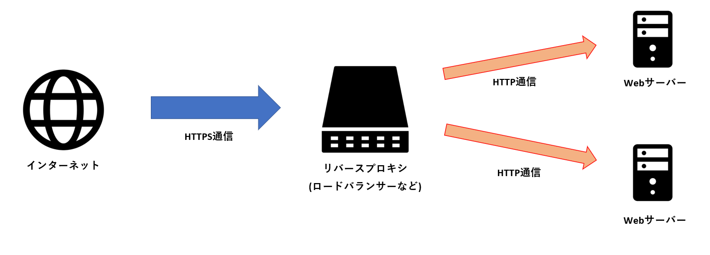

# Thiết lập khi dùng reverse proxy
Đây là thiết lập khi đặt reverse proxy (máy chủ nhận yêu cầu Web trước rồi chuyển cho máy chủ Web) phía trước máy chủ Exment.  
Cần thực hiện 2 việc: thiết lập phía Exment và thiết lập phía máy chủ reverse proxy.

> Các bước này đã được xem lại một phần từ v3.7.2.

## Giới thiệu
Máy chủ nhận yêu cầu Web (dịch vụ; dưới đây gọi là máy chủ reverse proxy), ví dụ load balancer của dịch vụ đám mây, và máy chủ Web có thể là hai máy khác nhau.  
Đặc biệt, có khi thiết lập như sau.  

- Kết nối từ Internet đến máy chủ reverse proxy: HTTPS
- Kết nối từ máy chủ reverse proxy đến máy chủ Web: HTTP




Các thiết lập bổ sung của máy chủ reverse proxy và Exment cần cho cấu hình như vậy được ghi ở dưới.  


### Các bước thiết lập - Exment

- Sửa tệp .env.

~~~
# (Ghi thêm vào giá trị đã có) URL đến máy chủ reverse proxy. Không cần "admin"
APP_URL=https://XXXX.com 

# Thêm mới khi Internet ⇔ máy chủ reverse proxy là HTTPS, máy chủ reverse proxy ⇔ máy chủ Web là HTTP
ADMIN_HTTPS=true

# Dùng giá trị "APP_URL" ở trên để tạo URL
ADMIN_USE_APP_URL=true

# Địa chỉ IP của máy chủ reverse proxy được phép làm proxy. Nếu có thể có nhiều địa chỉ IP thì phân cách bằng dấu phẩy
# ※Khi IP không cố định, hoặc khi do thiết lập zone mà ngoài máy chủ reverse proxy không có truy cập nào khác, cũng có thể chỉ định "*"
ADMIN_TRUST_PROXY_IPS=172.0.1.1,172.0.1.2
#ADMIN_TRUST_PROXY_IPS=*

# Với AWS ELB, thêm giá trị sau
ADMIN_TRUST_PROXY_HEADERS=HEADER_X_FORWARDED_AWS_ELB
~~~

- Khi dùng [xác thực SAML](/vi/login_saml), hãy đặt "Sử dụng proxy" thành YES ở "Cài đặt tùy chọn".


### Các bước thiết lập - Máy chủ reverse proxy

- Khi chuyển tiếp từ máy chủ reverse proxy (load balancer, Nginx, v.v.) đến máy chủ Web, cần gắn các header sau.  
Hãy kiểm tra xem các header đã được gắn chưa.  
※Đây là các header truyền thông tin về truy cập đến máy chủ reverse proxy. Phía máy chủ Web đọc và sử dụng chúng.  
    - X-Forwarded-Host : tên host của máy chủ reverse proxy
    - X-Forwarded-For : địa chỉ IP của client
    - X-Forwarded-Proto : http hoặc https
    - X-Forwarded-Port : cổng đến máy chủ reverse proxy

- Ví dụ: với nginx

```
    location / {
        proxy_set_header X-Forwarded-Host localhost;
        proxy_set_header X-Forwarded-For XXXX;
        proxy_set_header X-Forwarded-Proto https;
        proxy_set_header X-Forwarded-Port 10443;
    }
```

- ※Khi muốn xuất giá trị của request và giá trị của header để kiểm tra, hãy thêm dòng sau vào ".env" trong thư mục gốc. Chúng sẽ được ghi vào storage/logs/laravel.log.

```
EXMENT_DEBUG_MODE_REQUEST=1
```


[←Quay lại danh sách thiết lập bổ sung](/vi/quickstart_more)
