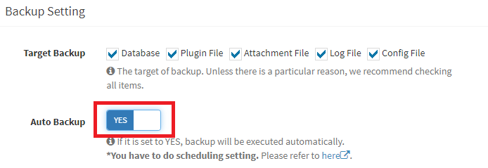

# Sao lưu / Khôi phục
Cách "sao lưu" (backup) để cất giữ dữ liệu của Exment, và cách "khôi phục" (restore) để đưa về như cũ bằng dữ liệu đã cất giữ.

| Việc muốn làm | Xem ở đâu |
|---|---|
| Sao lưu ngay bây giờ | Thực hiện sao lưu thủ công |
| Tự động sao lưu vào giờ đã định, ví dụ mỗi ngày | Thực hiện sao lưu tự động |
| Đưa về như cũ từ bản sao lưu | Khôi phục |
| Làm bằng lệnh | (Dành cho người dùng nâng cao) Sao lưu bằng lệnh, (Dành cho người dùng nâng cao) Khôi phục bằng lệnh |

## Tổng quan
Sao lưu và khôi phục được dùng, ví dụ, trong những lúc sau.

- Sao lưu trước khi cập nhật dữ liệu lớn, để khi không suôn sẻ thì đưa về như cũ.
- Sao lưu mỗi ngày để phòng sự cố không lường trước.
- Chuyển toàn bộ dữ liệu từ môi trường hiện có sang môi trường khác. (Trước khi làm, xin nhất định kiểm tra hoạt động.)

Đối tượng sao lưu như sau.
- Cơ sở dữ liệu
- Tệp plugin
- Tệp đính kèm
- Tệp nhật ký
- Tệp cấu hình

## Lưu ý
- Khi chuyển sang môi trường khác, tùy môi trường mà có thể không hoàn tất bình thường.  
Đặc biệt, khi chuyển sang hệ điều hành khác (Windows hay Linux), loại cơ sở dữ liệu khác (MySQL hay MariaDB), phiên bản cơ sở dữ liệu khác, vì nhiều nguyên nhân mà có thể không hoàn tất bình thường.  
Nhất định hãy kiểm tra từ trước.

- Về việc kiểm tra trước, chủ yếu khuyến nghị các việc sau.
    - Làm môi trường đích ở môi trường phát triển, v.v.
    - Thử chuyển ở giai đoạn mới chỉ tạo định nghĩa bảng.
    - Để loại cơ sở dữ liệu, phiên bản cơ sở dữ liệu giống nhau.

- Hiện tại, với SQLServer, sao lưu / khôi phục tự động chưa được hỗ trợ.  
Xin hãy sao lưu / khôi phục thủ công theo các bước ở [Sao lưu / Khôi phục (SQL Server)](/vi/backup_sqlserver).

## Màn hình
- Chọn "Cài đặt quản trị > Sao lưu" từ menu bên trái.  
Hoặc truy cập URL dưới đây.  
http(s)://(URL của Exment)/backup  
Khi đó, màn hình sao lưu sẽ được hiển thị.

> ※ URL là theo thiết lập chuẩn không có "/admin" (site cài mới từ v7.2.1 trở đi). Nếu `ADMIN_ROUTE_PREFIX` trong `.env` có giá trị (site cài từ phiên bản trước là "admin"), hãy thêm giá trị đó sau URL của site (ví dụ: `http(s)://(URL của Exment)/admin/backup`). Chi tiết vui lòng xem [Thay đổi hoặc xóa "admin" trong URL](/vi/additional_prefix).

## Sao lưu
Có 2 cách sao lưu: "thủ công" và "tự động".

### Thực hiện sao lưu thủ công
Các bước sao lưu thủ công vào lúc bạn muốn.

- Nhấp nút [Sao lưu] ở phía trên bên phải trang.  
  

- Hộp thoại xác nhận hiển thị, hãy nhấp [Xác nhận] rồi chờ.  
**※ Sao lưu mất rất nhiều thời gian. Xin đừng thao tác gì và hãy chờ.**
  

- Khi hoàn tất, thông báo sẽ hiển thị.  
Trong danh sách bản sao lưu sẽ có tệp với ngày giờ tạo là ngày giờ đã thực hiện.
  
  

- Tệp sao lưu đã tạo có thể tải xuống.  
Hãy nhấp liên kết [Tải xuống] ở dòng của bản sao lưu.  
  

- Tên tệp của bản sao lưu đã tạo có thể đổi.  
Hãy nhấp liên kết [Sửa tên tệp] ở dòng của bản sao lưu.  
※ Không đặt được tên có chứa kana nửa cỡ (half-width), ký hiệu.
  
- Sau khi nhập tên tệp, hãy nhấp nút [Gửi].
  

- Khi hoàn tất, thông báo hiển thị và tên tệp trong danh sách bản sao lưu thay đổi.
  

  

### Thực hiện sao lưu tự động
Có thể tự động sao lưu vào giờ đã định.  
Nếu sao lưu định kỳ, khi lỡ cập nhật dữ liệu sai nhiều, v.v. cũng phục hồi được.  
**※ Cần thiết lập [lịch tác vụ](/vi/additional_task_schedule) từ trước.**

Ví dụ, đây là cách thiết lập để sao lưu vào "3 giờ đêm", "cách 1 ngày", "giữ 7 thế hệ bản sao lưu".  

- Ở "Cài đặt sao lưu", đặt lựa chọn "Sao lưu tự động" thành "YES".
  

- Đổi các thiết lập tùy chọn.
  

- Sau đó, nhấp nút [Lưu] ở phía dưới trang.  

<h3 id="backup_command"><a href="#/vi/backup?id=backup_command" data-id="backup_command" class="anchor">(Dành cho người dùng nâng cao) Sao lưu bằng lệnh</a></h3>

Cũng có thể sao lưu bằng lệnh. Tại thư mục gốc của dự án, hãy chạy lệnh sau.

~~~
php artisan exment:backup
~~~

- Khi không chỉ định "--target=", tất cả các đối tượng (cơ sở dữ liệu, tệp plugin, tệp đính kèm, tệp nhật ký, tệp cấu hình) được sao lưu.
- Khi muốn giới hạn đối tượng, chỉ định ở "--target=" các khóa sau, phân cách bằng dấu phẩy.
    - database : cơ sở dữ liệu
    - plugin : tệp plugin
    - attachment : tệp đính kèm
    - log : tệp nhật ký
    - config : tệp cấu hình

~~~
# Ví dụ: khi chỉ sao lưu cơ sở dữ liệu và tệp đính kèm
php artisan exment:backup --target=database,attachment
~~~

<h3 id="check_backup_db"><a href="#/vi/backup?id=check_backup_db" data-id="check_backup_db" class="anchor">Kiểm tra bản sao lưu có cơ sở dữ liệu hay không</a></h3>

Đến v7.2.8, với một số tổ hợp giữa trình khách mysqldump và máy chủ cơ sở dữ liệu, bản sao lưu có thể được lưu mà không có cơ sở dữ liệu dù màn hình báo thành công (các tệp `.sql` có 0 byte). Ví dụ: công cụ trình khách MariaDB từ 11.4 với máy chủ MySQL 8 dùng chứng chỉ tự ký, hoặc với máy chủ MariaDB không có TLS. **Khôi phục từ bản sao lưu như vậy sẽ làm cơ sở dữ liệu trống.**

- Mở tệp zip của bản sao lưu và xem kích thước của `table_definition.sql` ở cấp trên cùng. **Nếu là 0 byte, bản sao lưu đó không có cơ sở dữ liệu. Đừng khôi phục từ bản đó.**
- Cập nhật lên v7.2.9, tạo bản sao lưu mới và kiểm tra theo cách tương tự.
- Từ v7.2.9, khi mysqldump thất bại hoặc chỉ ghi ra tệp trống, việc sao lưu sẽ thất bại kèm lý do và gợi ý. Việc khôi phục kiểm tra mọi tệp và kết nối trước khi thay đổi cơ sở dữ liệu; nếu kiểm tra không đạt, nó dừng lại với thông báo rằng chưa khôi phục gì và cơ sở dữ liệu không thay đổi. Lỗi của sao lưu tự động được ghi vào log.

#### Truyền tùy chọn cho mysqldump và mysql
Khi cài đặt TLS của trình khách và máy chủ không khớp, bạn có thể thêm tùy chọn trong `.env` (từ v7.2.9).

~~~
# tùy chọn thêm vào mysqldump (sao lưu)
EXMENT_DB_DUMP_OPTIONS=--skip-ssl-verify-server-cert
# tùy chọn thêm vào mysql (khôi phục và kiểm tra kết nối trước đó)
EXMENT_DB_RESTORE_OPTIONS=--skip-ssl-verify-server-cert
~~~

- Trình khách MariaDB: `--skip-ssl-verify-server-cert` (hoặc ghi `skip-ssl-verify-server-cert` trong `[client]` của my.cnf)
- Trình khách MySQL: `--ssl-mode=DISABLED`, hoặc `--ssl-mode=VERIFY_CA --ssl-ca=...` với tệp CA
- Sau đó, chạy `php artisan config:clear` (hoặc `php artisan config:cache` nếu bạn lưu cấu hình vào cache).

#### Nếu bạn dùng docker-exment
Trong image PHP của docker-exment, `mysql` và `mysqldump` là trình khách MariaDB. docker-exment mới nhất đưa một tệp cài đặt vào image để trình khách này kết nối được với MySQL và MariaDB của stack. Hãy lấy docker-exment mới nhất (`git pull`) và build lại image PHP (ví dụ `docker compose build php`, rồi `docker compose up -d`). Xem [README của docker-exment](https://github.com/exceedone/docker-exment#the-mysql-and-mysqldump-clients-in-the-php-container).

## Khôi phục
Có 2 cách khôi phục (phục hồi) dữ liệu: "chọn từ danh sách bản sao lưu" và "tải lên".  

### Lưu ý khi khôi phục
- Khi phiên bản Exment lúc sao lưu khác với phiên bản Exment đang cài, sau khi khôi phục cần cập nhật cơ sở dữ liệu lên mới nhất.  
Ví dụ: 
    - Phiên bản lúc sao lưu: v1.1.6 
    - Phiên bản hiện tại: v1.2.0  
    → Cần cập nhật cơ sở dữ liệu lên mới nhất  
    
Trường hợp đó, sau khi khôi phục, hãy chạy lệnh sau.  

~~~
php artisan exment:update
~~~

- Sau khi khôi phục, bạn sẽ tự động bị đăng xuất. Hãy đăng nhập bằng ID và mật khẩu của người dùng đã được sao lưu.  

- Từ v4.1.0, trong khi đang khôi phục, hệ thống ở chế độ bảo trì.  
Khi khôi phục xong, chế độ bảo trì tự động được hủy. Nếu chẳng may vì lý do nào đó chế độ bảo trì không được hủy, hãy hủy chế độ bảo trì theo các bước ở [Hủy chế độ bảo trì](/vi/troubleshooting).

### Chọn từ danh sách bản sao lưu
Đây là cách chọn tệp cần khôi phục từ danh sách các bản sao lưu đã thực hiện trước đây để phục hồi dữ liệu.  

- Từ danh sách bản sao lưu, nhấp liên kết [Khôi phục].  
  

- Hộp thoại xác nhận hiển thị, hãy nhấp [Xác nhận] rồi chờ.  
**※ Khôi phục mất rất nhiều thời gian. Xin đừng thao tác gì và hãy chờ.**
  

- Khi thông báo hoàn tất hiển thị, môi trường đã trở về thời điểm sao lưu.  
Màn hình tự động chuyển đến trang đăng nhập.  
  

### Tải lên
Đây là cách tải bản sao lưu đang lưu ở máy mình (cục bộ) lên Exment để phục hồi dữ liệu.  
**※ Nếu dung lượng tệp tải lên quá lớn, có thể không hoàn tất bình thường.** Trường hợp đó, vui lòng xem [Trường hợp tệp quá lớn không thể tải lên](/vi/backup?id=trường-hợp-tệp-quá-lớn-không-thể-tải-lên) ở dưới.  

- Nhấp nút [Khôi phục] ở phía trên bên phải trang.  
  

- Hộp thoại tải tệp lên hiển thị, hãy chọn tệp sao lưu đã tải về máy rồi nhấp "Gửi".  
  

- Sau khi nhấp nút "Gửi", hãy chờ.  
**※ Khôi phục mất rất nhiều thời gian. Xin đừng thao tác gì và hãy chờ.**

- Khi thông báo hoàn tất hiển thị, môi trường đã trở về thời điểm sao lưu.
  

### Trường hợp tệp quá lớn không thể tải lên
Khi khôi phục bằng "tải lên", nếu dung lượng tệp sao lưu quá lớn, việc khôi phục có thể thất bại.  
Khi đó, hãy khôi phục theo một trong hai cách sau.  

#### (1) Đổi giới hạn tải lên

- Hãy đổi kích thước giới hạn tải lên theo các bước ở [Thay đổi giá trị thiết lập PHP](/vi/additional_php_ini).

#### (2) Đặt tệp sao lưu trực tiếp lên máy chủ

- Đặt tệp sao lưu đã tải xuống vào đường dẫn sau của máy chủ.  

~~~
(thư mục gốc của dự án)/storage/app/backup/list
~~~

- Tải lại màn hình sao lưu.  

- Tệp sao lưu đã đặt được thêm vào danh sách bản sao lưu. Hãy khôi phục theo các bước ở "Chọn từ danh sách bản sao lưu" ở trên.

### Khi màn hình sao lưu hoặc lệnh hiển thị lỗi
Màn hình sao lưu hoặc lệnh có thể hiển thị thông báo như sau.

  

Khi lỗi này xuất hiện, có thể máy chủ chưa được thiết lập những gì cần cho sao lưu / khôi phục.  
Vui lòng xem [Xử lý sự cố](/vi/troubleshooting) và đổi thiết lập máy chủ.

### Khi khởi tạo lại dữ liệu tùy chỉnh, v.v. sau khi khôi phục
Sau khi khôi phục, có thể làm mới (refresh) dữ liệu tùy chỉnh, v.v. của Exment đã lưu và tạo dữ liệu từ đầu.  
Chi tiết vui lòng xem [Làm mới dữ liệu tùy chỉnh](/vi/refresh_data).

### Khi dùng SQL Server
Khi dùng SQLServer, hiện tại Exment chưa hỗ trợ sao lưu / khôi phục từ màn hình. Bạn cần làm thủ công.  
Chi tiết vui lòng xem [Sao lưu / Khôi phục (SQL Server)](/vi/backup_sqlserver).

<h3 id="restore_command"><a href="#/vi/backup?id=restore_command" data-id="restore_command" class="anchor">(Dành cho người dùng nâng cao) Khôi phục bằng lệnh</a></h3>

Cũng có thể khôi phục bằng lệnh.

- Đặt tệp sao lưu đã tải xuống vào đường dẫn sau của máy chủ.  

~~~
(thư mục gốc của dự án)/storage/app/backup/list
~~~

- Tại thư mục gốc của dự án, hãy chạy lệnh sau.

~~~
php artisan exment:restore (tên tệp zip)
~~~

- Khi bỏ qua tên tệp zip, danh sách bản sao lưu sẽ hiển thị, hãy chọn tệp cần khôi phục.
- Trước khi chạy, thông báo xác nhận sẽ hiển thị. Khi muốn chạy mà không hiển thị thông báo xác nhận, hãy chỉ định "--yes".

~~~
# Ví dụ: khi khôi phục mà không hiển thị thông báo xác nhận
php artisan exment:restore (tên tệp zip) --yes
~~~

<h3 id="change_backup_target"><a href="#/vi/backup?id=change_backup_target" data-id="change_backup_target" class="anchor">(Dành cho người dùng nâng cao) Thay đổi nơi lưu bản sao lưu</a></h3>

Thông thường, tệp sao lưu được đặt bên trong máy chủ Web.  
Cũng có thể đặt tệp sao lưu ở nơi khác. Nếu đặt ở nơi khác, dù máy chủ Web hỏng không khởi động được, vẫn có thể tải tệp sao lưu từ nơi đó xuống và phục hồi Exment.

※ Các bước thiết lập đã được chuyển sang [Thay đổi nơi lưu tệp](/vi/additional_file_saveplace).

### Những điều cần lưu ý
- Tùy máy chủ mà có thể không đổi được nơi lưu bản sao lưu.  
Đặc biệt với máy chủ thuê, **do thiết lập của công ty cung cấp, FTP, v.v. có thể bị hạn chế**. Mong bạn thông cảm.
