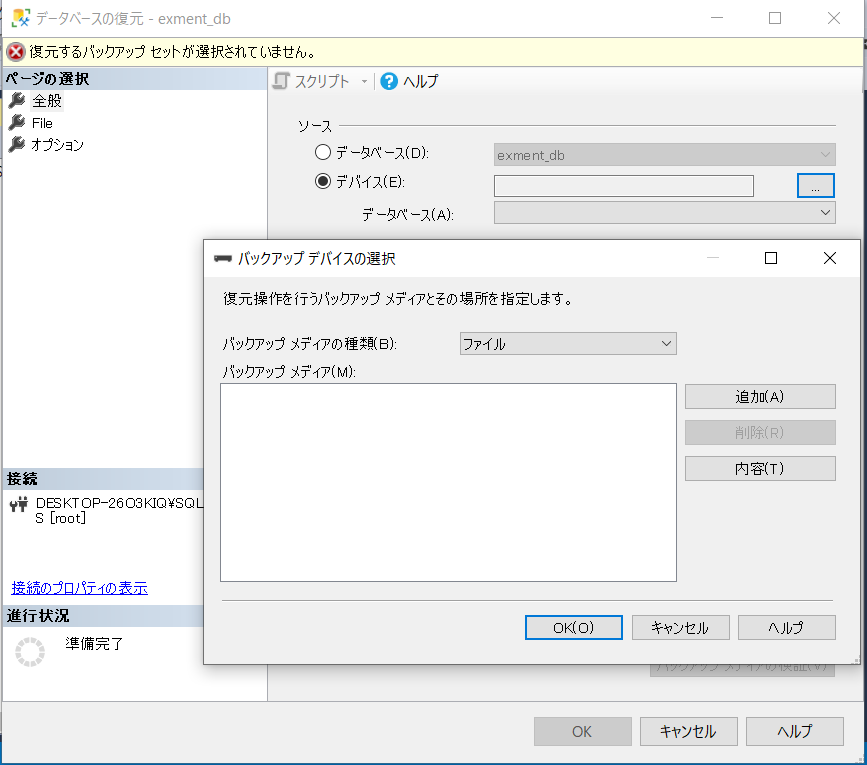

# Sao lưu và khôi phục (SQL Server)
Đây là các bước sao lưu / khôi phục (đưa về trạng thái cũ) dữ liệu của Exment bằng tay khi dùng SQL Server làm cơ sở dữ liệu.  

## Tổng quan
Khi dùng SQL Server, không thể sao lưu / khôi phục từ màn hình Exment. Hãy làm 2 việc sau bằng tay.

| Đối tượng | Cách làm |
| ---- | ---- |
| Cơ sở dữ liệu | Sao lưu và khôi phục bằng Microsoft SQL Server Management Studio (SSMS) |
| Tệp (4 loại bên dưới) | Dùng Explorer, v.v. để lưu cả thư mục sang nơi khác. Khi cần thì đưa trở lại |

- Tệp plugin
- Tệp đính kèm
- Tệp log
- Tệp thiết lập

## Sao lưu cơ sở dữ liệu
Đây là các bước sao lưu SQL Server.  
Hãy thực hiện vào lúc bạn muốn.  

- Khởi động Microsoft SQL Server Management Studio (SSMS).  
**※Nhất định phải đăng nhập bằng thành viên có một trong các vai trò: server role sysadmin, database role db_owner, database role db_backupoperator.**
  

- Bấm chuột phải vào cơ sở dữ liệu cần sao lưu, chọn Tasks → Back Up.  
  

- Ở màn hình Back Up Database, chọn "Backup type: Full" rồi bấm Add ở phần nơi lưu bản sao lưu.  
  

- Hộp thoại chọn nơi lưu bản sao lưu hiện ra, hãy quyết định thư mục và tên tệp tùy ý rồi bấm nút OK.  
  

- Quay lại màn hình Back Up Database và bấm nút OK. Việc sao lưu bắt đầu. Khi xong, một thông báo sẽ hiện ra.   
  

- Hãy kiểm tra xem tệp sao lưu (.bak) đã được tạo ở nơi lưu đã chọn chưa.

## Sao lưu các loại tệp
Các tệp sau nằm trong những thư mục cố định trên máy chủ. Hãy dùng Explorer, v.v. để lưu cả thư mục sang thư mục khác hoặc thiết bị lưu trữ ngoài.
  
~~~
Tệp plugin    : (thư mục gốc của dự án)/storage/app/plugins
Tệp đính kèm  : (thư mục gốc của dự án)/storage/app/admin
Tệp log       : (thư mục gốc của dự án)/storage/logs
Tệp thiết lập : (thư mục gốc của dự án)/config
Tệp .env      : (thư mục gốc của dự án)/.env
~~~
    
**※Tệp .env là tệp chứa các thiết lập quan trọng của Laravel. Nên sao lưu tệp này. Tuy nhiên, khi khôi phục, đừng thay thế nguyên tệp đó**.

## Khôi phục cơ sở dữ liệu
Đây là các bước đưa bản sao lưu SQL Server trở lại.  
Nhất định phải kiểm tra rằng không có người dùng nào đang dùng Exment rồi mới thực hiện.  

- Khởi động Microsoft SQL Server Management Studio (SSMS).  
**※Nhất định phải đăng nhập bằng thành viên có server role sysadmin hoặc dbcreator, hoặc bằng chủ sở hữu cơ sở dữ liệu (dbo).**
  

- Bấm chuột phải vào cơ sở dữ liệu cần khôi phục, chọn Tasks → Restore → Database.  
  

- Ở màn hình Restore Database, chọn "Source: Device", bấm "..." để mở hộp thoại Select backup devices.  
  

- Khi bấm nút Add, hộp thoại Locate Backup File hiện ra. Chọn tệp sao lưu muốn khôi phục rồi bấm OK.  
  

- Kiểm tra rằng tệp đã chọn được thêm vào hộp thoại Select backup devices, rồi bấm OK một lần nữa.  
  

- Quay lại màn hình Restore Database. Chọn "Select a page: Options" để mở tab Options. Đánh dấu "Restore options: Overwrite the existing database" và "Server connections: Close existing connections to destination database", rồi bấm OK.  
  

- Khi khôi phục xong, một thông báo sẽ hiện ra.  
  

### Lưu ý khi khôi phục
- Khi phiên bản Exment lúc sao lưu khác với phiên bản Exment đang được cài, sau khi khôi phục cần cập nhật cơ sở dữ liệu lên mới.  
Ví dụ: phiên bản lúc sao lưu: v1.1.6, phiên bản hiện tại: v1.2.0 → cần cập nhật cơ sở dữ liệu lên mới nhất  
Khi đó, sau khi khôi phục, hãy chạy lệnh sau.  

~~~
php artisan exment:update
~~~
    
**※Không thể khôi phục cơ sở dữ liệu đã sao lưu bằng Exment phiên bản mới vào Exment phiên bản cũ**.

## Khôi phục các loại tệp
Dùng Explorer, v.v. để đưa cả thư mục các tệp đã lưu trở lại chỗ cũ.  

- Tệp plugin và tệp đính kèm gắn với dữ liệu trong cơ sở dữ liệu. Hãy khôi phục những tệp được sao lưu cùng lúc, cùng với cơ sở dữ liệu.
- Với tệp log, không nên ghi đè trực tiếp mà nên đặt tên khác rồi lưu vào cùng thư mục.
  
~~~
Tệp plugin    : (thư mục gốc của dự án)/storage/app/plugins
Tệp đính kèm  : (thư mục gốc của dự án)/storage/app/admin
Tệp log       : (thư mục gốc của dự án)/storage/logs
Tệp thiết lập : (thư mục gốc của dự án)/config
~~~
