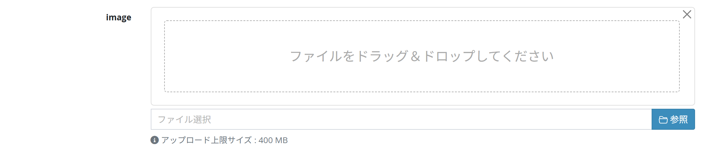
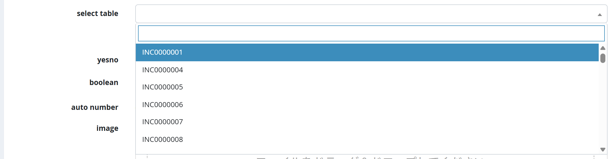
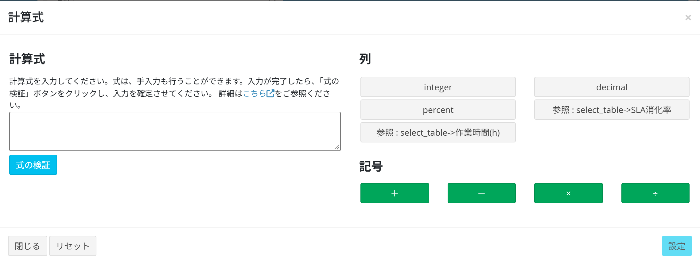

# Cột tùy chỉnh
Trang này hướng dẫn cách thiết lập "cột tùy chỉnh", tức là các cột của bảng tùy chỉnh.  

## Màn hình thiết lập
- Trên danh sách bảng tùy chỉnh, đánh dấu chọn một bảng cần thiết lập, rồi nhấp vào "Detailed table settings" (thiết lập chi tiết bảng) ở phía trên bên phải.  

- Hoặc chọn bảng cần thiết lập từ menu, sau đó cũng nhấp vào "Detailed table settings" ở phía trên bên phải.  
※ Cần thiết lập trước để bảng đó được hiển thị trên menu.  

- Trên màn hình thiết lập chi tiết bảng vừa hiển thị, nhấp vào biểu tượng cột tùy chỉnh.

- Danh sách các cột của bảng tùy chỉnh đã chọn sẽ được hiển thị.  

## Thêm cột mới
- Trên màn hình "Custom column setting" (thiết lập cột tùy chỉnh), nhấp vào nút [New] ở phía trên bên phải trang.

- Màn hình thêm mới cột tùy chỉnh sẽ hiển thị, hãy nhập các thông tin cần thiết.

## Lưu
Sau khi nhập các thiết lập, vui lòng nhấp vào [Submit].

## Chỉnh sửa
Nếu muốn chỉnh sửa một cột, vui lòng nhấp vào liên kết [Edit] ở dòng tương ứng.  

## Xóa
Nếu muốn xóa một cột, vui lòng nhấp vào liên kết [Delete] ở dòng tương ứng.  

**※ Tuy nhiên, không thể xóa các cột do hệ thống cài đặt sẵn.**

## Chi tiết các mục nhập (chung)
- Column name (alphanumeric) (tên cột, chữ và số): Tên của cột được sử dụng trong hệ thống. Nhập bằng chữ cái, chữ số, hoặc "-", "\_". Chỉ có thể thiết lập một lần và không thể thay đổi.  
**※ Không thể sử dụng các tên sau đây.**  
id,suuid,parent_id,parent_type,created_at,updated_at,deleted_at,created_user,updated_user,deleted_user

### Column display name (Tên hiển thị của cột)
Tên của cột được hiển thị trên màn hình.

## Loại cột
Loại của cột cần thiết lập. Nội dung đăng ký ở mục này sẽ được áp dụng cho form khi đăng ký dữ liệu.

> Về chi tiết đặc tả hệ thống của từng loại cột tùy chỉnh, vui lòng xem [Tài liệu tham chiếu cột tùy chỉnh](/column_reference).

#### One line text (Văn bản một dòng)
Văn bản một dòng (ô nhập văn bản - text box).  

#### Multiline text (Văn bản nhiều dòng)
Văn bản nhiều dòng (vùng nhập văn bản - text area).  

#### Text editor (Trình soạn thảo văn bản)
Có thể nhập dữ liệu bằng trình soạn thảo văn bản.

#### URL
Trường nhập cho phép nhập URL.  

#### Email address (Địa chỉ email)
Trường nhập cho phép nhập địa chỉ email.  

#### Integer (Số nguyên)
Trường nhập chỉ cho phép nhập số nguyên. Ngoài ra, khi đăng ký dữ liệu, các nút [+] [-] được hiển thị ở hai bên trái phải của mục, có thể nhấp để tăng hoặc giảm giá trị.  

#### Decimal (Số thập phân)
Trường nhập chỉ cho phép nhập số thập phân. Khi đặt hiển thị phần trăm thành YES, dữ liệu sẽ được hiển thị kèm ký hiệu %.  

#### Currency (Tiền tệ)
Trường nhập cho phép nhập số tiền. Có thể chọn định dạng hiển thị từ 4 loại (￥, 円, ＄, €).

#### Date (Ngày)
Trường nhập ngày. Khi đăng ký dữ liệu, có thể thay đổi ngày từ lịch.  

#### Time (Giờ)
Trường nhập giờ. Khi đăng ký dữ liệu, có thể thay đổi giờ từ đồng hồ.  

#### Date and time (Ngày và giờ)
Trường nhập ngày giờ. Khi đăng ký dữ liệu, có thể thay đổi ngày giờ từ lịch và đồng hồ.  

#### Choice (Lựa chọn)
Trường nhập dạng lựa chọn. Danh sách lựa chọn có giá trị và tiêu đề giống nhau.  

#### Choice (Register value / heading) (Lựa chọn - đăng ký giá trị và tiêu đề)
Trường nhập dạng lựa chọn. Danh sách lựa chọn có giá trị và tiêu đề khác nhau.  

#### Choice (select from a list of values in another table) (Lựa chọn - chọn từ danh sách giá trị của bảng khác)
Trường nhập dạng lựa chọn. Tạo lựa chọn mà các mục lựa chọn là dữ liệu của một bảng khác.  

#### YES/NO
Tạo công tắc chuyển đổi giữa "YES" và "NO". Khi đăng ký dữ liệu, YES được lưu là 1 và NO được lưu là 0.  

#### Binary selection (Chọn một trong hai giá trị)
Tạo công tắc chuyển đổi giữa hai giá trị. Có thể thay đổi cả giá trị được lưu khi đăng ký dữ liệu.  

#### Automatic numbering (Đánh số tự động)
Tạo các giá trị như UUID hoặc chuỗi ký tự ngẫu nhiên khi tạo dữ liệu.  

#### Image (Hình ảnh)
Trường nhập dùng để tải hình ảnh lên.  

#### File (Tệp)
Trường nhập dùng để tải tệp lên.  

#### User (Người dùng)
Lựa chọn dùng để chọn người dùng của hệ thống.  

#### Organization (Tổ chức)
Lựa chọn dùng để chọn tổ chức của hệ thống.  

## Chi tiết các mục nhập (chung)
- ##### Column name (alphanumeric) (Tên cột, chữ và số)
Tên của cột được sử dụng trong hệ thống. Nhập bằng chữ cái, chữ số, hoặc "-", "_". Chỉ có thể thiết lập một lần và không thể thay đổi.  
**※ Không thể sử dụng các tên sau đây.**  
id,suuid,parent_id,parent_type,created_at,updated_at,deleted_at,created_user,updated_user,deleted_user

- ##### Column display name (Tên hiển thị của cột)
Tên của cột được hiển thị trên màn hình.

- ##### Column type (Loại cột)
Chọn loại cột dùng để đăng ký dữ liệu từ [danh sách loại cột](/vi/column?id=loại-cột).

- ##### Required (Bắt buộc)
Chọn xem trường này có phải là mục bắt buộc hay không. Nếu đặt là YES, trường này sẽ là mục bắt buộc trên màn hình nhập dữ liệu và lỗi sẽ được hiển thị nếu không nhập.  

- ##### Index Enabled (Chỉ mục tìm kiếm)
Vui lòng tham khảo mục "[Chỉ mục tìm kiếm](/vi/column?id=chỉ-mục-tìm-kiếm)" bên dưới.  

- ##### Free word search target (Đối tượng tìm kiếm từ khóa tự do)
Được hiển thị khi chỉ mục tìm kiếm là YES.  
Vui lòng tham khảo mục "[Đối tượng tìm kiếm từ khóa tự do](/vi/column?id=free_word_search_target)" bên dưới.  

- ##### Unique (Duy nhất)
Nếu đặt là YES, khi đăng ký dữ liệu sẽ không thể đăng ký giá trị trùng với dữ liệu khác. Nếu muốn ngăn việc đăng ký trùng theo một tổ hợp giá trị của nhiều cột, vui lòng tham khảo [thiết lập khóa duy nhất kết hợp](/vi/table).  

- ##### Enter once only (Chỉ nhập một lần)
Nếu đặt là YES, cột này chỉ có thể nhập dữ liệu khi đăng ký mới. Khi chỉnh sửa dữ liệu, cột chỉ được hiển thị (không thể sửa).

- ##### Initial value (Giá trị ban đầu)
Giá trị được nhập sẵn vào mục của form làm giá trị ban đầu.  

- ##### Placeholder
Chuỗi ký tự được đăng ký làm placeholder (văn bản gợi ý) cho mục của form.  

- ##### Help (Trợ giúp)
Nội dung được hiển thị dưới mục của form dưới dạng thông tin hướng dẫn.

- ##### Display order (Thứ tự hiển thị)
Chỉ định thứ tự hiển thị trên màn hình danh sách cột tùy chỉnh.

- ##### Add to default form view (Thêm vào form và view mặc định)
Nếu là YES, cột sẽ được thêm vào form và view mặc định khi tạo mới. Chỉ có thể thiết lập khi tạo mới cột. Khi cập nhật, vui lòng thay đổi lần lượt từ [màn hình form](/vi/form) và [màn hình view](/vi/view).

- ##### Add to heading columns (Thêm vào cột tiêu đề)
Có thể thêm cột tùy chỉnh đang tạo vào các cột tiêu đề.  
※ Thiết lập này chỉ hiển thị khi tạo mới cột tùy chỉnh. Khi cập nhật thiết lập, vui lòng thay đổi từ [thiết lập cột hiển thị tiêu đề](/vi/table).

- ##### Cell appearance (Hiển thị ô)
Thiết lập cách hiển thị giá trị của cột này trên danh sách dữ liệu (màu sắc, tag, badge, v.v.).  
Chọn từ "display preset" (mẫu hiển thị có sẵn). Để biết chi tiết, vui lòng tham khảo [Cell style presets](/cell_style_preset.md).

## Giải thích chi tiết các mục nhập (theo loại cột)
- ##### Maximum number of characters (Số ký tự tối đa) (One line text, Multiline text)
Số ký tự tối đa có thể nhập vào mục của form. Nếu vượt quá sẽ phát sinh lỗi.  

- ##### Usable characters (Ký tự được phép sử dụng) (One line text)
Các loại ký tự được đánh dấu chọn sẽ có thể nhập vào mục của form.
Nếu không đánh dấu chọn loại nào, tất cả các loại ký tự đều có thể nhập.

- ##### Suggest input (Gợi ý khi nhập) (One line text)
Từ các giá trị dữ liệu đã đăng ký trong cùng cột tùy chỉnh, những giá trị khớp với nội dung đang nhập sẽ được hiển thị làm gợi ý.

- ##### Regular expression (Biểu thức chính quy) (One line text)
Có thể kiểm tra tính hợp lệ của nội dung nhập bằng biểu thức chính quy. Để biết chi tiết, vui lòng xem [Biểu thức chính quy](/vi/column?id=biểu-thức-chính-quy).

- ##### Minimum value (Giá trị nhỏ nhất) (Integer, Decimal)
Giá trị nhỏ nhất có thể nhập vào mục của form. Nếu gửi giá trị nhỏ hơn giá trị này, lỗi sẽ phát sinh. Nếu để trống, hệ thống không kiểm tra giá trị nhỏ nhất.  

- ##### Maximum value (Giá trị lớn nhất) (Integer, Decimal)
Giá trị lớn nhất có thể nhập vào mục của form. Nếu gửi giá trị lớn hơn giá trị này, lỗi sẽ phát sinh. Nếu để trống, hệ thống không kiểm tra giá trị lớn nhất.  

- ##### Calculation formula (Công thức tính) (Integer, Decimal, Currency)
Để biết chi tiết, vui lòng xem [tại đây](/vi/column?id=công-thức-tính).

- ##### Choices (Lựa chọn) (Choice, Choice (Register value / heading))
Đăng ký các lựa chọn sẽ được hiển thị làm ứng viên trong mục của form. Đăng ký nhiều lựa chọn bằng cách xuống dòng, mỗi dòng một lựa chọn.  
Nếu đã chọn loại cột "Choice (Register value / heading)", dấu phẩy được dùng làm ký tự phân tách cột: cột thứ nhất là giá trị, cột thứ hai là tiêu đề.  

↓  
  
Khi lưu dữ liệu trên form, giá trị của cột thứ nhất sẽ được lưu vào cơ sở dữ liệu.  

- #####  Display as radio buttons / checkboxes (Hiển thị dạng radio button / checkbox) (YES/NO, Choice, Choice (Register value / heading))
Với cột Choice hoặc Choice (Register value / heading) mà thiết lập chọn nhiều là NO, có thể hiển thị trên form dưới dạng radio button.
 

Với cột YES/NO, hoặc với cột Choice, Choice (Register value / heading) mà thiết lập chọn nhiều là YES, có thể hiển thị trên form dưới dạng checkbox.

- ##### Allow free input (Cho phép nhập tự do) (Choice)
Khi đặt là YES, người dùng có thể tự nhập và đăng ký lựa chọn chưa được đăng ký trong thiết lập cột.  

>Nếu [Display as radio buttons / checkboxes](/vi/column?id=radio_buttom) đang được đặt là YES thì không thể sử dụng thiết lập này.

- ##### Initial value type (Loại giá trị ban đầu) (Date, Time, Date and time, User)
Có thể thiết lập loại giá trị ban đầu khi đăng ký mới dữ liệu.  
・Với cột Date, Time, Date and time, có thể thiết lập [Specified date and time] (ngày giờ chỉ định) hoặc [Date and time of data entry] (ngày giờ thực hiện nhập dữ liệu) làm giá trị ban đầu.  
・Với cột User, có thể thiết lập [Specified user] (người dùng chỉ định) hoặc [Login user] (người dùng đăng nhập) làm giá trị ban đầu.

- ##### Target table (Bảng đối tượng) (Choice (select from a list of values in another table))
Chỉ định bảng sẽ được hiển thị làm ứng viên lựa chọn trong mục của form.  

>Nội dung hiển thị trong danh sách lựa chọn có thể thay đổi tại [thiết lập cột hiển thị tiêu đề](/vi/table).

- ##### Search choices each time (Tìm kiếm lựa chọn mỗi lần nhập) (Choice (select from a list of values in another table), User, Organization)
Thông thường, các lựa chọn trên màn hình chỉnh sửa dữ liệu sẽ hiển thị toàn bộ ứng viên dưới dạng danh sách ngay khi tải màn hình.  

Khi đặt thiết lập này là YES, ban đầu hệ thống không tải các lựa chọn mà sẽ tìm kiếm dữ liệu theo giá trị người dùng nhập và thu hẹp các ứng viên.  

Khi nhập chuỗi ký tự vào trường nhập, hệ thống sẽ tìm kiếm dữ liệu trên máy chủ và hiển thị kết quả làm ứng viên.

> Bất kể thiết lập này, nếu tổng số dữ liệu từ 100 bản ghi trở lên, hệ thống sẽ áp dụng cách thu hẹp ứng viên nói trên để cải thiện hiệu năng.  
Ngoài ra, giá trị giới hạn này có thể thay đổi bằng [giá trị cấu hình](/config).  

- ##### Numbering type (Loại đánh số) (Automatic numbering)
Chọn loại đánh số được thực hiện khi đăng ký dữ liệu.
- Format (Định dạng)  
Đăng ký số theo định dạng do người dùng chỉ định.
- Random (license code) (Ngẫu nhiên - mã giấy phép)    
Đăng ký chuỗi ký tự ngẫu nhiên gồm 25 ký tự (5 ký tự × 5).
- Random (UUID) (Ngẫu nhiên - UUID)  
Đăng ký chuỗi ký tự ngẫu nhiên gồm tổng cộng 32 ký tự.

- ##### Number of digits (Số chữ số) (Automatic numbering)
Số chữ số được đăng ký làm dữ liệu khi đánh số tự động. Phần còn thiếu sẽ được điền bằng số 0.  

- ##### Show users / organizations without permission (Hiển thị cả người dùng, tổ chức không có quyền) (User, Organization)
Thiết lập chỉ hiển thị những người dùng, tổ chức có quyền truy cập vào bảng, hay hiển thị tất cả người dùng, tổ chức.

- ##### Show an "assign to me" button (Hiển thị nút "Assign to me") (User)
Nếu đặt là YES, nút [Assign to me] (tôi phụ trách) sẽ được hiển thị bên cạnh cột này trên màn hình đăng ký và chỉnh sửa dữ liệu. Khi nhấp vào nút, người dùng đang đăng nhập sẽ được chọn.  
※ Nếu "Allow multiple selections" là YES, người dùng đang đăng nhập sẽ được thêm vào danh sách người dùng đã chọn.

- ##### Accept images pasted from the clipboard (Chấp nhận dán từ clipboard) (Image, File)
Nếu đặt là YES, hình ảnh (ảnh chụp màn hình, v.v.) được dán bằng Ctrl+V trên màn hình đăng ký và chỉnh sửa dữ liệu sẽ được thêm vào làm tệp của cột này. Tên tệp sẽ là "paste-(năm tháng ngày)-(giờ phút giây)-(số thứ tự)".  
※ Nếu "Allow multiple selections" là YES, hình ảnh sẽ được thêm vào các tệp đã chọn. Nếu là NO, tệp đã chọn sẽ được thay bằng hình ảnh vừa dán.  
※ Nếu dán bên trong trình soạn thảo văn bản, hình ảnh sẽ được đưa vào nội dung văn bản như trước đây. Ngoài ra, nếu dán văn bản vào ô nhập văn bản thì sẽ không được thêm làm tệp.  
※ Nếu trên màn hình có nhiều cột đặt thiết lập này là YES, hình ảnh sẽ được thêm vào cột đầu tiên.

- ##### Allow multiple selections (Cho phép chọn nhiều)
Vui lòng đặt là YES nếu muốn chọn nhiều mục đối với hình ảnh, tệp và các mục dạng lựa chọn.  

## Quy tắc định dạng đánh số tự động
Nếu đặt loại cột là "Automatic numbering" và loại đánh số (Numbering type) là "Format", có thể đăng ký số tự động theo quy tắc riêng của người dùng.  

Về các biến tham số có thể thiết lập, vui lòng xem trang sau.  
[Biến tham số](/params)

## Chỉ mục tìm kiếm
"Chỉ mục tìm kiếm" là chức năng được thiết lập sẵn trong cơ sở dữ liệu nhằm cải thiện hiệu năng tìm kiếm dữ liệu. "Chỉ mục" còn được gọi là "index".  
Trong Exment, một số chức năng chỉ có hiệu lực khi chỉ mục tìm kiếm này được đặt là YES.
    

Khi đặt là YES, các chức năng sau sẽ có hiệu lực.  
- Cột được hiển thị trong "Target column" (cột đối tượng) của thiết lập "Display condition" (điều kiện hiển thị) trong [view tùy chỉnh](/vi/view)  
    

- Cột được hiển thị trong "Target column" của thiết lập "Sort" (sắp xếp) trong [view tùy chỉnh](/vi/view)  
    

- Cột được hiển thị trong các mục của thiết lập "Filter" (bộ lọc) trong [danh sách dữ liệu](/vi/data_grid)  
    

- Biểu tượng "Sort" (sắp xếp) được hiển thị trong [danh sách dữ liệu](/vi/data_grid)
    

- Khi người dùng nhập từ khóa vào thanh tìm kiếm ở phía trên trang, cột sẽ trở thành đối tượng tìm kiếm dữ liệu. Vui lòng đặt là YES đối với các cột muốn cho phép tìm kiếm trên màn hình tìm kiếm, chẳng hạn như các loại mã hoặc các loại tên.  

- Có thể thiết lập **Free word search target (đối tượng tìm kiếm từ khóa tự do)**.  
Khi đặt là YES, cột sẽ trở thành đối tượng tìm kiếm khi nhập chuỗi ký tự vào thanh tìm kiếm để tìm kiếm.

※ Nếu thiết lập quá nhiều "chỉ mục tìm kiếm" trong cùng một bảng, hiệu năng có thể giảm khi tạo mới hoặc cập nhật dữ liệu.  
Số "chỉ mục tìm kiếm" có thể thiết lập trong cùng một bảng được khuyến nghị là tối đa 10 và giới hạn tối đa là 20.  
※ Ngoài ra, giới hạn số chỉ mục tìm kiếm có thể thay đổi bằng [giá trị cấu hình](/config.md?id=number-of-search-indexes).

## Sử dụng làm nhãn
> Từ v1.3.0, cách thiết lập này đã được chuyển sang [thiết lập mở rộng của bảng tùy chỉnh](/vi/table).

## Biểu thức chính quy
> Thiết lập này chỉ được hiển thị khi đã bật [Expert mode (chế độ chuyên gia)](/additional_expert).

Nếu loại cột tùy chỉnh là "One line text", có thể kiểm tra tính hợp lệ bằng biểu thức chính quy.  

  

#### Ví dụ về biểu thức chính quy
~~~
# Số điện thoại  
^0\d{2,3}-\d{1,4}-\d{4}$

# Mã bưu chính  
^\d{3}-\d{4}$

# Chỉ chữ Hiragana
^[ぁ-ん]+$

# Chỉ chữ Katakana
^[ァ-ヴ]+$
~~~

#### Khác
- Nếu đã thiết lập biểu thức chính quy, "Usable characters" sẽ không có hiệu lực.  
- Việc kiểm tra biểu thức chính quy sử dụng hàm của PHP. Khi tìm kiếm các mẫu biểu thức chính quy, vui lòng tìm dựa trên biểu thức chính quy của PHP.  
- Không cần thêm "/" ở đầu và cuối, cũng như "u" ở cuối biểu thức.  
- Nội dung của biểu thức chính quy không thuộc phạm vi hỗ trợ giải đáp. Mong quý vị thông cảm.

## Công thức tính
Nếu loại cột tùy chỉnh là "Integer", "Decimal" hoặc "Currency", có thể thiết lập công thức tính.  
Khi nhập các mục trên màn hình nhập dữ liệu, giá trị sẽ được tính tự động theo công thức đã thiết lập.  

### Cách thiết lập
- Nếu loại cột tùy chỉnh là "Integer", "Decimal" hoặc "Currency", mục "Calculation formula" sẽ được hiển thị, hãy nhấp vào mục này.  
    

- Hộp thoại nhập công thức tính sẽ hiển thị.  
  

- Vui lòng nhập công thức tính. Có thể nhập công thức bằng cách nhấp vào các nút ở cột bên phải hoặc nhập trực tiếp bằng tay.
※ Các biến có thể nhập sẽ được trình bày ở phần sau.
  

- Sau khi nhập xong, vui lòng nhấp vào nút "Validate formula" (kiểm tra công thức) để xác nhận nội dung nhập.
  

- ※ Nếu công thức đã nhập có sai sót, lỗi sẽ được hiển thị và không thể thiết lập.
  

- Sau khi nhập công thức hợp lệ, nhấp vào nút "Setting" (thiết lập) để đóng hộp thoại và công thức sẽ được thiết lập.
  

- Sau khi thiết lập, công thức tính sẽ được thực thi trên màn hình nhập dữ liệu. (Ví dụ dưới đây thiết lập cột 3 = cột 1 × cột 2)
  

### Công thức và biến có thể sử dụng

#### Các toán tử thông thường
- +, -, *, /  
※ Vui lòng nhập bằng ký tự nửa độ rộng (half-width). Lưu ý phép nhân không phải là "×" và phép chia không phải là "÷".

- Dấu ngoặc đơn ()

#### Biến
※ Về cơ bản, nên đăng ký biến bằng các nút được bố trí ở cột bên phải của hộp thoại "Calculation formula".

- Giá trị của cột khác
- Giá trị cột của bảng được tham chiếu
- Giá trị cột của bảng cha
- Tổng giá trị của cột trong bảng con
- Số bản ghi của bảng con

| Mục | Ví dụ | Giải thích |
| ---- | ---- | ---- |
| ${value:(tên cột)} | ${value:mitsumori_zeigaku} | Giá trị của cột khác trong cùng bảng sẽ được thiết lập. (Ví dụ: với bảng chi tiết báo giá, nếu nhập số tiền báo giá ${value:mitsumori_zeigaku} thì giá trị đang được nhập ở mục "Số tiền báo giá" sẽ được thiết lập)  |
| ${select_table:(tên cột).(tên cột của bảng được tham chiếu)} | ${select_table:client.client_shikiri} | Đối với cột trong cùng bảng có loại cột là "Choice (select from a list of values in another table)", "User" hoặc "Organization", giá trị của cột được tham chiếu sẽ được thiết lập. (Ví dụ: bảng "Thông tin hợp đồng (contract)" có cột "Khách hàng (client)" tham chiếu đến bảng "Thông tin khách hàng (client)"; nếu thiết lập ${select_table:client.client_shikiri} thì giá trị đang được nhập ở cột giá bán sỉ cho khách hàng (client_shikiri) của bảng "Thông tin khách hàng (client)" sẽ được thiết lập)  |
| ${parent:(tên cột)} | ${parent:mitsumori_value} | Giá trị của bảng cha sẽ được thiết lập. (Ví dụ: bảng báo giá và bảng chi tiết báo giá có quan hệ 1:n; đối với cột của bảng chi tiết báo giá, nếu nhập số tiền báo giá của cột bảng cha ${parent:mitsumori_value} thì giá trị của cột "Số tiền báo giá" đang được nhập trong dữ liệu cha sẽ được thiết lập)  |
| ${sum:(tên bảng con).(tên cột của bảng con)} | ${sum:mitsumori_detail.mitsumori_zeigaku} | Khi đã thiết lập quan hệ 1:n và form cho phép nhập đồng thời dữ liệu cha và con, tổng giá trị của cột được chỉ định trong bảng con sẽ được thiết lập. (Ví dụ: bảng báo giá và bảng chi tiết báo giá có quan hệ 1:n; đối với cột của bảng báo giá, nếu nhập số tiền chi tiết báo giá của cột bảng con ${sum:mitsumori_detail:mitsumori_zeigaku} thì tổng các giá trị đang được nhập ở "Số tiền báo giá" của toàn bộ dữ liệu con sẽ được thiết lập)  |
| ${count:(tên bảng con)} | ${count:mitsumori_detail} | Khi đã thiết lập quan hệ 1:n và form cho phép nhập đồng thời dữ liệu cha và con, số bản ghi của bảng con sẽ được thiết lập. (Ví dụ: nếu bảng báo giá và bảng chi tiết báo giá có quan hệ 1:n thì số bản ghi của bảng con sẽ được thiết lập)  |

### Trường hợp công thức bị tham chiếu vòng
Nếu thiết lập như dưới đây, công thức tính sẽ được thực hiện lặp lại vô hạn.    

- Cột calc1: công thức tính "${value:calc2} + 2"
- Cột calc2: công thức tính "${value:calc1} + 2"

"Nhập giá trị vào cột calc1" → "Đưa giá trị calc1 + 2 vào cột calc2" → "Đưa giá trị calc2 + 2 vào cột calc1" → "Đưa giá trị calc1 + 2 vào cột calc2"... và việc tính toán sẽ không bao giờ kết thúc.  

Khi đã thiết lập công thức tính như vậy, nếu nhập giá trị trên màn hình nhập dữ liệu, cảnh báo như dưới đây sẽ được hiển thị.  
Trong trường hợp này, vui lòng xem lại thiết lập công thức tính.
  

### Trường hợp phát sinh phép chia cho 0
Tùy theo công thức tính, phép chia cho 0 có thể phát sinh.  
Trong trường hợp đó, mục kết quả sẽ được để trống.

### Khác
Logic công thức tính chỉ hỗ trợ khi nhập dữ liệu trên màn hình.  
Hiện tại, chức năng này chưa hỗ trợ việc đăng ký dữ liệu bằng các chức năng như API hoặc plugin. Mong quý vị thông cảm.
