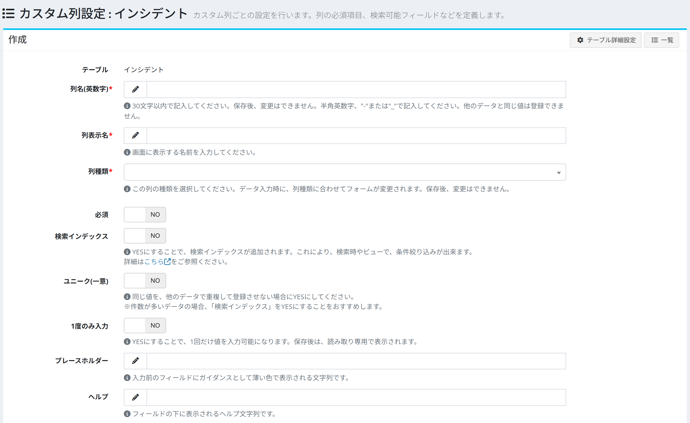
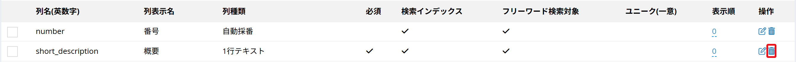
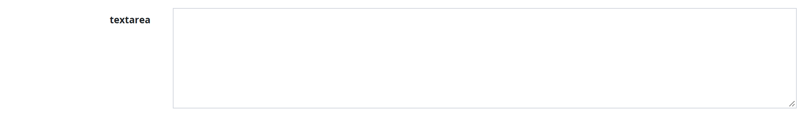

# Cột tùy chỉnh
Đây là trang để tạo, sửa và xóa các cột của bảng tùy chỉnh ("cột tùy chỉnh"). Cột là từng mục của dữ liệu, như "tên khách hàng", "mã bưu chính", "địa chỉ".  

- Cách tạo cột: vui lòng xem theo thứ tự "Màn hình thiết lập" → "Thêm cột mới" → "Lưu" ở dưới.
- Có những loại cột nào: vui lòng xem "Loại cột" ở dưới.
- Giải thích về từng mục: vui lòng xem "Chi tiết các mục nhập (chung)" và "Giải thích chi tiết các mục nhập (theo loại cột)" ở dưới.  

## Màn hình thiết lập
- Ở danh sách bảng tùy chỉnh, đánh dấu 1 bảng muốn thiết lập rồi bấm "Cài đặt chi tiết bảng" ở góc trên bên phải.  

- Hoặc, sau khi chọn bảng muốn thiết lập từ menu, cũng bấm "Cài đặt chi tiết bảng" ở góc trên bên phải.  
※Trước đó, cần thiết lập để bảng đó hiện trên menu.  

- Trên màn hình cài đặt chi tiết bảng hiện ra, bấm biểu tượng cột tùy chỉnh.

- Vậy là danh sách các cột của bảng tùy chỉnh đó hiện ra.  

## Thêm cột mới
- Trên màn hình "Cài đặt cột tùy chỉnh", bấm nút [Tạo mới] ở góc trên bên phải của trang.

- Màn hình thêm mới cột tùy chỉnh hiện ra, hãy nhập các mục cần thiết.

## Lưu
Nhập thiết lập xong, hãy bấm [Gửi].

## Chỉnh sửa
Khi muốn sửa cột, hãy bấm liên kết [Chỉnh sửa] ở dòng đó.  

## Xóa
Khi muốn xóa cột, hãy bấm liên kết [Xóa] ở dòng đó.  

**※Tuy nhiên, không xóa được các cột do hệ thống cài đặt sẵn.**

## Chi tiết các mục nhập (chung)
- Tên cột (chữ và số): tên của cột dùng trong hệ thống. Nhập bằng chữ cái, chữ số, hoặc "-", "\_". Chỉ đặt được 1 lần và không đổi được.  
**※Không dùng được các tên sau.**  
id,suuid,parent_id,parent_type,created_at,updated_at,deleted_at,created_user,updated_user,deleted_user

### Column display name (Tên hiển thị của cột)
Tên của cột hiện trên màn hình.

## Loại cột
Loại của cột. Loại chọn ở đây quyết định dạng của ô nhập khi đăng ký dữ liệu.

> Chi tiết đặc tả hệ thống của từng loại cột tùy chỉnh vui lòng xem [Tài liệu tham khảo cột tùy chỉnh](/vi/column_reference).

#### One line text (Văn bản một dòng)
Văn bản một dòng (ô nhập văn bản - text box).  

#### Multiline text (Văn bản nhiều dòng)
Văn bản nhiều dòng (vùng nhập văn bản - text area).  

#### Text editor (Trình soạn thảo văn bản)
Có thể nhập dữ liệu bằng trình soạn thảo văn bản.

#### URL
Trường nhập cho phép nhập URL.  

#### Email address (Địa chỉ email)
Trường nhập cho phép nhập địa chỉ email.  

#### Integer (Số nguyên)
Trường nhập chỉ cho phép nhập số nguyên. Ngoài ra, khi đăng ký dữ liệu, các nút [+] [-] được hiển thị ở hai bên trái phải của mục, có thể nhấp để tăng hoặc giảm giá trị.  

#### Decimal (Số thập phân)
Trường nhập chỉ cho phép nhập số thập phân. Khi đặt "Hiển thị dạng phần trăm" là YES, dữ liệu được hiện kèm ký hiệu %.  

#### Currency (Tiền tệ)
Trường nhập cho phép nhập số tiền. Có thể chọn định dạng hiển thị từ 4 loại (￥, 円, ＄, €).

#### Date (Ngày)
Trường nhập ngày. Khi đăng ký dữ liệu, có thể thay đổi ngày từ lịch.  

#### Time (Giờ)
Trường nhập giờ. Khi đăng ký dữ liệu, có thể thay đổi giờ từ đồng hồ.  

#### Date and time (Ngày và giờ)
Trường nhập ngày giờ. Khi đăng ký dữ liệu, có thể thay đổi ngày giờ từ lịch và đồng hồ.  

#### Choice (Lựa chọn)
Trường nhập dạng lựa chọn. Danh sách lựa chọn có giá trị và tiêu đề giống nhau.  

#### Choice (Register value / heading) (Lựa chọn - đăng ký giá trị và tiêu đề)
Trường nhập dạng lựa chọn. Danh sách lựa chọn có giá trị và tiêu đề khác nhau.  

#### Choice (select from a list of values in another table) (Lựa chọn - chọn từ danh sách giá trị của bảng khác)
Trường nhập dạng lựa chọn. Tạo lựa chọn mà các mục lựa chọn là dữ liệu của một bảng khác.  

#### YES/NO
Tạo công tắc chuyển đổi giữa "YES" và "NO". Khi đăng ký dữ liệu, YES được lưu là 1 và NO được lưu là 0.  

#### Binary selection (Chọn một trong hai giá trị)
Tạo công tắc chuyển đổi giữa hai giá trị. Có thể thay đổi cả giá trị được lưu khi đăng ký dữ liệu.  

#### Automatic numbering (Đánh số tự động)
Tạo các giá trị như UUID hoặc chuỗi ký tự ngẫu nhiên khi tạo dữ liệu.  

#### Image (Hình ảnh)
Trường nhập dùng để tải hình ảnh lên.  
※Trên màn hình danh sách dữ liệu và màn hình chi tiết dữ liệu, hình ảnh hiện kèm liên kết. Liên kết (thẻ a) có class "image-link", nên với [plugin (script)](/vi/plugin_quickstart_script) và [plugin (style)](/vi/plugin_quickstart_style), bạn đổi được cách xử lý và hình thức chỉ riêng cho liên kết của hình ảnh.

#### File (Tệp)
Trường nhập dùng để tải tệp lên.  

#### User (Người dùng)
Lựa chọn dùng để chọn người dùng của hệ thống.  

#### Organization (Tổ chức)
Lựa chọn dùng để chọn tổ chức của hệ thống.  

## Chi tiết các mục nhập (chung)
- ##### Column name (alphanumeric) (Tên cột, chữ và số)
Tên của cột dùng trong hệ thống. Nhập bằng chữ cái, chữ số, hoặc "-", "_". Chỉ đặt được 1 lần và không đổi được.  
**※Không dùng được các tên sau.**  
id,suuid,parent_id,parent_type,created_at,updated_at,deleted_at,created_user,updated_user,deleted_user

- ##### Column display name (Tên hiển thị của cột)
Tên của cột hiện trên màn hình.

- ##### Column type (Loại cột)
Chọn loại cột dùng để đăng ký dữ liệu từ [danh sách loại cột](/vi/column?id=loại-cột).

- ##### Required (Bắt buộc)
Chọn có đặt cột này là bắt buộc hay không. Đặt thành YES thì nó là mục bắt buộc trên màn hình nhập dữ liệu, và nếu không nhập thì lỗi hiện ra.  

- ##### Index Enabled (Chỉ mục tìm kiếm)
Vui lòng xem mục "[Chỉ mục tìm kiếm](/vi/column?id=chỉ-mục-tìm-kiếm)" ở dưới.  

- ##### Free word search target (Đối tượng tìm kiếm từ khóa tự do)
Hiện ra khi "Chỉ mục tìm kiếm" là YES.  
Vui lòng xem mục "[Đối tượng tìm kiếm tự do](/vi/column?id=free_word_search_target)" ở dưới.  

- ##### Unique (Duy nhất)
Đặt thành YES thì khi đăng ký dữ liệu, không đăng ký được giá trị giống với dữ liệu khác. Khi muốn ngăn trùng lặp theo tổ hợp của nhiều cột, vui lòng xem [Thiết lập khóa duy nhất kết hợp](/vi/table.md?id=thiết-lập-khóa-duy-nhất-kết-hợp).  

- ##### Enter once only (Chỉ nhập một lần)
Đặt thành YES thì cột chỉ nhập được khi đăng ký mới. Khi chỉnh sửa dữ liệu, cột chỉ được hiển thị.

- ##### Initial value (Giá trị ban đầu)
Giá trị được đặt sẵn trong ô nhập ngay từ đầu.  

- ##### Placeholder
Chuỗi ký tự hiện bằng chữ nhạt khi ô nhập đang trống (placeholder).  

- ##### Help (Trợ giúp)
Nội dung hiện dưới ô nhập làm phần giải thích.

- ##### Display order (Thứ tự hiển thị)
Chỉ định thứ tự hiển thị trên màn hình danh sách cột tùy chỉnh.

- ##### Add to default form view (Thêm vào form và view mặc định)
Đặt thành YES thì khi tạo cột mới, cột đó cũng được thêm vào form và view mặc định. Chỉ đặt được khi tạo cột mới. Khi muốn đổi về sau, hãy đổi từ [màn hình form](/vi/form.md) và [màn hình view](/vi/view.md).

- ##### Add to heading columns (Thêm vào cột tiêu đề)
Bạn thêm được cột tùy chỉnh đang tạo vào các cột tiêu đề.  
※Thiết lập này chỉ hiện khi tạo cột tùy chỉnh mới. Khi muốn đổi về sau, hãy đổi ở [Thiết lập cột hiển thị tiêu đề](/vi/table.md?id=thiết-lập-cột-hiển-thị-tiêu-đề).

- ##### Cell appearance (Hiển thị ô)
Đặt xem trên danh sách dữ liệu, giá trị của cột này hiện với hình thức nào (màu, tag, badge, v.v.).  
Chọn từ "Mẫu hiển thị có sẵn". Chi tiết vui lòng xem [Mẫu hiển thị ô](/vi/cell_style_preset.md).

## Giải thích chi tiết các mục nhập (theo loại cột)
- ##### Maximum number of characters (Số ký tự tối đa) (One line text, Multiline text)
Giới hạn số ký tự nhập được. Vượt quá thì có lỗi.  

- ##### Usable characters (Ký tự được phép sử dụng) (One line text)
Chỉ những loại ký tự được đánh dấu mới nhập được.
Khi không đánh dấu loại nào, nhập được tất cả các loại ký tự.

- ##### Suggest input (Gợi ý khi nhập) (One line text)
Trong các giá trị đã đăng ký ở cùng cột tùy chỉnh, những giá trị hợp với nội dung đang nhập được hiện làm gợi ý nhập.

- ##### Regular expression (Biểu thức chính quy) (One line text)
Bạn kiểm tra được nội dung đã nhập bằng biểu thức chính quy (cách viết quy tắc về thứ tự của các ký tự). Chi tiết vui lòng xem [Biểu thức chính quy](/vi/column?id=biểu-thức-chính-quy).

- ##### Minimum value (Giá trị nhỏ nhất) (Integer, Decimal)
Giá trị nhỏ nhất nhập được. Gửi giá trị nhỏ hơn thì có lỗi. Khi để trống, hệ thống không kiểm tra giá trị nhỏ nhất.  

- ##### Maximum value (Giá trị lớn nhất) (Integer, Decimal)
Giá trị lớn nhất nhập được. Gửi giá trị lớn hơn thì có lỗi. Khi để trống, hệ thống không kiểm tra giá trị lớn nhất.  

- ##### Calculation formula (Công thức tính) (Integer, Decimal, Currency)
Chi tiết vui lòng xem mục [Công thức tính](/vi/column?id=công-thức-tính) ở dưới.

- ##### Choices (Lựa chọn) (Choice, Choice (Register value / heading))
Đăng ký các lựa chọn sẽ hiện ra để chọn ở ô nhập. Đăng ký mỗi dòng 1 lựa chọn, cách nhau bằng xuống dòng.  
Khi loại cột là "Lựa chọn (lưu giá trị và nhãn)", hãy cách nhau bằng dấu phẩy, viết giá trị ở cột thứ 1 và tiêu đề ở cột thứ 2.  

↓  
  
Khi lưu dữ liệu trên form, giá trị của cột thứ 1 được lưu vào cơ sở dữ liệu.  

- #####  Display as radio buttons / checkboxes (Hiển thị dạng radio button / checkbox) (YES/NO, Choice, Choice (Register value / heading))
Với cột "Lựa chọn (giá trị cố định)", "Lựa chọn (lưu giá trị và nhãn)" mà chọn nhiều là NO, bạn cho hiện được trên form ở dạng radio button.
 

Với cột YES/NO, hoặc với cột "Lựa chọn (giá trị cố định)", "Lựa chọn (lưu giá trị và nhãn)" mà chọn nhiều là YES, bạn cho hiện được trên form ở dạng checkbox.

- ##### Allow free input (Cho phép nhập tự do) (Choice)
Đặt thành YES thì cả lựa chọn chưa đăng ký trong thiết lập cột cũng nhập tự do và đăng ký được.  

>Khi [Hiển thị dạng nút radio / hộp kiểm](/vi/column?id=radio_buttom) đang là YES thì không dùng được thiết lập này.

- ##### Initial value type (Loại giá trị ban đầu) (Date, Time, Date and time, User)
Bạn đặt được loại của giá trị ban đầu khi đăng ký mới dữ liệu.  
・Với cột Ngày, Giờ, Ngày và giờ, đặt được [Ngày giờ chỉ định] hoặc [ngày giờ nhập dữ liệu] làm giá trị ban đầu.  
・Với cột Người dùng, đặt được [người dùng chỉ định] hoặc [Người dùng đăng nhập] làm giá trị ban đầu.

- ##### Target table (Bảng đối tượng) (Choice (select from a list of values in another table))
Đặt bảng có dữ liệu sẽ hiện ra làm lựa chọn.  

>Câu chữ hiện trong danh sách làm lựa chọn đổi được ở [Thiết lập cột hiển thị tiêu đề](/vi/table?id=thiết-lập-cột-hiển-thị-tiêu-đề).

- ##### Search choices each time (Tìm kiếm lựa chọn mỗi lần nhập) (Choice (select from a list of values in another table), User, Organization)
Thông thường, lựa chọn trên màn hình chỉnh sửa dữ liệu hiện toàn bộ các mục để chọn thành danh sách khi tải màn hình.  

Khi đặt thiết lập này là YES, lúc đầu hệ thống không tải các lựa chọn, mà tìm dữ liệu theo giá trị người dùng nhập rồi thu hẹp các mục để chọn.  

Khi nhập chuỗi ký tự vào ô nhập, máy chủ tìm dữ liệu và hiện kết quả làm các mục để chọn.

> Dù thiết lập này thế nào, khi tổng số dữ liệu từ 100 trở lên, hệ thống dùng cách thu hẹp các mục để chọn để tăng hiệu năng.  
Giá trị giới hạn này đổi được bằng [giá trị thiết lập](/vi/config).  

- ##### Numbering type (Loại đánh số) (Automatic numbering)
Chọn loại đánh số khi đăng ký dữ liệu.
- Format (Định dạng)  
Đăng ký số theo định dạng do người dùng đặt.
- Random (license code) (Ngẫu nhiên - mã giấy phép)    
Đăng ký chuỗi ký tự ngẫu nhiên gồm 25 ký tự (5 ký tự × 5).
- Random (UUID) (Ngẫu nhiên - UUID)  
Đăng ký chuỗi ký tự ngẫu nhiên gồm tổng cộng 32 ký tự.

- ##### Number of digits (Số chữ số) (Automatic numbering)
Số chữ số được đăng ký làm dữ liệu khi đánh số tự động. Phần thiếu được điền bằng số 0.  

- ##### Show users / organizations without permission (Hiển thị cả người dùng, tổ chức không có quyền) (User, Organization)
Đặt xem chỉ hiện những người dùng, tổ chức có quyền truy cập bảng, hay hiện tất cả người dùng, tổ chức.

- ##### Show an "assign to me" button (Hiển thị nút "Assign to me") (User)
Đặt thành YES thì trên màn hình đăng ký và chỉnh sửa dữ liệu, nút [Tôi phụ trách] hiện bên cạnh cột này. Khi bấm nút, người dùng đang đăng nhập được chọn.  
※Khi "Cho phép chọn nhiều" là YES, người dùng đang đăng nhập được thêm vào những người dùng đã chọn.

- ##### Accept images pasted from the clipboard (Chấp nhận dán từ clipboard) (Image, File)
Đặt thành YES thì trên màn hình đăng ký và chỉnh sửa dữ liệu, hình ảnh (ảnh chụp màn hình, v.v.) dán bằng Ctrl+V được thêm làm tệp của cột này. Tên tệp là "paste-(năm tháng ngày)-(giờ phút giây)-(số thứ tự)".  
※Khi "Cho phép chọn nhiều" là YES, hình ảnh được thêm vào các tệp đã chọn. Khi là NO, tệp đã chọn được thay bằng hình ảnh vừa dán.  
※Khi dán trong trình soạn thảo văn bản, hình ảnh vào nội dung văn bản như trước nay. Ngoài ra, khi dán văn bản vào ô nhập văn bản thì không được thêm làm tệp.  
※Khi trên màn hình có nhiều cột đặt thiết lập này là YES, hình ảnh được thêm vào cột đầu tiên.

- ##### Allow multiple selections (Cho phép chọn nhiều)
Hãy đặt YES khi muốn chọn được nhiều cái ở các mục hình ảnh, tệp và các mục thuộc loại lựa chọn.  

## Quy tắc định dạng đánh số tự động
Khi đặt loại cột là "Đánh số tự động" và loại đánh số tự động là "Định dạng", bạn cho gắn số tự động theo quy tắc tự đặt.  

Các biến tham số đặt được vui lòng xem ở trang sau.  
[Biến tham số](/vi/params)

## Chỉ mục tìm kiếm
"Chỉ mục tìm kiếm" là thứ được đặt sẵn trong cơ sở dữ liệu để tìm dữ liệu nhanh hơn. "Chỉ mục" còn gọi là "index".  
Trong Exment, một số chức năng chỉ dùng được ở cột có "Chỉ mục tìm kiếm" là YES.
    

Khi đặt YES, các chức năng sau có hiệu lực.  
- Cột hiện ở "Cột đích" của thiết lập "Điều kiện hiển thị" trong [view tùy chỉnh](/vi/view)  
    

- Cột hiện ở "Cột đích" của thiết lập "Sắp xếp" trong [view tùy chỉnh](/vi/view)  
    

- Cột hiện trong các mục của thiết lập "Bộ lọc" ở [danh sách dữ liệu](/vi/data_grid)  
    

- Biểu tượng để sắp xếp hiện ở [danh sách dữ liệu](/vi/data_grid)
    

- Khi người dùng nhập từ khóa vào thanh tìm kiếm ở phía trên trang, cột là đối tượng tìm kiếm dữ liệu. Với cột muốn cho tìm trên màn hình tìm kiếm, như các loại mã và các loại tên, hãy đặt YES.  

- Bạn đặt được **Đối tượng tìm kiếm tự do**.  
Đặt thành YES thì cột là đối tượng tìm kiếm khi nhập chuỗi ký tự vào thanh tìm kiếm để tìm.

※Khi đặt rất nhiều "Chỉ mục tìm kiếm" trong 1 bảng, việc tạo mới và cập nhật dữ liệu có thể chậm đi.  
Số "Chỉ mục tìm kiếm" đặt được trong 1 bảng được khuyến nghị đến 10, và tối đa là 20.  
※Giới hạn số chỉ mục tìm kiếm đổi được bằng [giá trị thiết lập](/vi/config).

## Lưu ở dạng mã hóa (7.3.0)

Cột văn bản một dòng, nhiều dòng, email hoặc URL có thể lưu giá trị ở dạng mã hóa trong cơ sở dữ liệu. Chỉ có cơ sở dữ liệu hoặc tệp sao lưu thì không đọc được giá trị.

### Chuẩn bị trước khi dùng
1. Chạy `php artisan exment:data-key generate` trên máy chủ và đưa dòng được in ra vào `DATA_ENCRYPTION_KEYS` trong `.env`.
    - Khóa không nằm trong cơ sở dữ liệu và bản sao lưu. **Nếu mất khóa, các giá trị đã mã hóa sẽ không đọc lại được.** Hãy giữ một bản sao ở nơi an toàn, tách khỏi máy chủ.
2. Bật "Mã hóa cột" trong Quản lý chức năng (mặc định tắt).
3. Đặt "Lưu ở dạng mã hóa" của cột là YES. Các giá trị đã có được mã hóa ở chế độ nền (làm ngay: `php artisan exment:encrypt-column tên_bảng tên_cột`). Chọn NO sẽ chuyển lại.

### Những gì không làm được
Cột đã mã hóa không dùng được cho tìm kiếm một phần, sắp xếp, tổng hợp, biểu đồ, công thức hay tìm kiếm toàn văn, và không dùng cùng "Chỉ mục tìm kiếm", "Duy nhất" hay "Chọn nhiều".

### Cách hiển thị
- Danh sách, trang chi tiết, lịch sử thay đổi, API, AI (MCP), thông báo và xuất dữ liệu hiển thị giá trị bị che, như `****1234` (0 đến 4 ký tự cuối).
- Người có quyền nhóm vai trò "Xem giá trị đã mã hóa" sẽ thấy nút hình con mắt, bấm để xem giá trị thật một lúc. Mỗi lần đều được ghi vào nhật ký truy cập dữ liệu. API có `GET api/data/{bảng}/{id}/reveal/{cột}` (cùng quyền và nhật ký).
- Màn hình chỉnh sửa không bao giờ hiện giá trị thật. Để trống thì giữ nguyên giá trị.

### Xuất và nhập
- Tệp đã xuất chứa giá trị bị che (`****1234`). **Nhập lại tệp đó thì giá trị không đổi** (giá trị che trùng với dạng che của giá trị hiện tại được xem là "không đổi").
- **Để thay đổi giá trị, hãy nhập toàn bộ giá trị mới.** Một giá trị che khác (ví dụ `****0000`) sẽ làm dòng đó bị lỗi.

### Thay khóa
Tạo khóa mới bằng `exment:data-key generate`, đặt nó ở đầu `DATA_ENCRYPTION_KEYS`, rồi chạy `php artisan exment:data-key rotate`. `php artisan exment:data-key status` cho biết số giá trị của từng khóa. Chỉ xóa khóa cũ khi số đó là 0.

## Sử dụng làm nhãn
> Ở v1.3.0, cách thiết lập này đã được đổi sang [thiết lập mở rộng của bảng tùy chỉnh](/vi/table?id=thiết-lập-cột-hiển-thị-tiêu-đề).

## Biểu thức chính quy
> Thiết lập này chỉ hiện khi đã bật [chế độ chuyên gia (expert mode)](/vi/additional_expert).

Khi loại cột tùy chỉnh là "Văn bản một dòng", bạn kiểm tra được nội dung nhập bằng biểu thức chính quy.  

  

#### Ví dụ về biểu thức chính quy
~~~
# Số điện thoại  
^0\d{2,3}-\d{1,4}-\d{4}$

# Mã bưu chính  
^\d{3}-\d{4}$

# Chỉ chữ Hiragana
^[ぁ-ん]+$

# Chỉ chữ Katakana
^[ァ-ヴ]+$
~~~

#### Khác
- Khi đã đặt biểu thức chính quy, "Ký tự được phép" không có hiệu lực.  
- Việc kiểm tra biểu thức chính quy dùng hàm của PHP. Khi tìm ví dụ về biểu thức chính quy, hãy tìm theo biểu thức chính quy của PHP.  
- Không cần thêm "/" ở đầu và cuối, cũng như "u" ở cuối biểu thức.  
- Nội dung của biểu thức chính quy nằm ngoài phạm vi nhận câu hỏi. Mong bạn thông cảm.

## Công thức tính
Khi loại cột tùy chỉnh là "Số nguyên", "Số thập phân" hoặc "Tiền tệ", bạn đặt được công thức tính.  
Khi nhập các mục trên màn hình nhập dữ liệu, giá trị được tính tự động theo công thức đã đặt.  

### Cách thiết lập
- Khi loại cột tùy chỉnh là "Số nguyên", "Số thập phân" hoặc "Tiền tệ", mục "Công thức tính" hiện ra, hãy bấm vào.  
    

- Hộp thoại dành cho công thức tính hiện ra.  
  

- Hãy nhập công thức tính. Công thức được nhập bằng cách bấm các nút ở cột bên phải, hoặc nhập bằng tay.
※Các biến nhập được sẽ nói ở phần sau.
  

- Nhập xong, hãy bấm nút "Kiểm tra công thức" để xác nhận nội dung nhập.
  

- ※Nếu công thức đã nhập có chỗ sai, lỗi hiện ra và không đặt được.
  

- Sau khi nhập công thức đúng, bấm nút thiết lập thì hộp thoại đóng lại và công thức được đặt.
  

- Sau khi đặt, công thức tính được chạy trên màn hình nhập dữ liệu. (Ví dụ dưới đây đặt cột 1 × cột 2 cho cột 3)
  

### Công thức và biến có thể sử dụng

#### Các toán tử thông thường
- +, -, *, /  
※Hãy nhập bằng ký tự half-width. Lưu ý phép nhân không phải là "×" và phép chia không phải là "÷".

- Dấu ngoặc đơn ()

#### Biến
※Chúng tôi khuyên bạn đưa biến vào bằng các nút ở cột bên phải của hộp thoại "Công thức tính".

- Giá trị của cột khác
- Giá trị cột của bảng được tham chiếu
- Giá trị cột của bảng cha
- Tổng giá trị của cột trong bảng con
- Số bản ghi của bảng con

| Mục | Ví dụ | Giải thích |
| ---- | ---- | ---- |
| ${value:(tên cột)} | ${value:mitsumori_zeigaku} | Giá trị của cột khác trong cùng bảng sẽ được thiết lập. (Ví dụ: với bảng chi tiết báo giá, nếu nhập số tiền báo giá ${value:mitsumori_zeigaku} thì giá trị đang được nhập ở mục "Số tiền báo giá" sẽ được thiết lập)  |
| ${select_table:(tên cột).(tên cột của bảng được tham chiếu)} | ${select_table:client.client_shikiri} | Với cột trong cùng bảng có loại cột là "Lựa chọn (từ bảng khác)", "Người dùng" hoặc "Tổ chức", giá trị của cột được tham chiếu sẽ được thiết lập. (Ví dụ: bảng "Thông tin hợp đồng (contract)" có cột "Khách hàng (client)" tham chiếu đến bảng "Thông tin khách hàng (client)"; nếu thiết lập ${select_table:client.client_shikiri} thì giá trị đang được nhập ở cột giá bán sỉ cho khách hàng (client_shikiri) của bảng "Thông tin khách hàng (client)" sẽ được thiết lập)  |
| ${parent:(tên cột)} | ${parent:mitsumori_value} | Giá trị của bảng cha sẽ được thiết lập. (Ví dụ: bảng báo giá và bảng chi tiết báo giá có quan hệ 1:n; đối với cột của bảng chi tiết báo giá, nếu nhập số tiền báo giá của cột bảng cha ${parent:mitsumori_value} thì giá trị của cột "Số tiền báo giá" đang được nhập trong dữ liệu cha sẽ được thiết lập)  |
| ${sum:(tên bảng con).(tên cột của bảng con)} | ${sum:mitsumori_detail.mitsumori_zeigaku} | Khi đã thiết lập quan hệ 1:n và form cho phép nhập đồng thời dữ liệu cha và con, tổng giá trị của cột được chỉ định trong bảng con sẽ được thiết lập. (Ví dụ: bảng báo giá và bảng chi tiết báo giá có quan hệ 1:n; đối với cột của bảng báo giá, nếu nhập số tiền chi tiết báo giá của cột bảng con ${sum:mitsumori_detail:mitsumori_zeigaku} thì tổng các giá trị đang được nhập ở "Số tiền báo giá" của toàn bộ dữ liệu con sẽ được thiết lập)  |
| ${count:(tên bảng con)} | ${count:mitsumori_detail} | Khi đã thiết lập quan hệ 1:n và form cho phép nhập đồng thời dữ liệu cha và con, số bản ghi của bảng con sẽ được thiết lập. (Ví dụ: nếu bảng báo giá và bảng chi tiết báo giá có quan hệ 1:n thì số bản ghi của bảng con sẽ được thiết lập)  |

### Trường hợp công thức bị tham chiếu vòng
Nếu đặt như sau, việc tính toán sẽ không bao giờ kết thúc.    

- Cột calc1: công thức tính "${value:calc2} + 2"
- Cột calc2: công thức tính "${value:calc1} + 2"

Sẽ thành "Nhập giá trị vào cột calc1" → "Đưa giá trị calc1 + 2 vào cột calc2" → "Đưa giá trị calc2 + 2 vào cột calc1" → "Đưa giá trị calc1 + 2 vào cột calc2"..., và việc tính toán không xong.  

Khi đang đặt công thức tính như vậy mà nhập giá trị trên màn hình nhập dữ liệu, cảnh báo như sau hiện ra.  
Khi đó, hãy xem lại thiết lập của công thức tính.
  

### Trường hợp phát sinh phép chia cho 0
Tùy theo công thức tính, có thể xảy ra phép chia cho 0.  
Khi đó, mục kết quả để trống.

### Khác
Logic của công thức tính hỗ trợ việc nhập dữ liệu trên màn hình.  
Hiện nay, nó chưa hỗ trợ việc đăng ký dữ liệu bằng các chức năng như API và plugin. Mong bạn thông cảm.
