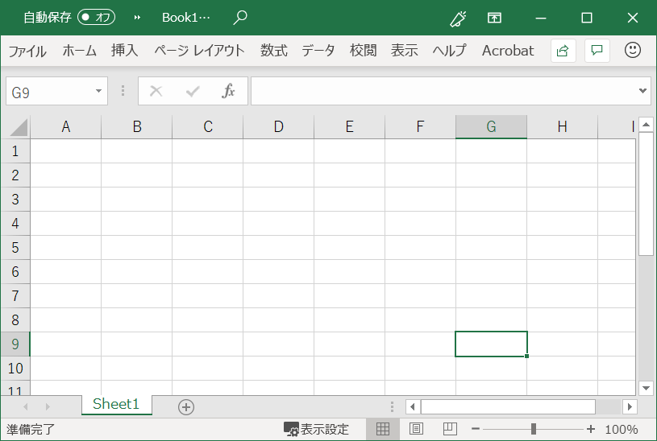
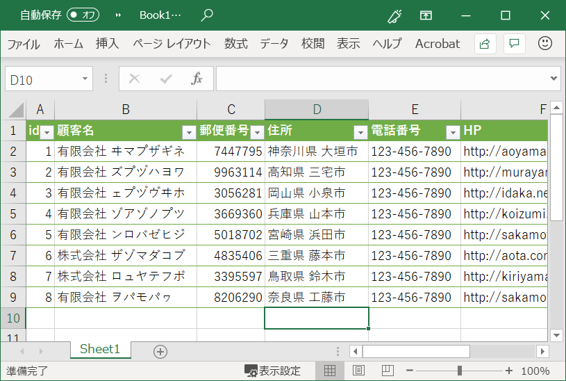
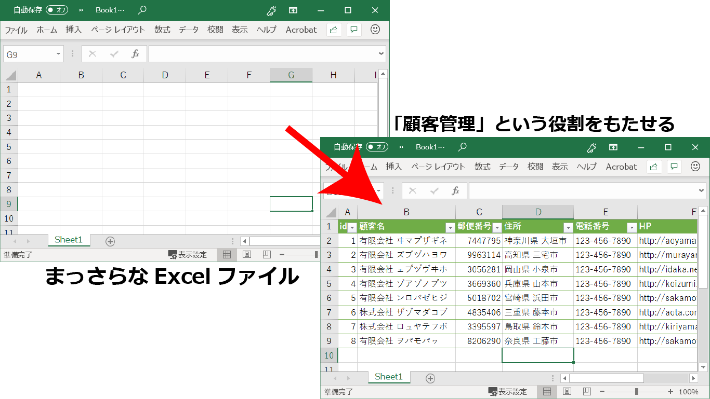
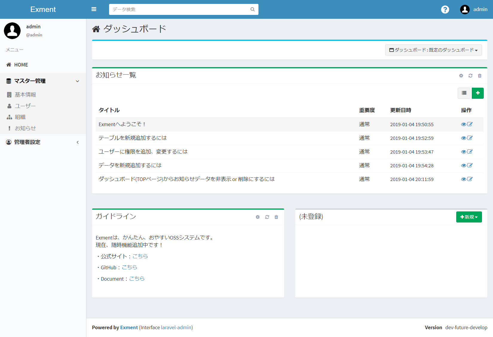
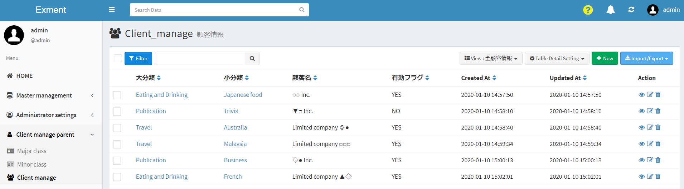

# Khái niệm của Exment
Exment là một "cơ sở dữ liệu Web có thể quản lý mọi thứ".  
Bằng cách bổ sung vào hệ thống Exment những nội dung muốn quản lý, bạn có thể giao cho hệ thống nhiều vai trò khác nhau.  
  
Có thể hình dung điều này dễ dàng hơn khi so sánh với Excel.  
Khi tạo một tệp mới trong Excel, một trang tính trống sẽ được hiển thị. Tại thời điểm này, tệp Excel đó chưa đảm nhận vai trò nào cả.  
  

Người dùng thêm các cột và trang tính vào trang tính này để tạo ý nghĩa cho nó.  
  
      
Trong ví dụ này, bằng cách thêm các thông tin như "id", "tên khách hàng", "mã bưu chính", "địa chỉ", tệp sẽ đảm nhận vai trò "quản lý khách hàng".  

Exment cũng dựa trên cùng khái niệm đó.  
Ở thiết lập ban đầu, Exment chỉ có các chức năng tối thiểu như quản lý người dùng và quản lý thông báo.  
Từ đó, người sử dụng sẽ tự mình bổ sung thêm nhiều chức năng khác nhau.  
    

Ví dụ, khi quản trị viên hệ thống thực hiện các thiết lập liên quan đến "quản lý khách hàng", Exment này sẽ đảm nhận vai trò "quản lý khách hàng".
    

Tương tự, khi quản trị viên hệ thống thực hiện các thiết lập liên quan đến "quản lý tác vụ", Exment này sẽ đảm nhận vai trò "quản lý tác vụ".
    
  
Như vậy, quản trị viên hệ thống có thể tự do thiết lập để hệ thống đảm nhận nhiều vai trò khác nhau.  
Khả năng là vô hạn. Cách sử dụng cũng là vô hạn.  
Ngoài ra, việc quản lý bằng Exment còn mang lại nhiều lợi ích khác. Về các lợi ích này, vui lòng xem [tại đây](https://exment.net/merit).
