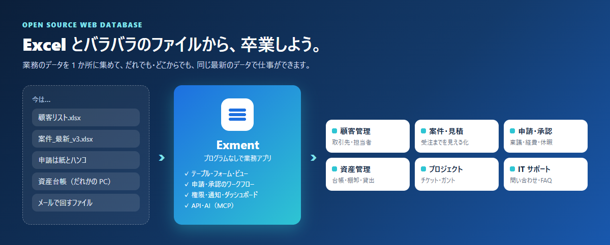

# Khái niệm của Exment

## Exment là gì
Exment là **cơ sở dữ liệu Web giúp bạn tạo ứng dụng hợp với công việc của công ty mình mà không cần viết chương trình**.  
Danh sách khách hàng, thương vụ, đơn yêu cầu, sổ tài sản — những dữ liệu hiện đang được quản lý rời rạc bằng Excel, giấy hay tệp đính kèm email — được gom về một nơi. Ai mở, mở từ đâu, cũng làm việc trên cùng một dữ liệu mới nhất.

> Lúc đầu, Exment là một "chiếc hộp trống". Bạn thêm bảng vào đó theo những thứ muốn quản lý, và nó trở thành hệ thống nghiệp vụ dành cho công ty bạn. Thêm khách hàng thì thành quản lý khách hàng, thêm đơn yêu cầu thì thành workflow. **Có bao nhiêu công ty thì có bấy nhiêu cách dùng.**

## 3 đặc điểm
### 1. Tạo được — không cần chương trình
- Chỉ bằng thao tác trên màn hình, bạn tạo được bảng, mục, form nhập liệu và danh sách (view).
- Danh sách xem được dưới dạng bảng, lịch, kanban, biểu đồ Gantt và biểu đồ.
- Chọn template (quản lý khách hàng, gói đơn yêu cầu, v.v.) là bắt đầu dùng được ngay.

### 2. Vận hành được — theo nhóm, an toàn
- **Workflow** từ đơn yêu cầu → phê duyệt hoặc trả lại, và **thông báo** về thời hạn hay thay đổi của dữ liệu (email, Slack, Microsoft Teams, LINE).
- Dùng nhóm vai trò để quyết định ai xem được gì, sửa được gì. Log thao tác cũng được lưu lại.
- Dashboard cho thấy ngay các con số hiện tại. Dùng được cả trên trình duyệt của điện thoại thông minh.

### 3. Kết nối được — với hệ thống khác và AI
- Trao đổi dữ liệu với hệ thống khác bằng API. Cũng tạo được API key cho từng người dùng.
- **AI (MCP)**: AI như Claude đọc được dữ liệu, với đúng quyền của người dùng.
- Các plugin chính thức (quản lý dự án, Support Desk, Groupware) được kèm sẵn miễn phí. Bạn thêm chức năng bằng plugin.

## Khác với Excel
| | Excel, tệp | Exment |
|---|---|---|
| Dữ liệu mới nhất | Tệp bị sao chép, không biết bản nào mới nhất | Luôn chỉ có một. Mọi người xem cùng một dữ liệu |
| Dùng cùng lúc | Có người đang mở thì không sửa được | Bao nhiêu người cũng nhập cùng lúc được |
| Quyền | Theo từng tệp. Khó đặt theo dòng hay cột | Bằng nhóm vai trò, theo từng bảng và từng dữ liệu |
| Lịch sử | Mất khi ghi đè | Lịch sử thay đổi và log thao tác được lưu lại |
| Phê duyệt, thông báo | Chuyển bằng email hoặc giấy | Tự động bằng workflow và thông báo |
| Tìm | Mở tệp ra rồi tìm | Tìm theo từ khóa, lọc, sắp xếp |

## Ví dụ về cách dùng
**Quản lý khách hàng**: gom đối tác và người phụ trách lại, để ai cũng xem được cùng một thông tin.

**Chia sẻ tệp**: đặt bản đề xuất, báo giá, hợp đồng vào workspace của từng bộ phận. Có quản lý phiên bản và quyền.

Ngoài ra còn có đơn yêu cầu và phê duyệt (tờ trình, thanh toán chi phí, nghỉ phép), quản lý thương vụ, quản lý tài sản và vật dụng, quản lý yêu cầu hỗ trợ, báo cáo ngày, v.v. Công việc nào cũng bắt đầu được từ việc thêm bảng. Chi tiết vui lòng xem [bản đồ chức năng](https://exment.net/feature-map/).

## Mã nguồn mở, dùng được lâu dài
- **Mã nguồn mở miễn phí** (GPL-3.0). Cài lên máy chủ của công ty thì **người dùng tăng, chi phí vẫn không tăng**.
- Dữ liệu nằm trên máy chủ của công ty bạn. Nếu không muốn chuẩn bị máy chủ, bạn cũng chọn được Exment SaaS.
- Với dịch vụ hỗ trợ có trả phí, bạn được tư vấn từ lúc đưa vào dùng đến lúc vận hành.

## Bước tiếp theo
- Dùng thử ở [demo](https://exment.net/demo-env/)
- Xem [quy trình cài đặt](/vi/quickstart)
- [Lợi ích của Exment](https://exment.net/merit/) và [so sánh với dịch vụ khác](https://exment.net/compare/)
