# Dashboard
Đây là màn hình được hiển thị khi đăng nhập vào Exment hoặc khi nhấp vào "HOME" hay "tên site hiển thị ở góc trên bên trái".  
Bằng cách tùy chỉnh tự do cách hiển thị, bạn có thể hiển thị thông tin đang được quản lý trong Exment dưới nhiều hình thức khác nhau.  
### Ví dụ hiển thị dashboard
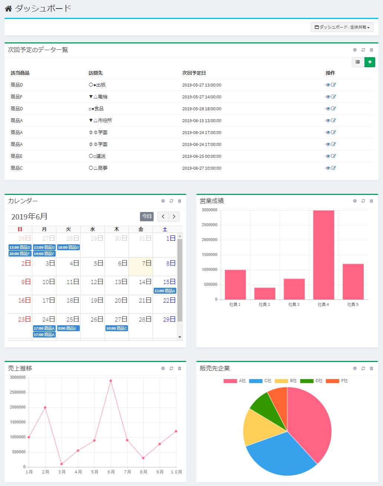

## Tạo mới dashboard
- Nhấp vào "Create New Dashboard" (Tạo mới dashboard) ở góc trên bên phải màn hình dashboard.  
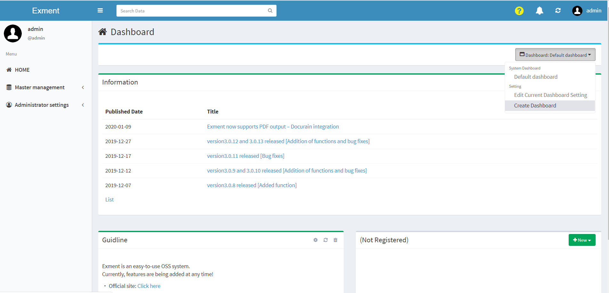
  
- Thiết lập các mục cần thiết cho dashboard.  
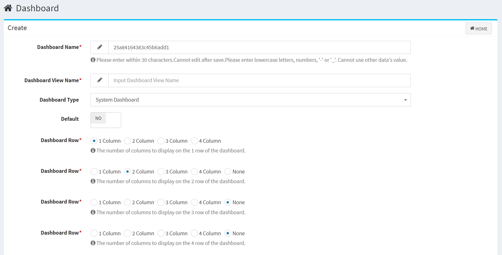

## Các mục thiết lập của dashboard
#### Dashboard name (alphanumeric) (Tên dashboard - chữ và số)
Là tên của dashboard.  
Không thể thay đổi sau khi lưu.

#### Dashboard display name (Tên hiển thị của dashboard)
Là tên hiển thị trên màn hình khi chọn dashboard.  
Có thể đặt bằng tiếng Nhật và vẫn có thể thay đổi sau khi lưu.

#### Dashboard type (Loại dashboard)
Chọn một trong hai loại "System Dashboard" (dashboard hệ thống) hoặc "User Dashboard" (dashboard người dùng).  

- "System Dashboard"  
Chỉ quản trị viên hệ thống mới có thể thiết lập. Đây là dashboard mà tất cả người dùng đều sử dụng được.  

- "User Dashboard"  
Là dashboard mà cả người dùng không phải quản trị viên hệ thống cũng có thể thiết lập. Chỉ người dùng đã tạo mới sử dụng được dashboard này.    

※ Không thể đổi "System Dashboard" thành "User Dashboard" về sau.  
Riêng với **"User Dashboard" do quản trị viên hệ thống tạo**, có thể đổi thành "System Dashboard" về sau.  
※ Khi thiết lập [Disable User Dashboard](/config.md?id=user-dashboard-disabled) (vô hiệu hóa dashboard người dùng), người dùng thông thường sẽ không thể tạo dashboard.

#### Default (Mặc định)
Chọn "YES" hoặc "NO".  
Trường hợp đã tạo nhiều dashboard, dashboard được hiển thị khi mở màn hình dashboard là dashboard được đặt là "YES".  
※ Bạn vẫn có thể hiển thị dashboard được đặt là "NO" bằng cách chọn từ danh sách.  
※ Chỉ có thể đặt "Default" là "YES" cho một dashboard duy nhất.  
Nếu đặt "YES" cho từ 2 dashboard trở lên, tất cả các dashboard khác ngoài dashboard được đặt "YES" sau cùng sẽ bị đổi thành "NO".

#### Select number of columns (Chọn số cột)
Chọn số cột hiển thị trên mỗi hàng của dashboard.  
Có thể hiển thị tối đa 4 cột trên một hàng.  
※ Số cột và diện tích hiển thị của mỗi cột tỉ lệ nghịch với nhau.  

### Ví dụ hiển thị 4 cột trên một hàng
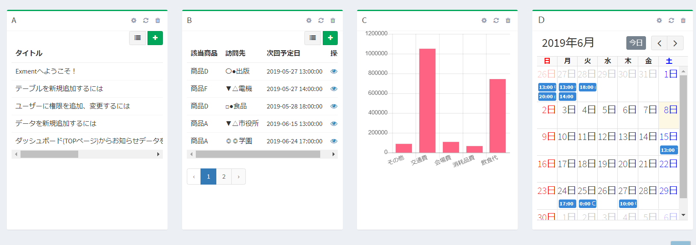  

## Thiết lập bộ lọc dashboard
Bạn có thể hiển thị "thanh bộ lọc" (filter bar) ở phía trên dashboard để lọc đồng thời tất cả các biểu đồ.  
Không cần tạo view riêng cho từng điều kiện như khu vực, sản phẩm, người phụ trách..., bạn vẫn có thể chuyển đổi điều kiện và xem kết quả tổng hợp ngay trên một dashboard.  
※ Về cách sử dụng thanh bộ lọc, vui lòng xem [Lọc bằng thanh bộ lọc](/vi/dashboard?id=lọc-bằng-thanh-bộ-lọc).

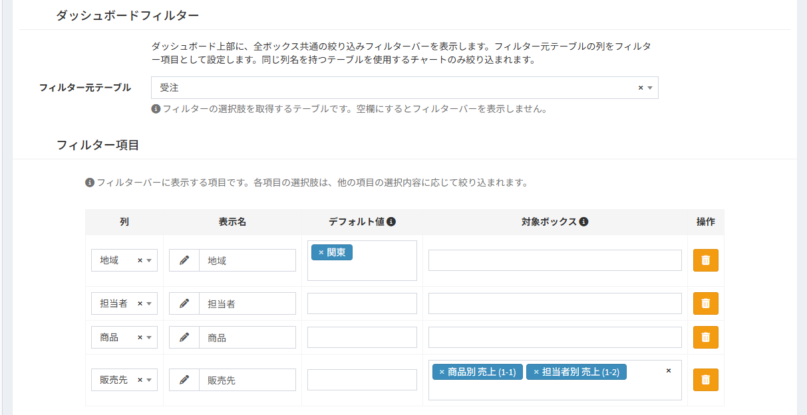

#### Filter source table (Bảng nguồn của bộ lọc)
Chọn bảng dùng để lấy các lựa chọn của bộ lọc.  
Nếu để trống, thanh bộ lọc sẽ không được hiển thị.

#### Filter items (Mục bộ lọc)
Thiết lập các mục hiển thị trên thanh bộ lọc, mỗi hàng một mục. Có thể thêm hàng bằng "New".

| Thiết lập | Nội dung |
|---|---|
| Column (Cột) | Chọn cột dùng để lọc trong số các cột của bảng nguồn của bộ lọc. |
| Display name (Tên hiển thị) | Là tên hiển thị trên thanh bộ lọc. Nếu để trống, tên cột sẽ được hiển thị. |
| Default value (Giá trị mặc định) | Là giá trị được chọn sẵn khi mở dashboard. Với mục chọn từ danh sách, hãy chỉ định các giá trị lưu, phân cách bằng dấu phẩy; với mục chỉ định theo khoảng "từ" - "đến", hãy chỉ định theo định dạng "giá trị nhỏ nhất~giá trị lớn nhất" (có thể chỉ định một phía). Nếu để trống, mục sẽ được hiển thị ở trạng thái chưa chọn. |
| Target boxes (Box đối tượng) | Chọn các biểu đồ sẽ được lọc bằng bộ lọc này. Nếu để trống, tất cả các biểu đồ có cột cùng tên sẽ được lọc. Vì danh sách lựa chọn chỉ hiển thị các biểu đồ đã lưu, hãy chọn trên màn hình thiết lập sau khi đã thêm biểu đồ. |

> Chỉ những biểu đồ sử dụng **bảng có cột cùng tên với mục bộ lọc** mới được lọc.  
> Các biểu đồ không thuộc trường hợp này sẽ hiển thị "Not affected by filters" (không thuộc đối tượng lọc).

> Để thao tác được nhanh ngay cả với bảng có nhiều dữ liệu, chúng tôi khuyến nghị bật "Index Enabled" (chỉ mục tìm kiếm) trong [thiết lập cột tùy chỉnh](/vi/column) cho các cột dùng làm mục bộ lọc.

> Khi xuất (export) / nhập (import) dashboard bằng [template](/template), thiết lập của thanh bộ lọc (bao gồm cả box đối tượng) cũng được giữ nguyên.

# Chọn item hiển thị
Tại [New] ở góc trên bên phải của mỗi cột trên dashboard đã tạo,  
bạn có thể chọn item muốn hiển thị trong 4 loại sau:  
"Data List", "System", "Chart", "Calendar".  

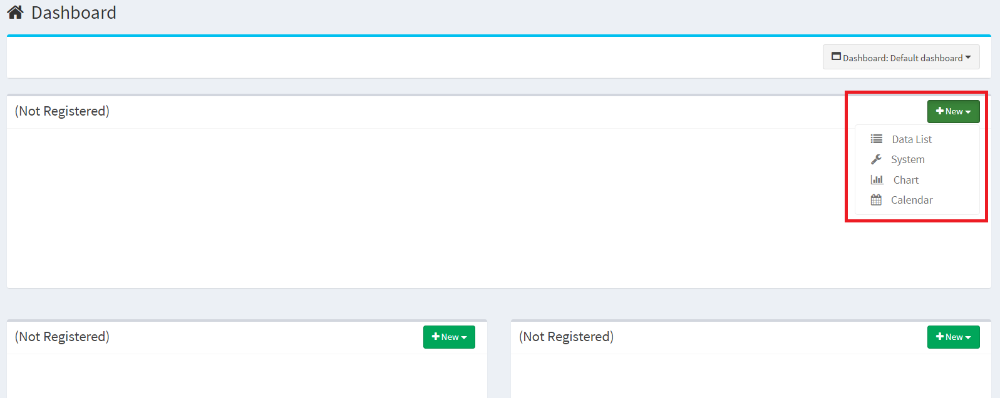  

Tiếp theo, hãy thiết lập nội dung hiển thị cụ thể cho từng item.

## Danh sách dữ liệu (Data List)
Bằng cách chỉ định bảng và view bất kỳ trong số các thông tin đang được quản lý trong Exment, bạn có thể hiển thị danh sách dữ liệu trên dashboard.

### Ví dụ hiển thị danh sách dữ liệu
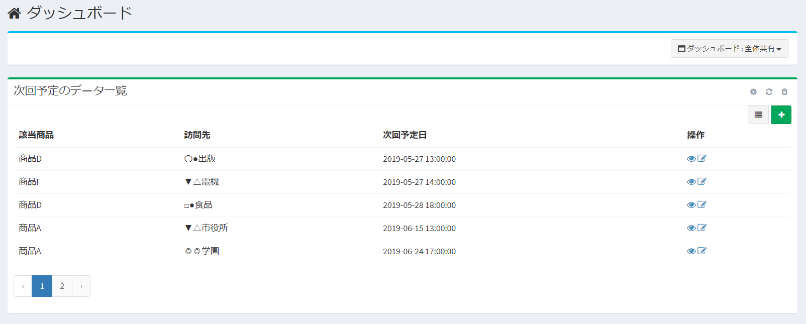

### Các mục thiết lập của danh sách dữ liệu
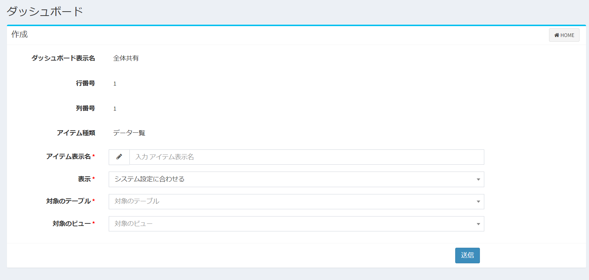
#### Item display name (Tên hiển thị của item)
Nhập tên của item sẽ hiển thị trên màn hình.

#### Display (Số dòng hiển thị)
Chọn số dữ liệu hiển thị trong một lần.

#### Target table (Bảng đối tượng)
Chọn bảng cần hiển thị trong số các bảng đã tạo ở [thiết lập bảng tùy chỉnh](/vi/table).

#### Target view (View đối tượng)
Chọn view cần hiển thị trong số các [view](/vi/view) của bảng đối tượng đã chọn.  
※ Không thể chọn view lịch, view kanban, view biểu đồ Gantt và view điều kiện. Với dashboard hệ thống, chỉ có thể chọn view hệ thống.  

## Hệ thống (System)
Bạn có thể hiển thị các nội dung liên quan đến hệ thống trên dashboard.  
※ Hiện tại có thể hiển thị "Guidelines", "Exment Latest News List", "Editor", "HTML", "Notifications list" và "2D/JAN Barcode".

### Các mục thiết lập của hệ thống
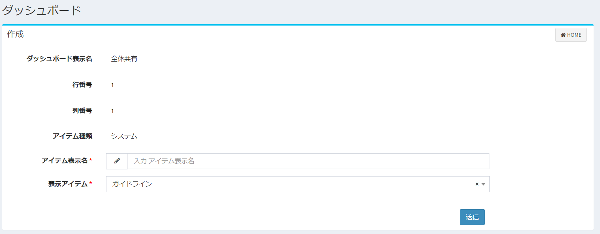

#### Item display name (Tên hiển thị của item)
Nhập tên của item sẽ hiển thị trên màn hình.

#### Display Items (Item hiển thị)
Chọn item sẽ hiển thị.

- ##### Guidelines (Hướng dẫn)
Có thể hiển thị thông tin hướng dẫn về hệ thống.  
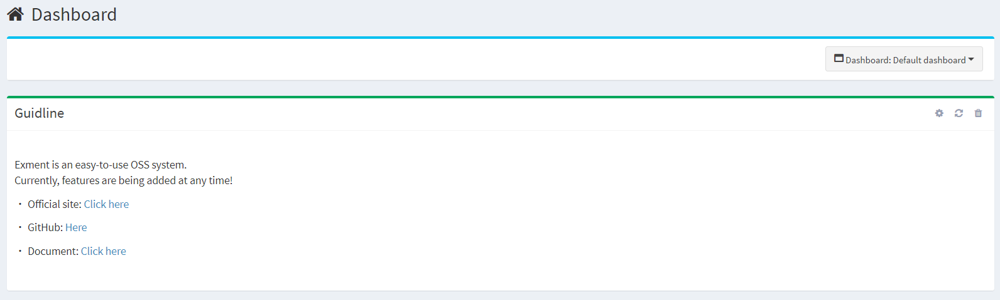

- ##### Exment Latest News List (Danh sách tin mới của Exment)
Lấy tin mới từ trang web chính thức của Exment và hiển thị.
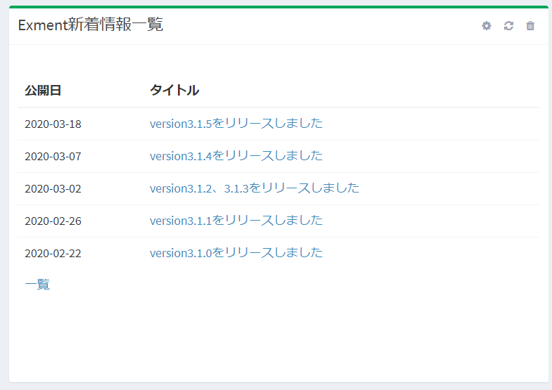

- ##### Editor (Trình soạn thảo)
Nhập nội dung tự do và hiển thị lên màn hình.
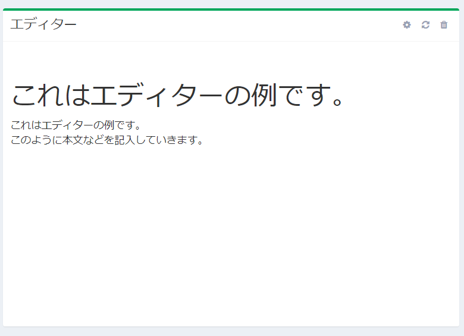

- ##### HTML
Nhập nội dung theo định dạng HTML và hiển thị lên màn hình. ※ Script cũng sẽ được thực thi.
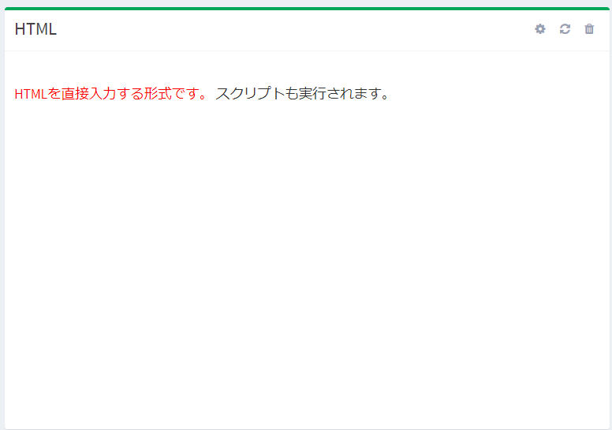

- ##### 2D/JAN Barcode (Mã vạch 2D/JAN)
Hiển thị nút quét mã vạch 2D/JAN.  
Có thể thay đổi tên hiển thị của phần "2D/JAN Barcode" trên nút "2D/JAN Barcode Scan" bằng "EXMENT_TEXT_SCAN_BUTTON_JA/EN" trong tệp .env.  

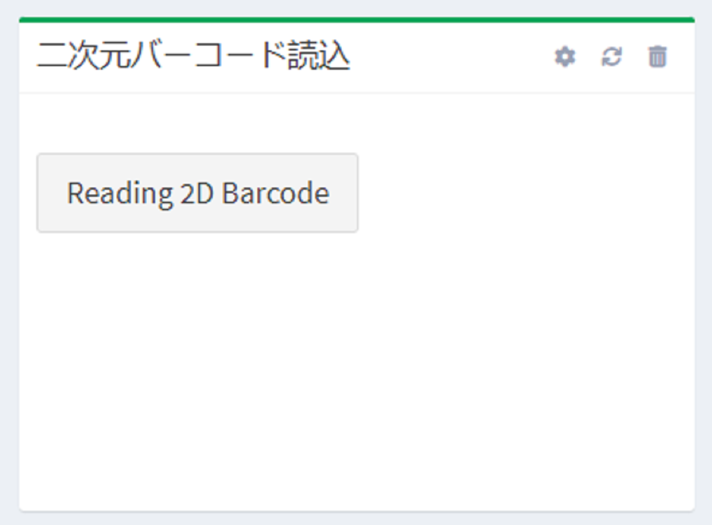

## Biểu đồ (Chart)
Dữ liệu được quản lý bằng các view của Exment (view thông thường, view toàn bộ dữ liệu, view tổng hợp, v.v.) có thể được chuyển thành 18 loại biểu đồ, tiêu biểu là biểu đồ cột, biểu đồ đường và biểu đồ tròn, để hiển thị trên dashboard.  
Với biểu đồ đang hiển thị, bạn có thể chuyển đổi loại biểu đồ, lọc, sắp xếp... ngay trên màn hình ([Thao tác trên dashboard](/vi/dashboard?id=thao-tác-trên-dashboard)).  
※ Vui lòng xem chi tiết tại [Nội dung thiết lập biểu đồ](/vi/dashboard?id=nội-dung-thiết-lập-biểu-đồ).

### Ví dụ hiển thị biểu đồ cột

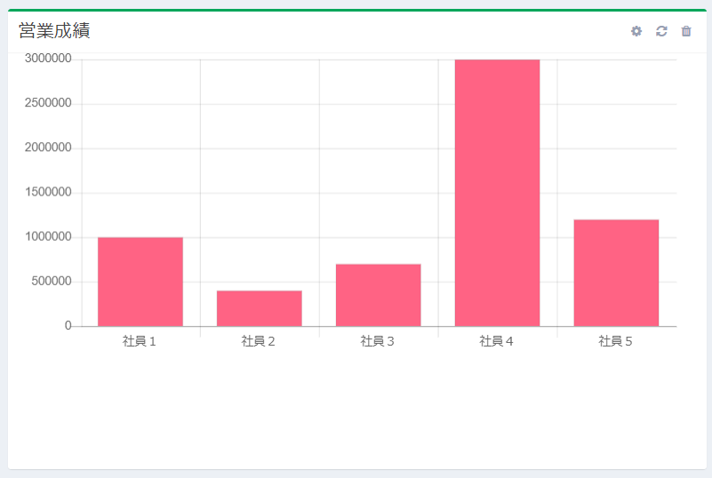

### Ví dụ hiển thị biểu đồ đường  
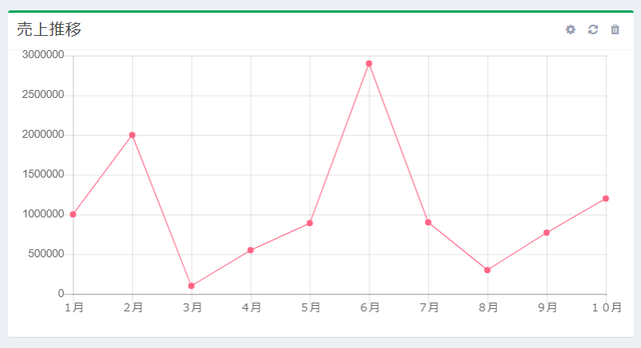

### Ví dụ hiển thị biểu đồ tròn
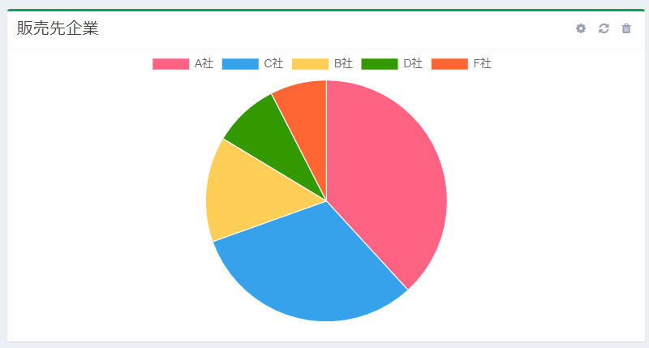

### Các mục thiết lập của biểu đồ
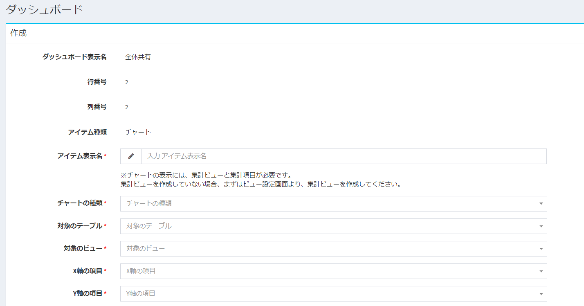

#### Item display name (Tên hiển thị của item)
Nhập tên của item sẽ hiển thị trên màn hình.

#### Chart type (Loại biểu đồ)
Chọn một loại biểu đồ trong 18 loại sau.

| Phân loại | Loại biểu đồ |
|---|---|
| Cơ bản | Biểu đồ cột (Bar), biểu đồ đường (Line), biểu đồ tròn (Pie) |
| Một chuỗi dữ liệu | Biểu đồ thanh ngang (Horizontal bar), biểu đồ vùng (Area chart), biểu đồ vành khuyên (Doughnut chart), biểu đồ radar (Radar chart), biểu đồ phễu (Funnel chart), biểu đồ đồng hồ đo (Gauge), biểu đồ phân tán (Scatter) |
| Nhiều chuỗi dữ liệu | Biểu đồ cột nhóm (Grouped bar), biểu đồ cột chồng (Stacked bar), biểu đồ nhiều đường (Multi-line), biểu đồ nhiệt (Heatmap), biểu đồ vùng chồng (Stacked area), biểu đồ treemap (Treemap), biểu đồ sunburst (Sunburst), biểu đồ hộp (Boxplot) |

Biểu đồ "nhiều chuỗi dữ liệu" hiển thị nhiều chuỗi dữ liệu cho mỗi mục trên trục hoành (ví dụ: hiển thị doanh thu hằng tháng theo từng sản phẩm).

Để sử dụng biểu đồ nhiều chuỗi dữ liệu, view tổng hợp cần được nhóm theo từ 2 cột trở lên. Trong các cột nhóm, cột được chọn tại [Series column](/vi/dashboard?id=series-column-multi-series-mục-chuỗi-dữ-liệu-nhiều-chuỗi) (mặc định là cột thứ 2) sẽ là chuỗi dữ liệu, còn cột đầu tiên trong các cột còn lại sẽ là trục hoành.

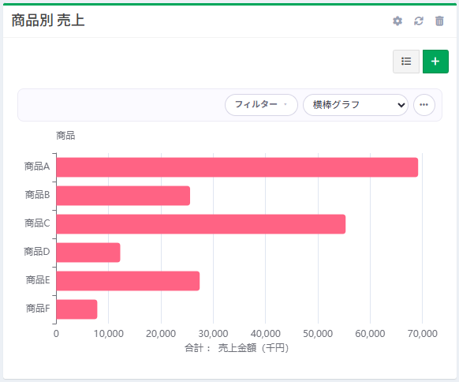

Biểu đồ thanh ngang

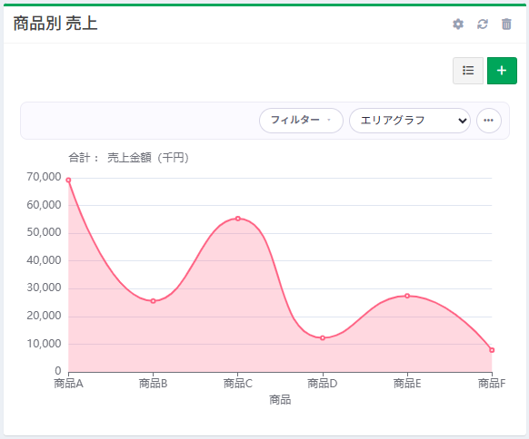

Biểu đồ vùng

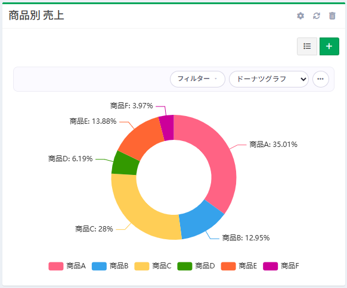

Biểu đồ vành khuyên

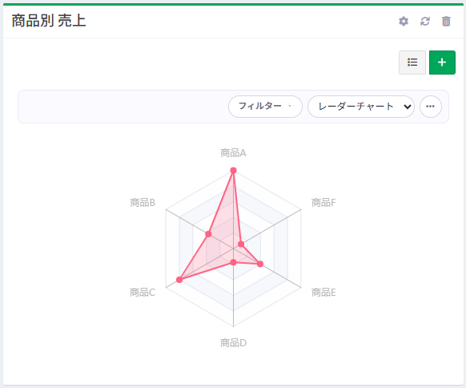

Biểu đồ radar

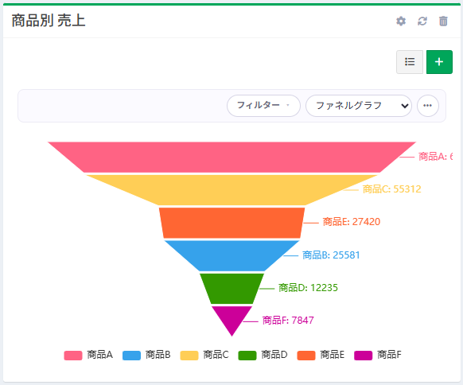

Biểu đồ phễu

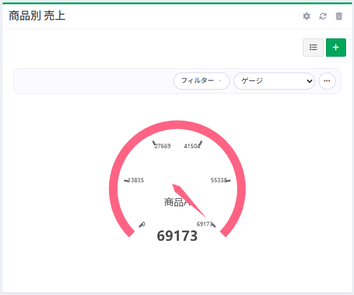

Biểu đồ đồng hồ đo

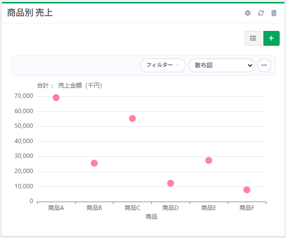

Biểu đồ phân tán

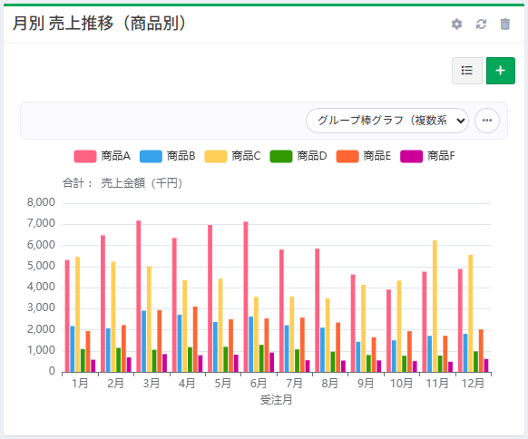

Biểu đồ cột nhóm

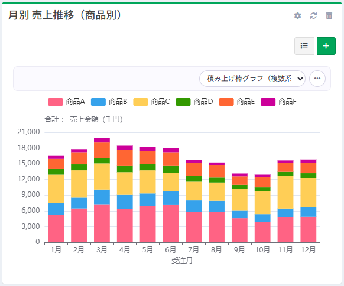

Biểu đồ cột chồng

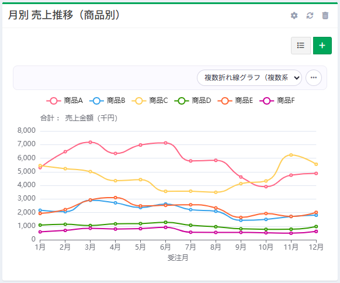

Biểu đồ nhiều đường

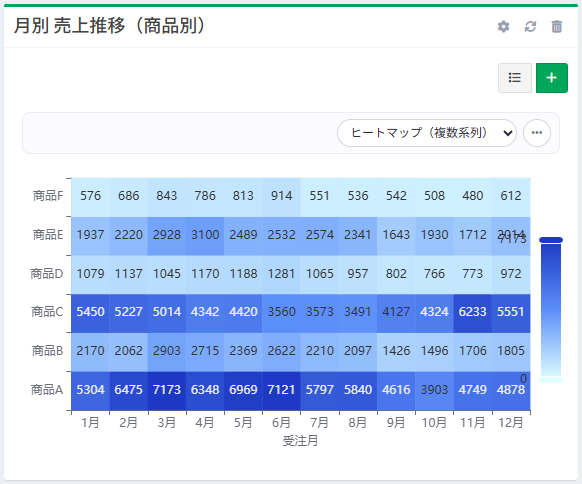

Biểu đồ nhiệt

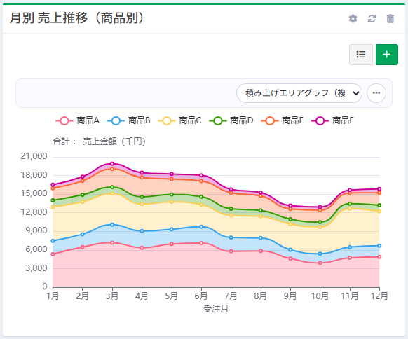

Biểu đồ vùng chồng

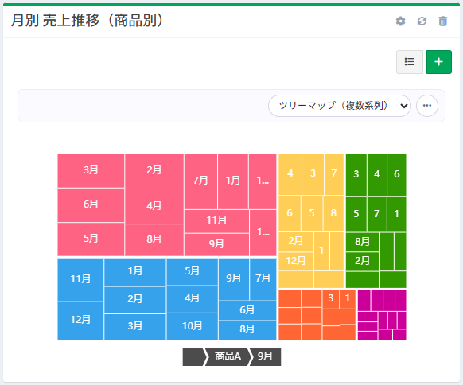

Biểu đồ treemap

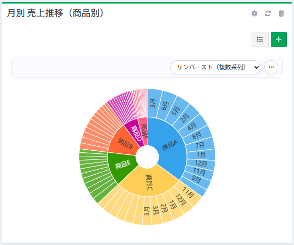

Biểu đồ sunburst

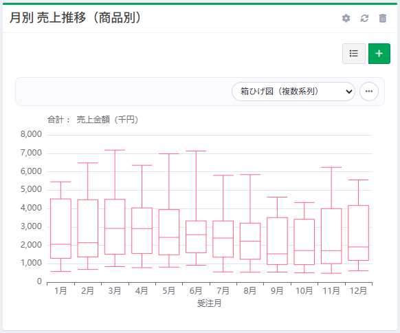

Biểu đồ hộp

#### Target table (Bảng đối tượng)
Chọn bảng cần hiển thị trong số các bảng đã tạo ở [thiết lập bảng tùy chỉnh](/vi/table).  
※ Các bảng mà bạn có quyền xem sẽ được hiển thị làm lựa chọn.

#### Target view (View đối tượng)
Chọn view cần hiển thị trong số các view (view thông thường, view toàn bộ dữ liệu, view tổng hợp, v.v.) của bảng đối tượng đã chọn.  
※ Không thể chọn view lịch, view kanban, view biểu đồ Gantt và view điều kiện. Với dashboard hệ thống, chỉ có thể chọn view hệ thống.  
※ Khi sử dụng biểu đồ nhiều chuỗi dữ liệu, hãy chọn view tổng hợp.  

#### X-axis item (Mục trục X)
Chọn trục X (trục hoành) để hiển thị trên biểu đồ.  
※ Vui lòng xem chi tiết tại [Nội dung thiết lập biểu đồ](/vi/dashboard?id=nội-dung-thiết-lập-biểu-đồ).  

#### Y-axis items (Mục trục Y)
Chọn trục Y (trục tung) để hiển thị trên biểu đồ.  
※ Vui lòng xem chi tiết tại [Nội dung thiết lập biểu đồ](/vi/dashboard?id=nội-dung-thiết-lập-biểu-đồ).  

#### Series column (multi-series) (Mục chuỗi dữ liệu - nhiều chuỗi)

Đây là thiết lập chỉ hiển thị khi chọn biểu đồ nhiều chuỗi dữ liệu.

Chọn cột dùng làm chuỗi dữ liệu trong số các cột nhóm của view tổng hợp. Nếu không chọn, cột nhóm thứ 2 sẽ là chuỗi dữ liệu.

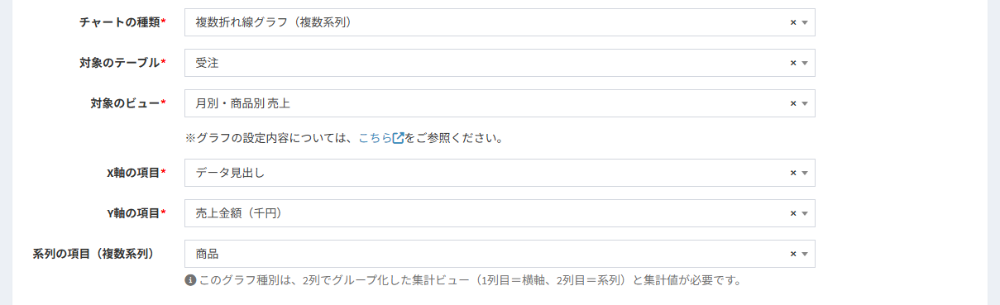

#### Chart filter fields (Mục bộ lọc biểu đồ)

Chọn các cột dùng để lọc riêng biểu đồ này. Có thể chọn nhiều cột.

Các cột đã chọn có thể được dùng để lọc từ nút **Filter** của biểu đồ ([Lọc bằng bộ lọc biểu đồ](/vi/dashboard?id=lọc-bằng-bộ-lọc-biểu-đồ)).

Nếu không chọn cột nào, nút **Filter** sẽ không được hiển thị.

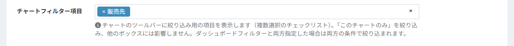

#### Các tùy chọn khác tùy theo loại biểu đồ

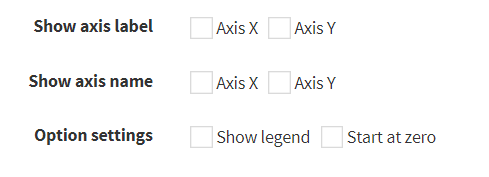

Các tùy chọn đã chọn sẽ được phản ánh lên biểu đồ.

※ **Show axis label** (hiển thị nhãn), **Show axis name** (hiển thị tên mục) và **Start at zero** (bắt đầu từ 0) chỉ dùng được với biểu đồ cột và biểu đồ đường.

## Lịch (Calendar)
Dữ liệu được quản lý bằng view lịch của Exment có thể được hiển thị trên dashboard  
theo một trong 2 hình thức hiển thị  
"Monthly" (theo tháng) và "List" (danh sách).
>Nội dung chữ được hiển thị có thể thay đổi tại [thiết lập cột hiển thị tiêu đề](/vi/table).

### Ví dụ hiển thị theo tháng
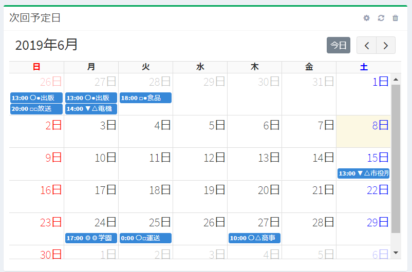  

### Ví dụ hiển thị danh sách
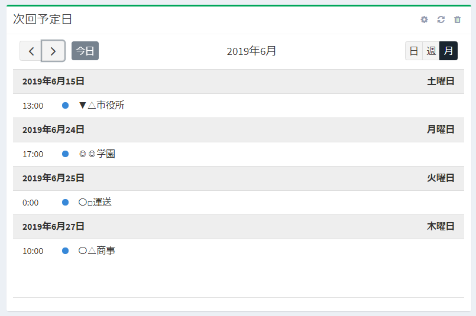  

### Các mục thiết lập của lịch

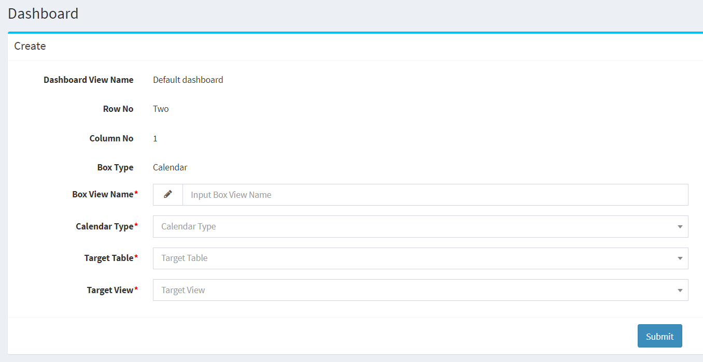  

#### Item display name (Tên hiển thị của item)
Nhập tên của item sẽ hiển thị trên màn hình.

#### Calendar type (Loại lịch)
"Monthly", "List"  
Chọn loại lịch muốn hiển thị trong 2 loại này.

#### Target table (Bảng đối tượng)
Chọn bảng cần hiển thị trong số các bảng đã tạo ở [thiết lập bảng tùy chỉnh](/vi/table).  
※ Chỉ những bảng đã thiết lập view lịch mới được hiển thị làm lựa chọn.

#### Target view (View đối tượng)
Chọn view cần hiển thị trong số các view lịch của bảng đối tượng đã chọn.  

## Nội dung thiết lập biểu đồ
Các mục trục X, trục Y thiết lập cho biểu đồ (chart) sẽ khác nhau tùy theo nội dung của view đối tượng.  

### Trường hợp view đối tượng là view toàn bộ dữ liệu hoặc view thông thường

#### X-axis item (Mục trục X)
Các lựa chọn của trục X gồm 2 loại sau. Hãy chọn một trong số đó.

- Mục "Data heading" (tiêu đề dữ liệu).  
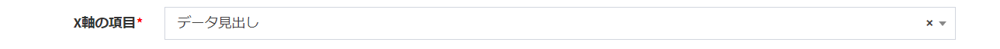  

Khi chọn mục này, [thiết lập cột hiển thị tiêu đề trong thiết lập bảng tùy chỉnh](/vi/table) sẽ được hiển thị trên trục X.  

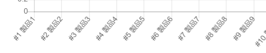  

- Các mục được hiển thị tại ["Display column selection" (chọn cột hiển thị) trong thiết lập view tùy chỉnh](/vi/view). Khi chọn, giá trị của cột đã chọn sẽ được hiển thị trên trục X.  
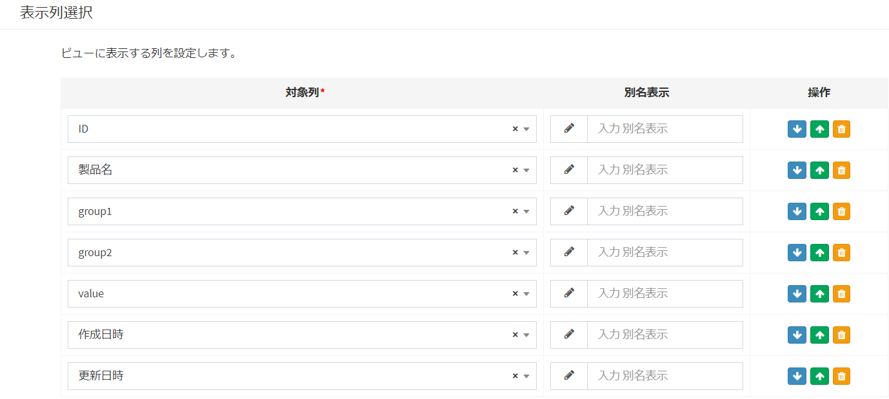  

#### Y-axis items (Mục trục Y)
Các lựa chọn của trục Y gồm 1 loại sau. Hãy chọn một trong số đó.

- Trong các mục được hiển thị tại ["Display column selection" (chọn cột hiển thị) trong thiết lập view tùy chỉnh](/vi/view), các cột thuộc những loại cột sau. Khi chọn, giá trị của cột đã chọn sẽ được hiển thị trên trục Y.
    - Integer (số nguyên)
    - Decimal (số thập phân)
    - Currency (tiền tệ)

### Trường hợp view đối tượng là view tổng hợp

#### X-axis item (Mục trục X)
Các lựa chọn của trục X gồm 1 loại sau.

- Mục "Data heading" (tiêu đề dữ liệu).  
  

Khi chọn mục này, giá trị đã thiết lập tại ["Group column selection" (chọn cột nhóm) trong thiết lập view tùy chỉnh](/vi/view) sẽ được hiển thị trên trục X.  
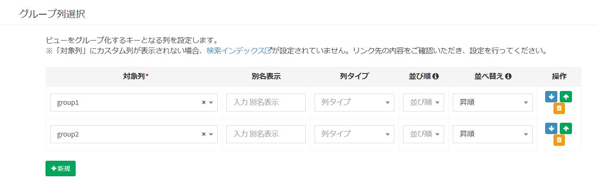  
  

#### Y-axis items (Mục trục Y)
Các lựa chọn của trục Y gồm 2 loại sau. Hãy chọn một trong số đó.

- Trong các mục được hiển thị tại ["Group column selection" (chọn cột nhóm) trong thiết lập view tùy chỉnh](/vi/view), các cột thuộc những loại cột sau. Khi chọn, giá trị của cột đã chọn sẽ được hiển thị trên trục Y.
    - Integer (số nguyên)
    - Decimal (số thập phân)
    - Currency (tiền tệ)

  

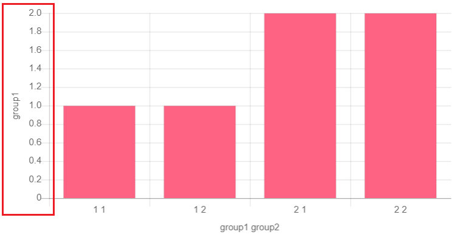  

- Các mục được hiển thị tại ["Calculation column selection" (chọn cột tổng hợp) trong thiết lập view tùy chỉnh](/vi/view). Khi chọn, giá trị của cột đã chọn sẽ được hiển thị trên trục Y.

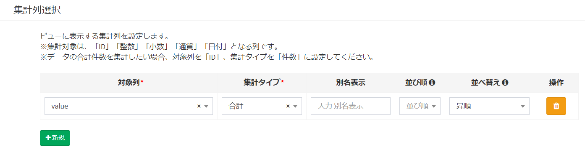  

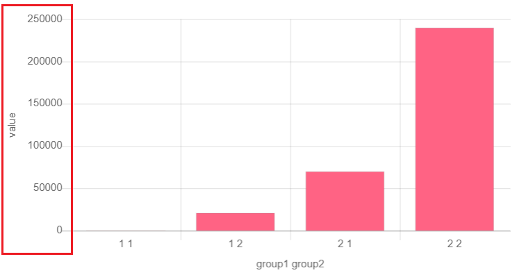  

## Chia sẻ dashboard
Chia sẻ dashboard đã tạo cho người dùng hoặc tổ chức khác.  
※ Chỉ "User Dashboard" mới là đối tượng chia sẻ. ("System Dashboard" ngay từ đầu đã được công khai cho tất cả người dùng.)  

#### Cách chia sẻ
- Nhấp vào nút "Share" (Chia sẻ) được hiển thị trên màn hình thay đổi thiết lập của dashboard.  
※ Nút này không hiển thị khi tạo mới.
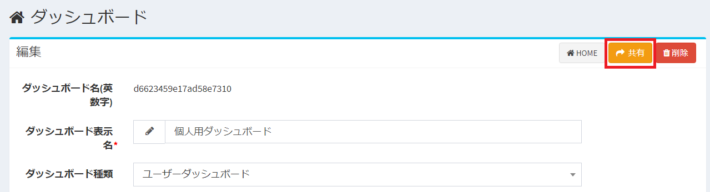  

- Hộp thoại chia sẻ dashboard sẽ được hiển thị.
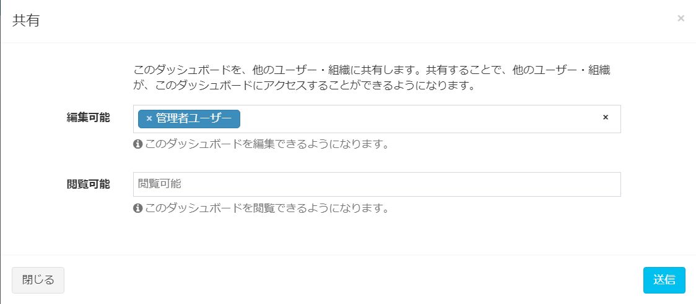  

- Thêm người dùng hoặc tổ chức muốn chia sẻ, sau đó nhấp vào "Send" để hoàn tất việc chia sẻ.  
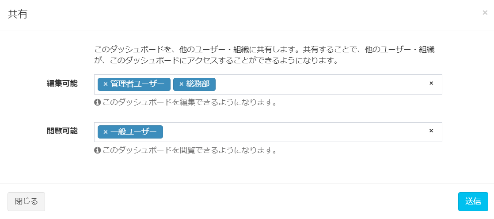  

# Thao tác trên dashboard

Trên dashboard, bạn có thể lọc biểu đồ, chuyển đổi loại biểu đồ và sắp xếp dữ liệu. Ngoại trừ việc thay đổi màu, các thao tác này không làm thay đổi thiết lập dashboard, thiết lập biểu đồ hay dữ liệu.

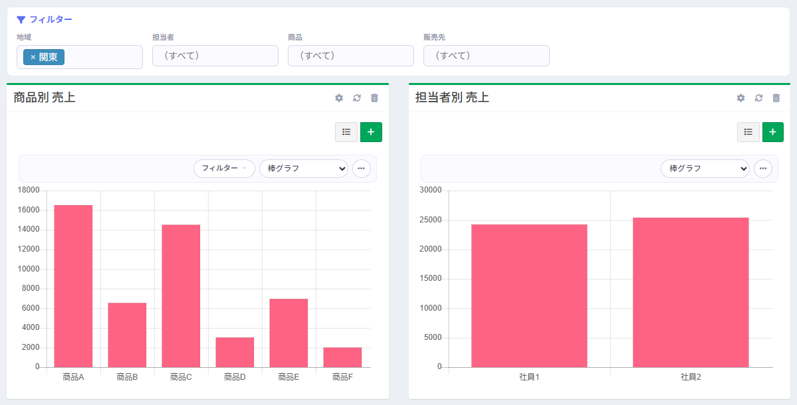

| Thao tác | Chức năng | Phạm vi |
|---|---|---|
| [Thanh bộ lọc](/vi/dashboard?id=lọc-bằng-thanh-bộ-lọc) | Lọc đồng thời các biểu đồ trên dashboard | Toàn bộ dashboard |
| [Nhấp vào biểu đồ](/vi/dashboard?id=lọc-bằng-cách-nhấp-vào-biểu-đồ) | Chọn giá trị đã nhấp trên thanh bộ lọc | Toàn bộ dashboard |
| [Bộ lọc biểu đồ](/vi/dashboard?id=lọc-bằng-bộ-lọc-biểu-đồ) | Chỉ lọc một biểu đồ | Từng biểu đồ |
| [Chuyển đổi loại biểu đồ](/vi/dashboard?id=chuyển-đổi-loại-biểu-đồ) | Hiển thị cùng dữ liệu bằng loại biểu đồ khác | Từng biểu đồ |
| [Menu "⋯"](/vi/dashboard?id=menu-⋯) | Sắp xếp, hiển thị nhãn giá trị, xuất (export) dữ liệu | Từng biểu đồ |
| [Thay đổi màu](/vi/dashboard?id=thay-đổi-màu-biểu-đồ) | Thay đổi màu của cột, hình quạt, v.v. | Từng biểu đồ |

## Lọc bằng thanh bộ lọc

Khi thực hiện [Thiết lập bộ lọc dashboard](/vi/dashboard?id=thiết-lập-bộ-lọc-dashboard), thanh bộ lọc sẽ được hiển thị ở phía trên dashboard.

Khi chọn giá trị trên thanh bộ lọc, cùng một điều kiện sẽ được áp dụng cho tất cả các biểu đồ là đối tượng của bộ lọc đó.

※ Thanh bộ lọc không hiển thị với người dùng không có quyền xem bảng nguồn của bộ lọc.

#### Chọn giá trị

Nhấp vào mục bộ lọc rồi chọn giá trị từ danh sách. Có thể chọn nhiều giá trị.

Khi đã chọn giá trị ở bộ lọc khác, danh sách chỉ hiển thị những giá trị có dữ liệu phù hợp với điều kiện đó. Ví dụ, khi chọn "Kanto" ở "Khu vực", mục "Người phụ trách" chỉ hiển thị những người phụ trách của khu vực Kanto.

Với cột ngày và cột ngày giờ, hãy chỉ định theo khoảng "từ" - "đến" thay vì chọn từ danh sách. Cột số cũng được chỉ định theo khoảng nếu có quá nhiều lựa chọn.

> Nếu có quá nhiều lựa chọn nên không thể hiển thị, hãy chọn giá trị ở bộ lọc khác trước để thu hẹp phạm vi.

#### Bỏ lọc

Khi nhấp vào "Reset", bộ lọc sẽ trở về trạng thái [giá trị mặc định](/vi/dashboard?id=filter-items-mục-bộ-lọc).

Nếu chưa thiết lập giá trị mặc định, tất cả điều kiện lọc sẽ được bỏ.

#### Biểu đồ không thuộc đối tượng lọc

Biểu đồ không chịu ảnh hưởng của thanh bộ lọc sẽ hiển thị "Not affected by filters", còn biểu đồ có một số mục bộ lọc không được áp dụng sẽ hiển thị "Filters not applied here".

Nhờ đó, bạn có thể kiểm tra các bộ lọc đã chọn được phản ánh như thế nào vào dữ liệu đang hiển thị.

> Điều kiện lọc được lưu giữ trong URL. Bạn có thể quay lại điều kiện trước đó bằng nút "Quay lại" / "Tiến" của trình duyệt. Ngoài ra, khi chia sẻ URL, người dùng khác có thể xem dashboard với cùng điều kiện.

> Điều kiện được chọn sau cùng sẽ được ghi nhớ theo từng người dùng, và lần mở dashboard tiếp theo cũng sẽ hiển thị với cùng điều kiện đó.

## Lọc bằng cách nhấp vào biểu đồ

Khi nhấp vào cột, hình quạt, v.v. của biểu đồ, giá trị đó sẽ được chọn trên thanh bộ lọc và các biểu đồ khác sẽ được lọc theo.

Biểu đồ được nhấp vẫn hiển thị tất cả các giá trị, trong đó giá trị đã chọn được hiển thị đậm, các giá trị còn lại được hiển thị nhạt.

| Thao tác | Kết quả |
|---|---|
| Nhấp vào giá trị | Chỉ chọn giá trị đó. |
| Nhấp lại vào giá trị đang chọn (khi chỉ đang chọn giá trị đó) | Bỏ chọn. |
| Nhấn giữ Ctrl (⌘ trên Mac) và nhấp | Chọn thêm giá trị. Nếu nhấp vào giá trị đã chọn, chỉ giá trị đó bị loại khỏi lựa chọn. |

※ Có thể sử dụng khi cột của trục hoành trên biểu đồ nằm trong các mục của thanh bộ lọc.  
※ Có thể sử dụng với biểu đồ của view tổng hợp. Không thể sử dụng khi cột của trục hoành là mục chỉ định theo khoảng "từ" - "đến" (cột ngày, v.v.) hoặc là cột chọn nhiều giá trị.  
※ Không thể sử dụng với biểu đồ radar, biểu đồ đồng hồ đo, treemap, sunburst và biểu đồ hộp.  
※ Khi chọn giá trị trên thanh bộ lọc, biểu đồ có trục hoành tương ứng với mục bộ lọc đó sẽ không bị lọc mà giá trị đã chọn sẽ được làm nổi bật.

## Lọc bằng bộ lọc biểu đồ

Bộ lọc biểu đồ chỉ được áp dụng cho chính biểu đồ đó, không ảnh hưởng đến các biểu đồ khác.

Khi thiết lập [Chart filter fields](/vi/dashboard?id=chart-filter-fields-mục-bộ-lọc-biểu-đồ) (mục bộ lọc biểu đồ) cho biểu đồ, nút "Filter" sẽ được hiển thị ở góc trên bên phải biểu đồ.

Nhấp vào "Filter" rồi chọn giá trị muốn hiển thị.

Trên nút sẽ hiển thị số mục đang được lọc. Khi nhấp vào "Reset", điều kiện của bộ lọc biểu đồ sẽ được bỏ.

Nếu có hơn 8 lựa chọn, ô tìm kiếm sẽ được hiển thị phía trên danh sách để bạn tìm giá trị mong muốn.

Với cột ngày và cột ngày giờ, hãy chỉ định theo khoảng "từ" - "đến" thay vì chọn từ danh sách. Cột số cũng được chỉ định theo khoảng nếu có quá nhiều lựa chọn.

※ Có thể dùng bộ lọc biểu đồ kết hợp với thanh bộ lọc. Khi đó, dữ liệu sẽ được lọc theo cả hai điều kiện.  
※ Lựa chọn của bộ lọc biểu đồ sẽ bị bỏ khi tải lại trang (F5).

## Chuyển đổi loại biểu đồ

Từ ô chọn loại biểu đồ ở góc trên bên phải biểu đồ, bạn có thể hiển thị cùng dữ liệu bằng loại biểu đồ khác.

Loại biểu đồ đã chọn sẽ được ghi nhớ theo từng người dùng, và lần mở dashboard tiếp theo cũng sẽ hiển thị bằng loại đó.

Khi chọn lại loại biểu đồ ban đầu, việc chuyển đổi sẽ được hủy và biểu đồ trở về loại ban đầu.

※ Chỉ có thể chuyển đổi giữa các biểu đồ một chuỗi dữ liệu với nhau, và giữa các biểu đồ nhiều chuỗi dữ liệu với nhau. Ví dụ, có thể chuyển biểu đồ cột sang biểu đồ vành khuyên hoặc biểu đồ phân tán, nhưng không thể chuyển sang biểu đồ cột chồng (nhiều chuỗi dữ liệu).

## Menu "⋯"

Khi nhấp vào "⋯" ở góc trên bên phải biểu đồ, menu sẽ được hiển thị.

| Menu | Nội dung |
|---|---|
| Sort by (Sắp xếp) | Sắp xếp tăng dần / giảm dần theo mục của trục hoành hoặc theo giá trị. |
| Data labels (Nhãn giá trị) | Hiển thị giá trị trên cột, điểm, v.v. Chỉ hiển thị với biểu đồ cột, biểu đồ đường, biểu đồ tròn, biểu đồ thanh ngang, biểu đồ vùng, biểu đồ phân tán, biểu đồ cột nhóm, biểu đồ cột chồng, biểu đồ nhiều đường và biểu đồ vùng chồng. |
| Export data (Xuất dữ liệu) | Tải xuống dữ liệu đang hiển thị dưới dạng tệp CSV. |
| Reset colors (Đặt lại màu) | Đưa màu đã thay đổi về như ban đầu. Chỉ hiển thị với người dùng có thể thay đổi màu và khi màu đã được thay đổi. |
| Reset (Đặt lại) | Đưa thiết lập sắp xếp và nhãn giá trị về thiết lập ban đầu. |

※ Thiết lập sắp xếp và nhãn giá trị được ghi nhớ theo từng người dùng.  
※ Với biểu đồ không có mục menu nào có thể hiển thị, "⋯" sẽ không được hiển thị.

## Thay đổi màu biểu đồ

Người dùng có quyền chỉnh sửa dashboard có thể nhấp chuột phải vào cột, hình quạt, v.v. của biểu đồ để thay đổi màu.

Chọn từ "Theme colors" (màu chủ đề), "Standard colors" (màu chuẩn), hoặc chỉ định màu tùy ý bằng "More colors...". Khi chọn "Automatic" (tự động), màu sẽ trở về như ban đầu.

Với biểu đồ cột, biểu đồ tròn, v.v., có thể thay đổi màu cho từng cột, từng hình quạt. Với các biểu đồ vẽ bằng một màu như biểu đồ đường, biểu đồ vùng và với biểu đồ nhiều chuỗi dữ liệu, có thể thay đổi màu cho từng chuỗi dữ liệu.

Khi chọn "More colors...", bảng màu cho phép chỉ định màu tùy ý sẽ được mở ra.

Nhấp vào bảng màu hoặc nhập giá trị RGB. Có thể chuyển sang nhập HSL / HEX bằng ↕. Khi nhấp vào "OK", màu sẽ được áp dụng.

※ Màu đã thay đổi được lưu vào thiết lập của biểu đồ và hiển thị giống nhau với tất cả người dùng.  
※ Người dùng chỉ có quyền xem không thể thay đổi màu.  
※ Biểu đồ nhiệt và biểu đồ hộp không hỗ trợ thay đổi màu.
