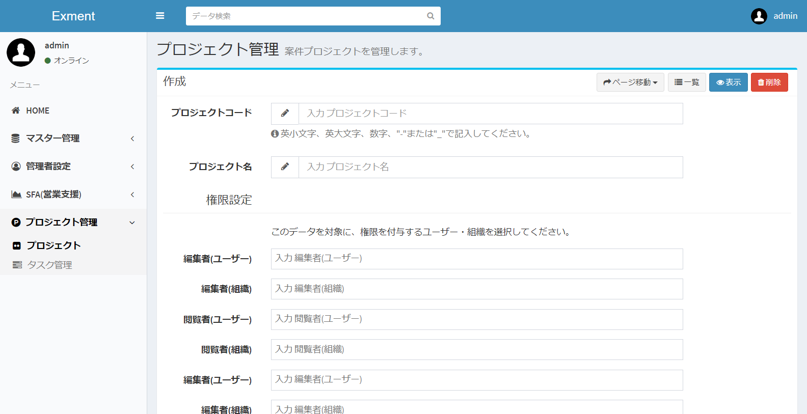
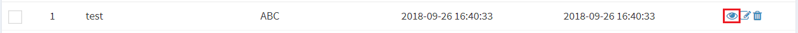

# Dữ liệu
Trang này giải thích các màn hình dùng để xem danh sách, thêm mới, chỉnh sửa, hiển thị và xóa dữ liệu trong bảng.  
Bảng do quản trị viên hệ thống tạo. Người dùng nhập giá trị vào bảng đó và lưu.

| Việc muốn làm | Nơi xem |
|---|---|
| Xem dữ liệu dạng danh sách | [Danh sách dữ liệu](/vi/data?id=danh-sách-dữ-liệu) |
| Thêm dữ liệu | [Thêm mới dữ liệu](/vi/data?id=thêm-mới-dữ-liệu) |
| Sửa dữ liệu | [Chỉnh sửa dữ liệu](/vi/data?id=chỉnh-sửa-dữ-liệu) |
| Xem nội dung của dữ liệu | [Hiển thị dữ liệu](/vi/data?id=hiển-thị-dữ-liệu) |
| Xóa dữ liệu | [Xóa dữ liệu](/vi/data?id=xóa-dữ-liệu) |
| Tạo dữ liệu bằng cách sao chép | [Sao chép dữ liệu](/vi/data?id=sao-chép-dữ-liệu) |

## Danh sách dữ liệu
Đây là danh sách dữ liệu được lưu trong bảng đó.  
Danh sách hiển thị những dữ liệu do chính bạn tạo và những dữ liệu mà bạn được gán quyền.

※Khi đăng ký cho người dùng hoặc tổ chức "quyền chỉnh sửa / xem tất cả dữ liệu", tất cả dữ liệu sẽ hiển thị, bất kể điều kiện nêu trên.  
  
  
Về chi tiết của màn hình danh sách, vui lòng xem [Danh sách dữ liệu](/vi/data_grid).  

## Thêm mới dữ liệu
1. Nhấp vào liên kết [Mới] ở phía trên bên phải của trang.  

※Nếu người dùng đăng nhập không có quyền "Chỉnh sửa" đối với bảng đó, nút này sẽ không hiển thị.  
Về cách gán quyền, vui lòng xem [Nhóm vai trò / Thiết lập quyền](/vi/role_group) ở menu bên trái.  

2. Màn hình tạo mới dữ liệu hiển thị.  

  
Về chi tiết của màn hình thêm mới, vui lòng xem [Form dữ liệu](/vi/data_form).  

### Kiểm tra nội dung trước khi lưu (xem trước)
Khi nhấp vào nút [Xem trước] ở phía trên bên phải của màn hình tạo mới, bạn có thể kiểm tra nội dung đang nhập trong một cửa sổ khác mà không lưu.  
Nội dung được hiển thị dưới dạng danh sách tên mục và giá trị, theo từng khối (block) của form.

- Nút [Xem trước] chỉ hiển thị trên màn hình tạo mới dữ liệu. Không hiển thị trên màn hình chỉnh sửa.  
- Dữ liệu không được lưu khi xem trước. Để cập nhật nội dung hiển thị sau khi thay đổi nội dung nhập, hãy nhấp lại vào nút [Xem trước] trên màn hình ban đầu.  
- Các khối của bảng con không hiển thị trong bản xem trước.

## Chỉnh sửa dữ liệu
1. Nhấp vào liên kết [Chỉnh sửa] ở dòng muốn chỉnh sửa.  

※Nếu người dùng đăng nhập không có quyền "Chỉnh sửa" đối với bảng đó, liên kết này sẽ không hiển thị.  
Về cách gán quyền, vui lòng xem [Nhóm vai trò / Thiết lập quyền](/vi/role_group) ở menu bên trái.  

2. Màn hình chỉnh sửa dữ liệu hiển thị.  

  
Về chi tiết của màn hình chỉnh sửa, vui lòng xem [Form dữ liệu](/vi/data_form).  

> Khi cập nhật dữ liệu, nếu một người dùng khác đã cập nhật cùng dữ liệu đó trước, thông báo lỗi dưới đây sẽ hiển thị.

## Hiển thị dữ liệu
1. Nhấp vào liên kết [Xem] ở dòng muốn hiển thị.  

2. Màn hình hiển thị dữ liệu xuất hiện.  

  
Về chi tiết của màn hình hiển thị, vui lòng xem [Chi tiết dữ liệu](/vi/data_details).  

## Xóa dữ liệu
- Nhấp vào liên kết [Xóa] ở dòng muốn xóa.  

## Sao chép dữ liệu
※Để hiển thị liên kết [Sao chép], cần thay đổi giá trị thiết lập. Vui lòng xem [Hiển thị liên kết sao chép của dữ liệu tùy chỉnh](/vi/config).  

1. Nhấp vào liên kết [Sao chép] ở dòng muốn sao chép.  

2. Màn hình chỉnh sửa hiển thị, với nội dung của dữ liệu đã chọn được điền sẵn.  

3. Sửa những chỗ cần thiết rồi lưu.  

Những gì được và không được sao chép:

- Chỉ những mục có trên form mới được sao chép.  
- Số tự động (đánh số tự động), tệp, hình ảnh, v.v. không được sao chép.  
