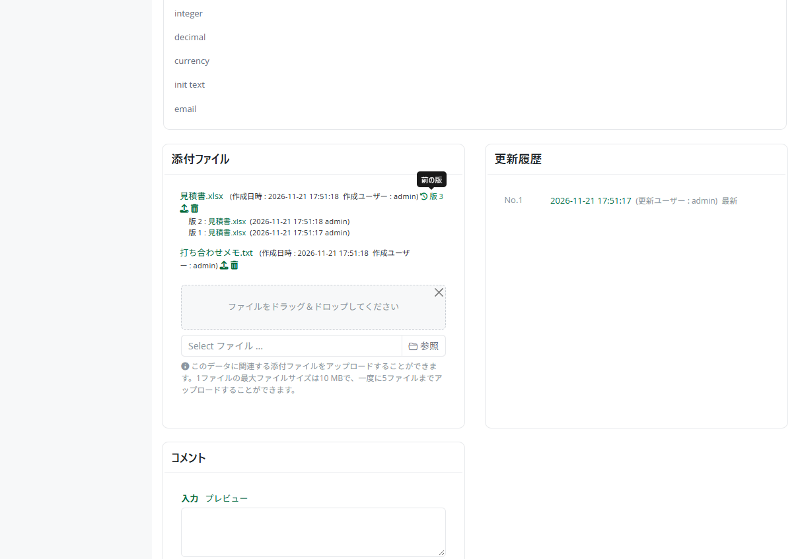
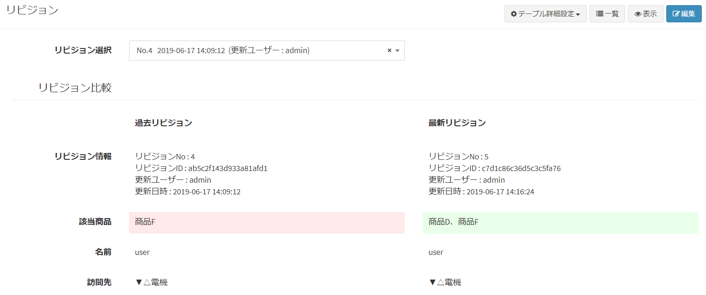

# Chi tiết dữ liệu
Khi nhấp vào dữ liệu cần xem trong [Danh sách dữ liệu](/vi/data_grid.md), chi tiết dữ liệu sẽ được hiển thị.  
Danh sách dữ liệu hiển thị các nội dung được chỉ định tại phần [chọn cột hiển thị](/vi/view) trong thiết lập view.  
Chi tiết dữ liệu hiển thị các mục của form phù hợp, theo thứ tự ưu tiên được thiết lập tại [thiết lập thứ tự ưu tiên của form](/vi/form).  

Ngoài ra, màn hình chi tiết dữ liệu hiển thị 4 loại thông tin sau đây.  

- Chi tiết nội dung  
- Tệp đính kèm  
- Bình luận  
- Lịch sử cập nhật  

## Chi tiết nội dung

- Hiển thị chi tiết các nội dung đã được đăng ký làm dữ liệu.

## Quay lại danh sách
Trên màn hình chi tiết và chỉnh sửa dữ liệu, nút [← Back to the list] được hiển thị ở bên phải dòng tiêu đề (tên bảng). Nhấp vào nút này để quay lại danh sách dữ liệu của bảng (cùng đích đến với nút [List] ở góc trên bên phải).

※ Có thể sử dụng từ v7.1.0.

## Tệp đính kèm
  

- Nhấp vào nút [Browse] rồi chọn tệp muốn đính kèm.  
- Nhấp vào nút [Upload].  

Với các bước trên, bạn có thể đính kèm tệp vào màn hình chi tiết dữ liệu.  

- Có thể xóa tệp đã đính kèm bằng nút [Delete].

#### Thay thế và phiên bản cũ (từ v7.2.0)
- Nhấn [Replace] (thay thế, mũi tên hướng lên) trên dòng của tệp đính kèm và chọn tệp để thay. Tệp hiện tại được giữ lại làm phiên bản cũ, và hiện "Replaced. Press "Version n" to see the earlier files." (đã thay thế; nhấn "Version n" để xem các tệp trước). Danh sách vẫn là mỗi tệp đính kèm một dòng.
- Tệp đính kèm đã từng được thay thế sẽ hiện "Version n" (phiên bản n). Nhấn vào để mở "Older versions" (phiên bản cũ) và tải các phiên bản cũ.
- Người thêm được tệp đính kèm thì thay thế được (có quyền sửa dữ liệu, và bảng dùng tệp đính kèm). Ở trang đặt [EXMENT_FILE_DELETE_USERONLY (English)](/config) là `true` trong `.env`, chỉ người đã tải tệp đó lên mới thay thế được.
- Mỗi tệp đính kèm giữ tối đa 10 phiên bản cũ. Quá số đó, phiên bản cũ nhất bị xóa cùng tệp. Đổi số này bằng `EXMENT_DOCUMENT_VERSION_LIMIT` trong `.env` (0 = không giữ). Khi người không có quyền xóa tệp đính kèm thay thế tệp, các phiên bản cũ không bị xóa dù vượt quá số này.
- Xóa tệp đính kèm thì các phiên bản cũ cũng bị xóa.
- Khi thay thế, thông báo được gửi giống như khi thêm tệp đính kèm.

## Bình luận
  

- Sau khi nhập bình luận, nhấp vào nút [Send] để bình luận về dữ liệu.
- Ngày giờ bình luận và tên người dùng được ghi tự động.
- Có thể xóa bình luận đã gửi bằng nút [Delete].  

※ Chỉ có thể xóa những bình luận do chính người dùng đang đăng nhập gửi.  
Trong ví dụ ở hình trên, do đang đăng nhập với tư cách user nên nút [Delete] của bình luận do admin gửi không được hiển thị.

#### Markdown và hình ảnh (từ v7.1.0)
Có thể viết bình luận bằng Markdown: tiêu đề, danh sách, chữ đậm, mã, liên kết, bảng (GitHub Flavored Markdown). Xuống dòng được hiển thị nguyên như vậy.

- Dùng [Write] và [Preview] của ô bình luận để kiểm tra trước khi gửi.
- Dán hoặc kéo thả hình ảnh (PNG, JPEG, GIF, WebP) vào ô bình luận: hình ảnh được tải lên làm tệp đính kèm của dữ liệu và được chèn vào bình luận dưới dạng ``. Kích thước tối đa mặc định là 10 MB.
- Hình ảnh viết dạng `)` trong nội dung (cột tùy chỉnh "Editor") cũng được hiển thị thành hình ảnh trên màn hình chi tiết dữ liệu.

※ **Các bình luận viết trước khi cập nhật lên v7.1.0 vẫn được hiển thị như cũ** (không đọc dưới dạng Markdown).  
※ HTML viết trong bình luận được hiển thị dưới dạng văn bản. Hình ảnh chỉ hiển thị cho người dùng đã đăng nhập và có thể xem dữ liệu chứa tệp đó. Hình SVG và hình của trang khác được hiển thị dưới dạng liên kết.  
※ Cũng có thể lấy danh sách, thêm và xóa bình luận bằng API. Xem [API reference](https://exment.net/reference/en/webapi.html).

#### Nhắc tên (thông báo cho thành viên bằng @)
Trong bình luận, bạn có thể chỉ định người dùng cụ thể để gửi thông báo cho họ.

- Khi nhập "@" (cũng có thể dùng ký tự toàn chiều rộng "＠") vào ô nhập bình luận, danh sách gợi ý người dùng sẽ được hiển thị.  
Nhập tiếp các ký tự để thu hẹp danh sách gợi ý. Khi nhấp vào một gợi ý (hoặc chọn bằng phím ↑↓ rồi nhấn phím Enter), "@mã người dùng" sẽ được nhập vào.  
- Khi gửi bình luận, người dùng được chỉ định sẽ nhận được thông báo trong hệ thống (biểu tượng thông báo ở góc trên bên phải của trang) với nội dung "You were mentioned in a comment: (tiêu đề của dữ liệu)" (bạn đã được nhắc tên trong một bình luận). Phần nội dung của thông báo hiển thị nội dung bình luận.

※ Danh sách gợi ý được hiển thị khi nhập "@" ở đầu dòng hoặc ngay sau khoảng trắng.  
※ Danh sách gợi ý chỉ gồm những người dùng đã được đăng ký mã người dùng (user code). Mỗi lần hiển thị tối đa 20 gợi ý (theo giá trị thiết lập `EXMENT_API_DEFAULT_DATA_COUNT`).  
※ Thông báo chỉ được gửi đến những người dùng có quyền xem dữ liệu đó. Ngoài ra, nếu chỉ định chính mình thì thông báo sẽ không được gửi.

## Lịch sử cập nhật

  

- Lịch sử cập nhật chỉ được hiển thị khi mục [sử dụng lịch sử thay đổi dữ liệu](/vi/table) trong thiết lập bảng được đặt là YES.
- Khi chỉnh sửa nội dung dữ liệu, ngày giờ chỉnh sửa và tên người dùng được ghi tự động.
- Khi nhấp vào ngày giờ hiển thị trong lịch sử cập nhật, màn hình sẽ chuyển sang màn hình phiên bản (revision).

#### Phiên bản (revision)
  
- Tại "Revision selection" (chọn phiên bản), chọn dữ liệu muốn so sánh trong số các dữ liệu có trong lịch sử.
- "Dữ liệu lịch sử đã chọn" được hiển thị ở bên trái và "dữ liệu mới nhất" ở bên phải; những mục có khác biệt về dữ liệu đã đăng ký sẽ được tô màu nền.
- Khi nhấp vào nút [Restore This Revision] (khôi phục phiên bản này) ở cuối trang, dữ liệu sẽ được khôi phục theo nội dung của dữ liệu đang chọn.

  

## Chia sẻ dữ liệu

> Về thiết lập chia sẻ dữ liệu, trước tiên vui lòng xem trang [Tổng quan về vai trò và quyền trong Exment](/permission).

Chia sẻ dữ liệu đã lưu cho người dùng hoặc tổ chức khác.  
※ Chỉ có thể thực hiện khi có quyền "Data sharing" (chia sẻ dữ liệu) trong [thiết lập nhóm vai trò](/vi/role_group).

#### Cách chia sẻ
- Trên màn hình chi tiết dữ liệu có hiển thị nút [Share]; hãy nhấp vào nút này.
  

- Hộp thoại chia sẻ dữ liệu được hiển thị.
  

- Thêm những người dùng muốn chia sẻ rồi nhấp vào [Submit] để hoàn tất việc chia sẻ.  
  

※ Quản trị viên hệ thống có thể thiết lập thông báo theo "tạo mới / cập nhật / chia sẻ / bình luận dữ liệu" tại [thiết lập thông báo](/notify) để gửi thông báo đến những người dùng được chia sẻ.
