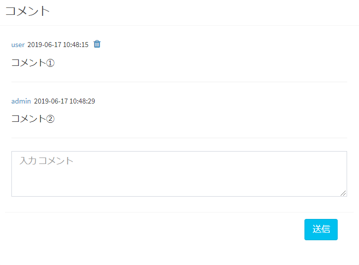
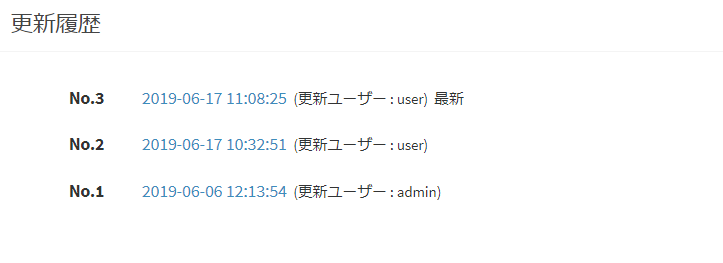

# Chi tiết dữ liệu
Trang này giải thích màn hình xem nội dung của 1 dữ liệu. Màn hình này mở ra khi nhấp vào dữ liệu muốn xem trong [Danh sách dữ liệu](/vi/data_grid).  

- Danh sách dữ liệu hiển thị nội dung đã chỉ định ở [Chọn cột hiển thị](/vi/view?id=display-column-selection-chọn-cột-hiển-thị) của thiết lập view.  
- Chi tiết dữ liệu hiển thị các mục của form phù hợp, theo thứ tự ưu tiên của [thiết lập thứ tự ưu tiên form](/vi/form?id=thiết-lập-thứ-tự-ưu-tiên-form).  

Màn hình chi tiết dữ liệu hiển thị 4 loại thông tin sau.  

- Chi tiết nội dung  
- Tệp đính kèm  
- Bình luận  
- Lịch sử cập nhật  

## Chi tiết nội dung

- Hiển thị chi tiết nội dung đã đăng ký làm dữ liệu.

## Quay lại danh sách
Trên màn hình chi tiết và màn hình chỉnh sửa dữ liệu, nút [← Quay lại danh sách] hiển thị ở bên phải dòng tiêu đề (tên bảng). Khi nhấp vào, bạn quay lại danh sách dữ liệu của bảng đó (cùng đích đến với nút [Danh sách] ở phía trên bên phải).

※Dùng được từ v7.1.0. Màu của nút là xanh dương với thiết kế "Cổ điển", và là màu nhấn của [Giao diện màu của trang](/vi/system_setting?id=site-skin-giao-diện-màu-của-trang) với thiết kế "Hiện đại".

## Tệp đính kèm
  

Có thể đính kèm tệp ở màn hình chi tiết dữ liệu.  

1. Nhấp vào nút [Browse] rồi chọn tệp muốn đính kèm.  
2. Nhấp vào nút [Upload].  

Tệp đã đính kèm có thể xóa bằng nút [Xóa].

#### Thay thế và phiên bản cũ (từ v7.2.0)
Khi bấm [Thay thế] bên cạnh tệp đã đính kèm rồi chọn tệp, tệp được thay bằng tệp mới.  
Tệp trước được giữ lại làm "phiên bản cũ". Khi bấm vào chữ như "Phiên bản 2" hiển thị bên cạnh tệp đã thay thế, danh sách các phiên bản cũ hiện ra và có thể mở từ đó.  

- Mỗi tệp đính kèm giữ được tối đa 10 phiên bản cũ. Phần vượt quá sẽ bị xóa, từ cái cũ nhất. Số này đổi được bằng `EXMENT_DOCUMENT_VERSION_LIMIT` trong `.env`.  
- Khi xóa tệp đính kèm, các phiên bản cũ của nó cũng bị xóa cùng.  

## Bình luận
  

- Nhập bình luận rồi nhấp vào nút [Gửi] để thêm bình luận vào dữ liệu.
- Ngày giờ bình luận và tên người dùng được ghi tự động.
- Bình luận có thể xóa bằng nút [Xóa].  

※Chỉ xóa được bình luận của chính người dùng đang đăng nhập.  
Trong ví dụ ở hình, do đang đăng nhập với tư cách user nên nút [Xóa] không hiển thị ở bình luận của admin.

#### Markdown và hình ảnh (từ v7.1.0)
Có thể viết bình luận bằng Markdown. Dùng được tiêu đề, danh sách, chữ đậm, mã, liên kết và bảng (GitHub Flavored Markdown). Xuống dòng được hiển thị nguyên là xuống dòng.

- Dùng [Soạn] và [Xem trước] của ô nhập bình luận để kiểm tra hiển thị trước khi gửi.
- Khi dán hoặc kéo thả hình ảnh (PNG, JPEG, GIF, WebP) vào ô nhập, hình ảnh được tải lên làm tệp đính kèm của dữ liệu và được chèn vào bình luận dưới dạng ``. Kích thước tối đa có giá trị ban đầu là 10MB (đổi được ở [giá trị thiết lập](/vi/config)).
- Hình ảnh viết dạng `)` trong nội dung (cột tùy chỉnh "Editor") cũng được hiển thị thành hình ảnh trên màn hình chi tiết dữ liệu (trên danh sách vẫn là chữ như trước). Viết nguyên url được trả về từ "tạo document (tệp đính kèm)" của API cũng hiển thị được.

※**Các bình luận viết trước khi cập nhật lên v7.1.0 vẫn được hiển thị là chữ như trước** (không đọc dưới dạng Markdown). Từ các bình luận viết sau khi cập nhật mới được hiển thị dưới dạng Markdown.  
※HTML viết trong bình luận không được xuất ra dưới dạng HTML mà hiển thị dưới dạng chữ. Liên kết đến trang ngoài được mở trong tab mới.  
※Hình ảnh chỉ hiển thị với người dùng đã đăng nhập và xem được dữ liệu có đính kèm tệp đó. Hình SVG và hình của trang khác không hiển thị thành hình ảnh trong bình luận mà hiển thị dưới dạng liên kết.  
※Cũng có thể lấy danh sách, thêm và xóa bình luận bằng API. Chi tiết vui lòng xem [API reference](https://exment.net/reference/ja/webapi.html).

#### Nhắc tên (thông báo cho thành viên bằng @)
Trong bình luận, bạn có thể chỉ định người dùng để gửi thông báo cho người đó.

- Khi nhập "@" (cũng dùng được ký tự toàn chiều rộng "＠") vào ô nhập bình luận, danh sách gợi ý người dùng sẽ hiển thị.  
Nhập tiếp các ký tự để thu hẹp danh sách gợi ý. Khi nhấp vào một gợi ý (hoặc chọn bằng phím ↑↓ rồi nhấn phím Enter), "@mã người dùng" sẽ được nhập vào.  
- Khi gửi bình luận, người dùng được chỉ định nhận được thông báo trong hệ thống (biểu tượng thông báo ở phía trên bên phải của trang) với nội dung "Bạn đã được nhắc đến trong một bình luận: (tiêu đề của dữ liệu)". Phần nội dung của thông báo hiển thị nội dung bình luận.

※Danh sách gợi ý hiển thị khi nhập "@" ở đầu dòng hoặc ngay sau khoảng trắng.  
※Danh sách gợi ý gồm những người dùng đã đăng ký mã người dùng. Mỗi lần hiển thị tối đa 20 gợi ý (theo giá trị thiết lập `EXMENT_API_DEFAULT_DATA_COUNT`).  
※Thông báo chỉ được gửi đến người dùng có quyền xem dữ liệu đó. Ngoài ra, chỉ định chính mình thì thông báo không được gửi.

## Lịch sử cập nhật

  

- Lịch sử cập nhật hiển thị khi [Sử dụng lịch sử thay đổi dữ liệu](/vi/table?id=use-data-change-history-sử-dụng-lịch-sử-thay-đổi-dữ-liệu) trong thiết lập bảng là YES.
- Khi chỉnh sửa dữ liệu, ngày giờ chỉnh sửa và tên người dùng được ghi tự động.
- Khi nhấp vào ngày giờ của lịch sử cập nhật, màn hình chuyển sang màn hình phiên bản (revision).

#### Phiên bản (revision)
  
- Ở "Chọn phiên bản sửa đổi", chọn dữ liệu muốn so sánh trong lịch sử.
- Bên trái hiển thị "dữ liệu lịch sử đã chọn", bên phải hiển thị "dữ liệu mới nhất". Các mục có nội dung khác nhau được tô màu nền.
- Khi nhấp vào nút [Khôi phục phiên bản sửa đổi này] ở phía dưới trang, dữ liệu quay về nội dung của lịch sử đã chọn.

  

## Chia sẻ dữ liệu

> Về thiết lập chia sẻ dữ liệu, trước tiên vui lòng xem trang [Tổng quan về vai trò và quyền trong Exment](/vi/permission).

Chia sẻ dữ liệu đã lưu với người dùng hoặc tổ chức khác.  
※Chỉ dùng được khi có quyền "Chia sẻ dữ liệu" ở [thiết lập nhóm vai trò](/vi/role_group).

#### Cách chia sẻ
1. Nhấp vào nút [Chia sẻ] trên màn hình chi tiết dữ liệu.
  

2. Hộp thoại chia sẻ dữ liệu hiển thị.
  

3. Thêm người dùng muốn chia sẻ rồi nhấp vào [Gửi]. Việc chia sẻ hoàn tất.  
  

※Nếu quản trị viên hệ thống thiết lập thông báo "Tạo mới/cập nhật/chia sẻ/bình luận dữ liệu" ở [thiết lập thông báo](/vi/notify), có thể gửi thông báo đến người dùng được chia sẻ.
