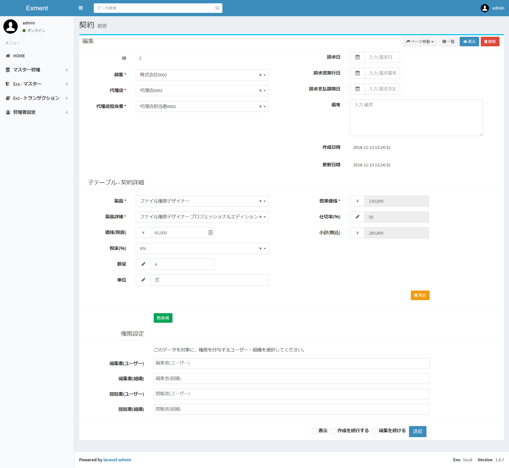

# Đăng ký dữ liệu
Trang này giải thích màn hình form dùng khi tạo dữ liệu mới và khi chỉnh sửa dữ liệu.

- Các mục hiển thị trên form được quyết định bởi [cài đặt cột tùy chỉnh](/vi/column), form tùy chỉnh và thiết lập [bảng liên quan](/vi/relation).  
- Nếu hiển thị không như mong muốn, hãy sửa thiết lập ở các trang trên.  

## Danh sách chức năng
  

##### Nút [Move to page]  
Chuyển sang màn hình thay đổi thiết lập của bảng tùy chỉnh đang hiển thị.

##### Nút [List]  
Chuyển sang màn hình danh sách dữ liệu.  
※Từ v7.1.0 trở đi, cũng có thể quay lại bằng nút [← Quay lại danh sách] ở bên phải dòng tiêu đề. Chi tiết vui lòng xem [Quay lại danh sách](/vi/data_details?id=quay-lại-danh-sách).

##### Nút [Display]  
Chuyển sang màn hình xem dữ liệu.

##### Nút [Delete]
Xóa dữ liệu đang hiển thị.  
※Dữ liệu đã xóa có thể khôi phục từ [Dữ liệu đã xóa](/vi/deleted_data).

##### Các mục của form  
Thay đổi giá trị của dữ liệu.  
Các mục hiển thị được quyết định bởi [cài đặt cột tùy chỉnh](/vi/column), form tùy chỉnh và thiết lập [bảng liên quan](/vi/relation).  
Nếu hiển thị không như mong muốn, hãy sửa thiết lập ở các trang trên.  

##### Bảng con  
Nếu đã thiết lập 1:n hoặc n:n ở [bảng liên quan](/vi/relation), bạn cũng có thể thêm và thay đổi cùng lúc dữ liệu của bảng được thiết lập làm bảng liên quan. Chi tiết vui lòng xem "Bảng con" ở dưới.

## Chi tiết chức năng  

### Bảng con
Nếu đã thiết lập 1:n hoặc n:n ở [bảng liên quan](/vi/relation), bạn cũng có thể thêm và thay đổi cùng lúc dữ liệu của bảng được thiết lập làm bảng liên quan.  
Ví dụ: khi bảng đang hiển thị là "Hợp đồng" và bảng con là "Chi tiết hợp đồng", bạn có thể đăng ký ngày thanh toán, thông tin khách hàng, đồng thời thêm và thay đổi dữ liệu chi tiết của hợp đồng đó.  
  
  
※Có 2 cách hiển thị dữ liệu của bảng con: "dạng form thông thường" và "dạng bảng".  
Dạng hiển thị được đổi trên màn hình form tùy chỉnh.  
  
##### Nút [New]  
Thêm 1 dữ liệu của bảng con.  
  
##### Nút [Delete]  
Xóa dữ liệu của bảng con đã chọn.  

### Màn hình chuyển đến sau khi lưu dữ liệu
  
Các ô đánh dấu hiển thị ở bên trái nút lưu.  
Khi đánh dấu, màn hình mở ra sau khi lưu dữ liệu sẽ thay đổi.

| Ô đánh dấu | Màn hình mở ra sau khi lưu |
|---|---|
| Danh sách | Màn hình danh sách của dữ liệu đó (khi không đánh dấu ô nào cũng là màn hình danh sách) |
| Xem | Màn hình chi tiết của dữ liệu đó |
| Tiếp tục tạo mới | Màn hình tạo mới dữ liệu của bảng đó |
| Tiếp tục chỉnh sửa | Màn hình chỉnh sửa của dữ liệu đó (hiển thị lại) |

- Khi đánh dấu "Tiếp tục tạo mới" hoặc "Tiếp tục chỉnh sửa" rồi lưu, lần hiển thị form tiếp theo, "Tiếp tục tạo mới" hoặc "Tiếp tục chỉnh sửa" đã được đánh dấu sẵn.  
- Từ v3.9.1, có thể chỉ định giá trị mặc định của các ô đánh dấu. Chi tiết vui lòng xem [Trang chuyển đến mặc định sau khi lưu dữ liệu](/vi/system_setting?id=data-submit-redirect-Đích-chuyển-hướng-mặc-định-sau-khi-lưu-dữ-liệu).
