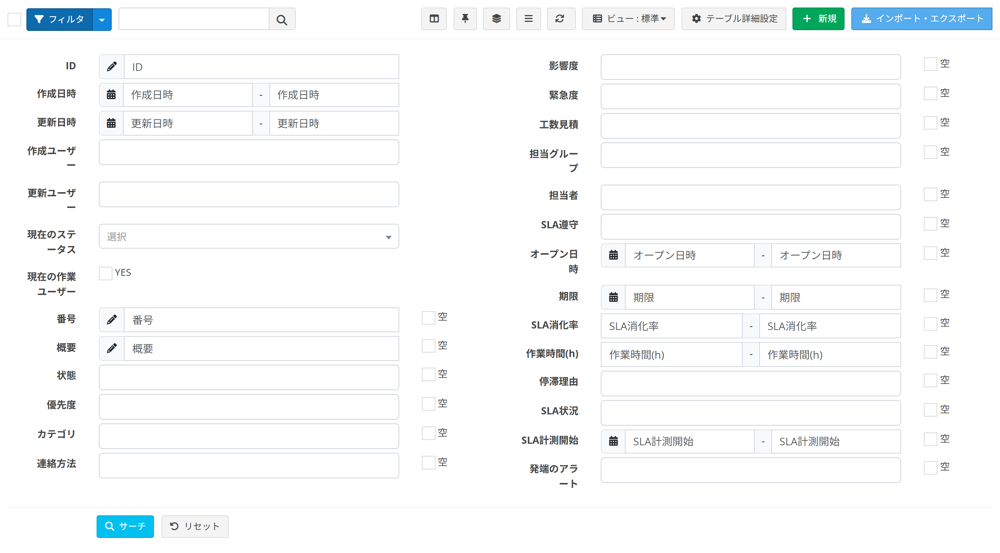

# Danh sách dữ liệu
- Hiển thị danh sách dữ liệu của từng bảng được lưu trong Exment.  
- Danh sách chỉ hiển thị những dữ liệu do chính bạn tạo hoặc những dữ liệu mà bạn được gán quyền.  
- Khi đăng ký cho người dùng hoặc tổ chức quyền chỉnh sửa / xem toàn bộ dữ liệu, toàn bộ dữ liệu sẽ được hiển thị bất kể điều kiện nêu trên. Để biết chi tiết về quyền, vui lòng xem [Vai trò / Quyền](/permission.md).

## Danh sách chức năng
  

※ Trên danh sách dữ liệu, bạn cũng có thể thực hiện các thao tác như chuyển đổi cột hiển thị, cố định cột, nhóm dòng và chỉnh sửa tại chỗ. Để biết chi tiết, vui lòng xem [Công cụ thao tác trên danh sách dữ liệu](/data_grid_tools.md).

##### Tự động làm mới  
Đây là biểu tượng ngoài cùng bên phải trong 5 biểu tượng thao tác ở góc trên bên phải. Danh sách được tải lại theo khoảng thời gian đã chọn (tắt, 30 giây, 1 phút, 5 phút). Để biết chi tiết, vui lòng xem [Công cụ thao tác trên danh sách dữ liệu](/data_grid_tools.md).

##### Bộ lọc  
Lọc nội dung của danh sách dữ liệu đang hiển thị. Vui lòng xem chi tiết ở phần dưới.

##### View  
Đây là nút view của bảng tùy chỉnh đang hiển thị. Vui lòng xem chi tiết ở phần dưới.  

##### Nhập (import) / Xuất (export)  
Đây là nút dùng để xuất (export) dữ liệu của bảng tùy chỉnh đang hiển thị hoặc nhập (import) dữ liệu. Để biết chi tiết, vui lòng xem [Nhập / xuất dữ liệu](/data_import_export.md).

##### Danh sách  
Đây là danh sách dữ liệu.  
Các dòng được hiển thị sẽ được lọc theo quyền của người dùng, thiết lập điều kiện lọc của view và thiết lập bộ lọc trên màn hình danh sách.  
Các cột được hiển thị thay đổi theo thiết lập cột của view.  

##### Cập nhật hàng loạt  
Cập nhật nội dung dữ liệu cùng lúc cho nhiều dòng đã chọn.  
Cần thiết lập trước cột cần cập nhật hàng loạt và giá trị cập nhật tại [Thiết lập cập nhật hàng loạt](/mass_update.md).

## Chi tiết chức năng  

### Bộ lọc
Lọc nội dung của danh sách dữ liệu đang hiển thị.  
  
Các mục lọc được hiển thị khi nhấp vào nút [Filter].  

- Các mục có thể dùng để lọc được xác định như sau.  
  - Nếu view có chỉ định các mục "Filter" (xem phần chỉ định mục "Filter" của view trong [View tùy chỉnh](/vi/view.md)) thì chỉ gồm các mục đó.  
  - Nếu không chỉ định thì gồm: các mục hệ thống (ID, ngày giờ tạo, ngày giờ cập nhật, v.v.; ngoại trừ các mục đã được đánh dấu chọn tại "Hide filter in data list" (ẩn bộ lọc trên danh sách dữ liệu) của [Thiết lập hệ thống](/vi/system_setting.md)), bảng cha của bảng con, trạng thái workflow của bảng có thiết lập workflow, bình luận nếu đang sử dụng bình luận, và các cột được đặt "Search index" là ON trong thiết lập cột tùy chỉnh.
[Xem hướng dẫn thiết lập cột tùy chỉnh tại đây](/vi/column.md)

- Tại từng mục, nhập từ khóa rồi nhấp vào nút [Search]; các dòng phù hợp sẽ được lọc và hiển thị.  

- Nếu muốn đặt lại bộ lọc, hãy nhấp vào nút [Reset].

- Khi người dùng không phải quản trị viên thực hiện lọc, bộ lọc chỉ được áp dụng trong phạm vi những dữ liệu mà người dùng đó có quyền. Dữ liệu mà người dùng không có quyền không thuộc đối tượng lọc.  

- Việc lọc bằng chức năng bộ lọc được thực hiện bổ sung vào điều kiện lọc của view đang hiển thị.

- Đối với các cột kiểu văn bản, việc từ khóa đã nhập được so khớp với phần đầu của giá trị (khớp tiền tố) hay với một phần bất kỳ của giá trị (khớp một phần) tuân theo mục "Data search method" (phương thức tìm kiếm dữ liệu) của [Thiết lập hệ thống](/vi/system_setting.md). Giá trị ban đầu là khớp tiền tố.

>Trong số các mục được hiển thị dưới dạng lựa chọn, đối với những mục có thiết lập quan hệ (relation), có thể thay đổi nội dung hiển thị tại [thiết lập cột hiển thị tiêu đề](/vi/table).

### View
Đây là nút view của bảng tùy chỉnh đang hiển thị.  
Tên nút là tên của view đang hiển thị.  
Khi nhấp vào nút, menu của view sẽ được hiển thị.
  

##### View hệ thống  
Hiển thị danh sách các view đã được đăng ký trong hệ thống.  
Khi nhấp vào một mục, màn hình sẽ chuyển sang hiển thị theo view đó.

##### Thiết lập - Thay đổi thiết lập của view hiện tại  
Thay đổi thiết lập của view đang hiển thị.  
Khi nhấp vào mục này, màn hình sẽ chuyển sang màn hình thay đổi thiết lập của view đó.  
※ Mục này chỉ được hiển thị đối với người dùng có quyền quản trị viên của bảng.  

##### Thiết lập - Tạo mới view  
Tạo mới một view.  
Khi nhấp vào mục này, màn hình sẽ chuyển sang màn hình tạo mới view.  
※ Mục này chỉ được hiển thị đối với người dùng có quyền quản trị viên của bảng.  

### Cập nhật hàng loạt
Cập nhật cùng lúc nội dung của nhiều dữ liệu đã chọn.  
Khi chọn bằng ô đánh dấu (checkbox) ở bên trái mỗi dòng, số dòng đang được chọn và biểu tượng ▼ sẽ được hiển thị ở phía trên bên trái.
  

- Khi nhấp vào biểu tượng ▼, chức năng xóa hàng loạt và các thiết lập cập nhật hàng loạt đã tạo sẽ được hiển thị dưới dạng các lựa chọn.  

- Khi nhấp vào lựa chọn ứng với nội dung muốn cập nhật, thông báo xác nhận việc thực hiện cập nhật hàng loạt sẽ được hiển thị; hãy nhấp vào nút xác nhận. Dữ liệu của các cột được chỉ định trong [Thiết lập cập nhật hàng loạt](/mass_update.md) sẽ được đăng ký với giá trị cập nhật.
  
