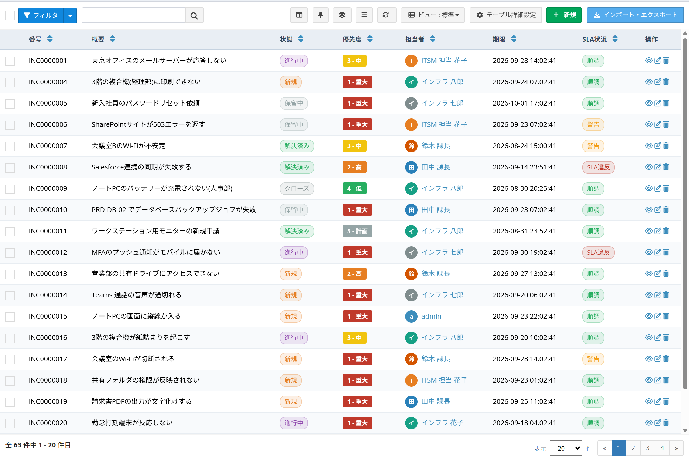

# Công cụ thao tác trên danh sách dữ liệu

Trang này tổng hợp các chức năng đổi cách hiển thị và chỉnh sửa tại chỗ dùng được trên màn hình [danh sách dữ liệu](/vi/data_grid).  
Không cần thiết lập, mở danh sách dữ liệu là dùng được ngay.

## Các nút trên thanh công cụ

Các nút nằm ở phía trên bên phải danh sách dữ liệu, bên trái phần chọn view.

Từ trái sang là [Chọn cột hiển thị], [Cố định cột], [Nhóm hàng], [Mật độ hiển thị], [Tự động làm mới]. Từ v7.1.0 trở đi, nút [[Chế độ Excel]](/vi/data_grid_tools?id=chỉnh-sửa-kiểu-excel) cũng hiển thị.

> Các thiết lập này là của riêng từng người dùng. Thiết lập của view không thay đổi, nên không ảnh hưởng đến màn hình của người dùng khác.  
> [Cố định cột] và [Mật độ hiển thị] **được lưu trong trình duyệt** và vẫn còn sau khi đóng trình duyệt.  
> [Nhóm hàng] và [Tự động làm mới] được lưu trong trình duyệt cho đến khi đóng tab.  
> [Chọn cột hiển thị] không được lưu trong trình duyệt mà **chỉ được giữ trong địa chỉ (URL) của danh sách** (`_columns_`). Khi mở lại danh sách từ menu hoặc đổi view, thiết lập quay về như cũ. Khi mở địa chỉ đã sao chép, cùng các cột đó sẽ hiển thị. Khi bấm [Tìm kiếm] ở [Bộ lọc], việc chỉ định các cột đã chọn cũng bị bỏ.

### Chọn cột hiển thị

Chọn các cột hiển thị trên màn hình trong số các cột của view đó.

- Nhập chữ vào ô nhập ở phía trên để lọc theo tên cột.
- Có thể thao tác cùng lúc bằng [Chọn tất cả], [Bỏ chọn tất cả], [Khôi phục mặc định].
- [Áp dụng] để phản ánh, [Hủy] để đóng.

※Không thể [Áp dụng] khi không chọn cột nào.  
※Cột đã ẩn không bị mất dữ liệu. Có thể đưa về như cũ bất cứ lúc nào bằng [Khôi phục mặc định].

### Cố định cột

Cố định các cột đã chỉ định ở mép trái màn hình, kể cả khi cuộn ngang. Với bảng rộng có nhiều dữ liệu, việc này giúp không bị lạc dòng đang xem.

| Mục | Nội dung |
| --- | --- |
| Cố định 2 cột đầu / Cố định 3 cột đầu | Thiết lập nhanh các tổ hợp thường dùng |
| Bỏ cố định | Bỏ tất cả các cố định |
| Cố định cột thao tác | Luôn hiển thị cột [Thao tác]. Trạng thái ban đầu là ON. Ở v7.0 có tên là "Cố định cột thao tác ở bên phải" |
| Cố định hàng tiêu đề | Giữ lại hàng tiêu đề khi cuộn dọc. Trạng thái ban đầu là ON |
| (danh sách tên cột) | Chọn từng cột cần cố định |

※Khi độ rộng màn hình không đủ, một số cột không được cố định. Khi đó, thông báo sẽ hiển thị trên màn hình.

### Nhóm hàng

Dữ liệu của trang đang hiển thị được gom lại và hiển thị theo từng giá trị của cột đã chọn.

- Tiêu đề của nhóm hiển thị số lượng của nhóm đó.
- Nhấp vào hình tam giác bên trái tiêu đề để thu gọn hoặc mở nhóm.
- [Không nhóm] đưa về thứ tự ban đầu.

> **Lý do hiển thị "chỉ trang này"**  
> Việc nhóm chỉ sắp xếp lại dữ liệu của trang hiện đang được tải trên màn hình.  
> Khi muốn tổng hợp trên tất cả dữ liệu, hãy tạo [view tổng hợp](/vi/view).

### Mật độ hiển thị

Đổi chiều cao của dòng và việc xuống dòng trong ô.

| Mục | Nội dung |
| --- | --- |
| Thu gọn | Giảm chiều cao của dòng. Một màn hình chứa được nhiều dòng hơn. |
| Tiêu chuẩn | Chiều cao mặc định. |
| Rộng | Tăng chiều cao của dòng. Ưu tiên dễ đọc. |
| Hiển thị trên một dòng | Chữ trong ô không xuống dòng mà nằm trên 1 dòng. Câu dài sẽ bị lược bớt giữa chừng. Trạng thái ban đầu là ON, dùng kết hợp với 3 chiều cao ở trên. |

### Tự động làm mới

Danh sách tự động được tải lại sau mỗi khoảng thời gian nhất định.  
Với công việc nhiều người cùng xử lý (ví dụ tiếp nhận yêu cầu hỗ trợ), có thể để màn hình mở và xem trạng thái mới nhất.

Chọn Tắt / 30 giây / 1 phút / 5 phút.  
※Thiết lập này bị bỏ khi đóng tab.

## Thao tác trên bảng

※Từ v7.1.0 trở đi, khi thiết kế màn hình là "Hiện đại", cột [Thao tác] (xem, chỉnh sửa, xóa) hiển thị ngay bên phải ô đánh dấu (phía bên trái của bảng). Với "Cổ điển", cột này vẫn ở mép phải như trước.

### Chỉnh sửa tại chỗ (nhấp đúp để chỉnh sửa)

Nhấp đúp vào ô để đổi giá trị ngay tại chỗ. Ô chỉnh sửa được sẽ hiển thị biểu tượng bút chì khi đưa chuột lên.

Khi chọn (nhập) giá trị, giá trị được tự động lưu và hiển thị của ô được cập nhật.

Các loại cột chỉnh sửa được như sau.

| Loại cột | Kiểu nhập hiển thị |
| --- | --- |
| Lựa chọn (giá trị cố định), Lựa chọn (lưu giá trị và nhãn), YES/NO | Danh sách chọn |
| Văn bản một dòng, Email, URL | Nhập văn bản |
| Số nguyên, Số thập phân, Tiền tệ | Nhập số |
| Ngày, Ngày và giờ | Lịch của Exment (chọn ngày). Giống với màn hình chỉnh sửa |

Các cột sau không chỉnh sửa tại chỗ được.

- Cột cho phép chọn nhiều
- Cột được tính tự động bằng công thức, và cột được dùng làm đầu vào của công thức
- Cột mà người dùng không đổi được trên màn hình chỉnh sửa (biểu mẫu) của dữ liệu đó

Với bảng đã vô hiệu hóa thao tác chỉnh sửa, hoặc khi đang hiển thị thùng rác, biểu tượng bút chì không hiển thị. Khi không có quyền chỉnh sửa bảng cũng không hiển thị.  
Việc lưu tuân theo cùng điều kiện với màn hình chỉnh sửa của dữ liệu đó: thiết lập mục của biểu mẫu, thiết lập "không cho thay đổi từ màn hình hiển thị", kiểm tra nhập, khóa bởi quy trình làm việc và quyền của người dùng đối với dữ liệu đó. Lịch sử thay đổi cũng được ghi lại. Khi không đổi được, giá trị không được lưu, lý do hiển thị bằng thông báo và ô quay về hiển thị ban đầu.

### Chỉnh sửa kiểu Excel

Khi bật [Chế độ Excel] trên thanh công cụ, có thể chọn ô bằng bàn phím và chỉnh sửa như Excel (từ v7.1.0 trở đi). Trạng thái ban đầu là OFF. ON/OFF được lưu trong trình duyệt.

| Thao tác | Nội dung |
| --- | --- |
| Nhấp chuột | Chọn ô (không mở chi tiết của dữ liệu) |
| Phím mũi tên, Tab, Shift+Tab | Di chuyển ô được chọn |
| Home, End (Ctrl+Home, Ctrl+End) | Di chuyển đến đầu, cuối dòng (đầu, cuối bảng) |
| F2, Enter, nhấp đúp, gõ ký tự | Bắt đầu chỉnh sửa ô đã chọn. Khi gõ ký tự, việc nhập bắt đầu từ ký tự đó (hỗ trợ cả bộ gõ tiếng Nhật) |
| Delete, Backspace | Bắt đầu chỉnh sửa ở trạng thái trống (giá trị chưa mất cho đến khi lưu bằng Enter) |
| Enter, Tab khi đang chỉnh sửa | Lưu rồi di chuyển đến ô kế tiếp |
| Esc khi đang chỉnh sửa | Thôi chỉnh sửa và đưa về giá trị ban đầu |

※Khi OFF thì như trước đây (nhấp chuột để mở dữ liệu, nhấp đúp hoặc biểu tượng bút chì để chỉnh sửa).  
※Ô chỉnh sửa được và điều kiện lưu (kiểm tra nhập, quyền, quy trình làm việc, v.v.) giống với [Chỉnh sửa tại chỗ](/vi/data_grid_tools?id=chỉnh-sửa-tại-chỗ-nhấp-đúp-để-chỉnh-sửa). Chỉ có cách bắt đầu và kết thúc chỉnh sửa là khác.

### Menu chuột phải

Khi nhấp chuột phải vào dòng, các thao tác đối với dữ liệu đó hiển thị trong menu.

| Mục | Nội dung |
| --- | --- |
| Xem nhanh | Hiển thị chi tiết ngay tại chỗ, không chuyển màn hình |
| Xem | Mở màn hình chi tiết của dữ liệu |
| Chỉnh sửa | Mở màn hình chỉnh sửa của dữ liệu |
| Nhân bản thành bản ghi mới | Mở màn hình tạo mới đã sao chép giá trị của dòng này |
| Đặt tôi làm ○○ | Đặt người dùng đang đăng nhập vào cột như người phụ trách |
| Lọc trong trang này: "○○" | Chỉ hiển thị các dòng có cùng giá trị với ô đã nhấp |
| Sao chép giá trị ô | Sao chép giá trị của ô đã nhấp vào clipboard |
| Xóa | Xóa dữ liệu này sau khi xác nhận |

※Menu được tạo theo quyền của người dùng đối với từng bảng, nên người dùng chỉ có quyền xem sẽ không thấy xóa và chỉnh sửa. Quyền đối với từng dữ liệu (ví dụ dữ liệu bị khóa bởi quy trình làm việc) được kiểm tra khi thực hiện. Nếu không thực hiện được, thông báo sẽ hiển thị.  
※Khi nhấp chuột phải trong lúc giữ phím Shift, menu gốc của trình duyệt sẽ mở.

### Xem nhanh

Có thể xem nội dung của 1 dữ liệu mà không rời danh sách.

- [Mở toàn trang] chuyển đến màn hình chi tiết thông thường.
- [Đóng] quay về danh sách. Vị trí cuộn và việc lọc của danh sách vẫn giữ nguyên.

### Chọn nhiều và thao tác hàng loạt

Khi chọn ô đánh dấu ở mép trái của dòng, màu của các dòng đã chọn thay đổi và thanh thao tác hiển thị ở phía dưới màn hình.

| Nút | Nội dung |
| --- | --- |
| Chỉnh sửa hàng loạt | Đổi giá trị của các dòng đã chọn cùng lúc |
| CSV / Excel | Chỉ xuất các dòng đã chọn ra tệp (mỗi định dạng có một nút) |
| Xóa hàng loạt | Xóa các dòng đã chọn cùng lúc |
| Bỏ chọn | Bỏ tất cả các lựa chọn |

※Các mục như [Xóa hàng loạt] thay đổi tùy theo quyền và [Cài đặt cập nhật dữ liệu](/vi/operation).

#### Thực thi quy trình làm việc
Với bảng đã thiết lập quy trình làm việc, có thể thực hiện cùng lúc hành động quy trình làm việc của các dữ liệu đã đánh dấu (từ v7.1.0 trở đi).  
Nhấp vào [Thực thi quy trình làm việc] từ menu thao tác hàng loạt của danh sách, hoặc từ thanh thao tác ở phía dưới màn hình.

- Các hành động thực hiện được với dữ liệu đã chọn hiển thị kèm số lượng, ví dụ "Phê duyệt (8 / 10 đã chọn)". Chọn hành động, nhập bình luận hoặc người xử lý tiếp theo nếu cần, rồi nhấp vào [Thực thi].
- Dữ liệu được thực hiện từng cái một, với cùng các kiểm tra như nút hành động trên màn hình chi tiết dữ liệu (có xem được không, có thực hiện được ở trạng thái đó không, đã thực hiện chưa). Dữ liệu không thực hiện được sẽ bị bỏ qua. Sau khi xong, số lượng đã thực hiện và số lượng bỏ qua (kèm lý do) sẽ hiển thị.
- Thông báo, plugin và việc phê duyệt bởi nhiều người hoạt động giống như khi thực hiện từng cái một. Mỗi lần thực hiện được tối đa 500 dữ liệu.

※Mục này hiển thị cả với người dùng không có quyền chỉnh sửa, nếu người đó thực hiện được hành động với dữ liệu đó. Không dùng được khi đang hiển thị thùng rác.  
※Về quy trình làm việc, vui lòng xem [Thực hiện workflow](/vi/workflow_execution).

#### Chỉnh sửa hàng loạt

- Chỉ nhập các mục muốn đổi. Lúc đầu mục nào cũng là "(không thay đổi)", nếu để nguyên thì không bị đổi.
- Với mục không bắt buộc, nếu chọn lựa chọn trống thì **giá trị đó bị xóa ở tất cả các dòng đã chọn**. Mục bắt buộc không để trống được.
- Khi nhấp vào [Áp dụng cho ○ hàng], dữ liệu được cập nhật sau khi xác nhận.
- Tiến độ được hiển thị, và sau khi kết thúc, số lượng thành công và thất bại được hiển thị.

※Chỉnh sửa hàng loạt chỉ hiển thị các cột chọn được giá trị bằng danh sách chọn.  
※Việc lưu đi qua xử lý cập nhật thông thường cho từng dữ liệu, nên kiểm tra nhập, quy trình làm việc và lịch sử thay đổi vẫn hoạt động như thường. Các dòng không cập nhật được do quyền hoặc kiểm tra sẽ được tính vào số lượng "thất bại".

### Hiển thị khi đang lọc

Khi chỉ định điều kiện ở [Bộ lọc] rồi tìm kiếm, các điều kiện hiện tại hiển thị phía trên bảng dưới dạng chip (nhãn nhỏ).

- Dấu "×" ở bên phải tên điều kiện bỏ riêng điều kiện đó.
- [Bỏ tất cả] bỏ tất cả các điều kiện.

Khi dùng "Lọc trong trang này" của menu chuột phải, việc lọc được hiển thị bằng dải màu vàng.

- Số dòng đang bị ẩn được hiển thị.
- [Bỏ lọc] đưa về như cũ.

> "Lọc trong trang này" chỉ áp dụng cho các dòng của trang đang hiển thị. Khi muốn lọc trên nhiều trang, hãy dùng bảng [Bộ lọc] hoặc [điều kiện hiển thị dữ liệu của view](/vi/view).

## Về quyền

Các chức năng này dùng nguyên các quyền hiện có.

- Dữ liệu hiển thị trong danh sách vẫn chỉ là dữ liệu mà người dùng đăng nhập xem được, như trước đây.
- Các thao tác chỉnh sửa và xóa được hiển thị theo quyền của người dùng đối với bảng. Dữ liệu không đổi được (không có quyền với dữ liệu đó, hoặc bị khóa bởi quy trình làm việc) sẽ bị từ chối khi thực hiện và không có gì được lưu.
- Chỉnh sửa tại chỗ và chỉnh sửa hàng loạt tuân theo cùng điều kiện với màn hình chỉnh sửa của dữ liệu đó (xem "Chỉnh sửa tại chỗ" ở trên). Dữ liệu không đổi được sẽ không được cập nhật.

## Mục liên quan

- [Danh sách dữ liệu](/vi/data_grid)
- [View tùy chỉnh](/vi/view)
- [Mẫu hiển thị](/vi/cell_style_preset)
- [Cài đặt cập nhật dữ liệu](/vi/operation)
