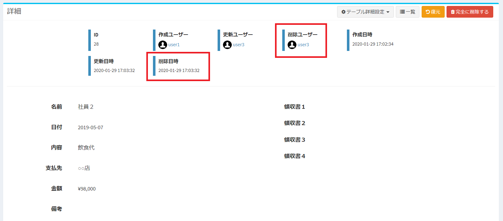
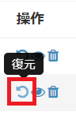

# Dữ liệu đã xóa
Trang này giải thích màn hình xem danh sách dữ liệu đã xóa, đưa dữ liệu về như cũ (khôi phục) và xóa vĩnh viễn.

- Chỉ người dùng có quyền hiển thị dữ liệu đã xóa mới hiển thị được dữ liệu đã xóa.
- Người dùng có quyền chỉnh sửa có thể khôi phục và xóa vĩnh viễn dữ liệu.  

※Về chi tiết của quyền, vui lòng xem [Nhóm vai trò](/vi/role_group).

## Hiển thị danh sách
  

1. Trên màn hình danh sách dữ liệu, chọn "Dữ liệu đã xóa" từ dấu ▼ ngay bên phải [Bộ lọc] ở phía trên bên trái.
2. Hiển thị thay đổi, và dữ liệu đã xóa của bảng đó hiển thị dưới dạng danh sách.

  

## Hiển thị chi tiết

- Có thể hiển thị chi tiết của dữ liệu trong danh sách dữ liệu đã xóa.  
- Hãy nhấp vào dòng của dữ liệu muốn hiển thị, hoặc biểu tượng xem ở cột thao tác.

  

- Trên màn hình chi tiết dữ liệu, có thể xem người dùng đã xóa và ngày giờ xóa.

  

## Khôi phục

- Dữ liệu đã xóa có thể đưa về màn hình danh sách dữ liệu (khôi phục).
- Có 3 cách khôi phục.
    - Dùng nút [Khôi phục] trên màn hình chi tiết dữ liệu.
      
    - Dùng biểu tượng [Khôi phục] ở cột thao tác trên màn hình danh sách dữ liệu đã xóa.
      
    - Trên màn hình danh sách dữ liệu đã xóa, đánh dấu dữ liệu muốn khôi phục, rồi chọn "Khôi phục" từ dấu ▼ ở phía trên bên trái màn hình dữ liệu đã xóa.
      

※Chỉ người dùng được cấp quyền chỉnh sửa dữ liệu đó mới khôi phục được dữ liệu.

## Xóa vĩnh viễn

- Dữ liệu đã xóa có thể xóa vĩnh viễn. Dữ liệu đã xóa vĩnh viễn cũng biến mất khỏi danh sách dữ liệu đã xóa.
- Có 3 cách xóa vĩnh viễn.
    - Dùng nút [Xóa vĩnh viễn] trên màn hình chi tiết dữ liệu.
      
    - Dùng biểu tượng [Xóa vĩnh viễn] ở cột thao tác trên màn hình danh sách dữ liệu đã xóa.
      
    - Trên màn hình danh sách dữ liệu đã xóa, đánh dấu dữ liệu muốn xóa vĩnh viễn, rồi chọn "Xóa vĩnh viễn" từ dấu ▼ ở phía trên bên trái màn hình dữ liệu đã xóa.
      

※Chỉ người dùng được cấp quyền chỉnh sửa dữ liệu đó mới xóa vĩnh viễn được dữ liệu.

## Chuyển đến màn hình danh sách dữ liệu

- Trên màn hình danh sách dữ liệu đã xóa, khi nhấp vào [Dữ liệu đã xóa▼] rồi chọn "Hủy", bạn chuyển đến màn hình danh sách dữ liệu của bảng đó.

  

#### Thiết lập quyền
- Để hiển thị dữ liệu đã xóa, người dùng cần có quyền hiển thị dữ liệu đó.
- Để khôi phục hoặc xóa vĩnh viễn dữ liệu đã xóa, người dùng cần có quyền chỉnh sửa dữ liệu đó.

※Về thiết lập quyền, vui lòng xem [Nhóm vai trò](/vi/role_group).
