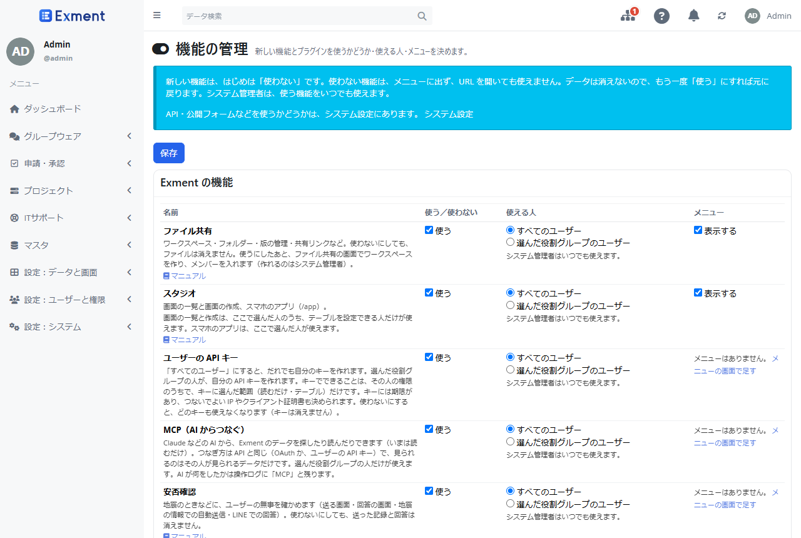

# Quản lý tính năng
Quyết định có sử dụng các tính năng mới và plugin hay không, ai được sử dụng, và menu.  
Exment được dùng ở rất nhiều trang, nên tính năng mới lúc đầu là "không sử dụng". Cho đến khi quản trị viên hệ thống chuyển sang "Sử dụng", tính năng đó không hiện trên menu và không dùng được kể cả khi mở bằng URL. Chỉ cập nhật Exment thì màn hình và menu không thay đổi.

※Màn hình này dùng được từ Exment v7.2.1 trở đi.

## Màn hình thiết lập
Đăng nhập bằng quản trị viên hệ thống rồi mở "Cài đặt quản trị" → "Quản lý tính năng" (URL là `/feature`).  
Chỉ quản trị viên hệ thống mới mở được màn hình này.

Màn hình được chia thành "Tính năng của Exment" ở trên và "Plugin" ở dưới.

## Tính năng của Exment
Đây là các tính năng mới của bản thân Exment. Hiện có các tính năng sau.

| Tên | Nội dung |
| --- | --- |
| Chia sẻ tệp | Workspace, thư mục, quản lý phiên bản, liên kết chia sẻ, v.v. Chuyển sang không sử dụng thì tệp cũng không bị xóa. (Chỉ hiện ở các phiên bản có chia sẻ tệp) |
| Studio | Danh sách màn hình, tạo màn hình và ứng dụng điện thoại (/app). Người dùng được là người thiết lập được bảng. |
| Bảo trì dữ liệu | Sắp xếp dữ liệu của bảng cùng lúc (hiện tại là xóa hàng loạt tệp đính kèm). Người dùng được là người thiết lập được bảng. (từ v7.3.0 trở đi) [Bảo trì dữ liệu](/vi/data_maintenance) |

Với mỗi tính năng, bạn quyết định 3 mục sau.

| Mục | Nội dung |
| --- | --- |
| Sử dụng | Có sử dụng tính năng đó trên trang này hay không. Lúc đầu là "không sử dụng". |
| Người được sử dụng | "Tất cả người dùng" hoặc "Người dùng thuộc nhóm vai trò đã chọn". Nếu không chọn nhóm vai trò nào thì chỉ quản trị viên hệ thống dùng được. Quản trị viên hệ thống lúc nào cũng dùng được. |
| Menu | Có "Hiển thị" trên menu hay không. Chỉ hiện với người được sử dụng. Khi không có dòng menu, sẽ hiện "Không có trong menu. Khi lưu, mục này sẽ được thêm vào cuối "Cài đặt: Hệ thống"." |

Cột trạng thái hiện như sau.

| Trạng thái | Ý nghĩa |
| --- | --- |
| Mới | Tính năng chưa ai quyết định (được coi là "không sử dụng"). |
| Đang bật | Đang là "Sử dụng" và ở trạng thái dùng được. |
| Không khả dụng trong môi trường này | Đang bị chặn bằng thiết lập của máy chủ ([Khóa tính năng bằng thiết lập máy chủ](/vi/feature?id=khóa-tính-năng-bằng-thiết-lập-máy-chủ)). Không chuyển sang "Sử dụng" được từ màn hình này. |
| Không thể sử dụng vì tính năng cần thiết đang tắt. | Đây là tính năng chỉ chạy khi có một tính năng khác (hiện "Chỉ khi đang sử dụng "...".") và tính năng kia đang là "không sử dụng". |

※Với Studio, trong số những người được chọn ở đây, chỉ người thiết lập được bảng mới dùng được.  
※Việc có sử dụng API, biểu mẫu công khai, v.v. hay không vẫn nằm ở [Thiết lập hệ thống](/vi/system_setting) như trước.

<!-- Ảnh màn hình: một dòng tính năng của Exment (Sử dụng, Người được sử dụng, Menu) (img/feature/feature_core.png). Chụp sau khi #1861 được merge -->

## Plugin
Các plugin đã cài đặt cũng nằm trên cùng màn hình.  
Màn hình không giữ thêm một bản thiết lập mới, mà cho xem đúng thiết lập đang có.

| Mục | Nội dung |
| --- | --- |
| Sử dụng | Giống với việc bật/tắt plugin. Khi đang tắt sẽ hiện "Đang tắt". Khi muốn đổi, từ "Thay đổi trong cài đặt plugin" bạn đổi ở màn hình [Plugin](/vi/plugin). |
| Người được sử dụng | Giống với quyền "sử dụng" plugin của nhóm vai trò. Khi muốn đổi, bạn đổi ở màn hình [Nhóm vai trò](/vi/role_group). |
| Menu | Có hiện trên menu hay không. Chỉ riêng mục này được quyết định ở màn hình này. |

※Với plugin thuộc loại "ai cũng dùng được" và plugin đã đặt "tất cả người dùng đều có thể sử dụng" trong thiết lập plugin, điều đó sẽ được hiện ra.  
※Khi trong plugin có tính năng do plugin đăng ký (ví dụ: Web mail), mỗi tính năng hiện thành một dòng bên dưới plugin. Tính năng trong plugin lúc đầu cũng là "không sử dụng". Người dùng được là những người được chọn ở đây, trong số những người dùng được plugin.

<!-- Ảnh màn hình: dòng plugin và các dòng tính năng trong plugin (img/feature/feature_plugin.png). Chụp sau khi #1861 được merge -->

## Plugin chính thức miễn phí (đi kèm Exment)
Exment có kèm sẵn các plugin chính thức miễn phí (quản lý dự án, hỗ trợ IT, Groupware). Bạn cài từ mục "Plugin chính thức miễn phí (đi kèm Exment)" của "Quản lý tính năng". Chi tiết vui lòng xem [Plugin chính thức](/vi/plugin_official).

- Cho đến khi bấm "Sử dụng (cài đặt)", plugin không được cài đặt và cũng không được nạp (bảng cũng không được tạo).
- Khi bấm, hệ thống kiểm tra rồi cài đặt và bật plugin. Tính năng chính của plugin đó cũng thành "Sử dụng". Sau đó plugin cũng nằm ở mục "Plugin" phía trên, và bạn quyết định được người được sử dụng và menu.
- Khi có phiên bản mới, sẽ hiện "Có phiên bản mới ...". Hệ thống không tự cài. Bạn cập nhật bằng "Cập nhật lên phiên bản này" (thiết lập, menu và quyền được giữ lại).
- Phiên bản trước khi cập nhật vẫn còn, và bạn quay lại được bằng "Quay lại phiên bản trước (...)".
- Cập nhật Exment không tự chuyển các plugin đang dùng. Xem [Cập nhật và plugin chính thức đi kèm](/vi/update?id=cập-nhật-và-plugin-chính-thức-đi-kèm).
- Plugin đã cài bằng tay từ trước vẫn dùng được như cũ (không cài lại). Chỉ khi bản kèm sẵn mới hơn thì mới có thông báo. Khi đã thay bằng phiên bản kèm sẵn thì không quay lại phiên bản cài bằng tay được.
- Plugin kèm sẵn được cài sau khi kiểm tra chữ ký của Exceed One. Plugin có chữ ký không khớp sẽ không hiện ra.
- Ở trang mà đơn vị vận hành đổi phiên bản (SaaS, v.v.), sẽ hiện "Việc thay đổi phiên bản do đơn vị cung cấp trang này thực hiện." và không có nút (`EXMENT_BUNDLED_PLUGINS_UPDATES=false` trong `.env`).

#### Thông báo bản sửa lỗi bảo mật
Khi phiên bản mới của plugin chính thức đã cài có bản sửa lỗi bảo mật, hệ thống báo cho quản trị viên hệ thống.

- Phía trên trang chủ của quản trị viên hệ thống hiện "Có bản cập nhật cho plugin chính thức (...)". Ở dòng của Quản lý tính năng cũng hiện dấu "Sửa lỗi bảo mật" và "Phiên bản này có bản sửa lỗi bảo mật. Vui lòng nhấn "Cập nhật lên phiên bản này"."
- Hệ thống gửi cùng tiêu đề và nội dung đó, chỉ 1 lần, bằng thông báo ở chuông, và bằng email ở trang gửi được email.
- Những người dùng khác không thấy gì. Việc cập nhật chỉ diễn ra khi quản trị viên hệ thống bấm "Cập nhật lên phiên bản này".
- Khi quay lại phiên bản không có bản sửa lỗi bảo mật, hệ thống hỏi lại một lần nữa.

#### Thông báo tính năng mới
Khi cập nhật Exment và có thêm tính năng mới chưa được quyết định, hệ thống báo chỉ 1 lần bằng thông báo trên trang chủ của quản trị viên hệ thống và bằng chuông ("Có tính năng mới (...). Ban đầu các tính năng này ở trạng thái tắt. ..."). Không gửi email. Ở trang mới cài đặt thì không hiện.

<!-- Ảnh màn hình: mục plugin chính thức miễn phí (img/feature/feature_bundled.png). Chụp sau khi #1867 được merge -->

## Khi chuyển sang "không dùng"
- Tính năng không còn hiện trên menu (dòng menu không bị xóa, chỉ bị ẩn).
- Các trang và API của tính năng đó không dùng được, kể cả khi mở trực tiếp bằng URL.
- Dữ liệu (workspace, tệp, màn hình, v.v.) không bị xóa. Chuyển lại sang "Sử dụng" thì mọi thứ trở lại như cũ.
- Khi bạn lưu sau khi chuyển một tính năng đang có người dùng sang "không sử dụng", hoặc sau khi giảm số người được sử dụng, hệ thống hỏi "Một số người dùng sẽ không thể sử dụng các mục sau nữa. Bạn có muốn lưu không?".

## Thông báo khi không dùng được
Khi mở URL của tính năng không dùng được, thông báo sau sẽ hiện ra.

| Thông báo | Khi nào hiện |
| --- | --- |
| Tính năng này không được sử dụng trên trang này. | Khi tính năng đó là "không sử dụng" (hoặc khi bị chặn bằng thiết lập của máy chủ). Với quản trị viên hệ thống, còn có liên kết đến "Quản lý tính năng". |
| Bạn không có quyền sử dụng tính năng này. Vui lòng liên hệ quản trị viên. | Khi tính năng là "Sử dụng" nhưng người đang đăng nhập không nằm trong "Người được sử dụng". |

Ở cả hai, bạn về được trang chủ từ liên kết "Quay lại trang chủ". Khi gọi từ API, cùng thông báo đó được trả về dạng JSON (404 khi không sử dụng, 403 khi không có quyền).

<!-- Ảnh màn hình: màn hình "Tính năng này không được sử dụng trên trang này." (img/feature/feature_not_used.png). Chụp sau khi #1861 được merge -->

## Với trang đã cập nhật
Dù cập nhật Exment, những gì đang dùng vẫn dùng được như cũ.

- Tính năng đã dùng từ trước khi cập nhật sẽ thành "Sử dụng". Vẫn thấy như trước.
  - Chia sẻ tệp: trang có ít nhất 1 workspace
  - Studio: trang đã có người từng mở màn hình Studio hoặc ứng dụng điện thoại (kiểm tra bằng log thao tác)
- Tính năng chỉ có menu mà không được dùng sẽ thành "không sử dụng".
- Việc bật/tắt plugin và quyền của nhóm vai trò không thay đổi.
- Trong các tính năng trong plugin, những tính năng plugin đó có từ trước vẫn là "Sử dụng" ở các trang đã cài plugin từ trước.
- Ở trang mới cài đặt, tất cả bắt đầu từ "không sử dụng".
- Menu "Quản lý tính năng" được thêm vào dưới "Cài đặt quản trị".

## Khóa tính năng bằng thiết lập máy chủ
Khi ghi `EXMENT_FEATURES_LOCKED` vào `.env` của máy chủ, bạn cố định được tính năng đó ở "không sử dụng", dù quản trị viên hệ thống của trang chọn gì.  
Dùng cho các dịch vụ không cung cấp tính năng (SaaS, v.v.). Ghi các khóa, cách nhau bằng dấu phẩy.

~~~
EXMENT_FEATURES_LOCKED=file_server,studio
~~~

| Khóa | Tính năng |
| --- | --- |
| `file_server` | Chia sẻ tệp |
| `studio` | Studio (gồm cả ứng dụng điện thoại) |

Tính năng đã cố định sẽ hiện "Không khả dụng trong môi trường này" trên màn hình này.

※Sau khi đổi `.env`, ở máy chủ có dùng cache của thiết lập, hãy chạy `php artisan config:clear` (hoặc `php artisan config:cache`).

## Thứ tự quyết định
Việc dùng được hay không được quyết định theo thứ tự từ trên xuống. Thiết lập ở dưới không mở rộng được hơn thiết lập ở trên.

1. **Thiết lập của máy chủ**: tính năng ghi trong `EXMENT_FEATURES_LOCKED` thì không dùng được.
2. **"Sử dụng" / "không sử dụng" của trang**: tính năng "không sử dụng" thì không ai dùng được.
3. **Người được sử dụng**: tất cả người dùng, hoặc người dùng thuộc nhóm vai trò đã chọn (quản trị viên hệ thống lúc nào cũng dùng được).
4. **Thiết lập bên trong tính năng**: với Studio là quyền của bảng, với chia sẻ tệp là quyền của workspace, v.v.

## Dành cho người viết plugin
Plugin đăng ký được tính năng bên trong nó và hiện 1 dòng trên màn hình này. Tính năng đã đăng ký lúc đầu là "không sử dụng".

~~~php
use Exceedone\Exment\Services\Features;

// Đăng ký trong constructor của lớp plugin, v.v. Khóa bắt đầu bằng uri của plugin
Features::register('exment_groupware.mail', [
    'label' => 'Web mail',
    'endpoints' => ['plugins/exment_groupware/mail'],
]);

// Kiểm tra bên trong trang của plugin
if (!Features::allowed('exment_groupware.mail')) {
    return Features::deny('exment_groupware.mail');
}
~~~

- Các trang ghi trong `endpoints` sẽ hiện thông báo ở trên khi không dùng được.
- Khi đặt `existing => true`, ở các trang đã cài plugin đó từ trước, tính năng vẫn là "Sử dụng" (dùng khi đăng ký sau một tính năng đã có từ trước).
- Khi ghi khóa của tính năng khác vào `requires`, tính năng sẽ không dùng được khi tính năng kia là "không sử dụng".

## Mục liên quan
- [Thiết lập hệ thống](/vi/system_setting)
- [Plugin](/vi/plugin)
- [Nhóm vai trò / Thiết lập quyền](/vi/role_group)
- [Menu](/vi/menu)
