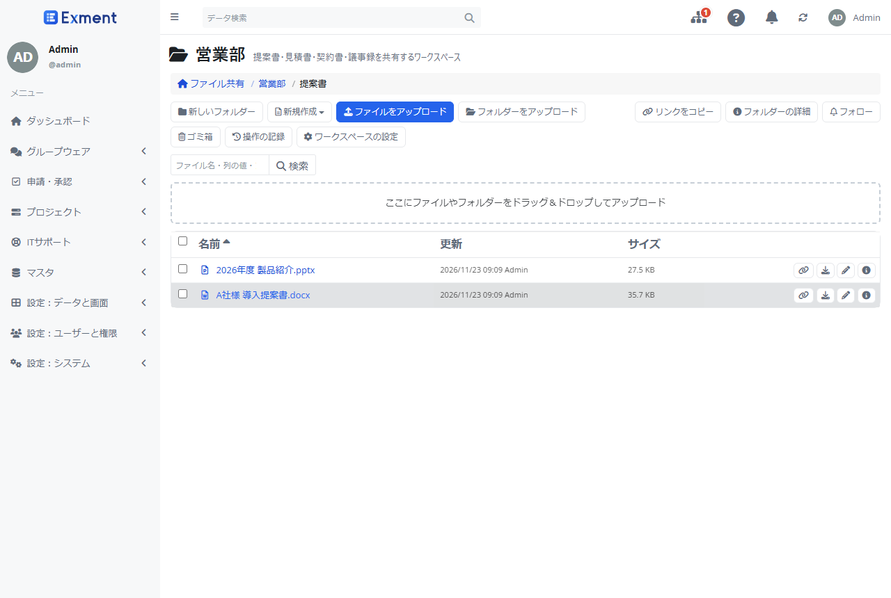
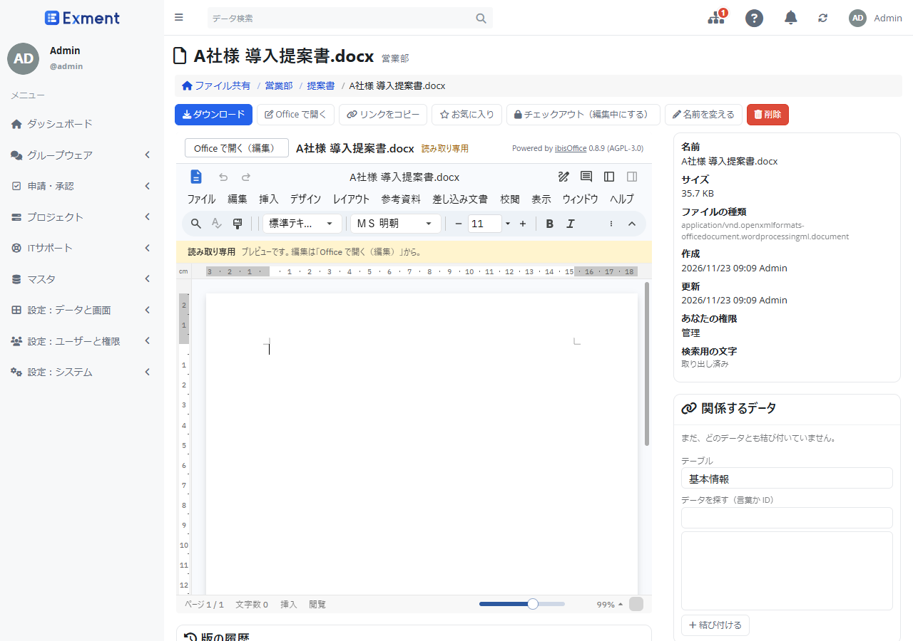

# Chia sẻ tệp (File sharing)
Đặt thư mục và tệp vào không gian làm việc (workspace) của từng nhóm để chia sẻ. Có phân quyền theo thư mục, quản lý phiên bản, xem trước và thùng rác. Dùng được giống như thư viện tài liệu của Box hay SharePoint.  
Nội dung tệp được đặt ở nơi lưu tệp của Exment (máy cục bộ, S3, Azure, FTP…, giữ nguyên thiết lập hiện tại).

※Tính năng này dùng được từ Exment v7.2.1 trở đi. <!-- TODO: sửa theo phiên bản mà chia sẻ tệp được đưa vào master -->

## Bắt đầu sử dụng
Chia sẻ tệp ban đầu là "Không sử dụng". Khi quản trị viên hệ thống đặt "Chia sẻ tệp" thành "Sử dụng" ở "Cài đặt quản trị" → "[Quản lý tính năng](/vi/feature)", mục "Chia sẻ tệp" sẽ hiện trên menu bên trái. Người được dùng (nhóm vai trò) cũng chọn được trong Quản lý tính năng.

## Workspace
Không gian làm việc là nơi đặt tệp của một nhóm (tương đương một site của SharePoint).

- Tạo bằng "Tạo không gian làm việc". Người tạo trở thành người quản lý của không gian làm việc đó. Ai được tạo thì quyết định bằng `EXMENT_FILE_SERVER_WORKSPACE_CREATE` trong `.env` (`admin`: chỉ quản trị viên hệ thống, `all`: ai cũng được).
- Trong "Cài đặt không gian làm việc", quyết định các mục sau.

| Mục | Nội dung |
| --- | --- |
| Tên, mô tả | Tên và mô tả của không gian làm việc. |
| Thành viên | Người dùng, tổ chức và quyền của họ (Xem, Tải lên, Chỉnh sửa, Quản lý). Cần ít nhất 1 người quản lý. |
| Giới hạn dung lượng (GB) | Để trống là không giới hạn. Tệp của phiên bản cũ và thùng rác cũng được tính. |
| Số ngày lưu trong thùng rác | Quá số ngày này thì xóa vĩnh viễn. Đặt 0 thì giữ cho đến khi xóa bằng tay. |
| Số phiên bản lưu giữ | Số phiên bản cũ giữ lại cho mỗi tệp. |
| Cột (siêu dữ liệu) | Các cột gắn cho tệp của không gian làm việc này. Vui lòng xem "Cột (metadata)" ở dưới. |

Trang đầu hiển thị danh sách các không gian làm việc mở được, cùng "Yêu thích", "Tệp cập nhật gần đây" và "Được chia sẻ với tôi".

## Thư mục và tệp
- Tải lên bằng "Thư mục mới", "Tải tệp lên", "Tải thư mục lên", hoặc kéo và thả. Tệp lớn được gửi theo từng phần, nên dù bị ngắt giữa chừng vẫn gửi tiếp được.
- Với từng tệp, thư mục, có thể đổi tên, di chuyển, sao chép, tải xuống (nhiều tệp thành ZIP), xóa và thêm vào yêu thích.
- Mục đã xóa vào thùng rác. Từ thùng rác có thể "Khôi phục" hoặc "Xóa vĩnh viễn".

## Quyền
Có 4 quyền. Quyền ở trên làm được mọi việc của quyền ở dưới.

| Quyền | Làm được gì |
| --- | --- |
| Xem | Xem, tải xuống |
| Tải lên | Thêm tệp |
| Chỉnh sửa | Đổi tên, di chuyển, xóa, phiên bản mới, tạo liên kết chia sẻ |
| Quản lý | Đổi quyền, hủy check out, phê duyệt |

- Thư mục và tệp kế thừa quyền của thư mục cha (hoặc không gian làm việc).
- "Ngừng kế thừa quyền" để thư mục, tệp đó có quyền riêng. "Kế thừa quyền" để trở lại như cũ.
- Quản trị viên hệ thống quản lý được mọi không gian làm việc.

## Phiên bản và check out
- Ghi đè tệp cùng tên, hoặc "Tải lên phiên bản mới", sẽ tạo phiên bản mới. Từ "Lịch sử phiên bản", có thể tải phiên bản trước xuống, hoặc dùng "Khôi phục phiên bản này" để lưu nội dung của phiên bản trước thành phiên bản mới.
- Khi "Check out (đang chỉnh sửa)", người khác không thể sửa hoặc xóa tệp đó. Khi xong, hãy "Check in (kết thúc chỉnh sửa)". Người có quyền Quản lý có thể "Hủy check out".

## Xem trước
Ảnh, video, âm thanh, PDF và văn bản xem được trên màn hình. Tệp Office (docx, xlsx, pptx) hiển thị khác nhau tùy theo sự chuẩn bị của máy chủ.

| Chuẩn bị của máy chủ | Cách hiển thị tệp Office |
| --- | --- |
| Có LibreOffice (`EXMENT_FILE_SERVER_SOFFICE_PATH`) | Chuyển thành PDF rồi hiển thị. |
| Có plugin chính thức "Groupware" | "Mở bằng Office" mở chỉ đọc bằng Office trên trình duyệt (ibisOffice). Nếu có cả LibreOffice thì chuyển bằng tab. |
| Không có cả hai | Chỉ hiển thị chữ trong tệp. Để xem đúng như hình thức, hãy tải xuống. |

Với ibisOffice của Groupware, không cần LibreOffice hay Docker, và dùng được cả trên máy chủ thuê. Về việc chuẩn bị và thiết lập máy chủ Web, vui lòng xem [Groupware](/vi/plugin_groupware).

※Các tệp html, svg… vì lý do an toàn không hiển thị trên màn hình, chỉ tải xuống được.

※Tệp nhận từ bên ngoài qua liên kết nhận tệp thì dù mở cũng không tạo bản xem trước và không trích chữ. Chỉ tạo khi người có quyền Quản lý bấm "Tạo bản xem trước".

## Liên kết chia sẻ cho người bên ngoài
Có thể đưa tệp, thư mục cho người bên ngoài không đăng nhập, hoặc nhận tệp từ người bên ngoài. Tạo liên kết ở mục "Liên kết chia sẻ cho người bên ngoài" trên màn hình của tệp.

| Loại liên kết | Nội dung | Ai tạo được |
| --- | --- | --- |
| Liên kết chia sẻ (người bên ngoài xem và tải xuống) | Với thư mục, cho xem cả những thứ bên trong. Bỏ "Cho phép tải xuống" thì chỉ xem trước. | Người có quyền Chỉnh sửa |
| Liên kết nhận tệp (người bên ngoài tải lên) | Người bên ngoài đưa tệp vào thư mục. Họ không thấy tệp của người khác. Tệp cùng tên không bị ghi đè mà thành "tên (2)". | Người có quyền Chỉnh sửa (từ 7.2.1. Liên kết do người chỉ có quyền Tải lên tạo trước đây sẽ không mở được nữa) |

- Có thể đặt thời hạn hiệu lực, mật khẩu và số lần được mở. Mật khẩu từ 8 ký tự trở lên (`EXMENT_FILE_SERVER_SHARE_PASSWORD_MIN`). Dùng "Thu hồi" để vô hiệu bất cứ lúc nào.
- Liên kết không hợp lệ (hết hạn, đã thu hồi, quá số lần, v.v.) đều hiện "Không thể mở liên kết".
- Thời hạn hiệu lực của liên kết chia sẻ mới mặc định là 30 ngày, dài nhất là 90 ngày (`EXMENT_FILE_SERVER_SHARE_DEFAULT_DAYS`, `EXMENT_FILE_SERVER_SHARE_MAX_DAYS`. Đặt 0 thì không có mặc định, không có giới hạn). Liên kết không có thời hạn đã tạo trước đây hiện là "Không giới hạn" trong danh sách liên kết.
- Chỉ người đã tạo liên kết và người có quyền Quản lý với tệp, thư mục đó mới xem được địa chỉ của liên kết chia sẻ.
- Khi đưa cho người trong công ty, hãy dùng "Sao chép liên kết nội bộ". Chỉ người có quyền xem tệp đó mới mở được.
- Khi không muốn cho dùng liên kết chia sẻ cho người bên ngoài, ghi `EXMENT_FILE_SERVER_EXTERNAL_SHARE=false` vào `.env`. Giới hạn của thời hạn hiệu lực đổi được bằng `EXMENT_FILE_SERVER_SHARE_MAX_DAYS`.
- Liên kết chia sẻ (`/share/...`) là thứ đưa cho người bên ngoài, nên bình thường không áp dụng bộ lọc IP của Web trong Cài đặt hệ thống. Khi muốn chỉ cho mở từ trong công ty, ghi `EXMENT_FILE_SERVER_SHARE_WEB_IP_FILTER=true` vào `.env`. Đây là thiết lập được đọc khi tạo route, nên site đang dùng `php artisan route:cache` hãy chạy lại lệnh đó sau khi đổi.

## Cột (metadata)
Trong cài đặt không gian làm việc, có thể tạo các cột gắn cho tệp (như "Khách hàng", "Loại").

- Loại gồm: văn bản, nhiều dòng, số, ngày, lựa chọn, nhiều lựa chọn, có/không. Có thể quyết định bắt buộc, giá trị mặc định và có hiện trong danh sách hay không.
- Trong danh sách, có thể lọc theo cột (chọn được cả "chưa nhập"), sắp xếp và chia nhóm.

## Gắn với dữ liệu
Ở "Dữ liệu liên quan" trên màn hình của tệp, có thể gắn tệp với dữ liệu của bảng Exment (như khách hàng). Trên màn hình chi tiết của dữ liệu sẽ có mục "Tệp trong chia sẻ tệp". Cả hai chỉ hiện những gì có quyền xem.

## Tìm kiếm
Dùng "Tìm kiếm" để tìm theo tên tệp, giá trị cột và chữ trong tệp. Chỉ hiện các tệp có quyền xem.

- Chữ trong tệp được lấy từ văn bản, HTML, Office (docx, xlsx, pptx) và OpenDocument. PDF được lấy khi có pdftotext (`EXMENT_FILE_SERVER_PDFTOTEXT_PATH`), ảnh và PDF quét được lấy khi có tesseract (`EXMENT_FILE_SERVER_OCR_PATH`).
- Bình thường tìm trong cơ sở dữ liệu. Khi đặt `EXMENT_FILE_SERVER_MEILI=true`, sẽ tìm bằng [Meilisearch](/vi/additional_meilisearch) (dùng chỉ mục riêng `exment_files`, khác với tìm kiếm toàn văn của dữ liệu).

## Phê duyệt, lưu giữ pháp lý, thời hạn lưu giữ
<!-- TODO: kiểm tra khi P5 (exment PR #1859) được đưa vào -->
| Tính năng | Nội dung |
| --- | --- |
| Phê duyệt | Khi đặt "cần phê duyệt" trong "Quy tắc" của thư mục, tệp đưa vào sẽ thành "Chờ phê duyệt". Cho đến khi được phê duyệt, chỉ người tải lên và người quản lý xem được. Người có quyền Quản lý thực hiện "Phê duyệt" hoặc "Trả lại". |
| Lưu giữ pháp lý | Khi gắn cho không gian làm việc, thư mục, tệp thì không xóa được nữa. Phiên bản cũ cũng không bị mất. Chỉ quản trị viên hệ thống mới gắn, gỡ được (người có quyền Quản lý chỉ xem). |
| Thời gian lưu giữ | Khi quyết định số ngày trong cài đặt không gian làm việc, tệp không xóa được trong số ngày đó. Chỉ quản trị viên hệ thống mới quyết định, gỡ được (người có quyền Quản lý chỉ xem). |
| Người có thể tải xuống | Người có quyền thấp hơn quyền đã định thì chỉ xem (xem "Chỉ xem" ở dưới). |
| Hình mờ (watermark) | Hiển thị tên người đang xem và ngày giờ chồng lên bản xem trước. |
| Nhật ký thao tác | Ghi lại việc hiển thị, tải xuống, tải lên, xóa, đổi quyền, liên kết chia sẻ, v.v. Xuất được ra CSV. |
| Theo dõi, bình luận | Khi không gian làm việc, thư mục, tệp đang theo dõi thay đổi, sẽ báo bằng chuông và email. `@mã người dùng` trong bình luận sẽ báo cho người đó. |

### Chỉ xem
Với người có quyền thấp hơn "Người có thể tải xuống" của không gian làm việc, và với liên kết chia sẻ đã bỏ "Cho phép tải xuống", tệp được cho xem như sau.

| Tệp | Cách hiển thị |
| --- | --- |
| Hình ảnh | Cho xem bằng ảnh đã thu nhỏ. |
| Office, PDF | Nếu có bản đã chuyển thành PDF thì cho xem bằng bản đó. |
| Văn bản, video, âm thanh | Không cho xem. |

Mỗi lần xem đều được ghi vào nhật ký thao tác.

## Máy chủ
- **Xử lý hằng ngày**: việc tự động xóa thùng rác chạy bằng `php artisan exment:file-server-purge` (3:30 mỗi ngày). Hãy thiết lập [lịch tác vụ](/vi/additional_task_schedule).
- **Hàng đợi (queue)**: ảnh thu nhỏ, xem trước và trích chữ chạy trên hàng đợi.
- **Trích chữ lại**: `php artisan exment:file-server-index` trích chữ của các tệp chưa làm và tạo lại chỉ mục của Meilisearch.
- **Phần mềm khác** (cái nào không có thì vẫn chạy được): LibreOffice (xem trước Office), pdftotext (chữ của PDF), tesseract (OCR), Meilisearch (tìm nhanh).
- **Chạy LibreOffice không có mạng**: tệp Office có thể đi đọc URL bên ngoài. Ghi lệnh đặt trước LibreOffice vào `EXMENT_FILE_SERVER_SOFFICE_PREFIX` thì chuyển đổi được mà không có mạng (ví dụ: `unshare -rn`, `firejail --net=none --quiet`). Hãy kiểm tra trước xem lệnh đó có dùng được trên máy chủ không.
- **Giới hạn tải lên**: tệp lớn được gửi theo từng phần. Mỗi tệp tối đa 2 GB (`EXMENT_FILE_SERVER_MAX_FILE_SIZE`), mỗi người được để dở tối đa 20 lượt tải lên (`EXMENT_FILE_SERVER_MAX_UPLOADS`), tổng của chúng tối đa 10 GB (`EXMENT_FILE_SERVER_MAX_UPLOAD_BYTES`). Lượt tải lên đang dở cũng được tính vào dung lượng của không gian làm việc. Lượt nào 60 phút không có gì gửi đến thì không tính, và bị xóa khi người đó bắt đầu lượt tiếp theo.

## Thiết lập chính (.env)
| Thiết lập | Mặc định | Nội dung |
| --- | --- | --- |
| `EXMENT_FILE_SERVER_WORKSPACE_CREATE` | `admin` | Ai được tạo không gian làm việc (`admin`, `all`) |
| `EXMENT_FILE_SERVER_MAX_FILE_SIZE` | `2147483648` (2 GB) | Giới hạn kích thước của 1 tệp (byte. 0 là không giới hạn. 2 GB từ 7.2.1) |
| `EXMENT_FILE_SERVER_MAX_UPLOADS` | `20` | Số lượt tải lên một người được để dở |
| `EXMENT_FILE_SERVER_MAX_UPLOAD_BYTES` | `10737418240` (10 GB) | Tổng các lượt tải lên đang dở của một người (byte. 0 là không giới hạn) |
| `EXMENT_FILE_SERVER_EXTERNAL_SHARE` | `true` | Có dùng liên kết chia sẻ cho người bên ngoài không |
| `EXMENT_FILE_SERVER_SHARE_DEFAULT_DAYS` | `30` | Mặc định của thời hạn hiệu lực của liên kết chia sẻ mới (ngày. 0 là không có mặc định) |
| `EXMENT_FILE_SERVER_SHARE_MAX_DAYS` | `90` | Giới hạn của thời hạn hiệu lực của liên kết chia sẻ (ngày. 0 là không giới hạn, cho phép cả không thời hạn) |
| `EXMENT_FILE_SERVER_SHARE_PATH` | `share` | Phần đầu của URL liên kết chia sẻ |
| `EXMENT_FILE_SERVER_SHARE_PASSWORD_MIN` | `8` | Số ký tự ngắn nhất của mật khẩu liên kết chia sẻ |
| `EXMENT_FILE_SERVER_SHARE_WEB_IP_FILTER` | `false` | Có áp dụng bộ lọc IP của Web cho cả liên kết chia sẻ không |
| `EXMENT_FILE_SERVER_SOFFICE_PATH` | không có | Vị trí của LibreOffice (soffice) |
| `EXMENT_FILE_SERVER_SOFFICE_PREFIX` | không có | Lệnh đặt trước LibreOffice (để chạy không có mạng) |
| `EXMENT_FILE_SERVER_PDFTOTEXT_PATH` | không có | Vị trí của pdftotext |
| `EXMENT_FILE_SERVER_OCR_PATH` | không có | Vị trí của tesseract |
| `EXMENT_FILE_SERVER_MEILI` | `false` | Có tìm bằng Meilisearch không |
| `EXMENT_FILE_SERVER_AUDIT` | `true` | Có ghi nhật ký thao tác không |
| `EXMENT_FILE_SERVER_NOTIFY` | `true` | Có gửi thông báo theo dõi không |

## Mục liên quan
- [Quản lý tính năng](/vi/feature)
- [Thiết lập nơi lưu tệp](/vi/additional_file_saveplace)
- [Lịch tác vụ](/vi/additional_task_schedule)
- [Sử dụng công cụ tìm kiếm toàn văn (Meilisearch)](/vi/additional_meilisearch)
- [Nhóm vai trò / Thiết lập quyền](/vi/role_group)
